A content fragment is content without a page: a product, an article, a person, an opening hour. You write it once, in a form, and it is used wherever it is needed: on several pages, in an app, on a screen in a shop.

The form comes from a **model**. A model says which elements a kind of content has: a title, a picture, an author. Every fragment made from the model has those elements.

## The Content Fragments console

Open **Home › Content Fragments**. Content fragments live in Media's folders, and the console shows those folders with only the fragments in them.

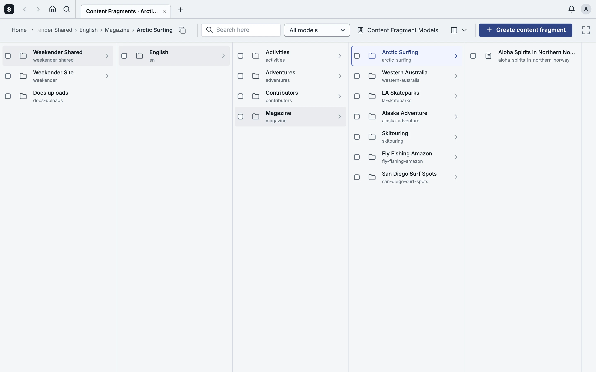

The bar has the breadcrumbs, a **search** field, the **Model** selector that narrows the list to the fragments of one model, **Content Fragment Models** (a shortcut to the models), the display format, and **Create content fragment**.

### Select a fragment

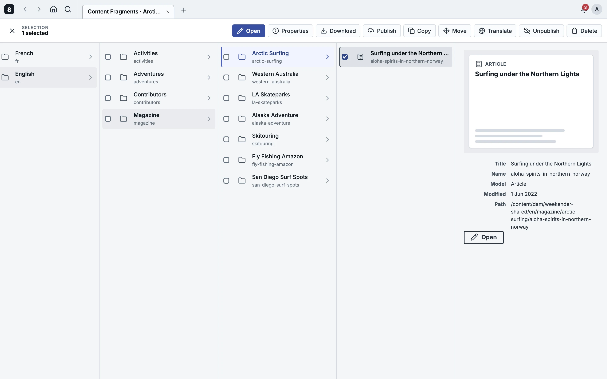

Tick a fragment to see it at the right: its model, title, name, when it was modified, its path, and an **Open** button.

| Action | What it does |
|---|---|
| **Open** | Opens the fragment in its editor |
| **Properties** | Title, description and tags |
| **Download** | The fragment as a file |
| **Publish**, **Unpublish** | Puts the fragment on the live site, or takes it off. Publish its model too, the first time: the live site needs the model to answer queries |
| **Copy** | Remembers it; paste it in another folder |
| **Move** | Moves or renames it. Look at **Used in** first: the pages that show it are listed there |
| **Translate** | Makes the fragment in another language. See [Translations](translations.md) |
| **Delete** | Deletes it. Pages that show it will show nothing in its place |

### Create a content fragment

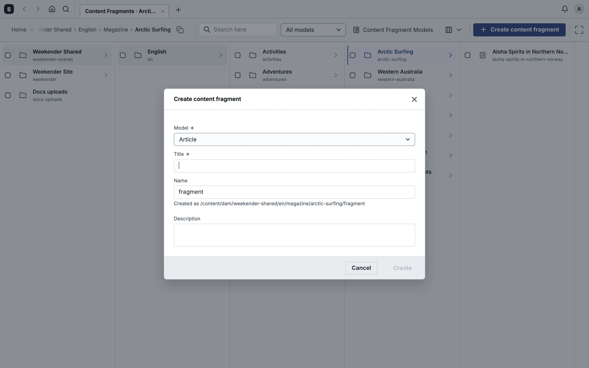

| Field | What it is |
|---|---|
| **Model** | What kind of content it is. Only enabled models are offered, and a folder's **Allowed models** can narrow the choice |
| **Title** | Its name in the console |
| **Name** | The last part of its path, made from the title; the line below shows the path it will get |
| **Description** | What it is for |

**Create** opens the new fragment in the editor.

## The content fragment editor

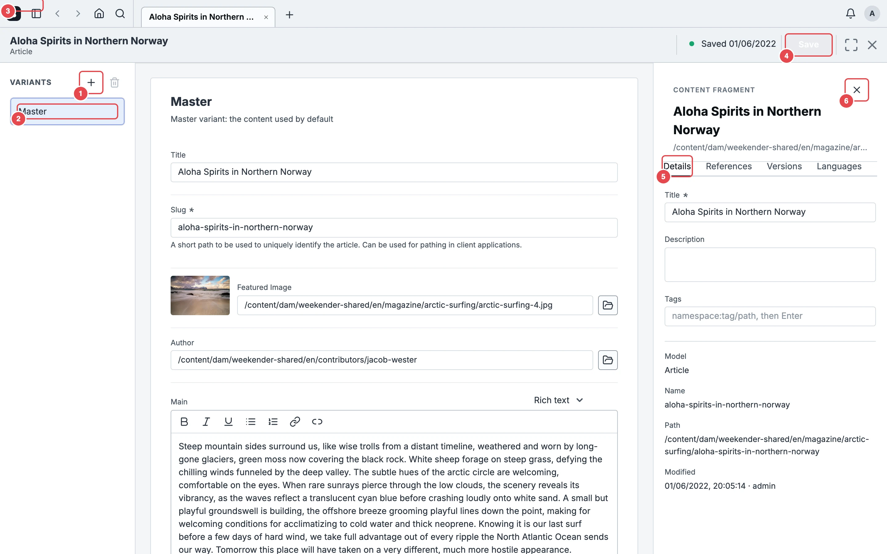

| | Part | What it does |
|---|---|---|
| 1 | **Create variant** | Adds another wording of the fragment. The bin beside it deletes the selected variant |
| 2 | **Master** | The variants. *Master* is the content used by default |
| 3 | **Format** | For a text: **Rich text**, **Markdown** or **Plain text** |
| 4 | **Save** | Saves the fragment. Left of it, the state: *Saved*, with the date, or that there are changes |
| 5 | **The panel** | Details, References, Versions and Languages of the fragment |
| 6 | **Close inspector** | Hides the panel |

In the middle is the form the model defines, one field per element. A field with a `*` must be filled in; the grey line under a field is the help the model gives.

- A **text** with rich text has a small toolbar: bold, italic, underline, bulleted and numbered lists, link, and source.
- A **content reference**, like *Featured Image*, shows the picture and its path; the folder button chooses a file from Media.
- A **fragment reference**, like *Author*, holds the path of another fragment; the folder button chooses one.

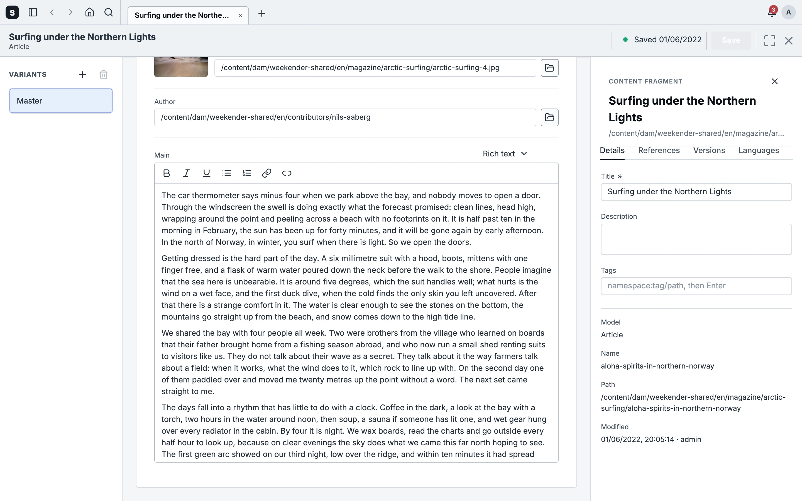

The editor checks the fields as you save: a required field left empty or a value that breaks a rule is pointed out, and nothing is saved until it is fixed.

### Variants

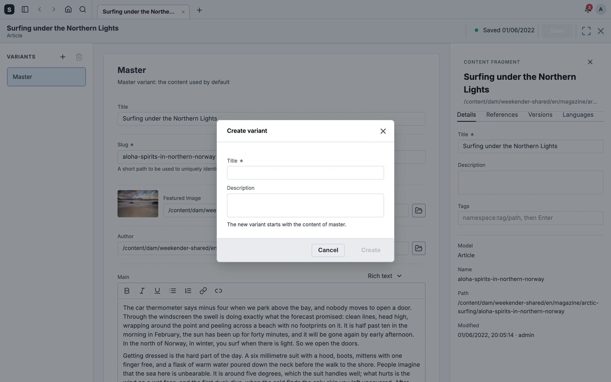

A variant is another wording of the same fragment for another use: a short version for a teaser, a version for the newsletter. **Create variant** asks for a title and a description; the new variant starts with the content of Master, and you then change what should differ. A page or an application asks for a variant by name and gets Master when that variant does not exist.

### Details

The first tab of the panel holds the fragment's **Title**, **Description** and **Tags**, and below them what you cannot change here: its model, name, path, and when it was modified and by whom.

### References

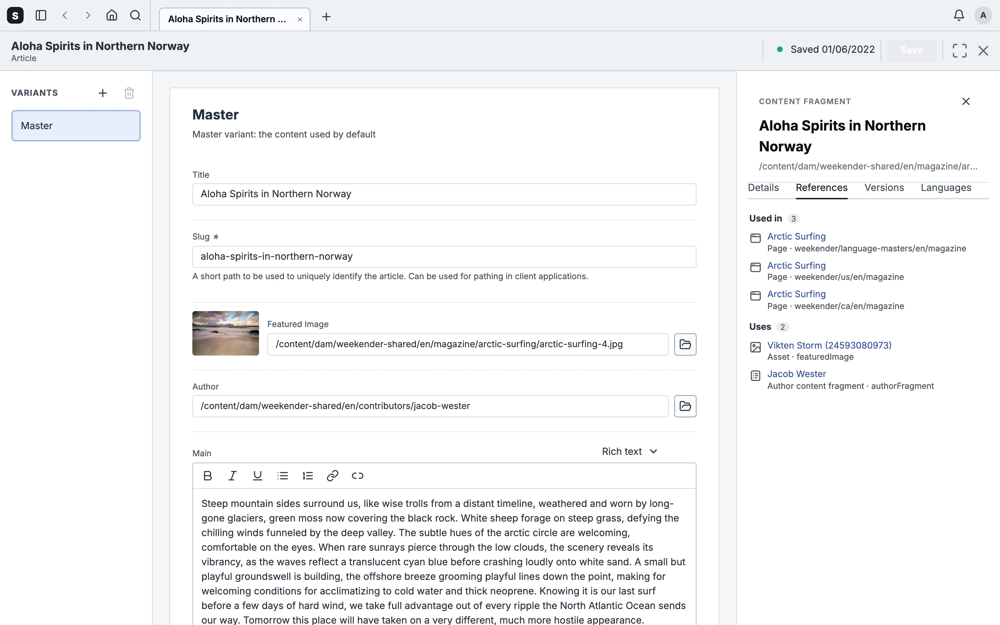

- **Used in**: the pages and fragments that show this one, each with its path. Look here before you move, unpublish or delete it.
- **Uses**: what this fragment points at, such as its picture and its author, each with the element that holds it.

### Versions

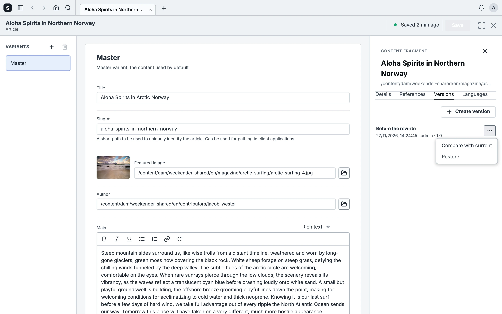

**Create version** keeps the fragment as it is now, with a label and a comment. Each version then offers **Compare with current** and **Restore**.

### Languages

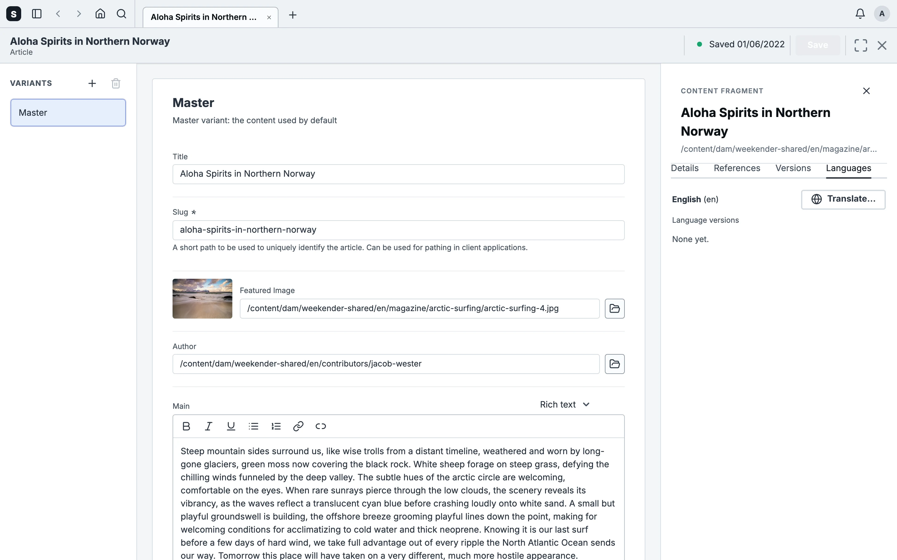

The language of the fragment, its versions in other languages, and **Translate…**, which makes one. See [Translations](translations.md).

## Models

Open **Home › Content Fragment Models**. Models belong to a site's configuration: the first column lists the configurations, the second the models of the one you click.

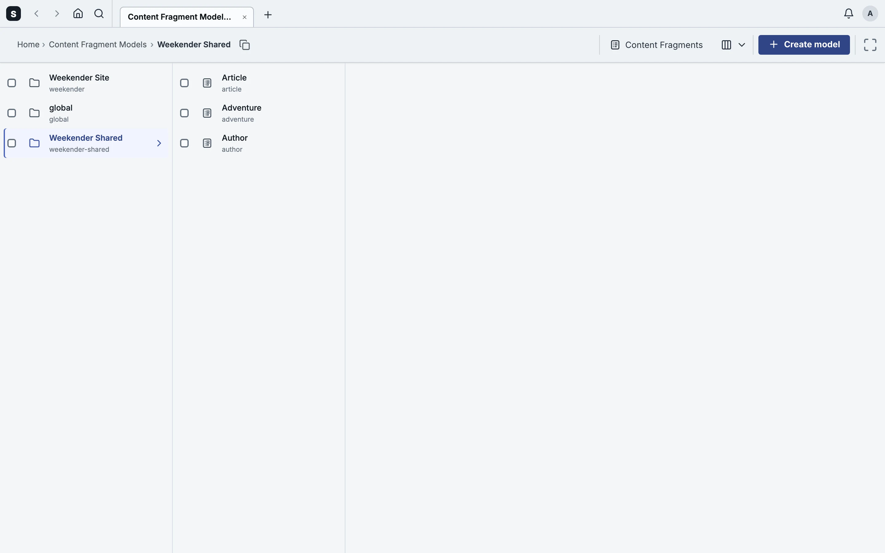

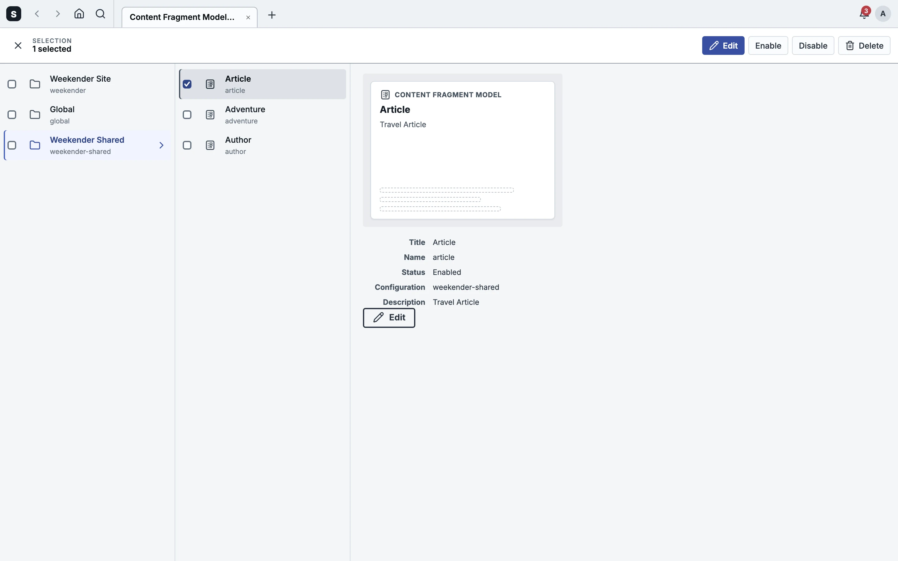

Tick a model to see its title, name, status, configuration and description at the right.

| Action | What it does |
|---|---|
| **Edit** | Opens the model editor |
| **Enable**, **Disable** | A disabled model is not offered for new content fragments; existing fragments keep working |
| **Delete** | Deletes the model. Refused while fragments use it |

**Create model** asks for the configuration, a title and a description:

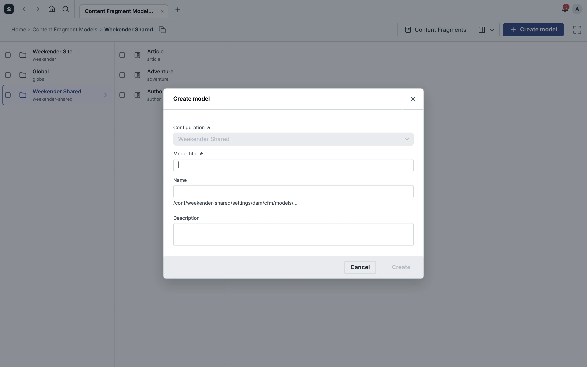

### The model editor

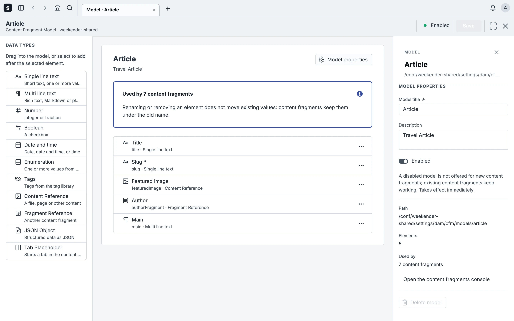

At the left are the **data types**; in the middle the elements of the model, in the order of the form; at the right a panel with the properties of the model, or of the element you click.

To add an element, drag a data type into the model, or select an element and click a data type: the new one is added after it.

| Data type | For |
|---|---|
| **Single line text** | Short text, one or more values: a name, a slug |
| **Multi line text** | Rich text, Markdown or plain text: a summary, a body |
| **Number** | An integer or a fraction: a price, a quantity |
| **Boolean** | A checkbox |
| **Date and time** | A date, a date and time, or a time |
| **Enumeration** | One or more values from a list you define |
| **Tags** | [Tags](tags.md) from the tag library |
| **Content Reference** | A file, a page or other content, such as a picture |
| **Fragment Reference** | Another content fragment: the author of an article, the related products |
| **JSON Object** | Structured data, in a form an application reads |
| **Tab Placeholder** | Starts a tab in the content fragment's form, for long models |

The `⋯` at the right of an element moves it up or down, duplicates it, or deletes it:

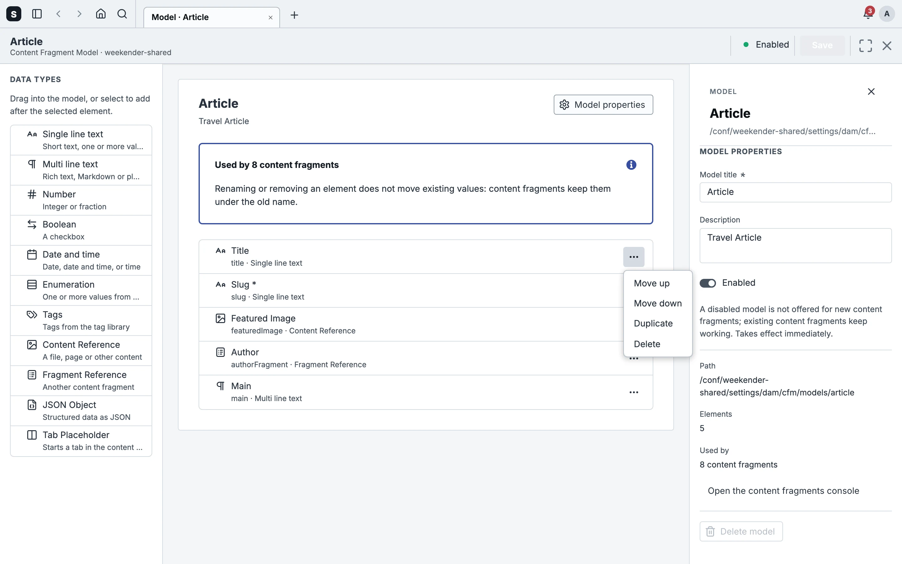

### An element's settings

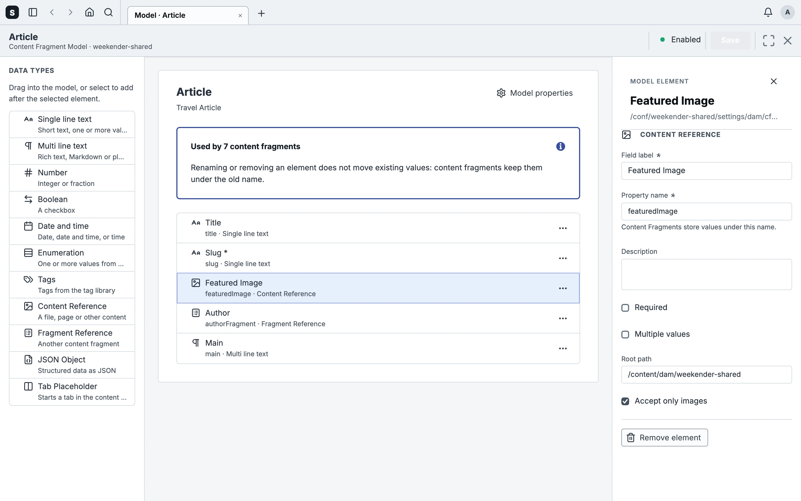

Click an element for its settings at the right. Every element has:

| Setting | What it is |
|---|---|
| **Field label** | What authors see above the field |
| **Property name** | The name the value is stored under, and the name applications use. Change it only before fragments exist |
| **Description** | Help shown under the field |
| **Required** | The fragment cannot be saved without it |
| **Multiple values** | The field holds a list |

The rest depends on the data type. A content reference has a **Root path**, where the picker starts, and **Accept only images**. A text has its default format and may have a **Maximum length** or a **Validation pattern** with the **Error message** to show:

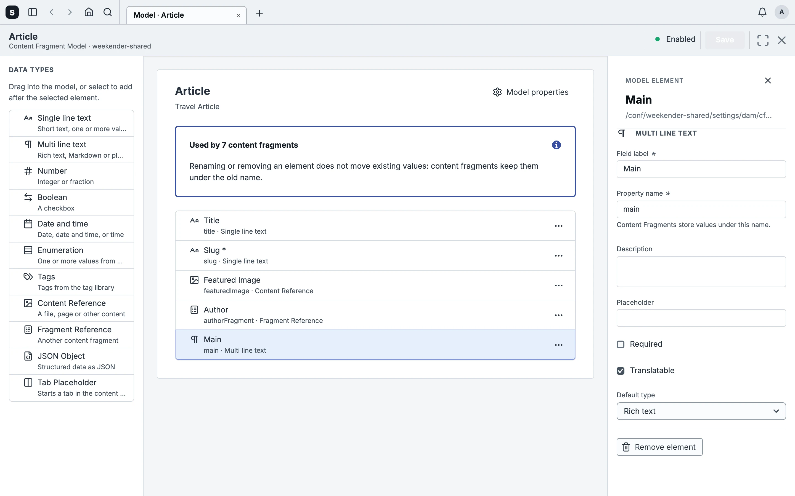

**Remove element** takes the element out of the model.

### The model's own properties

With no element selected, or after **Model properties**, the panel shows the **Model title**, the **Description**, the **Enabled** switch, the path of the model, how many elements it has, and **Used by**: how many content fragments are made from it, with a link that opens them in the console.

> **Warning:** Changing a model does not rewrite the fragments already made from it. Renaming or removing an element does not move existing values: content fragments keep them under the old name. The editor says how many fragments use the model.

## Use a fragment on a page

Drag the **Content Fragment** component onto a page and choose the fragment. Choose whether to show one element or several, and which variant. The **Content Fragment List** component shows every fragment of a model, optionally filtered by tags and sorted by an element.

When the fragment changes and is published, every page that shows it shows the new content.

## Use fragments in an application

Every model is available over GraphQL: an application asks for exactly the elements it needs and gets JSON back. Fragment references are followed, so an article arrives with its author in one request.

A developer writes the query once and saves it under a name as a **persisted query**; applications then call it by that name. Try queries in **Home › System › Developer**. See [APIs](../developer/apis.md).
