An experience fragment is a part of a page, made of components, that you write once and show in many places: the header and footer of a site, a promotion that appears on twenty pages, a sign-up box, the short biography under every article of one author.

Change the fragment and publish it, and every page that shows it changes.

## Experience fragment or content fragment?

| | Experience fragment | Content fragment |
|---|---|---|
| **What it is** | Components laid out the way they will look | Fields of content, with no look of their own |
| **You edit it** | In the page editor | In a form |
| **Use it for** | A header, a footer, a banner, a promotion | A product, an article, a person |
| **Shown by** | The Experience Fragment component | Components and applications that decide how it looks |

See [Content fragments](content-fragments.md) for the other kind.

## The console

**Home › Experience Fragments** opens the console. It is the [Pages console](pages.md) you already know, rooted at the experience fragments: the same views, the same path at the top, the same inspector, selection bar, keyboard shortcuts and right-click menu.

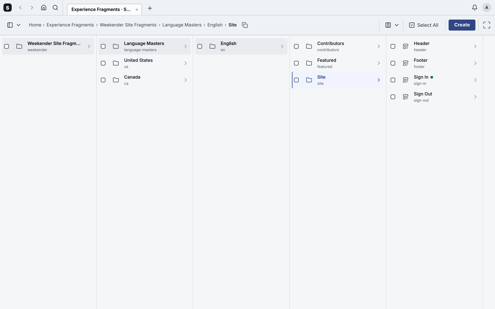

Fragments are usually kept by site and by language, in the same shape as the site's pages. The demo keeps them under *Weekender Site Fragments*: one folder per country and language, and in each the folders **Site** (header, footer, sign-in), **Contributors** (one fragment per author) and **Featured** (promotions of articles).

| In the list | What it is |
|---|---|
| A folder | Opens like any folder |
| A fragment | Has the fragment icon and an arrow: its variants are inside |
| A variant | Inside a fragment. This is what you edit and what a page shows |
| A green dot | The item is published |

## Create a fragment

**Create**, in a folder, offers:

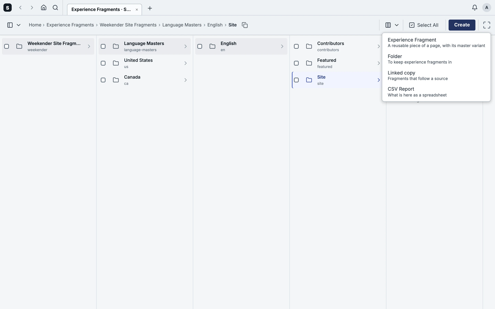

| Choice | What it makes |
|---|---|
| **Experience Fragment** | A fragment, with its first variant |
| **Folder** | A folder to keep fragments in |
| **Linked copy** | Fragments that follow a source and receive its changes. See [Linked copies and sync](sync.md) |
| **CSV Report** | What is here, as a spreadsheet |

**Experience Fragment** opens a wizard with two steps.

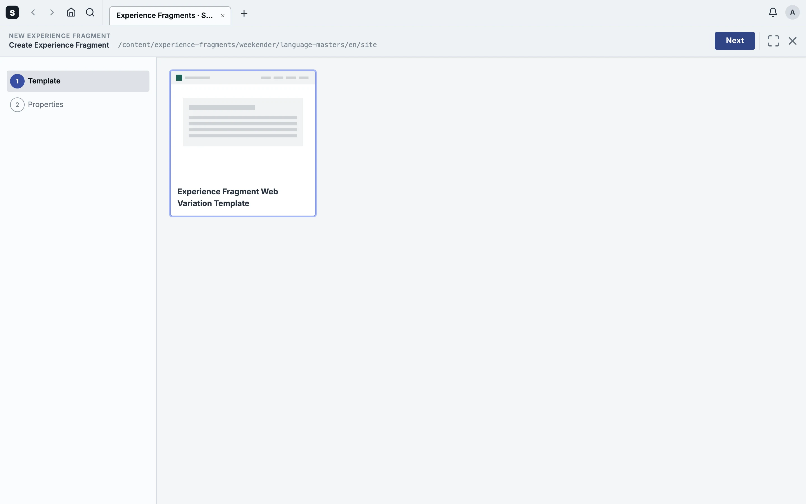

Pick the template the variant is built from and choose **Next**. The templates offered are the ones the site allows for fragments; the demo has one, *Experience Fragment Web Variation Template*.

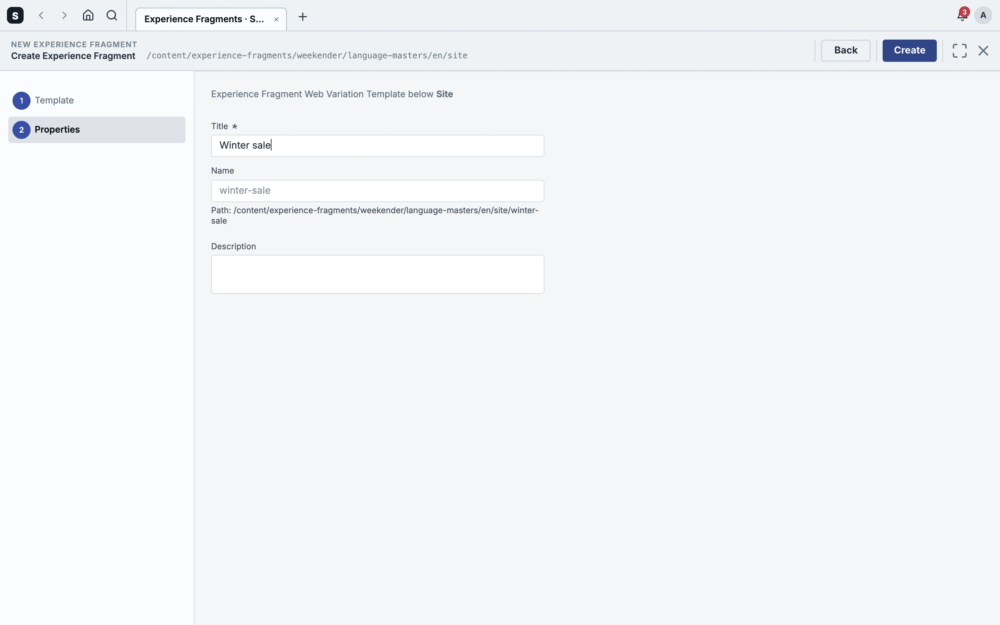

| Field | Meaning |
|---|---|
| **Title** | The fragment's name in the console and in pickers |
| **Name** | Its place in the address. Left empty, it is made from the title; the path that results is shown below |
| **Description** | A note for the people who will use the fragment |

**Create** makes the fragment and, inside it, a first variant named **master**. **Back** returns to the templates.

## Select a fragment

Tick a fragment to select it. The bar at the top and the inspector on the right work as for a page.

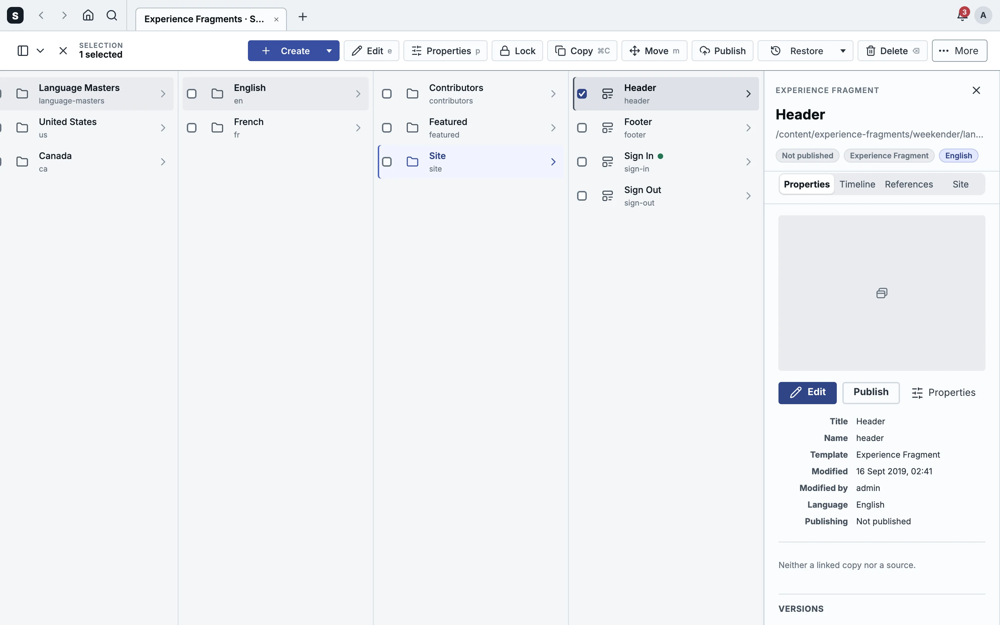

| Action | What it does |
|---|---|
| **Create** | Something new beside or inside the selection |
| **Edit** | Opens it in the page editor. For a fragment, that is its master variant |
| **Properties** | Title, tags, description |
| **Lock** | Keeps others from changing it while you work |
| **Copy**, **Move** | As for pages. Moving a fragment updates the pages that show it |
| **Publish** | Puts it on the live site. The arrow beside **Restore** has the versions and the deleted items |
| **Delete** | Removes it. Look at the references first |
| **More** | **Publish with the pages below** (the fragment with all its variants), **Language versions**, **Site configuration**, **Unpublish** |

The inspector names what is selected, **Experience fragment** or **Variant**, shows whether it is published and its language, and has the tabs **Properties**, **Timeline**, **References** and **Site**, the same as for [pages](pages.md).

## Variants

A fragment can have several variants: the same promotion as a wide banner for pages and as a narrow box for a sidebar, a sign-in as a window over the page and as a page of its own. Each variant is edited on its own. A page shows the variant you choose.

Open a fragment to see its variants.

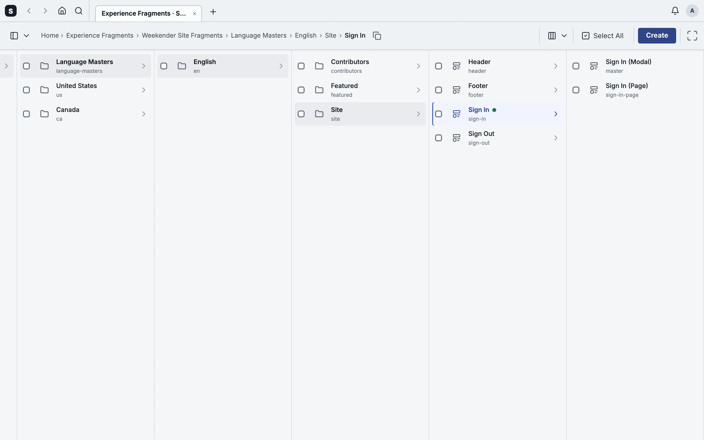

Inside a fragment, **Create** offers **Variant** instead of Experience Fragment.

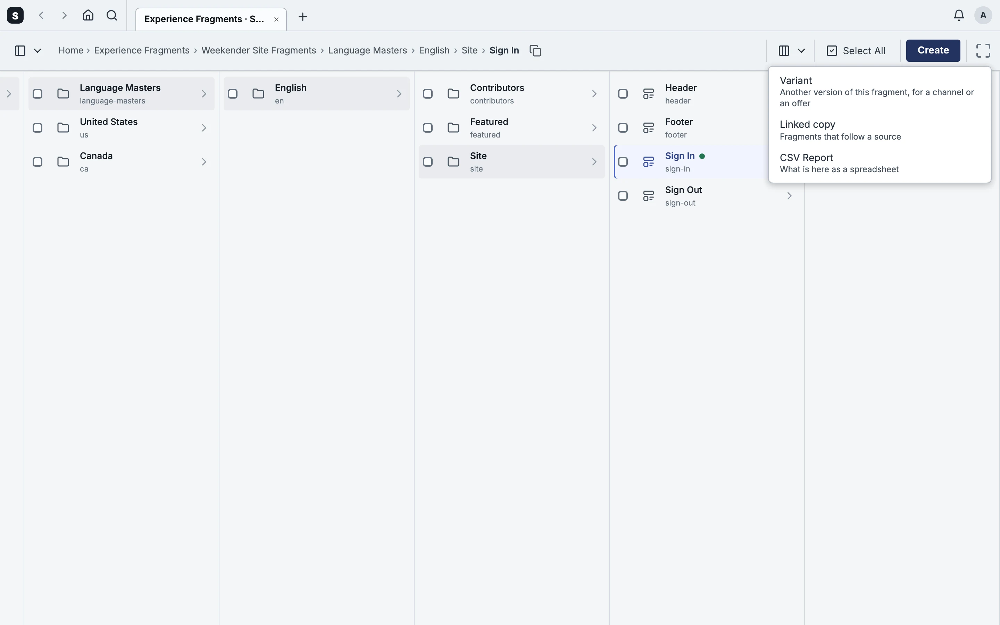

The wizard is the same: a template, then **Title**, **Name** and **Description**.

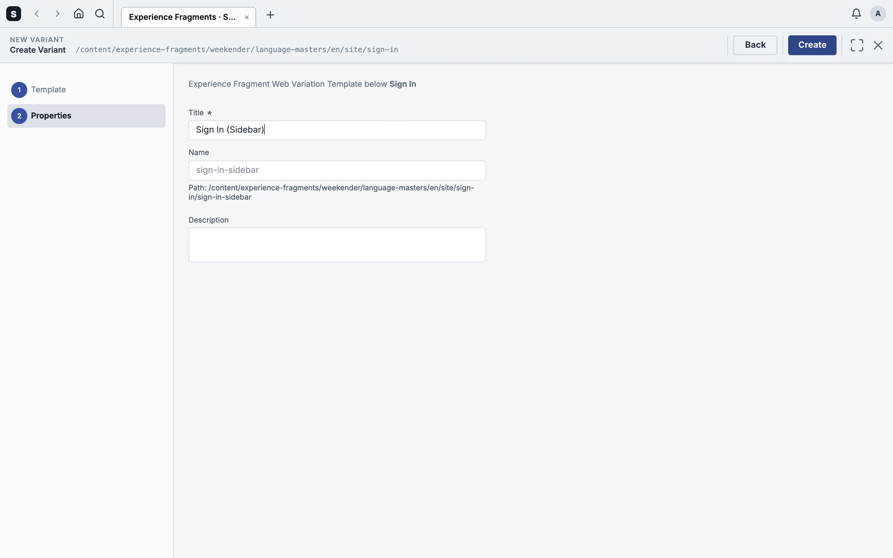

The first variant, **master**, is made together with the fragment, and it is what **Edit** opens when the fragment itself is selected. The others are for the places where master does not fit.

## Edit a variant

A variant opens in the [page editor](page-editor.md). Everything there works as on a page: the components on the left, drag and drop, the toolbar of a selected component, layout, preview, undo, annotations, **Publish**.

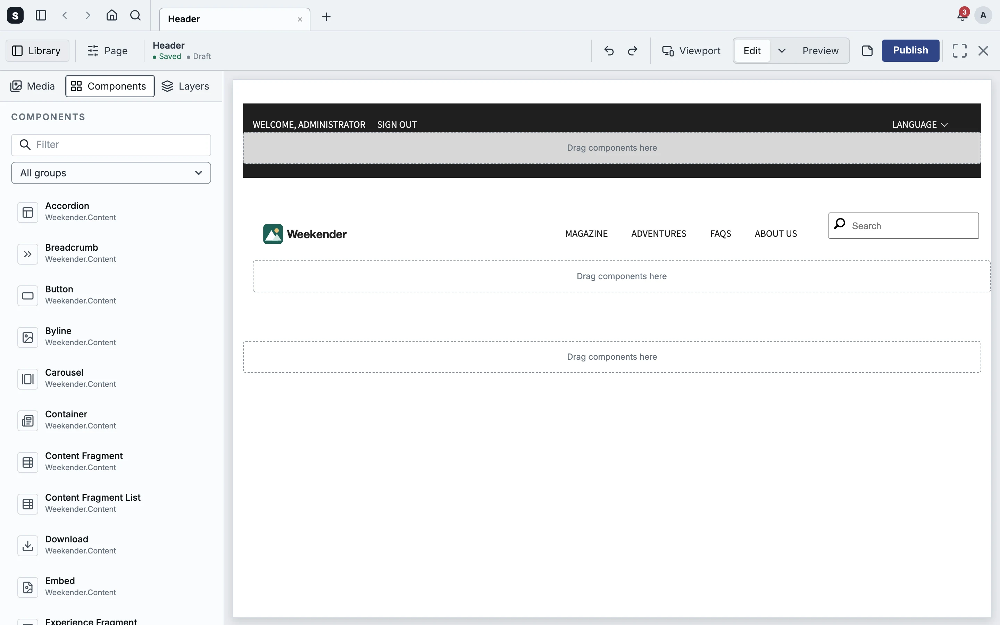

What you see is the fragment alone, without the page around it. Its width in the editor is the width of the window: a fragment for a narrow column will be shown narrower by the page that uses it, so check it there too, or with **Viewport**.

## Properties

**Properties** of a fragment has the tab **Basic**: its title, tags and descriptions, and the times it goes on and off.

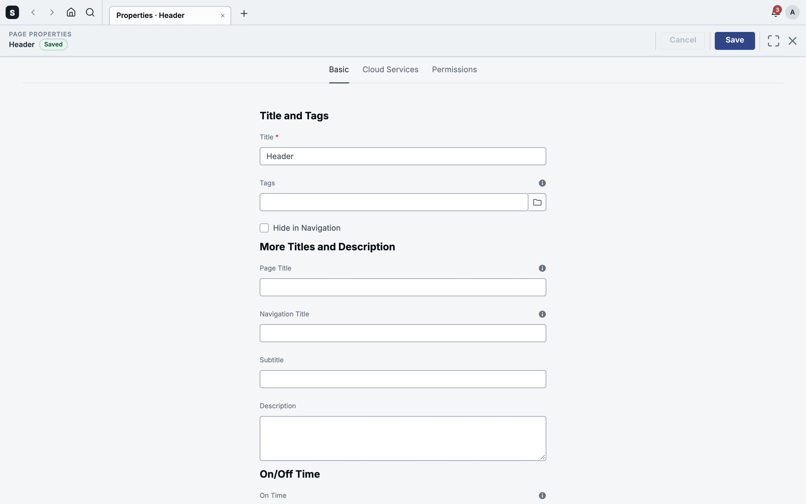

A variant has the full [page properties](page-properties.md): **Basic**, **Advanced**, **Images**, **Cloud Services** and **Permissions**.

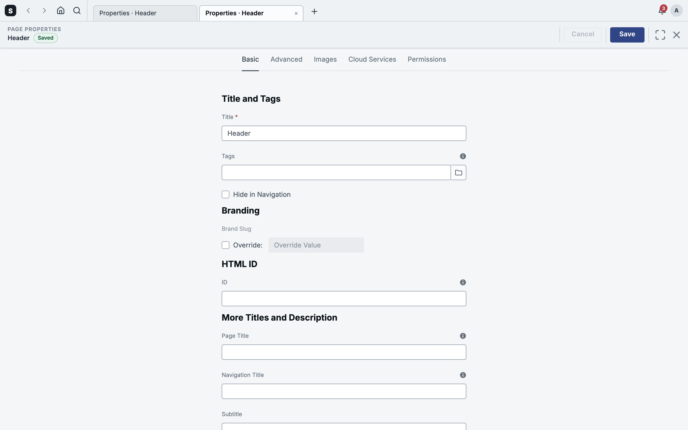

## Show a fragment on a page

Drag the **Experience Fragment** component onto the page, select it and choose **Configure** (the wrench).

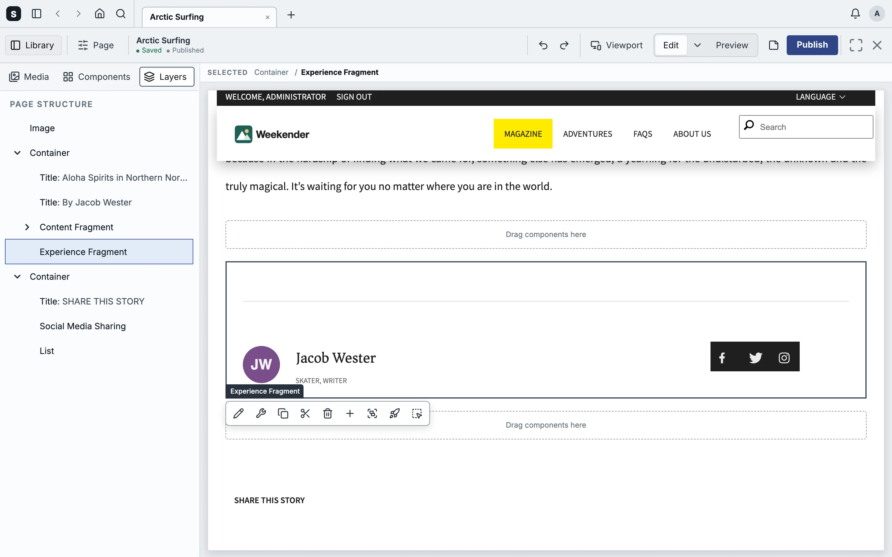

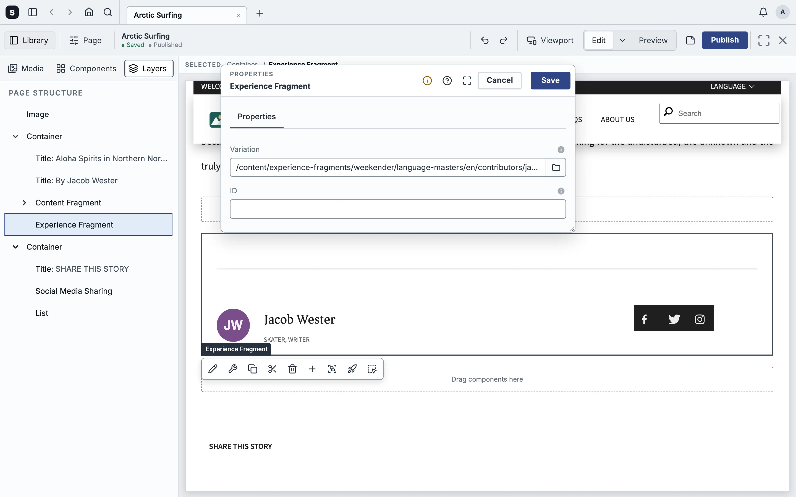

| Field | Meaning |
|---|---|
| **Variation** | The variant to show. The folder button opens a picker; choose a variant, not the fragment |
| **ID** | An HTML id for the component, for links that jump to it and for styling |

On the page, the fragment is one block: you select and move it as a whole, and you change its content by editing the variant, not the page.

### In a template

The header and footer of a site are usually experience fragments placed in the [template](templates.md), so every page gets them without anyone adding them. To change the header of the whole site, edit the header fragment and publish it.

### Sites in several languages

When fragments are kept by language, in the same shape as the site, a page shows the fragment of its own language by itself: the English page shows the English header, the French page the French one, though both use the same template and the template names only one of them.

## Make a fragment from part of a page

You built something on a page and now want it elsewhere too. In the page editor, select the component and choose **Convert to experience fragment variant** in its toolbar.

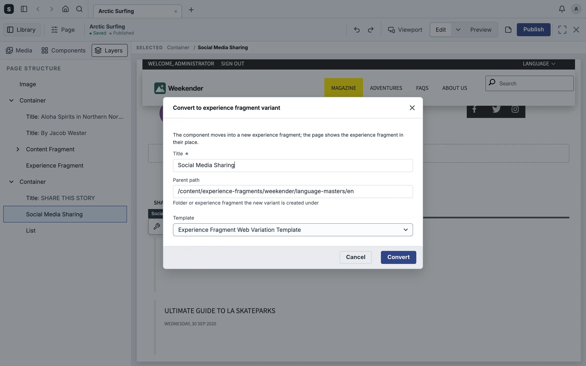

| Field | Meaning |
|---|---|
| **Title** | The title of the new fragment or variant. It starts as the component's name |
| **Parent path** | A folder: a new fragment is made there, with the component as its master variant. Or an existing fragment: the component becomes one more variant of it |
| **Template** | The template of the new variant |

**Convert** moves the component into the fragment; the page shows the fragment in its place, so nothing changes for visitors. Several components selected together are converted together, into one variant.

## Publish

A fragment is published like a page. When you publish a page that shows a fragment not yet on the live site, the fragment is offered to be published with it.

When a fragment is published, the Live cache refreshes exactly the pages that show it. See [Publishing](publishing.md).

## Before you change or delete one

Select the fragment and open the inspector's **References** tab: it lists every page that shows it. A fragment placed in a template is listed with the template's name; it then shows on every page made from that template.

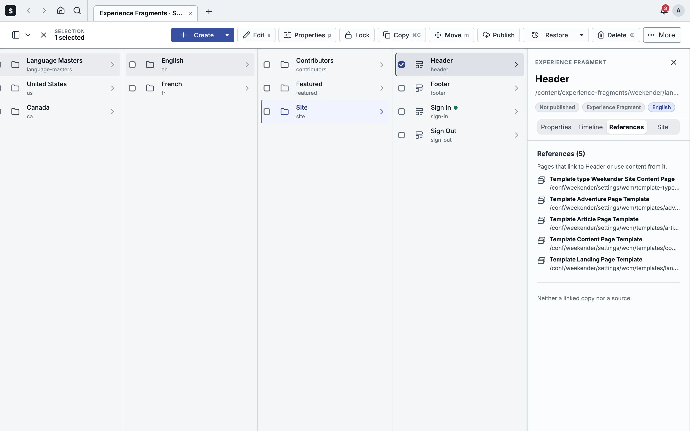

A change reaches all of the pages. A deleted fragment leaves an empty place on each.

## Generate Variations

**Generate Variations**, on Home, writes several versions of a short text for you to choose from: a banner, a headline, a tile, an email. A language model writes them, so the screen needs one: an administrator adds a provider of the AI connector under **Translations › Providers**. Without it, the screen says so and **Generate** stays off.

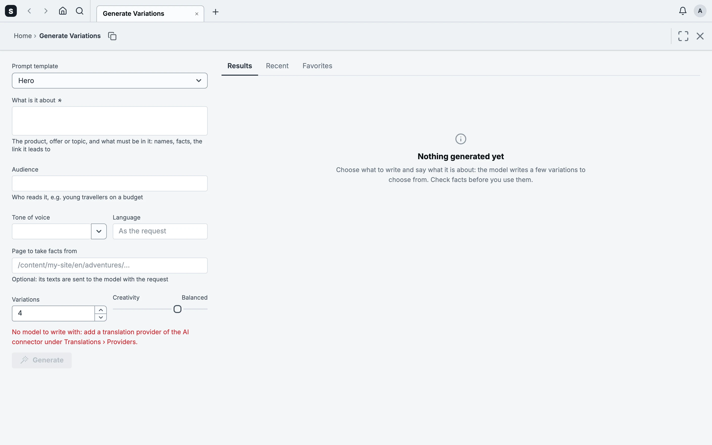

| Field | Meaning |
|---|---|
| **Prompt template** | What to write: Hero, Headline, Text, Tile, FAQ, Product description, Email, Social media post, or **Your own prompt** |
| **What is it about** | The product, offer or topic, and what must be in the text: names, facts, the link it leads to |
| **Audience** | Who reads it, such as *young travellers on a budget* |
| **Tone of voice**, **Language** | How it should sound, and the language to write in. Empty, the language of your request is used |
| **Page to take facts from** | Optional: a page whose texts are sent to the model with the request, so that it writes from your content |
| **Variations** | How many versions to write |
| **Creativity** | From careful to free |
| **Generate** | Sends the request |

| On the right | Meaning |
|---|---|
| **Results** | The versions just written. Each can be copied, and starred to keep it |
| **Recent** | What you generated before. It is kept for you only |
| **Favorites** | The versions you starred |
| **Export to Experience Fragment** | Makes a new experience fragment with the chosen versions as its variants, ready to be placed on pages or used in [personalization](personalization.md) |

A model can be wrong. Check names, prices and facts before you use a text.
