A form in Sensible Studio is a page made of form components. You build it in the page editor, publish it like a page, and read what visitors send in a table beside it.

Because a form is a page, everything pages have works for forms: templates, versions, publishing, translation, releases.

## The Forms console

**Home › Forms** opens the console. It is the [Pages console](pages.md), rooted at the forms. Sensible Studio comes with two examples under **Sample forms**: *Contact us* and *Book a trip*.

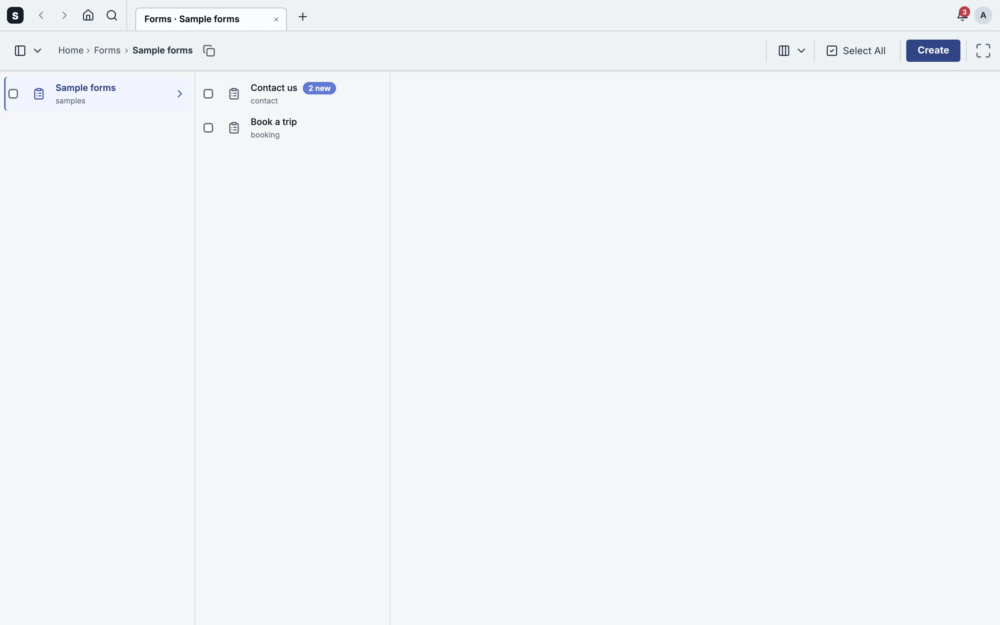

A form with submissions nobody has looked at yet shows their number beside its title. Select a form for its actions: the ones every page has, and **Submissions** (key `s`).

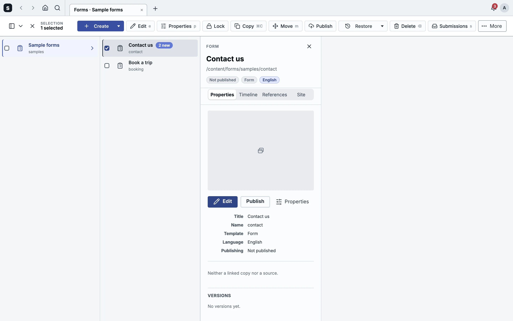

## Create a form

Choose **Create › Form** in the folder of your site.

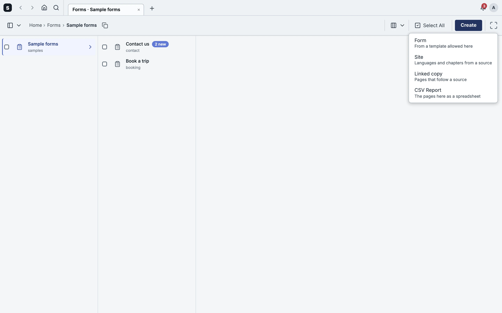

The wizard has the two steps of a page: the template, **Form**, then the title and name.

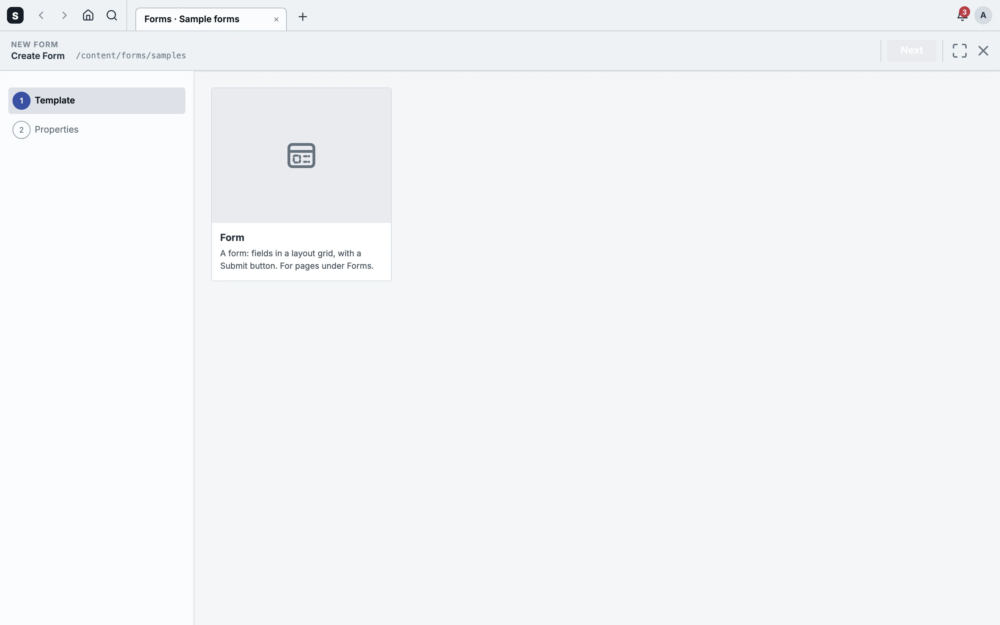

A new form starts with a name, an email address, a message and a **Send** button.

## Build it

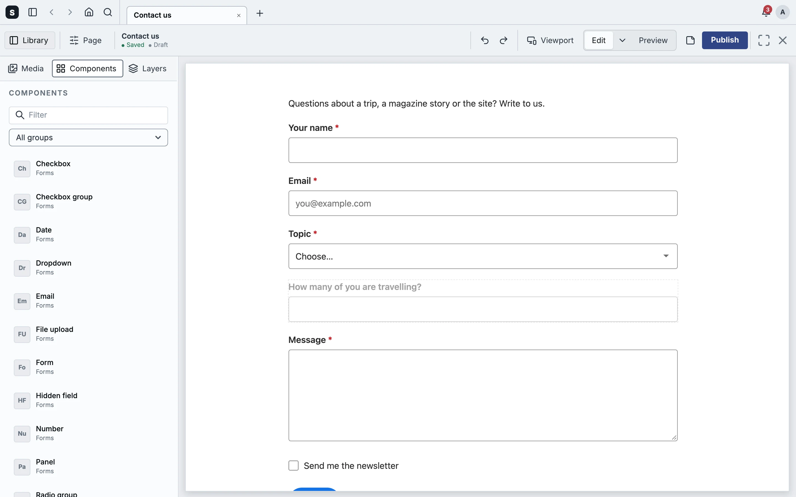

In the editor, the **Components** tab offers the form components:

| Component | For |
|---|---|
| **Text field**, **Text area** | A short answer; a longer one |
| **Email**, **Number**, **Date** | Checked as the visitor types |
| **Dropdown**, **Radio group** | One choice from several |
| **Checkbox**, **Checkbox group** | Yes or no; several choices |
| **File upload** | Documents or images, with the kinds and sizes you allow |
| **Hidden field** | A value sent along that the visitor does not see, such as the campaign |
| **Text** | An explanation between fields |
| **Panel** | A group of fields. In a form with steps, each panel is a step |
| **Submit button** | The button that sends the form |
| **Form** | The form itself: every field is inside it |

The **Layers** tab shows the form's structure, which is the quickest way to select a field or the form itself.

### A field's dialog

Select a field and choose **Configure** (the wrench). The dialog has three tabs.

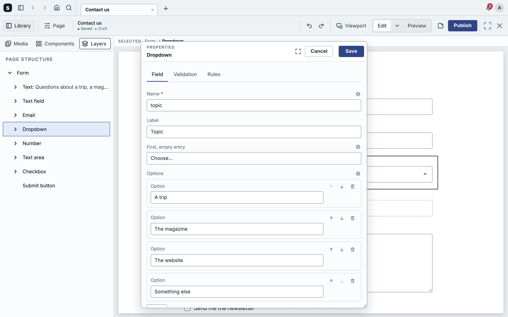

| Field (tab Field) | Meaning |
|---|---|
| **Name** | The key of the field in a submission, and the heading of its column: letters, digits, `_` and `-` |
| **Label** | What the visitor reads above the field |
| **First, empty entry** (dropdown) | A text such as "Choose…" that leaves the field unanswered until a choice is made |
| **Options** (dropdown, radio group, checkbox group) | One per row. The text is also the value stored |
| **Placeholder** (text fields) | A greyed example inside the empty field |
| **Default value** | What the field starts with |
| **Help text** | A line shown under the field |

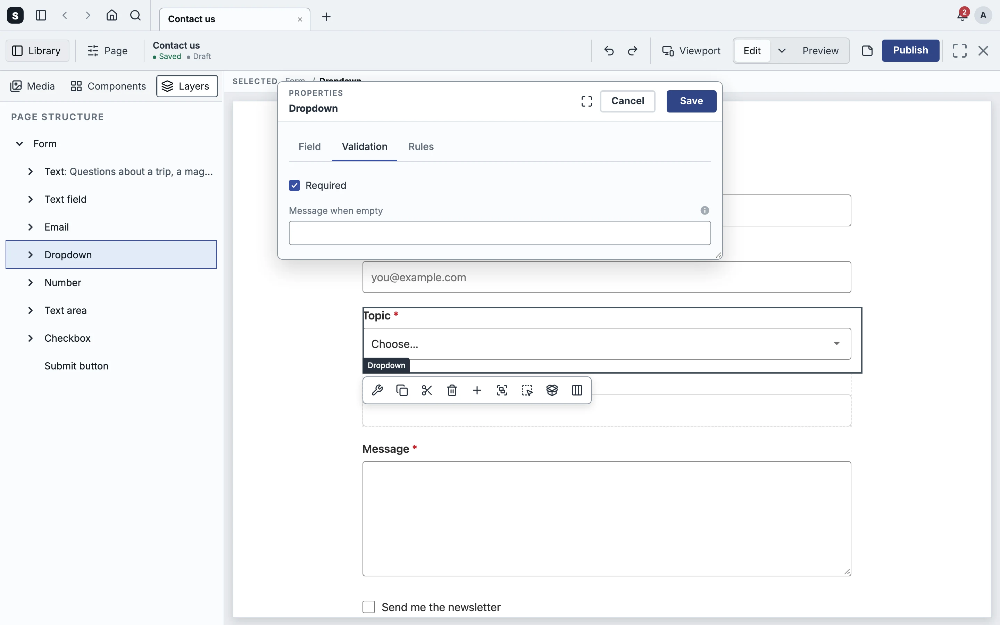

**Validation** has **Required** and the **Message when empty**, and, by the kind of field, what is accepted: a shortest and longest length, a lowest and highest number, an earliest and latest date, a pattern, the kinds and sizes of files.

A field that is filled in wrongly is pointed out to the visitor before the form is sent, and checked again on the server.

### Rules

A rule makes a field react to an answer. In *Contact us*, the question "How many of you are travelling?" is shown, and required, only when the topic is *A trip*.

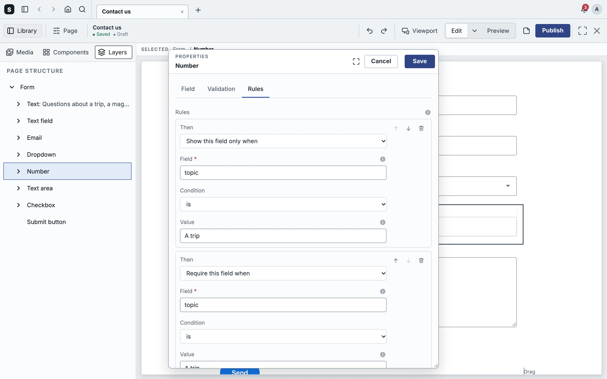

| Part of a rule | Meaning |
|---|---|
| **Then** | What happens: **Show this field only when**, **Hide this field when**, **Disable this field when**, **Require this field when** |
| **Field** | The name of the field whose answer decides |
| **Condition** | *is*, *is not*, *contains*, *is empty*, *is not empty*, *is greater than*, *is less than* |
| **Value** | The answer to compare with |

A field can have several rules; the arrows order them and the bin removes one. Hidden fields are not required and are not sent.

### The form's own dialog

Select **Form** in Layers and choose **Configure**.

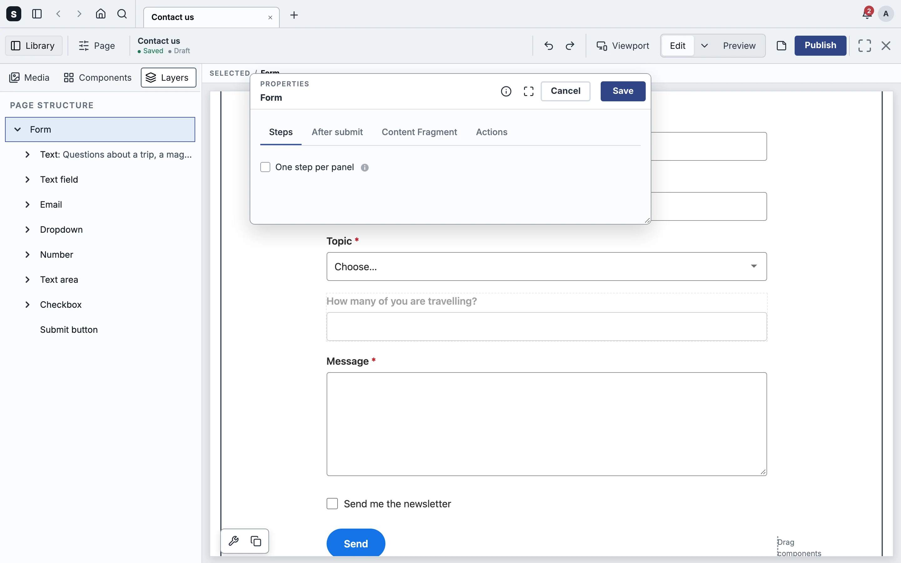

| Tab | What it sets |
|---|---|
| **Steps** | **One step per panel**: the top-level panels become steps with **Next** and **Back** and a progress bar; each step is checked before the next |
| **After submit** | What the visitor sees: **Show a message**, with the message, or go to a **Page** |
| **Content Fragment** | Make a content fragment from each submission |
| **Actions** | What else happens with a submission |

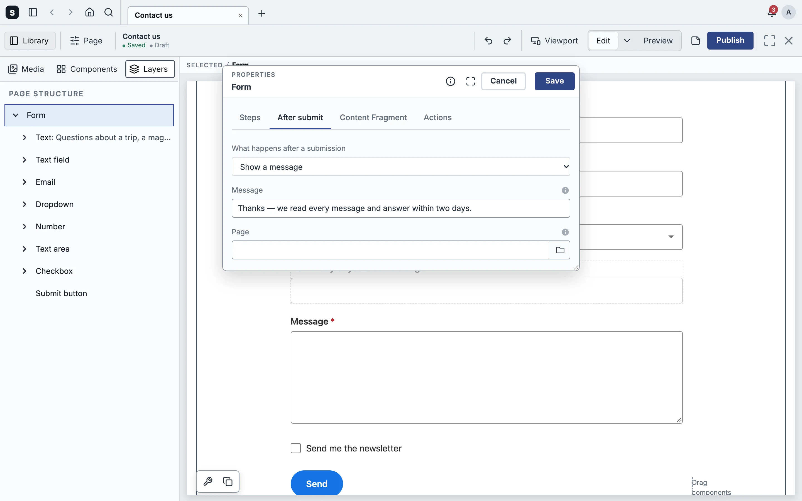

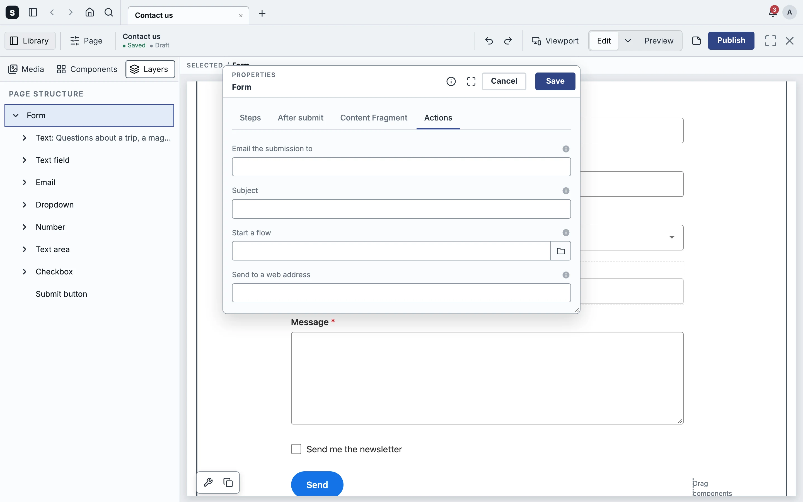

| Field (Actions) | Meaning |
|---|---|
| **Email the submission to** | An address that receives the answers, with the **Subject** you give. An administrator sets up the mail server under **Mail** |
| **Start a flow** | A flow model: each submission starts it, so someone handles it from their [Inbox](flows.md) |
| **Send to a web address** | The answers are posted to this address, to pass them to another system |

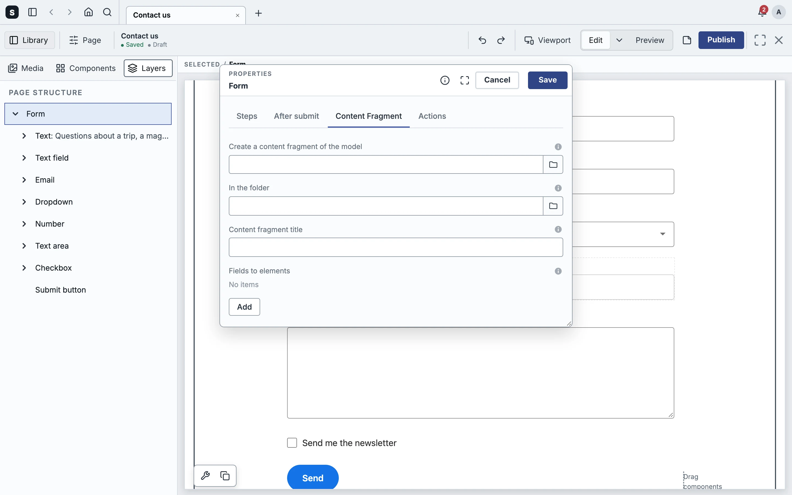

| Field (Content Fragment) | Meaning |
|---|---|
| **Create a content fragment of the model** | The [model](content-fragments.md) of the fragments |
| **In the folder** | Where they are made |
| **Content fragment title** | The title of each, which can use the answers |
| **Fields to elements** | Which answer goes into which field of the model. **Add** makes a pair |

### Try it

Switch the editor to **Preview** and fill in the form. Rules, steps and checks work as on the live site. A form sent from the preview is checked but not stored, and the confirmation says so.

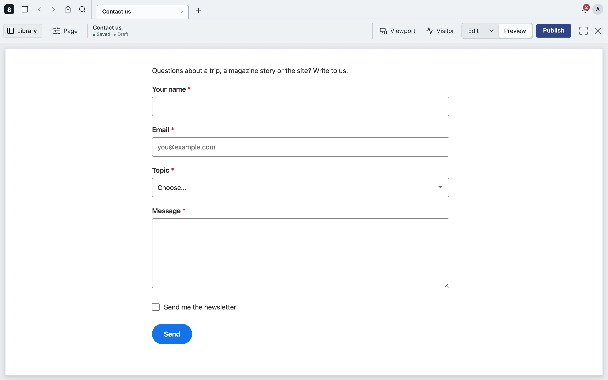

## Read what was sent

Select the form in the Forms console and choose **Submissions**, or press `s`.

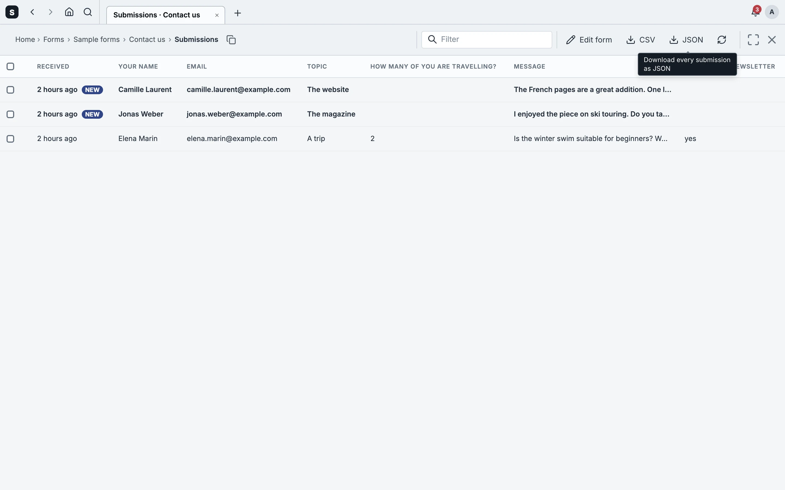

The table has one column per field and one row per submission, newest first; **New** marks the ones nobody has opened.

| Part | Meaning |
|---|---|
| **Filter** | Narrows the table to the rows that contain a text, in any answer |
| **Edit form** | Opens the form in the editor |
| **CSV**, **JSON** | Download the table |
| The circular arrow | Reads the submissions again |
| A click on a row | Opens the submission on the right |
| The ticks | Select submissions, to delete several |

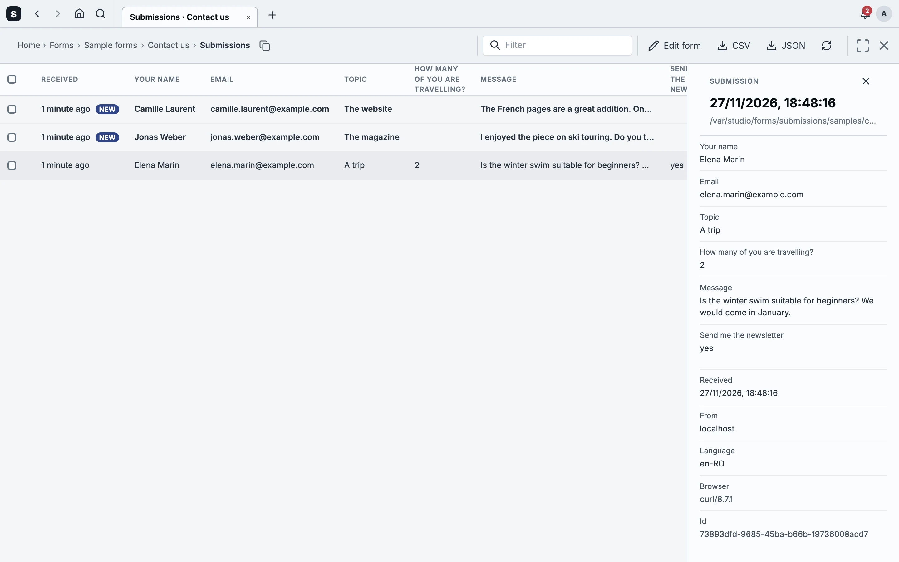

An opened submission shows every answer in full, the files that were uploaded, and what Sensible Studio noted: when it was received, from where, the visitor's language and browser, and its id. **Mark as new** puts the badge back; **Delete** removes the submission.

Submissions are sent on the live site and arrive on the author instance within a moment. They are never kept on the live site.

## Mail

**Home › System › Forms** has two tools: **Forms**, the console, and **Mail**, the mail server that sends submissions.

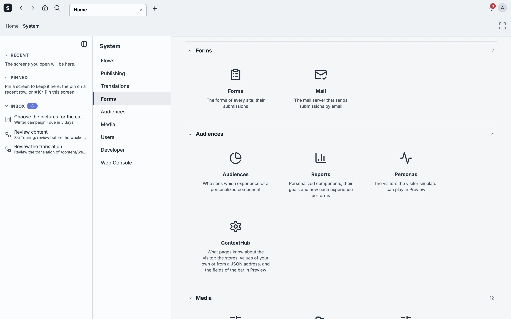

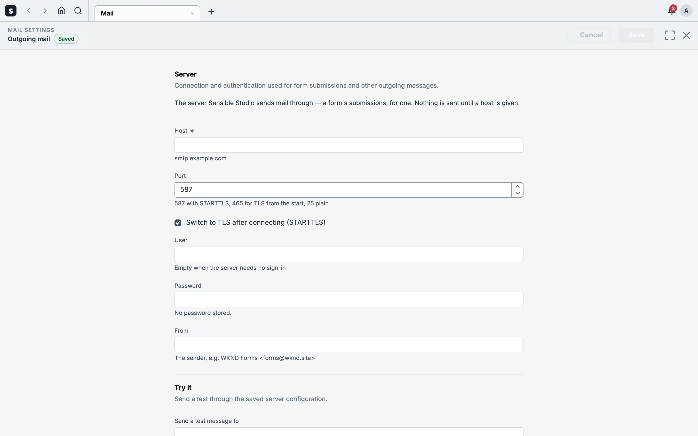

| Field | Meaning |
|---|---|
| **Host**, **Port** | The mail server |
| **Switch to TLS after connecting (STARTTLS)** | For servers that expect it, usually on port 587 |
| **User**, **Password** | The account that sends |
| **From** | The sender's address on the messages |
| **Send a test message to**, **Send test** | Tries the settings with a real message |

## Publish

Publish the form like a page. Use the form on a site page by linking to it, or let your developers embed it in the site's templates.

## Personal data

A form collects what you ask for, and what you collect is your responsibility. Ask only for what you need, say on the form what it is used for, and delete submissions when you no longer need them. Exports are files outside Sensible Studio: handle them with the same care.

## Protection against misuse

Each form has a hidden field that people never fill in and automated senders do; submissions that fill it are dropped. Submissions from one address are limited to one every two seconds, and a submission may be at most 256 KB, files aside.
