An uploaded file is more than the file. Sensible Studio makes the sizes a site needs, can deliver any image at any size on request, finds the subject of a picture so crops keep it in view, and proposes tags by looking at the image.

Most of this is set up once by an administrator, under **Home › System › Media**, and then works by itself in the folders that use it. The other tools of that group (metadata, search, reports, sharing) are in [Media settings](media-settings.md).

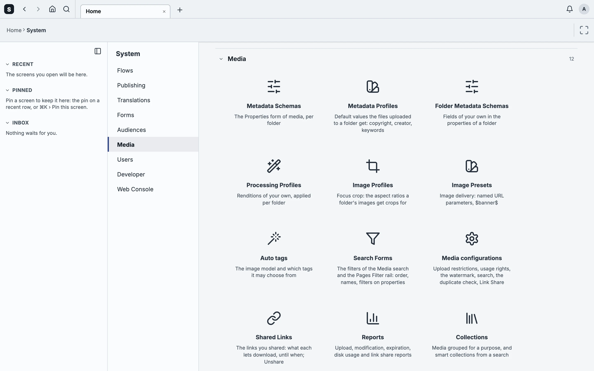

| Tool | What it is for |
|---|---|
| **Processing Profiles** | Extra renditions, made as files for the folders that use the profile. The watermark is here too |
| **Image Profiles** | Focus crops: the proportions a folder's images get crops for |
| **Image Presets** | Named sets of delivery parameters, such as `$card$`, and gallery presets |
| **Auto tags** | The image model, the tags it may propose, learning your own tags, colour tags |

## What happens to an uploaded file

| Kind of file | What is made |
|---|---|
| **Images** | Thumbnails, a web size and a zoom size. The image is never enlarged, and a photo taken sideways is turned upright |
| **Video** | A thumbnail, a poster frame, and a copy every browser can play. Duration, size and codecs are read |
| **PDF** | A preview of the first page. The text is taken out for the search |
| **Office documents** | A preview, and their text for the search |
| **SVG** | A preview. An SVG is always served in a way that keeps scripts inside it from running |

Video needs `ffmpeg` and office documents need LibreOffice on the machine that runs Sensible Studio. Without them those files are still stored and downloadable, but get no preview. See [Install and run](../getting-started/install.md).

**Reprocess** makes everything again for a file, a selection or a folder, for example after you changed a folder's settings.

### The Renditions panel

Everything that exists for one file is on its page: open the file in [Media](media.md) and choose **Renditions** in the rail on the left.


| Part | What it lists |
|---|---|
| **Renditions** | The files made from the original, each with its size, weight and type. The arrow downloads one. `original` is the file as it was uploaded; a rendition of a processing profile carries the name the profile gave it (here `wide.jpeg`) |
| **Focus crop** | The crops of the folder's image profile, each with its proportions and its size in pixels. Click one to see it on the picture; the pencil opens the crop editor; the button on the right copies its address |
| **Image delivery** | One line per image preset, with the parameters it stands for. The button copies the address of this file with that preset |
| **Custom size** | A width of your own: type it, and copy the address the panel shows below |

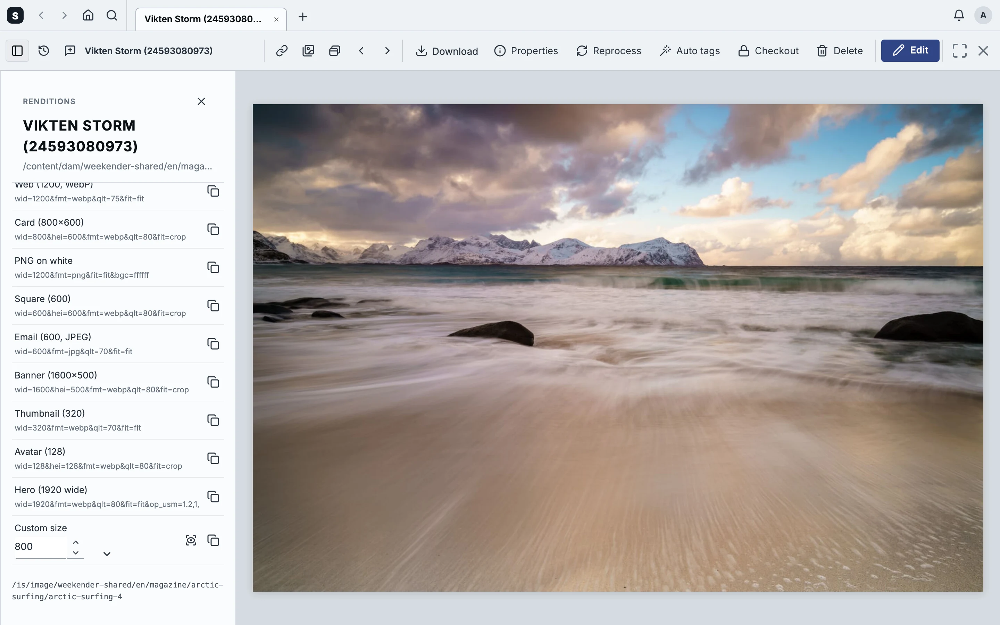

## Processing profiles: renditions of your own

A processing profile is a list of extra renditions to make. An administrator creates profiles in **Processing Profiles**; you choose one under **Processing** in a [folder's properties](media.md). It applies to the folder, the folders below it, and the files uploaded or reprocessed from then on.

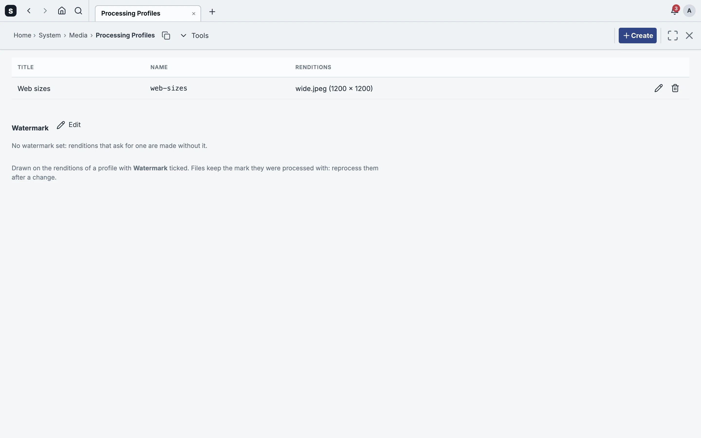

**Create** opens the editor; the pencil of a row opens it for that profile and the bin deletes the profile.

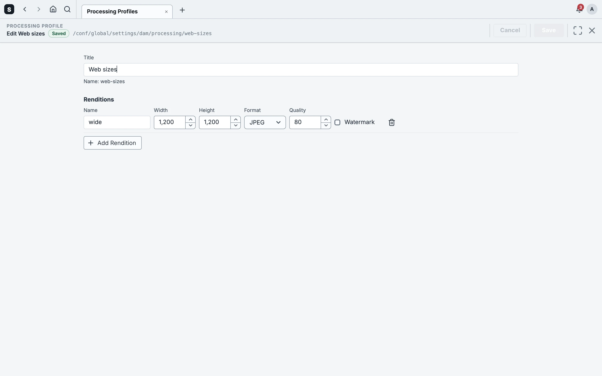

| Field | Meaning |
|---|---|
| **Title** | What people choose in a folder's properties. The name below it is made from the title and does not change afterwards |
| **Name** | The name of the rendition, which becomes the file name: `wide` gives `wide.jpeg` |
| **Width**, **Height** | The box the picture is fitted into, in pixels. Proportions are kept and a picture is never enlarged |
| **Format** | JPEG, PNG or WebP for pictures; MP4 or WebM for a video, which then has a height (720 for 720p) instead of a box |
| **Quality** | 1 to 100, for JPEG and WebP |
| **Watermark** | Draws the watermark on this rendition |
| **Add Rendition** | One more line. The bin at the end of a line removes it |

Use a profile for sizes that must exist as files, such as a print size someone downloads. For images shown on a website, use image delivery instead: nothing has to be made in advance.

### The watermark

There is one watermark for the whole of Media. **Edit**, under the list of profiles, sets it.

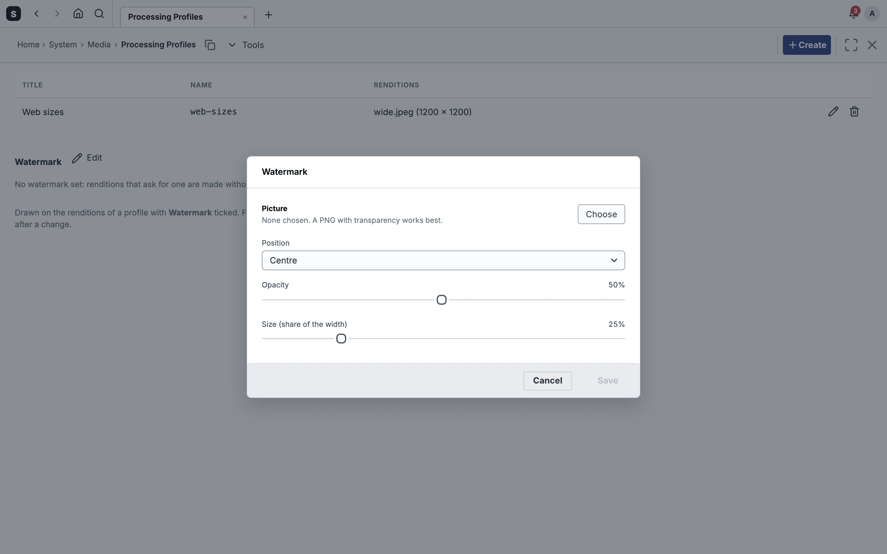

| Field | Meaning |
|---|---|
| **Picture** | **Choose** takes a picture from Media. A PNG with transparency works best |
| **Position** | Where on the rendition it is drawn: the centre, one of the four corners, or repeated over the whole picture |
| **Opacity** | How strongly it shows |
| **Size** | Its width, as a share of the rendition's width |

Renditions keep the mark they were made with. After you change the watermark, reprocess the files that should get the new one.

## Image delivery: any size, by address

Every image in Media can be requested at any size, format and quality through its address. The image is made when it is first asked for, then kept.

```
/is/image/<the file's path below /content/dam>?<parameters>
```

For the file `/content/dam/weekender-shared/en/magazine/arctic-surfing/arctic-surfing-4.jpg`, this address gives it 800 pixels wide, as WebP:

```
/is/image/weekender-shared/en/magazine/arctic-surfing/arctic-surfing-4?wid=800&fmt=webp
```

| Parameter | Meaning |
|---|---|
| `wid`, `hei` | The box, in pixels. One of them alone keeps the proportions |
| `fit` | `fit` stays inside the box (the default); `crop` fills it and keeps the middle; `stretch` fills it without keeping proportions |
| `fmt` | `jpeg` (the default), `png`, `png-alpha`, `webp`, `webp-alpha` |
| `qlt` | Quality, 1 to 100 |
| `crop` | `x,y,w,h`: the part of the image to use |
| `rotate`, `flip` | `90`, `180`, `270`; `h`, `v`, `hv` |
| `op_sharpen`, `op_usm`, `op_blur`, `op_brightness`, `op_contrast`, `op_saturation` | Adjustments |
| `op_grayscale=1`, `op_sepia=1` | Black and white; sepia |
| `op_gradient`, `op_overlay`, `op_vignette` | A fade, a tint, darker corners: useful under text |
| `op_radius`, `op_border` | Rounded corners; a border |
| `bgc` | The background colour where the image is transparent |

You rarely type these: the Renditions panel of a file gives the address for every preset and for a width of your own.

### Image presets

A preset is a named set of parameters, used as `?$card$`. Presets make every image of one kind come out the same, give you one place to change them all, and give people a word to use: "card" instead of `wid=800&hei=600&fit=crop`. Parameters given after the preset win over the preset's own: `?$card$&qlt=60`.

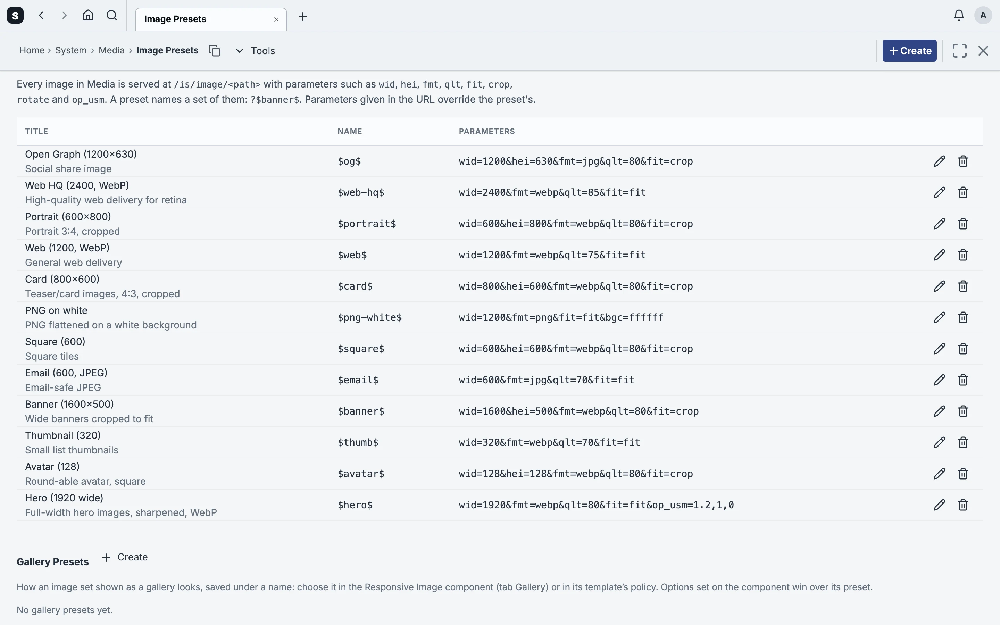

| Preset | What it gives |
|---|---|
| `$hero$` | 1920 wide, sharpened, WebP: full-width hero images |
| `$banner$` | 1600×500, cropped to fit |
| `$card$` | 800×600, cropped: teasers and cards |
| `$square$`, `$portrait$` | 600×600 and 600×800, cropped |
| `$thumb$`, `$avatar$` | 320 wide; 128×128 |
| `$web$`, `$web-hq$` | 1200 and 2400 wide, WebP: general use, and screens with a high pixel density |
| `$email$` | 600 wide, JPEG: safe for mail programs |
| `$og$` | 1200×630, JPEG: the picture of a link shared on social networks |
| `$png-white$` | PNG flattened on a white background |

**Create** makes a preset; the pencil of a row opens the preset editor and the bin deletes the preset.

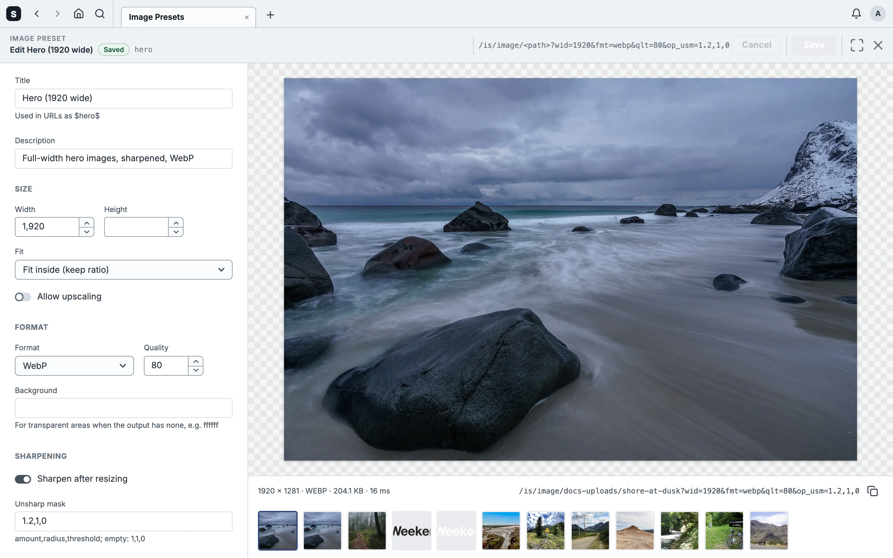

| Field | Meaning |
|---|---|
| **Title**, **Description** | For people. The name under the title is what the address uses, between dollar signs |
| **Width**, **Height** | The box. Leave one empty to keep the proportions |
| **Fit** | Fit inside and keep the proportions, crop to fill the box, or stretch |
| **Allow upscaling** | Off, a small picture stays small instead of being enlarged |
| **Format**, **Quality** | The file type and how hard it is compressed |
| **Background** | The colour behind transparent areas when the format has no transparency, such as `ffffff` |
| **Sharpen after resizing**, **Unsharp mask** | Sharpening, and its amount, radius and threshold |
| **Advanced** | The remaining parameters of the table above |

The right side delivers a real picture with exactly these settings. Under it you read the resulting size, format, weight and the time it took, and the address that was asked for; the button beside the address copies it. The strip of pictures at the bottom changes the sample: try a preset on a landscape, a portrait and a logo before you save it.

### Gallery presets

A gallery preset is the look of a set of pictures shown together: where the thumbnails are, the shape of the pictures, arrows, enlarging. **Create**, beside **Gallery Presets** at the bottom of Image Presets, makes one.

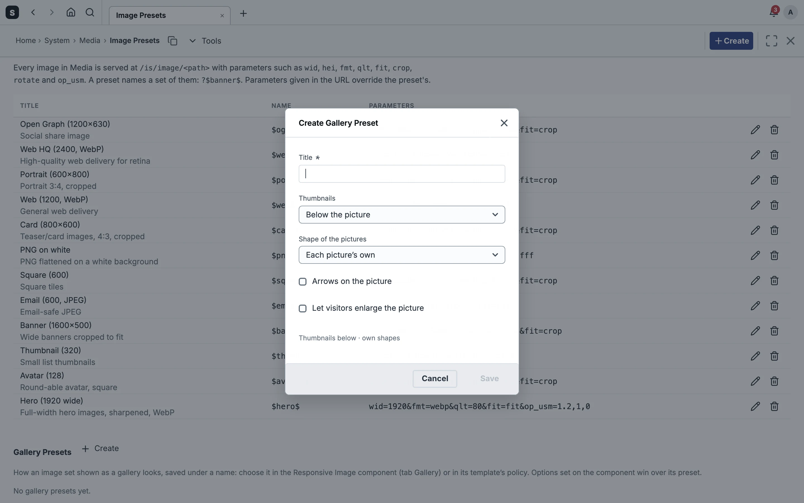

| Field | Meaning |
|---|---|
| **Title** | The name authors choose |
| **Thumbnails** | Below the picture, left or right of it, dots instead of thumbnails, or none |
| **Shape of the pictures** | Each picture's own proportions, or one shape for all (16:9, 3:2, 4:3, 1:1), so the gallery keeps its height |
| **Arrows on the picture** | Previous and next, on the picture itself |
| **Let visitors enlarge the picture** | A click opens the picture large |

Authors choose a gallery preset in the **Gallery** tab of the Responsive Image component; a template's policy can set one for all its pages. Options set on the component win over the preset.

## Focus crops: the subject stays in view

A site needs the same picture as a wide banner, a square and a tall portrait. A crop around the middle of the picture often cuts off what matters. A **focus crop** is placed around the subject instead.

1. An administrator creates an **image profile** in **Image Profiles**: a list of crops, each with a name and proportions.
2. You choose the profile under **Processing** in a folder's properties (**Image Profile**).
3. Every image in the folder gets those crops, now (after **Reprocess**) and when new images arrive.

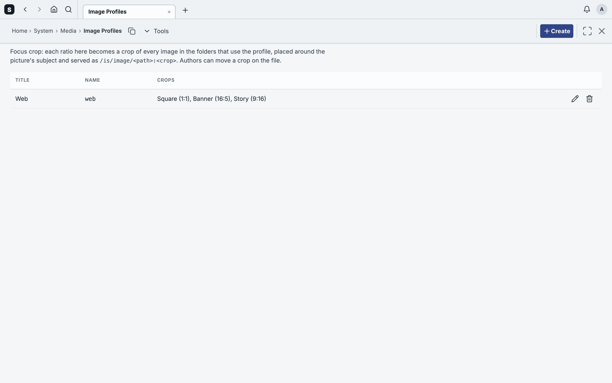

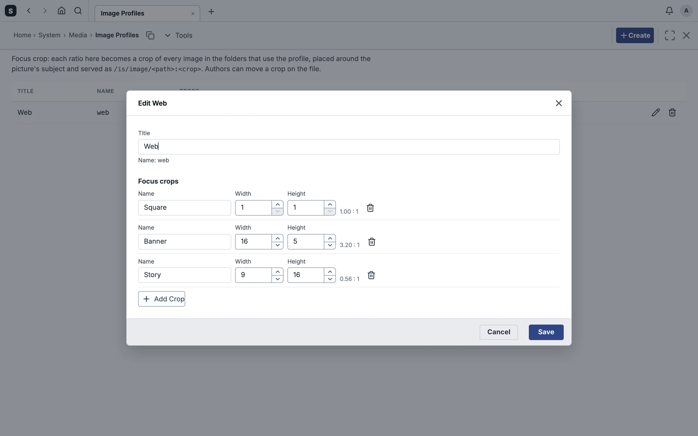

| Field | Meaning |
|---|---|
| **Title** | What people choose in a folder's properties |
| **Name** (of a crop) | The word used in addresses, and what authors see: *Square*, *Banner*, *Story* |
| **Width**, **Height** | The proportions, not pixels: 16 and 5 for a banner, 9 and 16 for a story. The number after them is the ratio |
| **Add Crop** | One more crop. The bin removes one |

Request a crop by adding its name to the address. The other parameters then apply to the cropped picture:

```
/is/image/weekender-shared/en/magazine/arctic-surfing/arctic-surfing-4:Story?wid=400&fmt=webp
```

### See and adjust a crop

In the Renditions panel of a file, click a crop to see it instead of the whole picture.

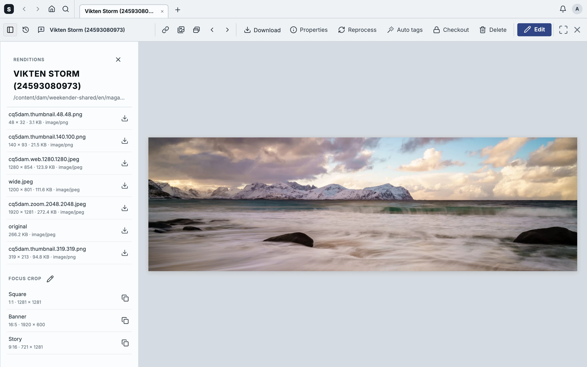

The pencil beside **Focus crop** opens the crop editor.

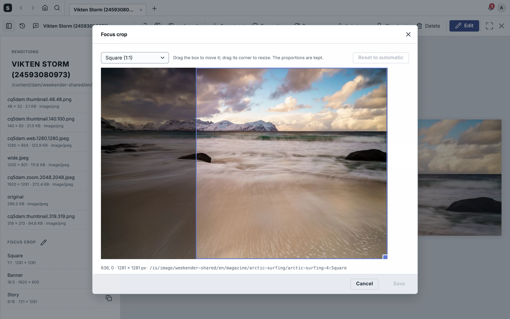

| Control | What it does |
|---|---|
| The list at the top | Chooses which of the file's crops you are editing |
| The frame | Drag it to move the crop; drag its corner to resize it. The proportions are kept |
| The line under the picture | The crop's position and size in pixels, and its address |
| **Reset to automatic** | Gives all of the file's crops back to the automatic choice |
| **Save** | Keeps your frame |

A crop you adjusted is yours: it is not replaced when crops are computed again, unless you reset it.

## The Responsive Image component

**Responsive Image**, in the group **Media** of the [page editor](page-editor.md)'s components, shows an image with one crop on wide screens and another on phones, each at the size the screen needs. Drag it onto a page, select it and choose **Configure** (the wrench).

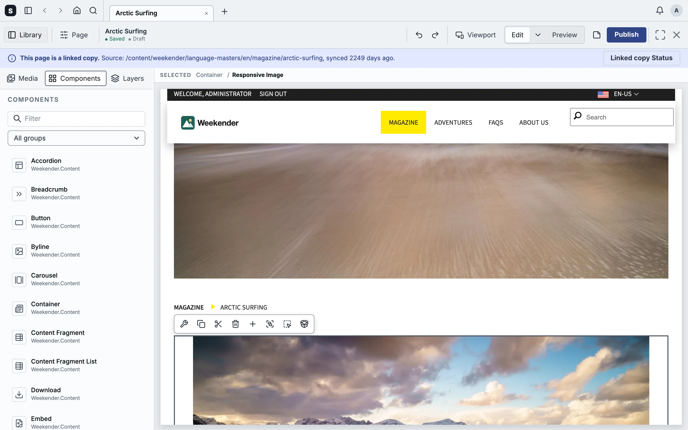

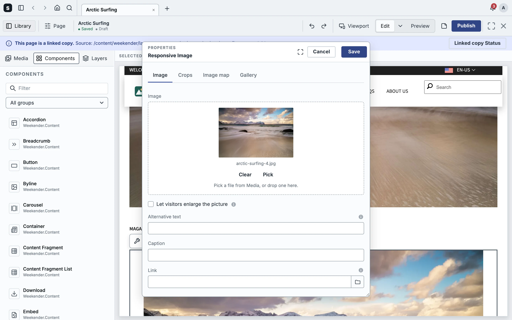

| Tab | Field | Meaning |
|---|---|---|
| **Image** | **Image** | **Pick** chooses a file from Media, or drop one here; **Clear** empties it |
| | **Let visitors enlarge the picture** | A button on the picture opens it large |
| | **Alternative text** | Read by screen readers, and shown when the image cannot be loaded |
| | **Caption** | A line shown under the picture |
| | **Link** | Where a click on the picture goes |
| **Crops** | **Focus crop**, **Image preset** | For each screen size, which crop of the file to show and which preset to deliver it with |
| **Image map** | | For a picture with an [image map](media.md): which fields of a record an area's card shows |
| **Gallery** | **Gallery preset**, **Thumbnails**, **Arrows on the picture**, **Shape of the pictures** | When the file is an [image set](media.md): the look of the gallery. A preset, or options of your own, which win over the preset. **As the template says** leaves an option to the template's policy |

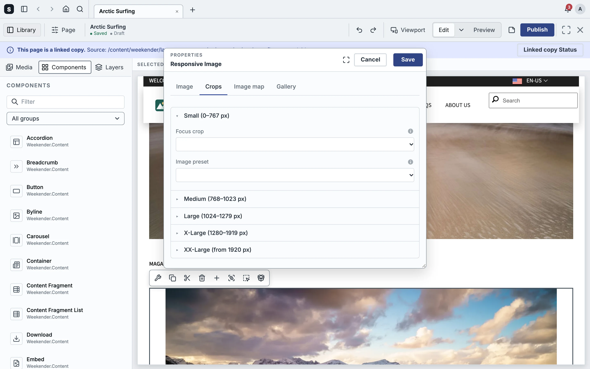

The screen sizes are **Small** (up to 767 pixels wide), **Medium** (768 to 1023), **Large** (1024 to 1279), **X-Large** (1280 to 1919) and **XX-Large** (from 1920). A size you leave empty takes the crop of the next larger size that has one, so most pictures need two choices: a tall or square crop for Small and a wide one for XX-Large. With no crop chosen anywhere, the whole picture is shown.

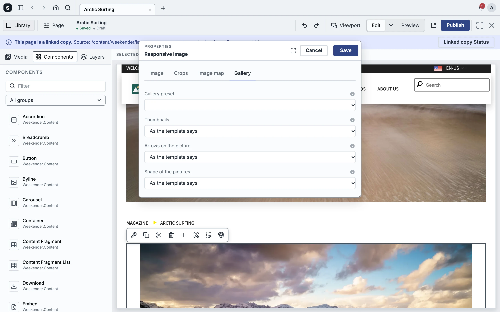

## Auto tags

Sensible Studio can look at an image and propose tags for it. It does this on its own machine: no picture is sent anywhere, and no account with an outside service is needed.

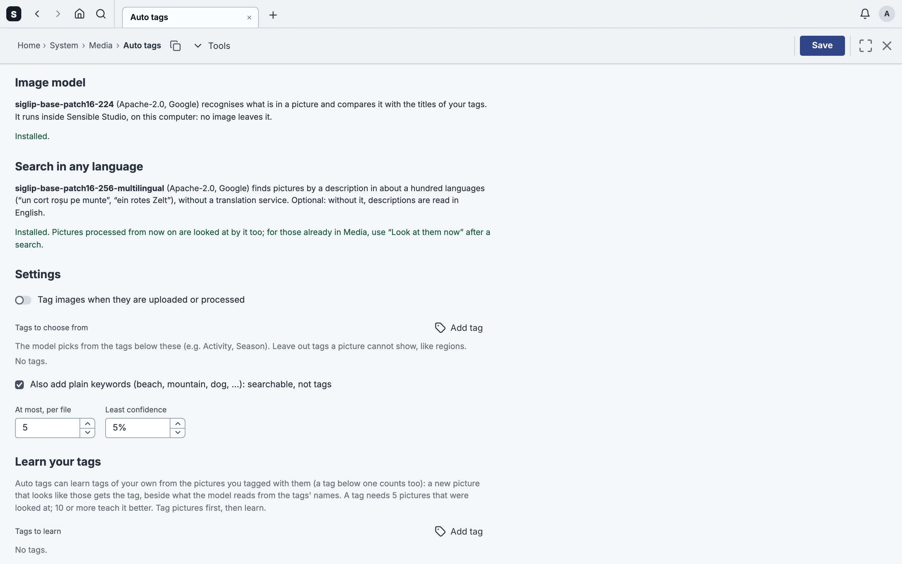

| Section | What you do there |
|---|---|
| **Image model** | Install the model once (a download of about 800 MB). The page says **Installed** when it is there |
| **Search in any language** | A second, optional model that finds pictures by a description in about a hundred languages, without a translation service. Pictures processed from then on are looked at by it too; **Look at them now** does it for the pictures already in Media |
| **Settings** | **Tag images when they are uploaded or processed** switches auto tags on. **Tags to choose from** are the tags the model may propose: choose tags a picture can show, an activity or a season, not a region or a campaign. **Also add plain keywords** adds everyday words (beach, mountain, dog) that the search finds but that are not tags. **At most, per file** and **Least confidence** limit what is kept |

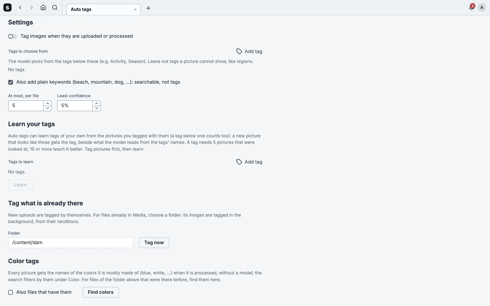

| Section | What you do there |
|---|---|
| **Learn your tags** | The model learns what your tags mean from the pictures your team has already tagged with them. Add the tags under **Tags to learn** and choose **Learn**. A tag needs 5 tagged pictures; 10 or more teach it better |
| **Tag what is already there** | New uploads are tagged by themselves. For files already in Media, choose a **Folder** and **Tag now**: its images are tagged in the background |
| **Color tags** | Every picture gets the names of the colours it is mostly made of when it is processed, without a model. **Find colors** does it for the files that were there before; **Also files that have them** computes them again |

What authors see:

- In a file's [properties](media.md), each proposal is shown with how sure the model is, such as "Surfing 93%". Accept one to make it a real tag; reject one and it is not proposed for that file again.
- **Auto tags**, on a file, a selection or a folder, runs the model on images that are already there.
- Proposed tags and keywords are found by the search even before anyone accepts them.
- Colours show as swatches in a file's properties, and the search has a **Color** filter: every image that is mostly blue, for example.
