The tools on this page are under **Home › System › Media**. An administrator sets them up; authors meet their results in [Media](media.md): the fields of the Properties form, the filters beside a search, the Share Link dialog. Renditions, crops, presets and auto tags, which are in the same group, are in [Images and delivery](media-delivery.md).

| Tool | What it is for |
|---|---|
| **Metadata Schemas** | The Properties form of files, per folder |
| **Metadata Profiles** | Values the files uploaded to a folder get by themselves: a copyright line, a creator, keywords |
| **Folder Metadata Schemas** | Fields of your own in the properties of a folder |
| **Search Forms** | The filters of the Media search and of the Pages search |
| **Media configurations** | Upload restrictions, usage rights, the watermark, search, the duplicate check, Link Share |
| **Shared Links** | The links you shared: what each lets download, and until when |
| **Reports** | Uploads, changes, expiry, disk usage and link shares, as tables and CSV |
| **Collections** | Files grouped for a purpose |

Every one of these screens has the same top bar: the path **Home › System › Media › the tool**, a button that copies the screen's address, and **Tools**, a menu with the other tools of the group.

## Metadata schemas

A metadata schema decides which fields the **Properties** of a file show. Without one, files get the standard form. **Create** opens the schema editor, which starts with a copy of the standard fields.

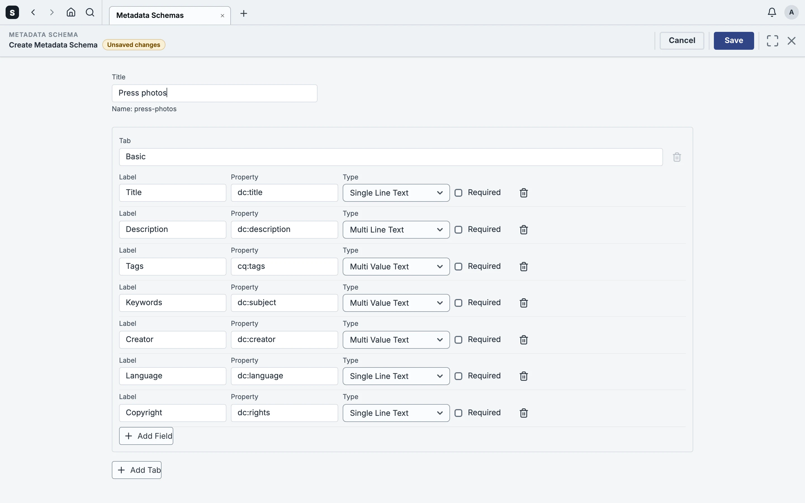

| Part | Meaning |
|---|---|
| **Title** | What people choose in a folder's properties. The name under it is made from the title |
| **Tab** | A tab of the Properties form. **Add Tab** makes another; the bin removes a tab with its fields |
| **Label** | What the field is called in the form |
| **Property** | Where the value is kept in the file's metadata, such as `dc:title` or `dc:rights`. Use a name of your own for a field of your own: `campaign`, `press:embargo` |
| **Type** | The kind of field (below) |
| **Required** | The form is not saved while the field is empty |
| **Add Field** | One more field in this tab. The bin at the end of a line removes a field |

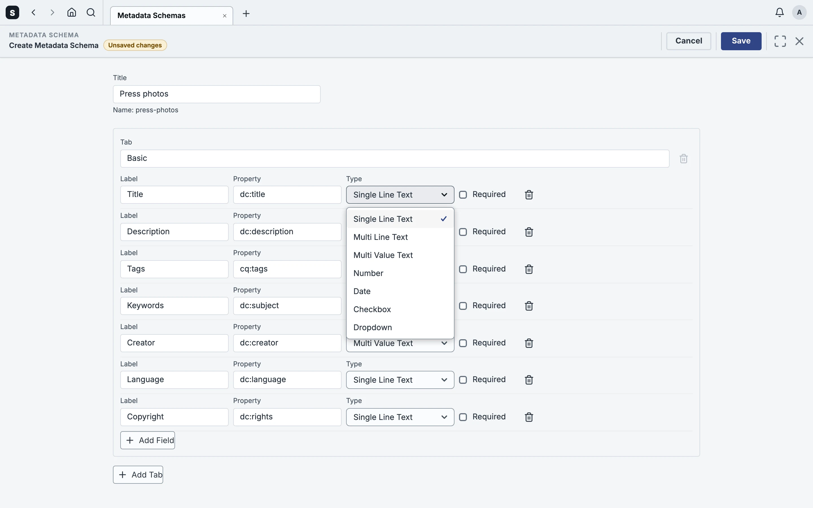

| Type | The field in the form |
|---|---|
| **Single Line Text** | One line |
| **Multi Line Text** | A text box |
| **Multi Value Text** | Several short texts, each added with Enter. Tags use this type with the property `cq:tags` |
| **Number** | A number |
| **Date** | A date picker |
| **Checkbox** | Yes or no |
| **Dropdown** | One of a list of choices you give |

**Save**, at the top right, keeps the schema. To use it, open the properties of a folder in Media and choose it as the folder's **Metadata Schema**: the files of that folder and of the folders below it then show this form.

## Metadata profiles

A metadata profile gives values to the files uploaded into a folder, so that nobody has to type the same copyright line fifty times. Its editor has the same list of fields as a schema, and under it the **Default values**.

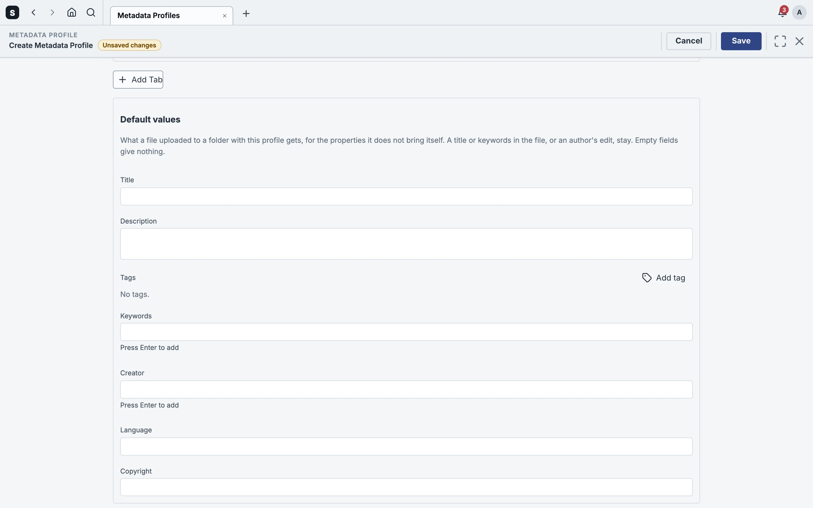

Fill in the values the files should get and leave the rest empty: an empty field gives nothing. A value is given only where the file brings none itself. A title or keywords stored in the file, and anything an author typed, stay.

Choose the profile in the properties of a folder (**Metadata Profile**). It applies to the files uploaded from then on; **Apply to the files here**, in the same place, gives the values to the files that are already in the folder.

## Folder metadata schemas

Folders can have fields of their own too: the owner of a campaign folder, the date its licence ends. A folder metadata schema has one tab, **Folder**, and the same kinds of fields as a file's schema.

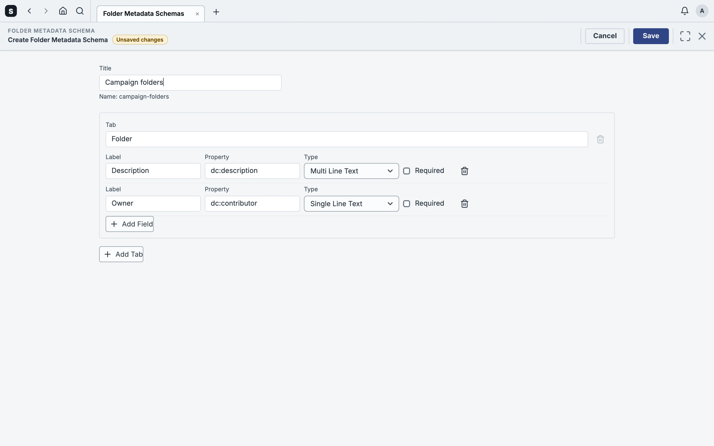

Choose the schema in a folder's properties (**Folder Metadata Schema**). Its fields then show there, under **Folder Metadata**, for that folder and the folders below it.

## Search forms

A search form is the list of filters that a search shows beside its results. There are two: **Media search** and **Pages search**. Choose one in **Search form** at the top left.

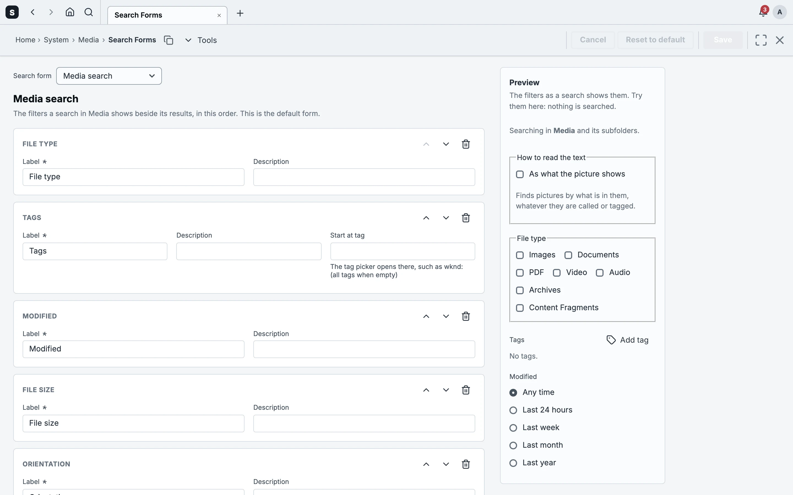

| Part | Meaning |
|---|---|
| A filter's box | Its **Label**, an optional **Description** shown under it, and settings of its own: the **Tags** filter has **Start at tag**, the tag where its picker opens |
| The arrows | Move the filter up or down. The order here is the order in the search |
| The bin | Removes the filter from the form |
| **Add filter** | At the end of the list: adds one of the filters that are not in the form |
| **Preview** | The form as a search shows it. You can try the filters; nothing is searched |
| **Reset to default** | Goes back to the form Sensible Studio starts with |
| **Save** | Keeps the form. Searches use it from then on |

The Media search starts with **File type**, **Tags**, **Modified**, **File size**, **Orientation** and **Color**.

## Media configurations

Six settings for the whole of Media. Each card shows what is set now; a click opens its form. Only an administrator changes them; **All settings**, in the bar of a form, goes back to the cards.

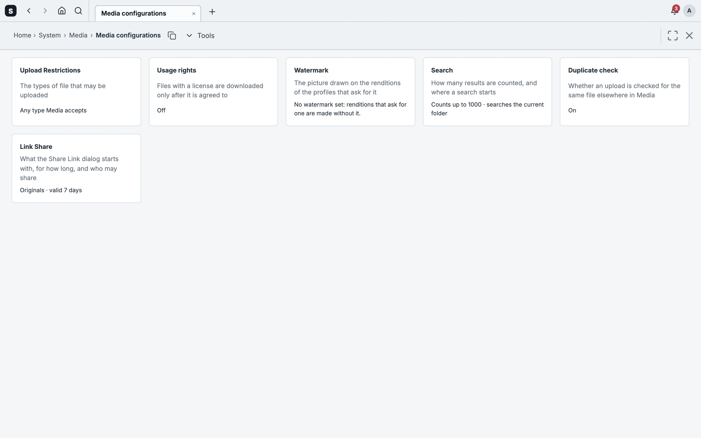

### Upload Restrictions

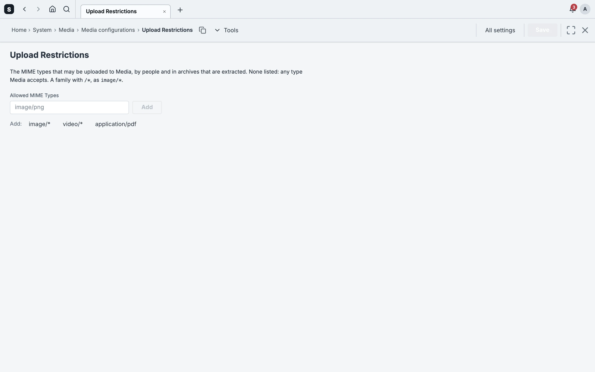

The types of file that may be uploaded, as MIME types. With none listed, Media accepts any type. Type one and choose **Add**, or use the shortcuts under the field. A whole family is written with `/*`, as `image/*`. The list applies to what people upload and to the files taken out of an uploaded archive.

### Usage rights

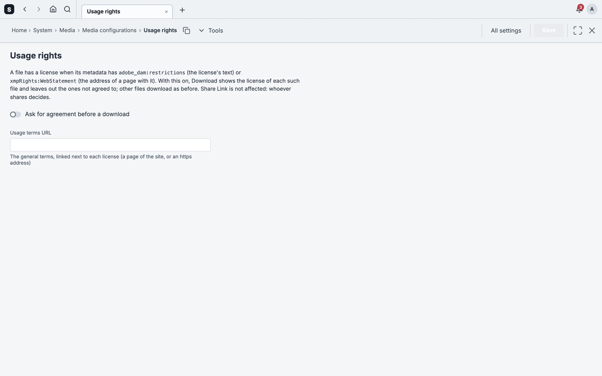

A file has a licence when its metadata has the licence's text (`adobe_dam:restrictions`) or the address of a page with it (`xmpRights:WebStatement`).

| Field | Meaning |
|---|---|
| **Ask for agreement before a download** | On, the Download dialog shows the licence of each such file and leaves out the files whose licence was not agreed to. Other files download as before |
| **Usage terms URL** | Your general terms, linked next to each licence: a page of the site or an `https` address |

With this on and a watermark set, a licensed picture is shown large with the watermark on it. Share Link is not affected: whoever shares decides.

### Watermark

The same watermark as in [Processing Profiles](media-delivery.md): its picture, position, opacity and size.

### Search

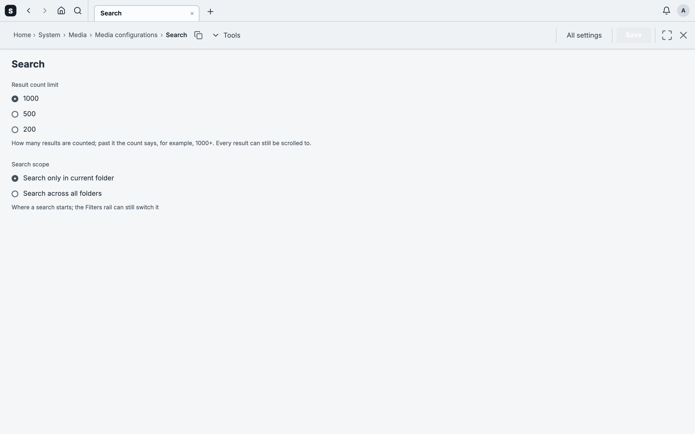

| Field | Meaning |
|---|---|
| **Result count limit** | How many results are counted: 1000, 500 or 200. Past it the count says, for example, *1000+*. Every result can still be scrolled to |
| **Search scope** | Where a search starts: in the current folder, or across all folders. The Filters rail of a search can still switch it |

### Duplicate check

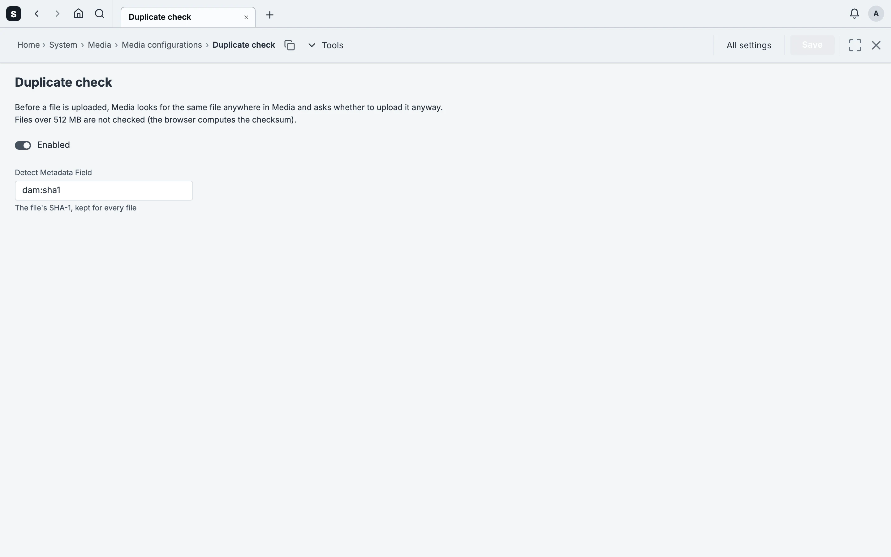

Before a file is uploaded, Media looks for the same file anywhere in Media and asks whether to upload it anyway. Files are compared by their checksum, which Media keeps for every file, so a renamed copy is found too. Files over 512 MB are not checked.

### Link Share

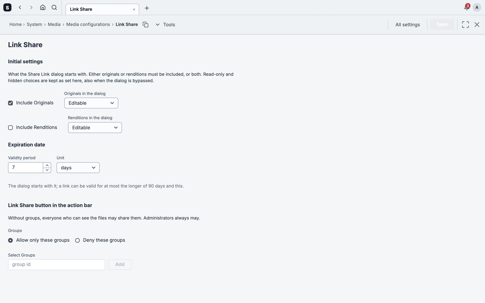

| Section | Meaning |
|---|---|
| **Initial settings** | What the Share Link dialog starts with: **Include Originals**, **Include Renditions**. Each can be **Editable** (the person sharing decides), **Read-only** (shown, but fixed) or **Hidden**. One of the two must be included |
| **Expiration date** | The **Validity period** the dialog starts with, in hours, days, months or years |
| **Link Share button in the action bar** | Who may share. Without groups, everyone who can see the files. With groups: **Allow only these groups** or **Deny these groups**. Administrators always may |

## Shared links

**Share Link**, on a selection in Media, makes an address with which anyone can download those files without an account, until the link expires. **Shared Links** lists your links that still work.

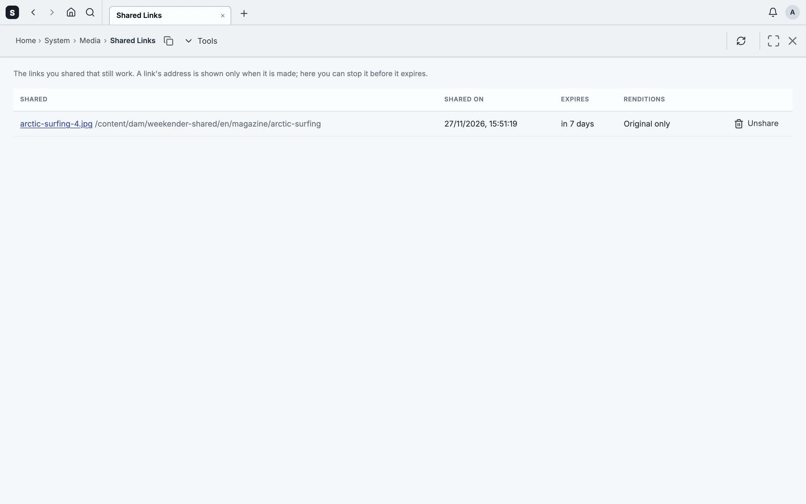

| Column | Meaning |
|---|---|
| **Shared** | The files or folders of the link |
| **Shared on**, **Expires** | When it was made, and how long it still works |
| **Renditions** | What it lets download: the originals, their renditions, or both |
| **Unshare** | Stops the link now |

The address of a link is shown only when the link is made; copy it then. The circular arrow in the bar reads the list again.

## Reports

A report is a table about the files of a folder, made when you ask for it and kept until you delete it. **Create** starts with the kind of report.

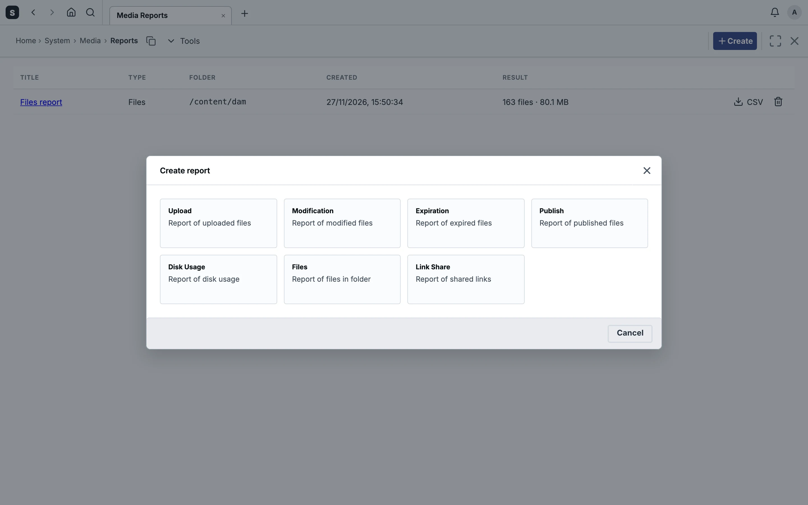

| Report | What it lists |
|---|---|
| **Upload** | The files added in a period |
| **Modification** | The files changed in a period |
| **Expiration** | The files that expire in a period, or that have expired by now |
| **Publish** | The files published in a period |
| **Disk Usage** | The size of each folder, with the folders below it added up |
| **Files** | Every file of a folder |
| **Link Share** | The links that were shared |

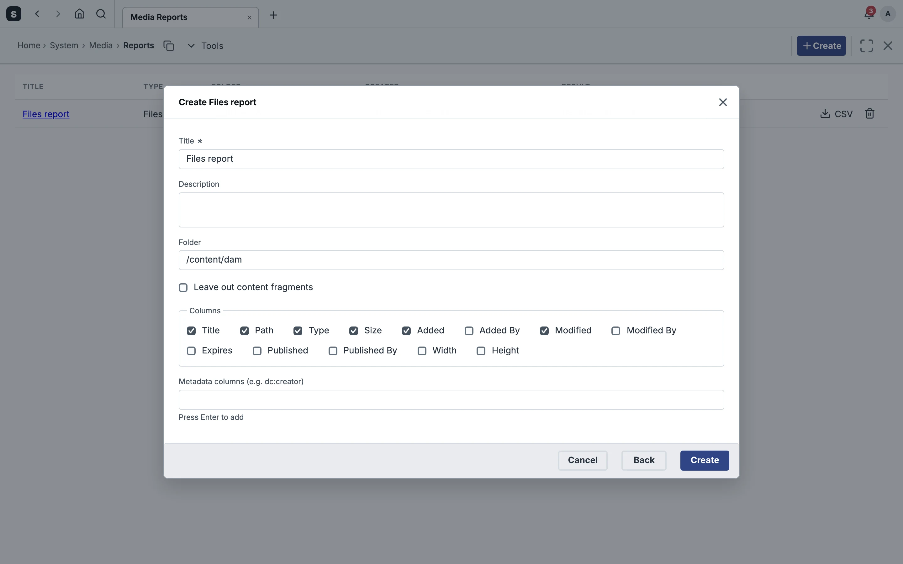

| Field | Meaning |
|---|---|
| **Title**, **Description** | For the list of reports |
| **Folder** | The report covers this folder and the folders below it |
| **Leave out content fragments** | Only files, no records |
| **Columns** | Tick the columns you want: title, path, type, size, who added or changed a file and when, expiry, publishing, width, height |
| **Metadata columns** | Any metadata property as a further column: type its name, such as `dc:creator`, and press Enter |
| **Back**, **Create** | To the kinds of report; make the report |

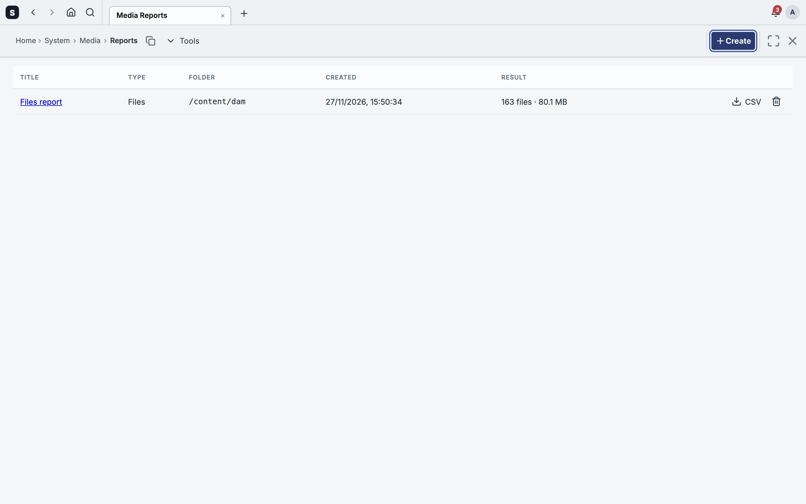

A row shows the kind, the folder, when the report was made and its result in a line. **CSV** downloads the table; the bin deletes the report. Click the title to read it.

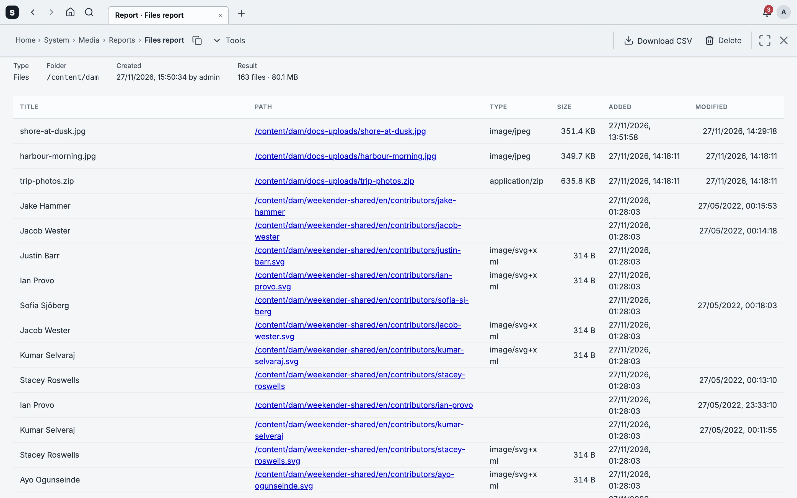

A report shows what its author may see, and only its author and the administrators can open it.

## Collections

A collection groups files for a purpose, such as the pictures of a campaign, without moving them: a file stays in its folder and can be in several collections.

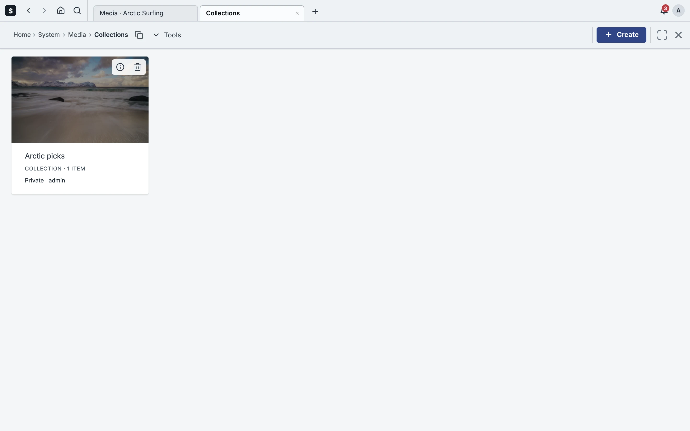

| Action | How |
|---|---|
| Create one | **Create**: a **Title**, a **Description**, and **Public collection** if others should see it. Without the tick, only you see it |
| Add files | Select them in Media and choose **Add to Collection**. See [Media](media.md) |
| Keep a search | A search in Media can be saved as a collection that always shows what the search finds now |
| Open, rename, delete | Click a collection to open it; the buttons on its card open its properties and delete it. Deleting a collection does not delete its files |

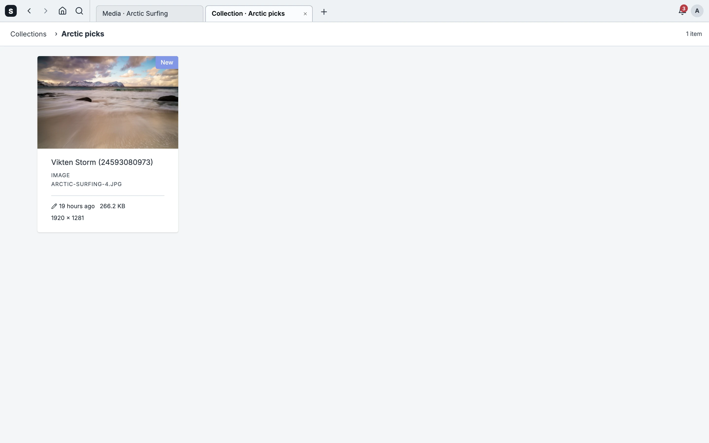

In a collection, **Select** and **Properties** work as in a folder, and **Collections**, at the start of the path, goes back to the list.
