Media is where the files of your sites live: images, video, audio, documents. Everything a page shows comes from here, and everything here is processed, searchable and ready to deliver.

Open it from **Home › Media**.

## The console

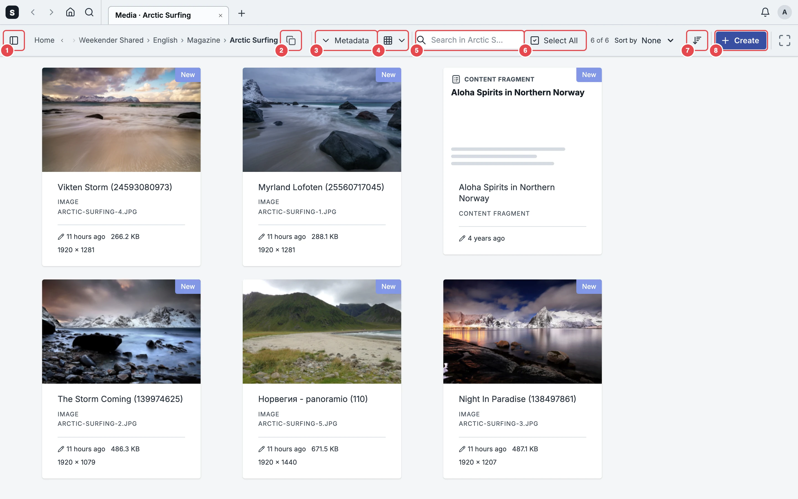

| | Part | What it does |
|---|---|---|
| 1 | **Filters** | Opens the rail at the left that narrows what is shown |
| 2 | **Copy path** | Copies the path of the folder. Left of it are the breadcrumbs; when the path is long, an arrow scrolls it |
| 3 | **Metadata** | **Export Metadata (CSV)** and **Import Metadata (CSV)** for the folder |
| 4 | **View** | Card View, List View or Column View |
| 5 | **Search** | Finds files in this folder and below it, by name, title and the text inside documents |
| 6 | **Select All** | Selects everything shown; beside it, how many items are shown |
| 7 | **Sort** | **Sort by** name, title, date, size or type, and the direction |
| 8 | **Create** | A folder, files (an upload), or a linked copy |

The console remembers the view and the order you chose.

### What a card shows

A card has the picture of the file, its title, its kind and file name, when it was last changed, its size, and for an image its dimensions in pixels. A **New** badge marks what was added recently. Folders are cards too, with pictures from the files inside:

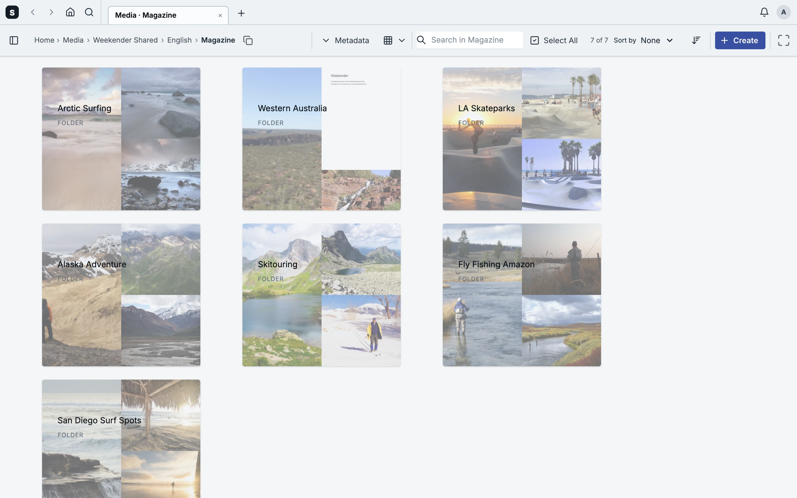

Content fragments kept in Media appear among the files, marked **Content Fragment**; they are described in [Content fragments](content-fragments.md).

Move the pointer over a card for its two buttons: **Select**, and **Properties**. Click the card itself to open the file or go into the folder.

### List and columns

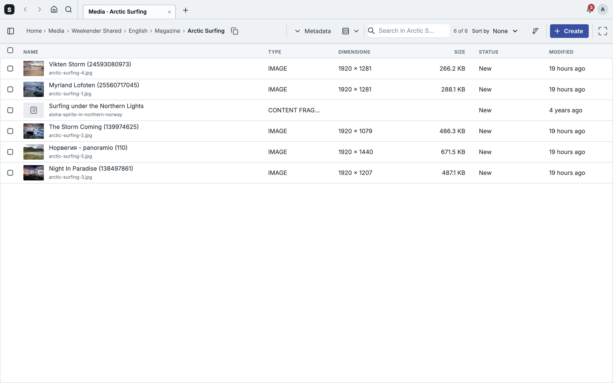

**List View** is a table; click a heading to sort. **Column View** shows one column per folder level, as in Pages:

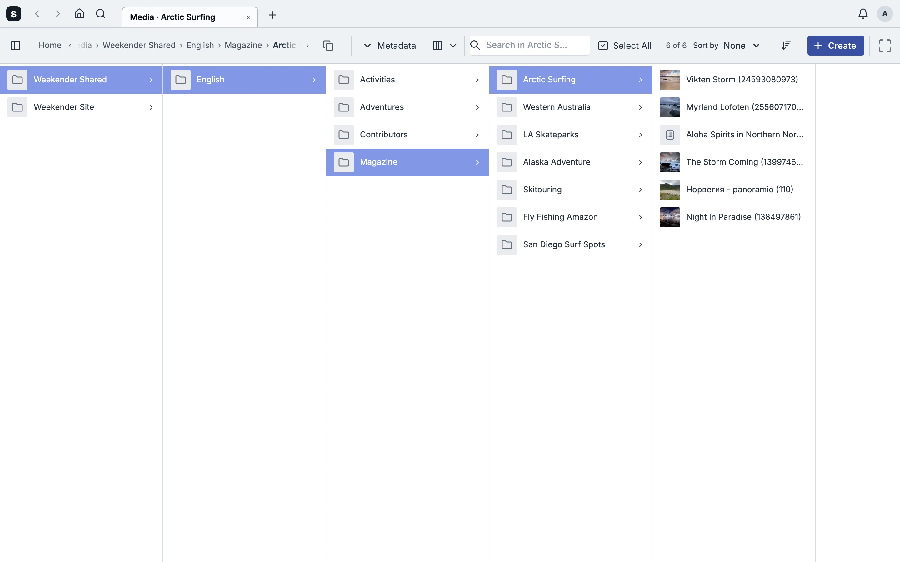

### Filters

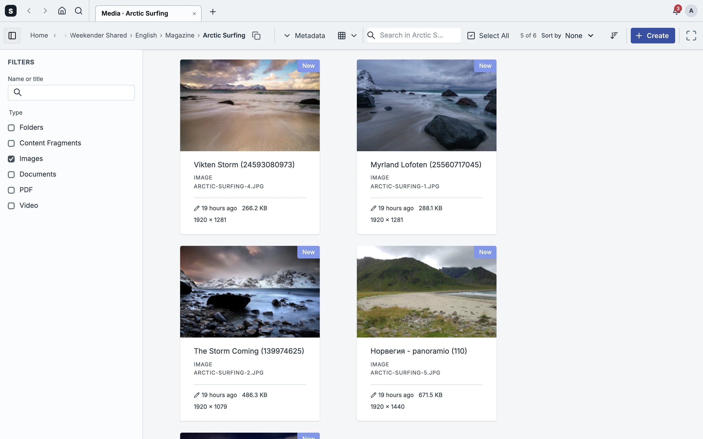

| Filter | Finds |
|---|---|
| **Name or title** | Files whose name or title contains the text |
| **Type** | Folders, Content Fragments, Images, Documents, PDF, Video. Tick one or several |

The filters apply to the folder you are in. Click **Filters** again to close the rail.

## Create and upload

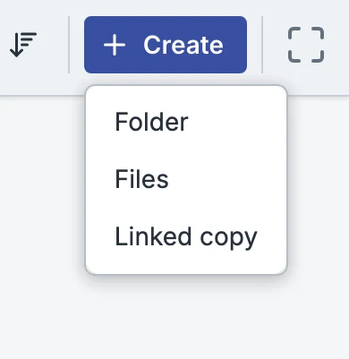

| Create | What you get |
|---|---|
| **Folder** | A new folder. Its name in the address is made from its title |
| **Files** | Choose files from your computer to upload here |
| **Linked copy** | A folder that follows another folder: its files stay in step with the source. See [Several sites](sync.md) |

You can also drop files anywhere on a folder. A panel at the bottom right shows each file and how far it is:

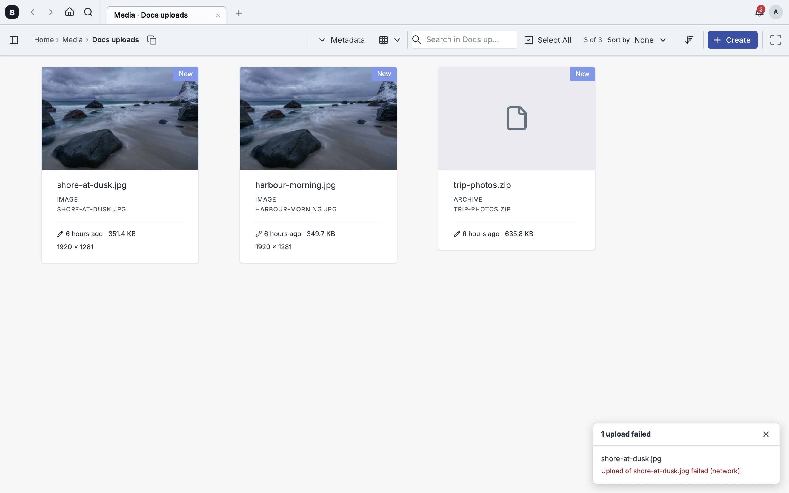

The card of a new file says **Processing** while its thumbnails and web sizes are made, its metadata is read, its main colours are found, and the text inside a document is taken out for the search. A moment later it has its picture and its dimensions, and a **New** badge:

See [Images and delivery](media-delivery.md) for what is made.

### The same file again

Before anything is sent, the console checks whether the *same file*, under any name, is already somewhere in Media, and says where:

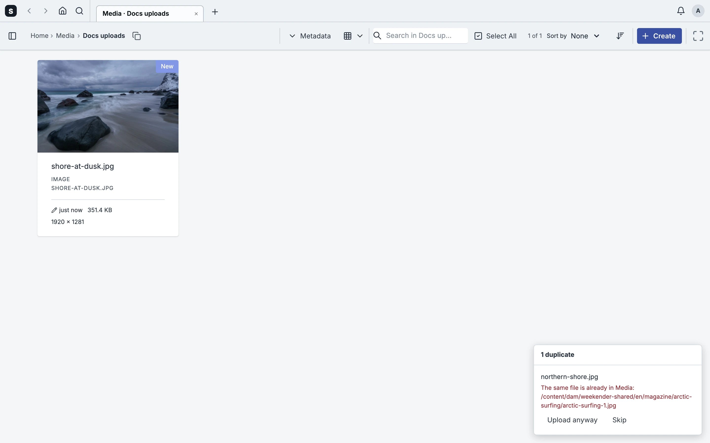

**Upload anyway** goes on; **Skip** leaves the file out.

### The same name again

When a file of the same *name* is already in the folder, you decide for each file:

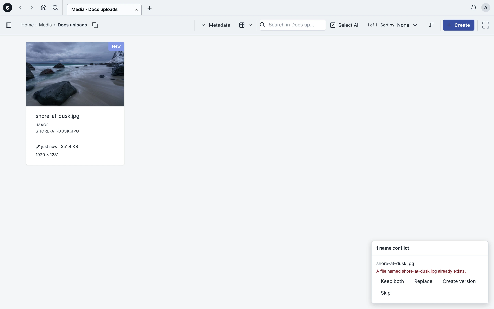

| Choice | Result |
|---|---|
| **Keep both** | The new file gets a numbered name |
| **Replace** | The new file takes the place of the old one |
| **Create version** | The old file becomes a version of the new one, so you can go back |
| **Skip** | Nothing is uploaded |

You see only the actions you are allowed to perform in a folder. A folder you may only read says so, instead of inviting you to drop files into it.

## Select files

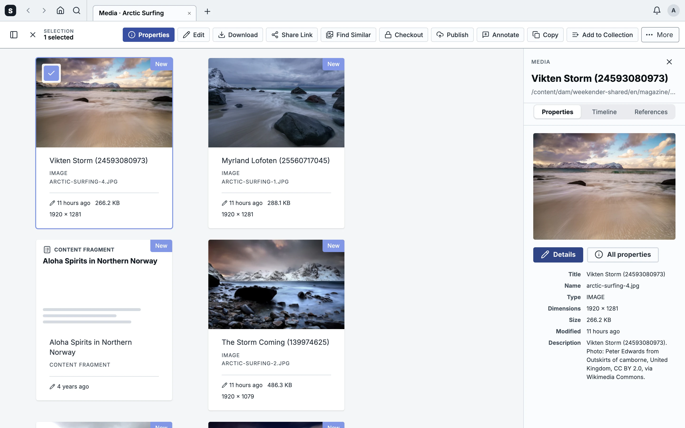

**Select** on a card ticks it. The bar becomes the action bar, and the inspector at the right shows the file: a preview, the buttons **Details** (the file's page) and **All properties**, and its title, name, type, dimensions, size, when it was modified and its description. Its tabs **Timeline** and **References** show its versions and the pages that use it.

| Action | What it does |
|---|---|
| **Properties** | Opens the properties form. With several files, you change them together |
| **Edit** | Opens the image editor |
| **Download** | One file downloads as it is. Several files or folders download as a ZIP, with their renditions if you want |
| **Share Link** | Makes a link with which anyone can download the files without signing in, for a time you set |
| **Find Similar** | Shows the images that look like this one, when the instance has the model for it |
| **Checkout** | Keeps the file to yourself: nobody else can change, move, replace or delete it until you **Check In** |
| **Publish**, **Unpublish** | Puts the file on the live site, or takes it off |
| **Annotate** | Opens the file to draw and write notes on it |
| **Copy** | Remembers the selection; **Create › Paste** puts a copy in another folder |
| **Add to Collection** | Adds the files to a collection: a list of files from anywhere in Media |

**More** holds the rest:

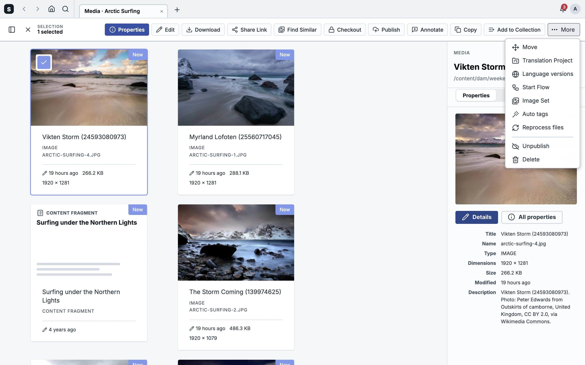

| Action | What it does |
|---|---|
| **Move** | Moves or renames. The pages that use the files are listed, and their references are rewritten so they keep working |
| **Translation Project** | Sends the files' metadata, or the text of documents, to be [translated](translations.md) |
| **Language versions** | The file in the site's other languages |
| **Start Flow** | Sends the files through a [flow](flows.md), such as an approval |
| **Image Set** | Groups the selected images into a set that is delivered as one |
| **Reprocess files** | Makes the thumbnails and web sizes again, and reads the metadata again |
| **Delete** | Warns when pages still use the files, and lists those pages |

### Move or rename

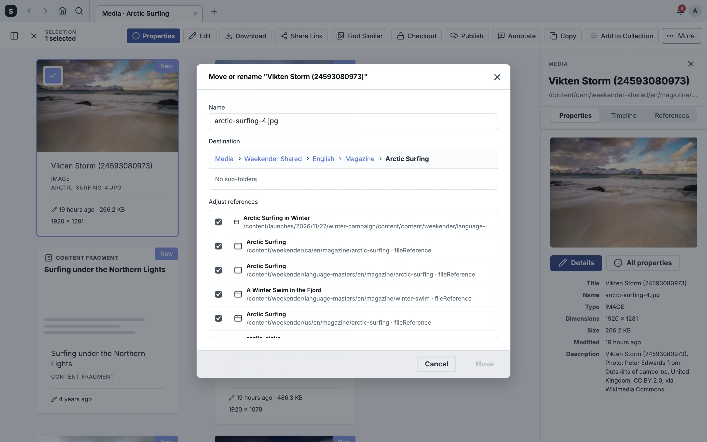

| Field | What it is |
|---|---|
| **Name** | The file's name at its new place. Change only this to rename it |
| **Destination** | Click through the path, and the sub-folders listed below it, to choose the folder |
| **Adjust references** | The pages and fragments that use the file, each with the property that names it. Leave them ticked, and they keep working |

### Share a link

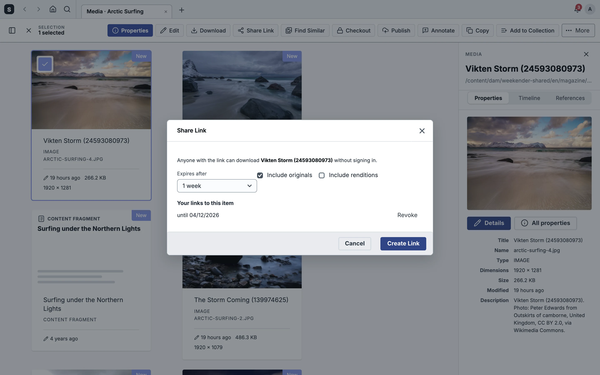

Anyone with the link can download the files without signing in.

| Field | What it is |
|---|---|
| **Expires after** | How long the link works: a week by default |
| **Include originals** | The files as they were uploaded |
| **Include renditions** | Their smaller sizes as well |

**Create Link** makes the link and shows it, ready to copy.

### Download

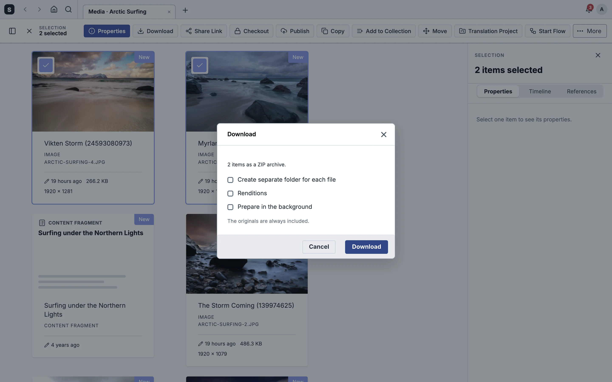

One file downloads as it is. Several files or folders come as a ZIP archive; the originals are always in it.

| Option | What it does |
|---|---|
| **Create separate folder for each file** | Puts each file, with its renditions, in a folder of its own inside the archive |
| **Renditions** | Adds the smaller sizes |
| **Prepare in the background** | For a large download: the archive is made while you go on working, and you are told when it is ready |

### Collections

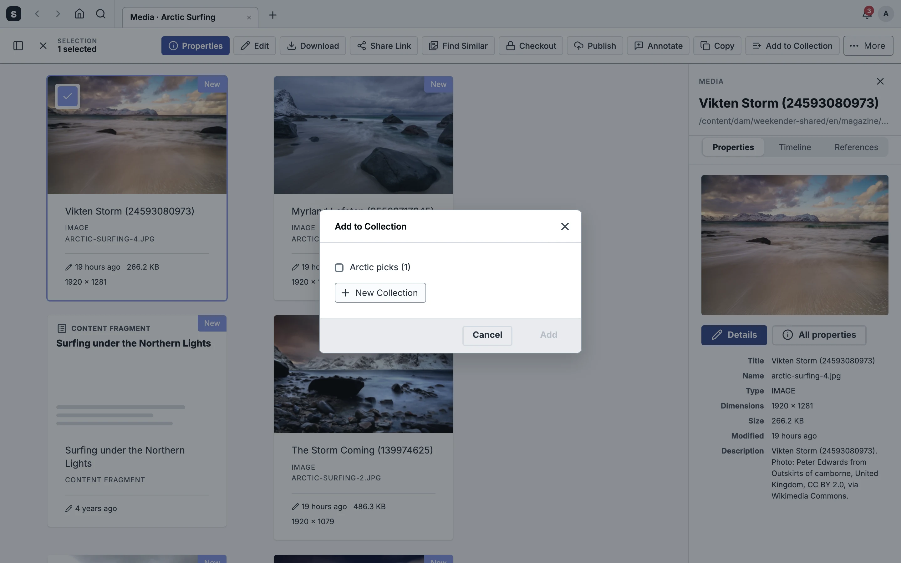

A collection is a list of files from anywhere in Media: the files stay where they are. Choose a collection, or **New Collection**, then **Add**.

### Image sets

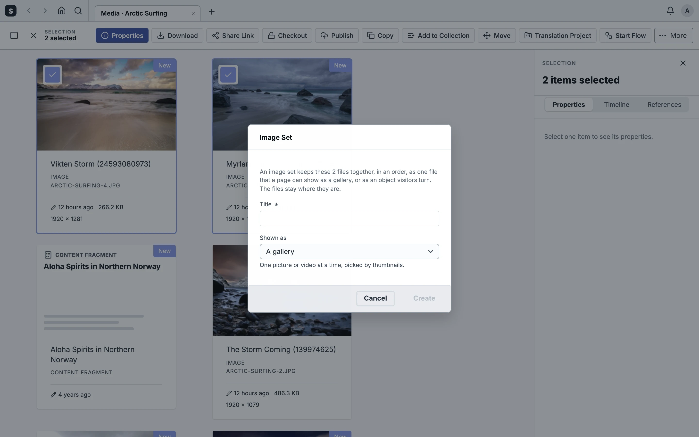

An image set keeps the selected files together, in an order, as one file that a page can show as **a gallery** (one picture or video at a time, picked by thumbnails) or as an object visitors turn. The files stay where they are. Give it a **Title** and choose how it is **shown**.

### Annotate

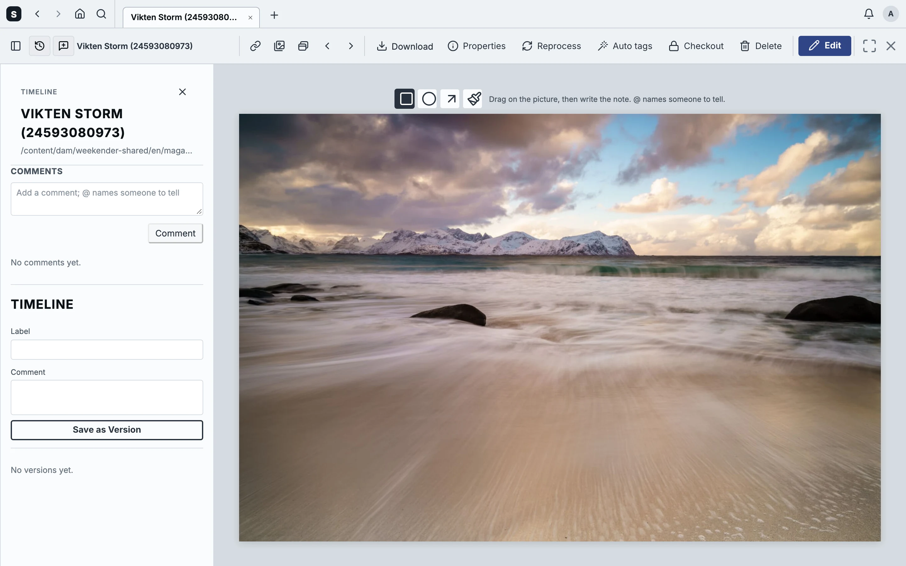

**Annotate** opens the file with drawing tools above it and the comments at the left. Choose a rectangle, a circle or an arrow, drag on the picture, then write the note; `@` names someone to tell. **Comments** at the left takes notes about the file as a whole, and below it the **Timeline** saves a version with a label and a comment.

### Start a flow, language versions

**Start Flow** asks for the flow model, a title and a comment, as for a page. **Language versions** shows the file in the site's other languages and translates its title and description; see [Translations](translations.md).

### Find similar

**Find Similar**, and the **Similar** panel of a file's page, list the pictures that look like this one, the closest first, each with how alike it is in percent. Click one to open it.

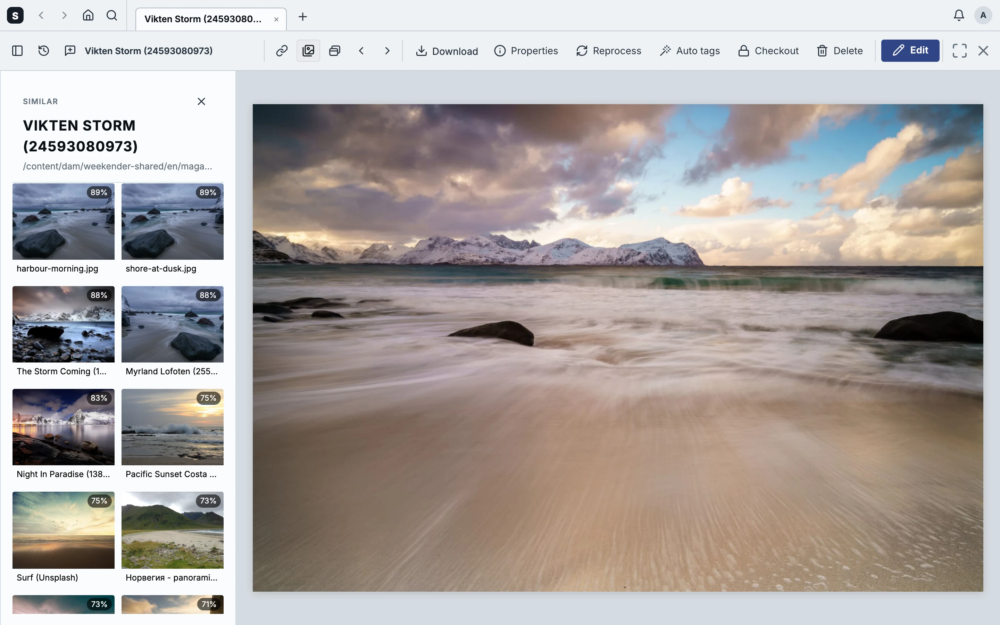

Two things are needed. The instance must have the model that compares pictures: an administrator installs it in **Home › System › Media**, and without it the panel says so. And a picture can only be compared once it has been looked at: new uploads are looked at by themselves, and for the pictures that were in Media before, the panel says how many are waiting and offers **Look at them now**.

Right-click a file for the same actions as a menu:

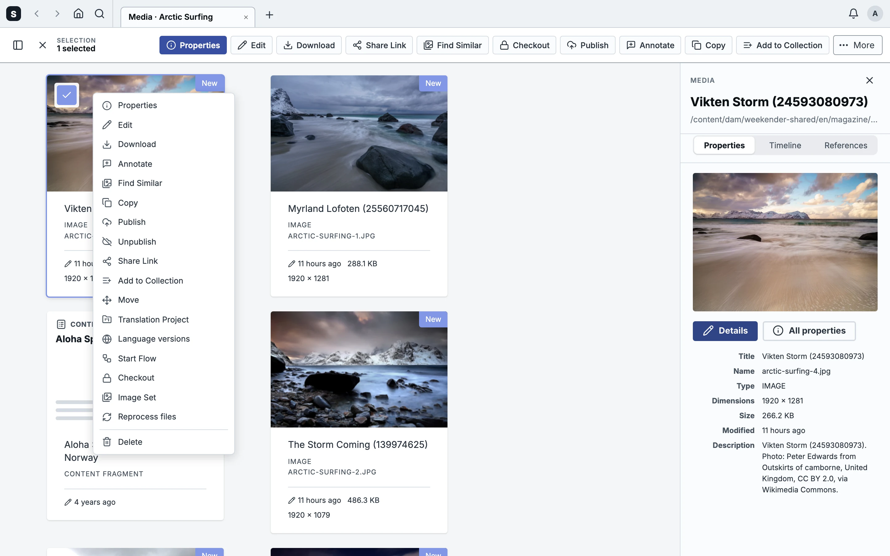

### Extract an archive

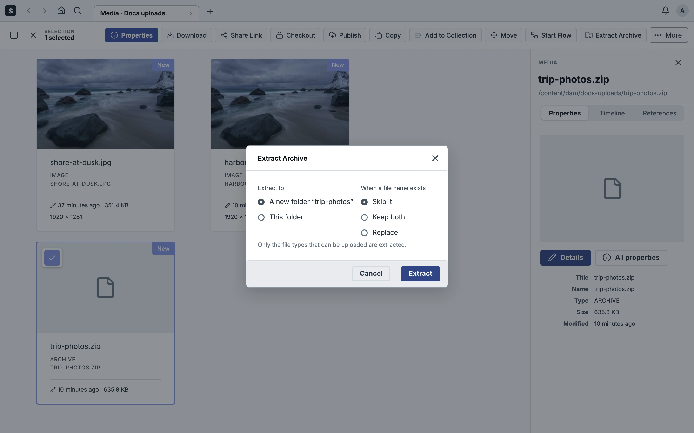

A ZIP file has **Extract Archive** in its bar.

| Option | What it does |
|---|---|
| **Extract to** | **A new folder** named after the archive, or **This folder** |
| **When a file name exists** | **Skip it**, **Keep both** (the new file gets a numbered name) or **Replace** |

Only the file types that can be uploaded are extracted.

### Relate files

Select two or more files and choose **More › Relate** to link them to each other, such as a photo and the release form signed for it. The console confirms how many files were related, and each of them then lists the others in the **Related** panel of its page.

## A file's page

Click a file to open it.

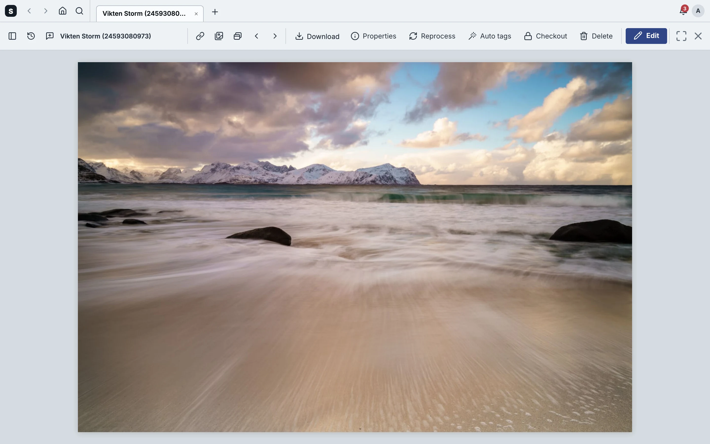

The bar has, from the left: the buttons of the side panels, the file's title, **Copy link**, **Related**, **Similar**, the arrows to the previous and next file of the folder, then **Download**, **Properties**, **Reprocess**, **Auto tags**, **Checkout**, **Delete** and **Edit**. `p` opens the properties, `e` the image editor, and the arrow keys move to the previous and next file. A video or a sound file has a player in place of the picture.

### Renditions

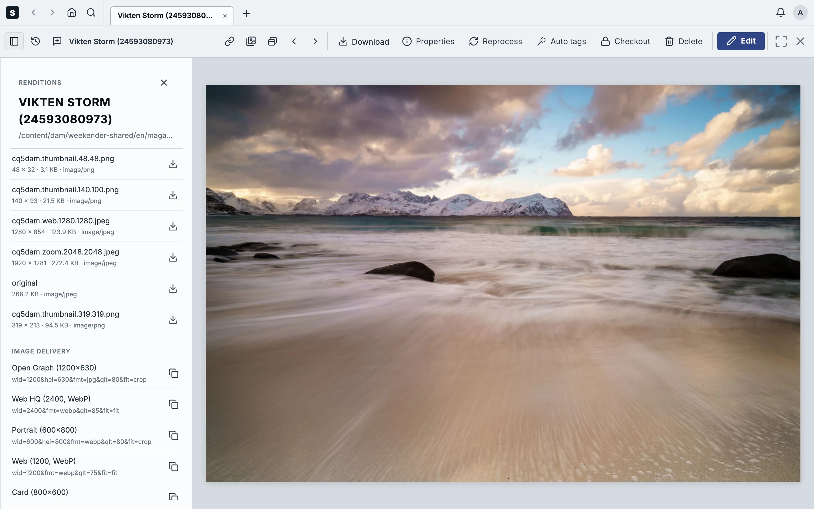

Every size of the file that was made, each with its dimensions, its weight and a download button: the **original**, the thumbnails, and the web sizes.

For an image, **Image delivery** below lists the ready-made delivery addresses, such as *Open Graph (1200×630)* or *Web (1200, WebP)*, each with what it asks for and a button that copies the address. See [Images and delivery](media-delivery.md).

### Timeline

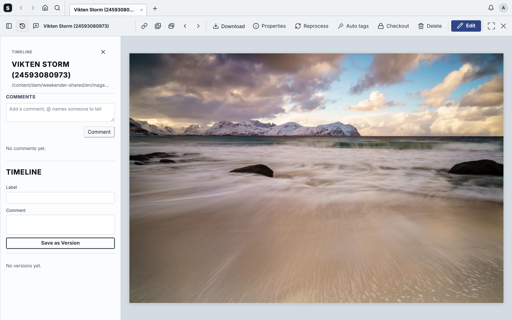

The versions of the file and what happened to it. **Save as Version** takes a label and a comment. **Revert** goes back to a version; the current state is saved as a version first. A version is also made before the image editor changes a file, and when you choose **Create version** at upload.

### Related, Similar, References

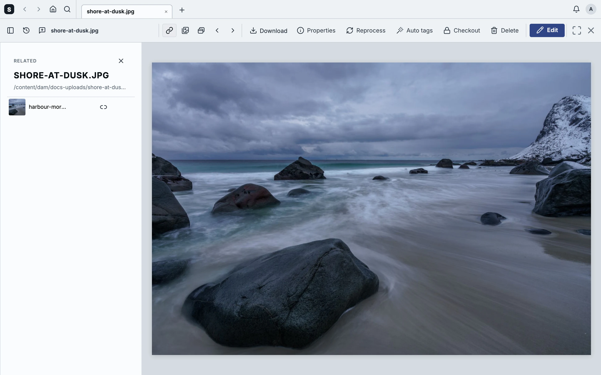

- **Related**: the files linked to this one. Click one to open it; the button beside it takes the link away. Files are linked with **More › Relate** in the console.
- **Similar**: pictures that look like it. See *Find similar* above.
- **References**: the pages and fragments that use the file. Look here before you replace or delete it.

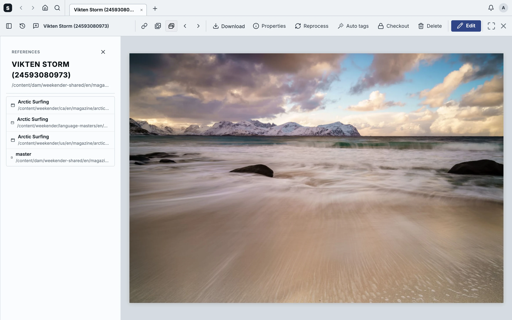

### The image editor

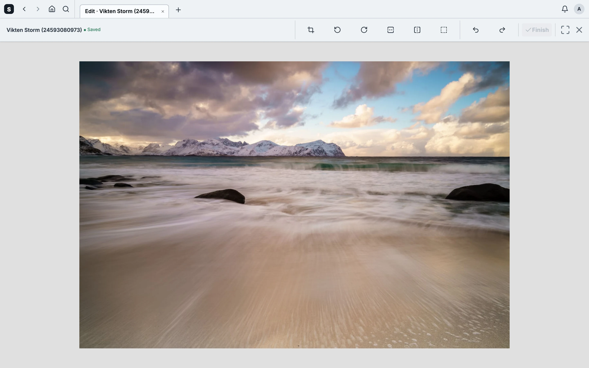

**Edit** opens the image editor: crop, rotate and flip, and draw the areas of an image map. Unlike the crop of an Image component on a page, this changes the file itself; the state before is kept as a version.

## Properties

**Properties** (`p`) holds what is known about a file. The form has the file's picture, title and name at the top, and five tabs.

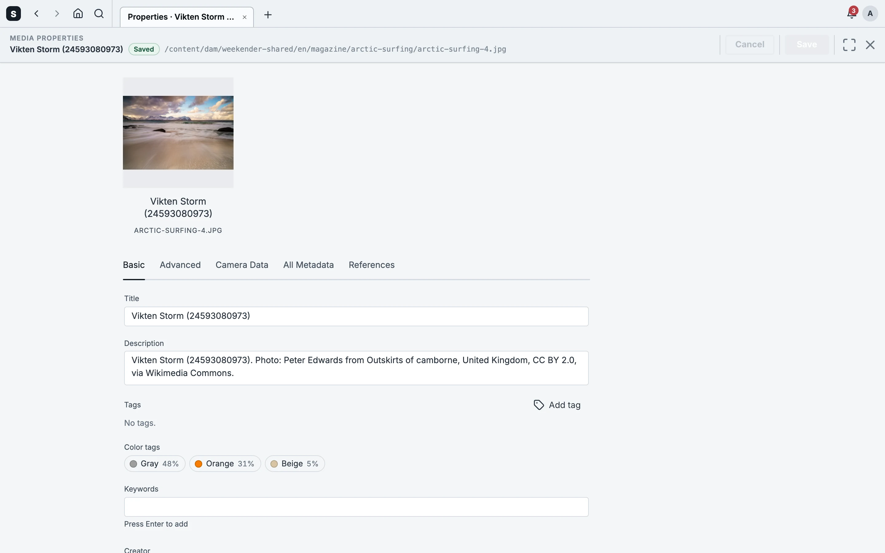

### Basic

| Field | What it is |
|---|---|
| **Title**, **Description** | What the file is called and what it shows. A page can take its alternative text from the description |
| **Tags** | The [tags](tags.md) that classify it. **Add tag** opens the tag picker |
| **Color tags** | The main colours of an image, found when it was processed, each with its share |
| **Keywords** | Free words. Type one and press `Enter` |
| **Creator**, **Contributor** | Who made it, and who helped. Several values each |
| **Language** | The language of the file, as a code such as `en` or `de-CH` |
| **Copyright** | The rights line or licence |
| **Expires** | After this day the file is marked *Expired*, and its page says where it is still used |

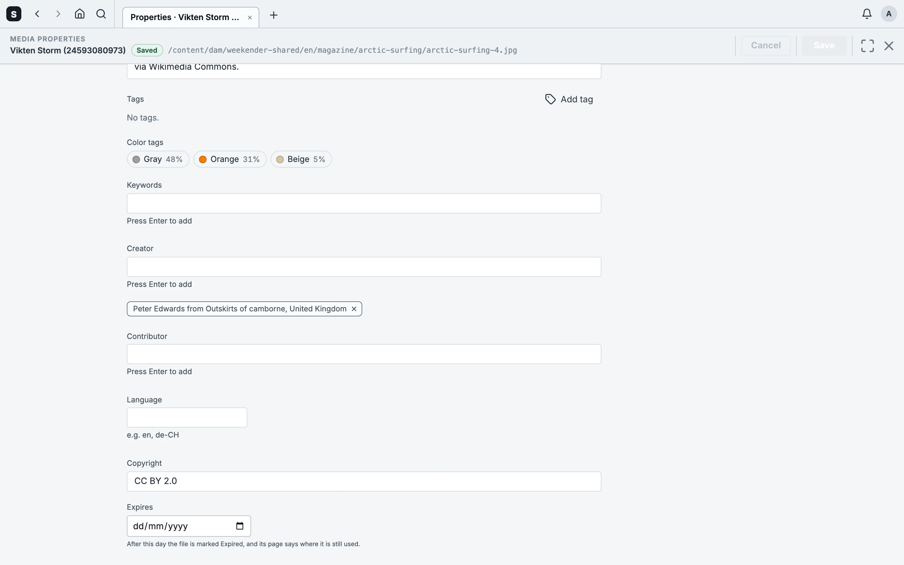

Much of this is read from the file itself when it is uploaded.

### Advanced

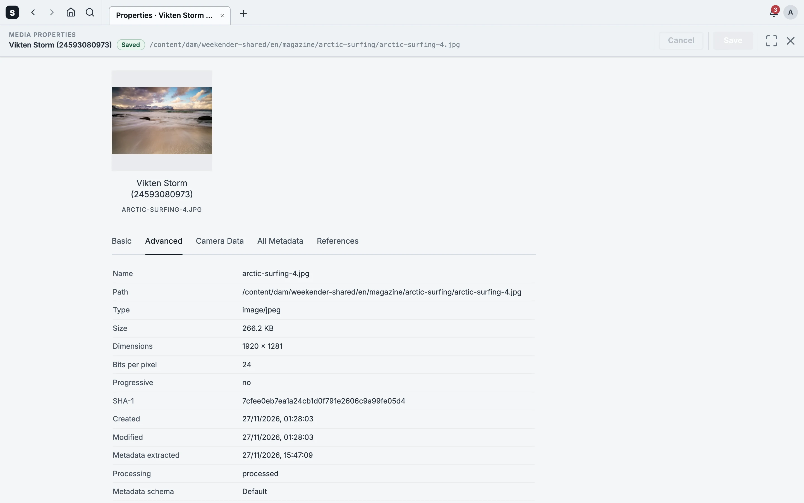

Facts about the file that you cannot change here: its name and path, type, size, dimensions, bits per pixel, a checksum (SHA-1), when it was created, modified and processed, and the metadata schema its form uses.

### Camera Data, All Metadata, References

- **Camera Data**: what the camera wrote into a photo, in words: camera maker and model, lens, exposure time, aperture, ISO, when it was taken, its size in pixels, its colour space, and the position if the camera recorded one. A picture that went through an editor or a website often has none left; the tab then says so.
- **All Metadata**: every property stored with the file, with its technical name.
- **References**: the pages that use the file.

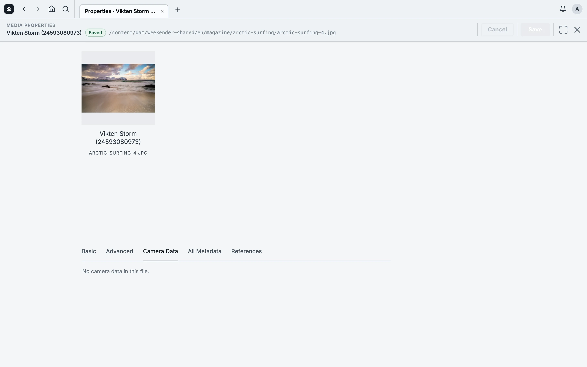

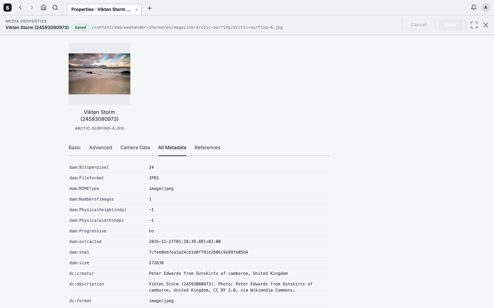

### Several files at once

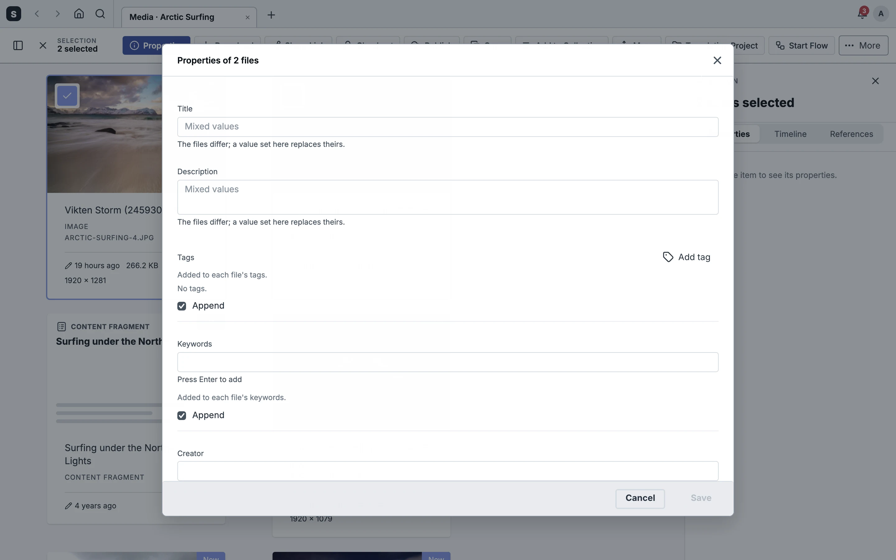

Select several files and choose **Properties** to change them together. Fields whose values differ say **Mixed values**: a value you set there replaces theirs, and what you leave alone stays as each file has it. For **Tags**, **Keywords** and the other lists, **Append** adds your values to each file's own; untick it to replace them.

### Edit metadata in a spreadsheet

**Metadata › Export Metadata (CSV)** gives you a file with one row per file and one column per property.

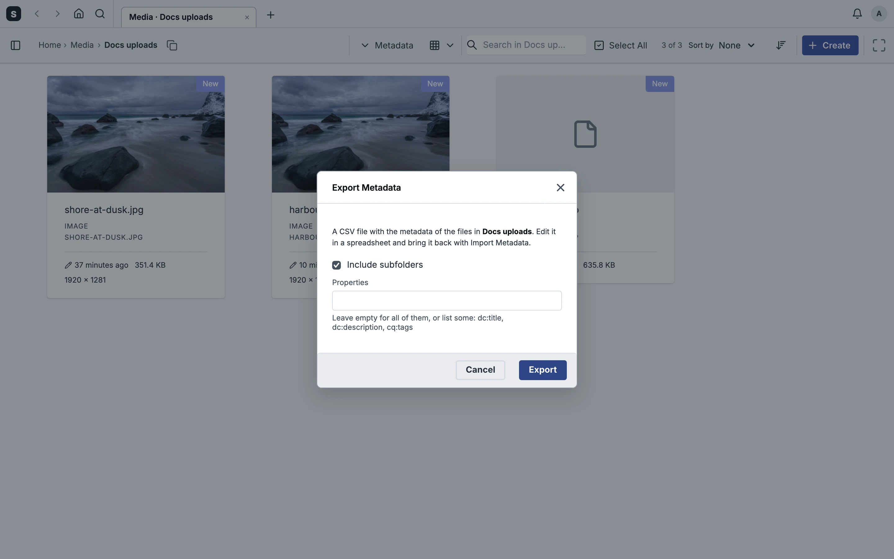

| Option | What it does |
|---|---|
| **Include subfolders** | Also the files of the folders below |
| **Properties** | Leave empty for all of them, or list some, such as `dc:title, dc:description, cq:tags` |

Edit the file in a spreadsheet, then bring it back with **Metadata › Import Metadata (CSV)**:

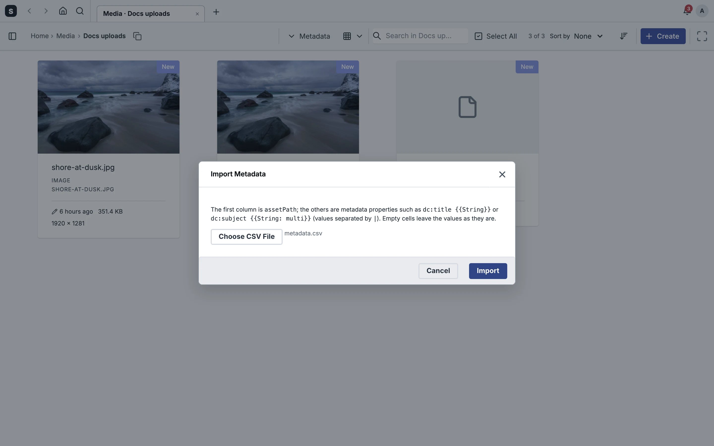

The first column is `assetPath`; the others are properties, named as in the export, such as `dc:title {{String}}` or `dc:subject {{String: multi}}`, where several values are separated by `|`. Empty cells leave the values as they are. **Choose CSV File**, then **Import**; the result says how many files were updated, and lists the rows that failed.

An administrator can design the properties form: which tabs and fields it has, which are required, which are dropdowns. That is a **metadata schema**, set per folder. See **Home › System › Media**.

## Folder settings

**Properties** on a folder's card sets what applies to every file in it and in the folders below.

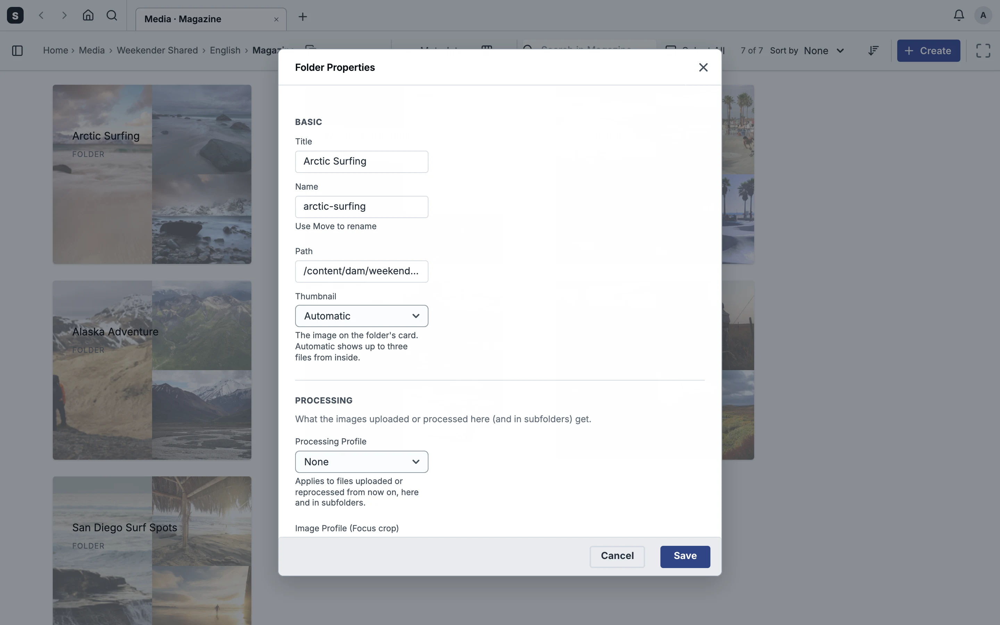

| Section | Field | What it does |
|---|---|---|
| **Basic** | **Title** | The folder's name in Media |
| | **Name**, **Path** | Its place in the address. Use **Move** to rename |
| | **Thumbnail** | The image on the folder's card. *Automatic* shows up to three files from inside |
| **Processing** | **Processing Profile** | Extra renditions to make for the files uploaded or reprocessed here |
| | **Image Profile (Focus crop)** | The crops around the subject to make for the images here |
| **Metadata** | **Metadata Schema** | Which Properties form the files here get |
| | **Metadata Profile** | Values new files start with, such as a copyright line, for what a file does not bring itself |
| | **Folder Metadata Schema** | Fields of its own for this folder and the folders below |
| **Members** | **Make folder private** | Limits the folder to its members. Everyone who works in Media sees a folder that is not private; members get more than that |

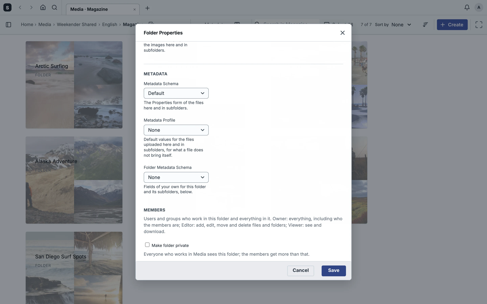

Members are users and groups with a role in the folder and everything in it: an **Owner** may do everything, including choosing the members; an **Editor** adds, edits, moves and deletes files and folders; a **Viewer** sees and downloads.
