The page editor shows the page as visitors will see it, with a thin layer on top that lets you select and change every component. What you change is saved at once; there is no Save button.

To open it, select a page in the Pages console and choose **Edit** (or press `e`).

## The screen

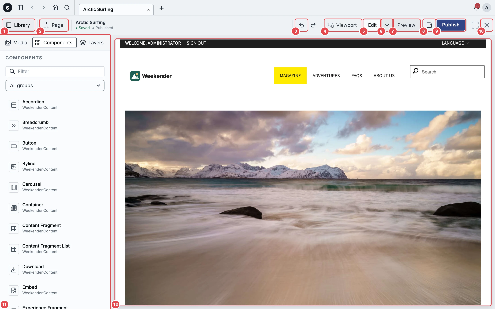

| | Part | What it does |
|---|---|---|
| 1 | **Library** | Shows and hides the panel at the left |
| 2 | **Page** | The menu for the page as a whole: properties, lock, publish, template, flow, release |
| 3 | **Undo**, **Redo** | `Cmd+Z` and `Shift+Cmd+Z` (`Ctrl+Z` and `Ctrl+Y` on Windows and Linux) |
| 4 | **Viewport** | Shows the ruler of screen sizes above the page |
| 5 | **Edit** | The mode you are in. Click it to come back from Preview |
| 6 | **The arrow beside it** | Chooses another mode: Layout, Developer, Personalize, History |
| 7 | **Preview** | The page as a visitor uses it |
| 8 | **Add annotation** | Puts a note on the selected component |
| 9 | **Publish** | Publishes the page |
| 10 | **Close** | Leaves the editor. Left of it, **Full screen** hides everything but the editor |
| 11 | **The Library** | Three tabs: Media, Components and Layers |
| 12 | **The page** | Click a component to select it |

Between **Page** and the buttons at the right, the bar shows the page's **title** and two states: **Saved**, which turns to *Saving…* while a change is written, and where the page stands: **Draft**, **Published**, or changed since it was published.

A **status bar** appears under the bar when there is something to know about the page: it is in a flow, someone else has locked it, or it is a linked copy. For a linked copy it names the source and when the page was last synchronized, with a **Linked copy Status** button.

Above the page, **Selected** names the component you selected, with the containers around it; click one of them to select it instead.

## The Library

### Components

The list of components you can put on this page, each with its group. **Filter** narrows the list as you type; the selector below it shows one group. The `i` on a row describes the component.

To add one, drag it to the place you want it on the page. A line shows where it will land.

### Media

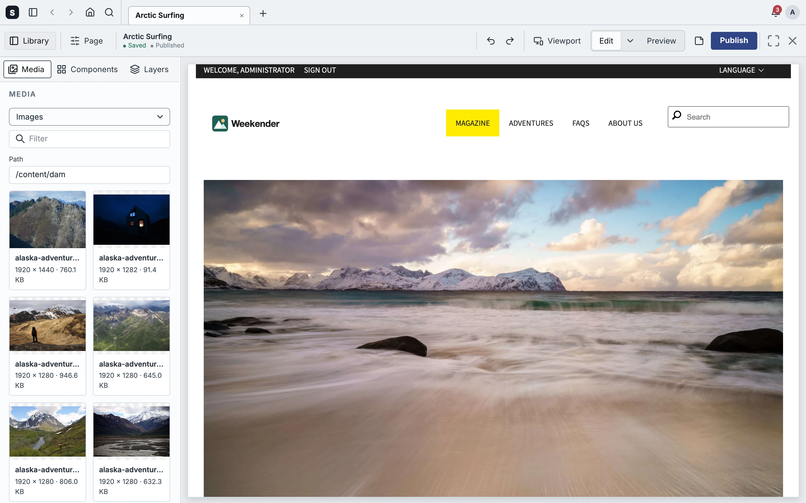

The files of [Media](media.md), to drag onto the page. Search by name, or go into a folder. An image dropped on the page becomes an Image component; dropped on an image that is already there, it replaces the picture.

### Layers

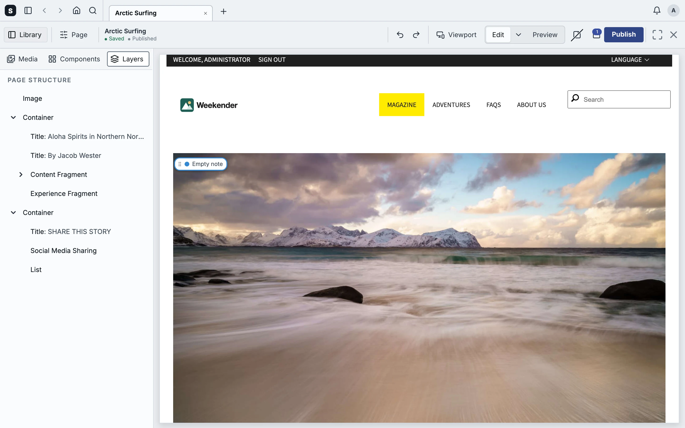

The structure of the page as a tree: every container with the components inside it, each named by its type and the start of its text. Click a row to select the component on the page, also when it is hidden inside a tab or an accordion: the editor opens the panels around it for you. The arrow beside a container folds it.

**Library** in the bar hides the panel, so that the page gets the whole width:

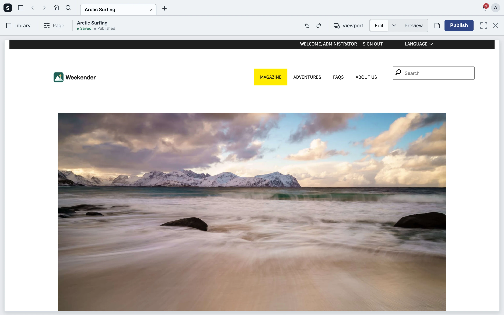

## Select and change a component

Move the pointer over the page: the component under it is outlined, and its name is shown. Click to select it. A toolbar opens above it with what you can do; only the actions the component supports are shown.

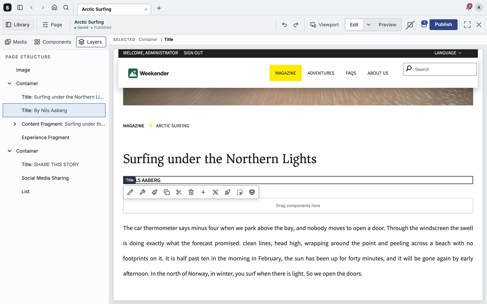

| Action | What it does |
|---|---|
| **Edit** | Edits the component in place: type in a title, format a text, crop an image |
| **Configure** | Opens the component's dialog, with all of its settings |
| **Styles** | Chooses among the looks the template allows for this component |
| **Select panel** | For tabs, accordions and carousels: shows another panel, or reorders the panels |
| **Copy**, **Cut**, **Paste**, **Delete** | Paste inserts before the selected component |
| **Insert component** | Adds a component here, from the ones allowed in this container |
| **Group** | Selects several components, so the next action applies to all. `Cmd`-click does the same |
| **Parent** | Selects the container around the component |
| **Layout** | Switches to Layout mode for this component |
| **Convert to experience fragment variant** | Moves the selection into a new [experience fragment](experience-fragments.md) and leaves a reference in its place |
| **Sync changes** | On a page that is a source: sends this component's changes to its linked copies |
| **Cancel inheritance**, **Re-enable inheritance** | On a linked copy: lets you change the component here, or gives it back to the source |

Double-click a component to edit it in place. If it cannot be edited in place, its dialog opens.

### Styles

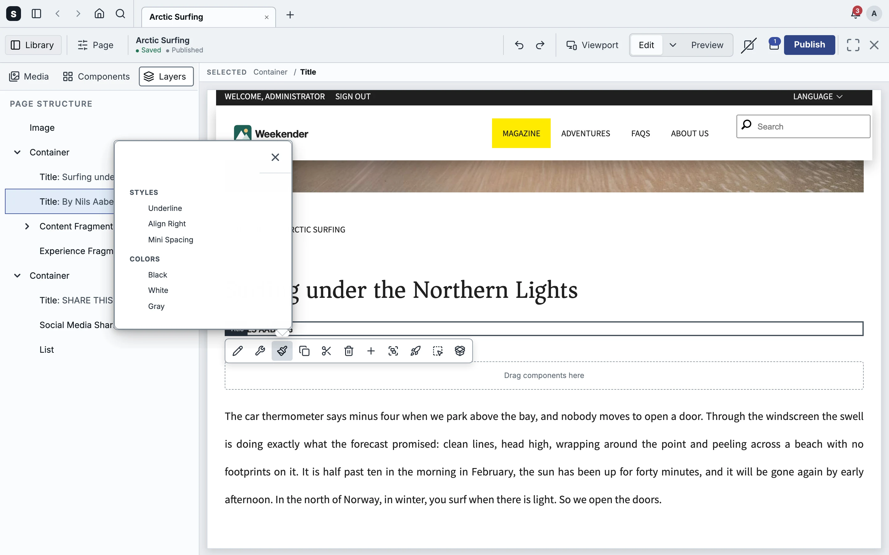

**Styles** opens the looks the template allows for this component, in the groups its configuration defines. Click one to switch it on, click it again to switch it off; one of each group can be on. The `×` closes the list. A component without styles has no such button.

### Edit in place

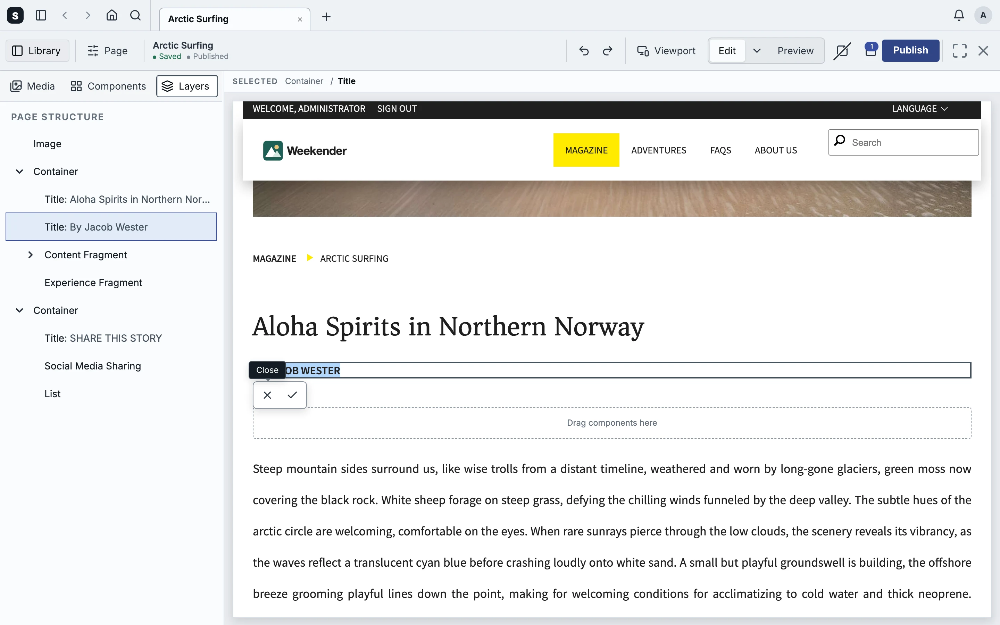

A title becomes a field you type in, with two buttons below it: the cross discards what you typed, the tick saves it. `Esc` and `Enter` do the same.

A text shows a small toolbar with the formats the site allows: bold, italic, lists, links, paragraph styles. Click the tick in that toolbar, or simply click somewhere else on the page, to save.

Editing an image in place opens the image tools:

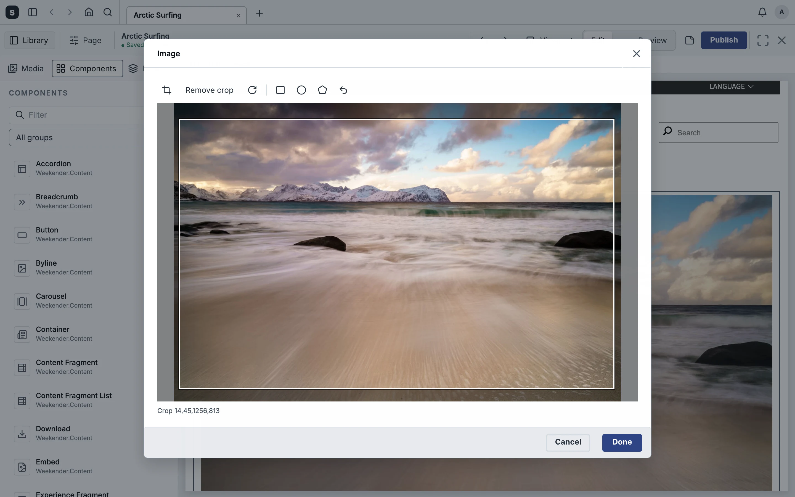

| Tool | What it does |
|---|---|
| **Crop** | Draws the frame of what is kept; drag its corners. Sites can offer fixed aspect ratios. The numbers below the picture are the frame's position and size |
| **Remove crop** | Shows the whole picture again |
| **Rotate** | Turns the picture a quarter |
| **Rectangle**, **Circle**, **Polygon** | Draw an area of an image map on the picture and give it a link: a visitor who clicks there follows it |
| **Undo** | Takes back the last step |

**Done** saves, **Cancel** discards. The original file is never changed: the crop is applied when the image is served.

### The dialog

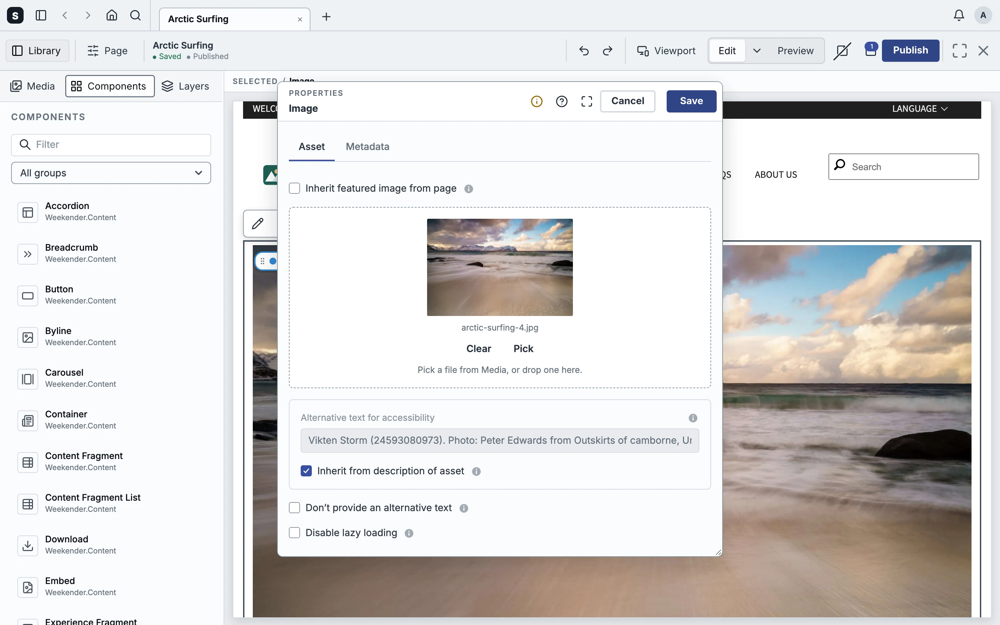

**Configure** opens the component's dialog in a window that floats over the page. Its fields are the component's own, often on several tabs: the picture shows the Image component with **Asset** and **Metadata**.

| Part | What it does |
|---|---|
| **The title bar** | Drag it to move the dialog aside: to see the page behind it, or to drag an image from the Library into one of its fields |
| **The first round button** | Says what is not filled in correctly, when something is |
| **?** | Help for the component |
| **The square button** | Makes the dialog fill the window, and back |
| **Cancel**, **Save** | Discards or saves. Nothing changes on the page before you save |
| **The corner at the bottom right** | Drag it to resize the dialog |

A small `i` beside a field explains it. A file field, like the image above, takes a file dropped from the Media tab, or **Pick** to choose one; **Clear** empties it.

### Insert a component

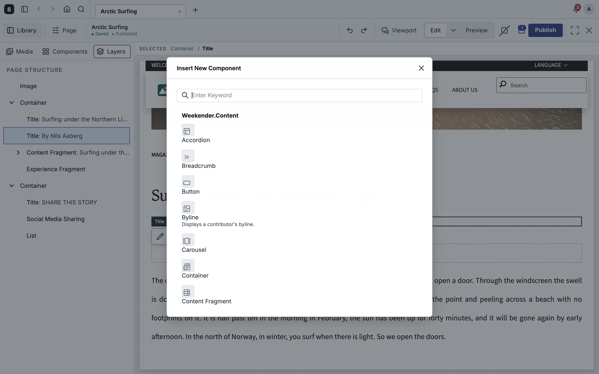

**Insert component** opens **Insert New Component**: the components allowed in the container you are in, by group, each with a line that says what it shows. Type a keyword to narrow the list, and click a component: it is added before the selected one.

Every container ends with a slot that says **Drag components here**. A component that is still empty, such as an image without a file, is shown as a labelled box so you can select it and fill it in.

### Move

Drag a component to a new place on the page, or to another container. A line shows where it will land.

Some parts of a page cannot be selected: the ones its template keeps fixed, usually the header and the footer. They are the same on every page made from that template. To change them, use **Edit Template** in the page menu. See [Templates](templates.md).

### Tabs, accordions and carousels

These show one panel at a time. To work on another panel, select the container and choose **Select panel**: click a panel to show it, or drag one to change the order.

## The viewport ruler

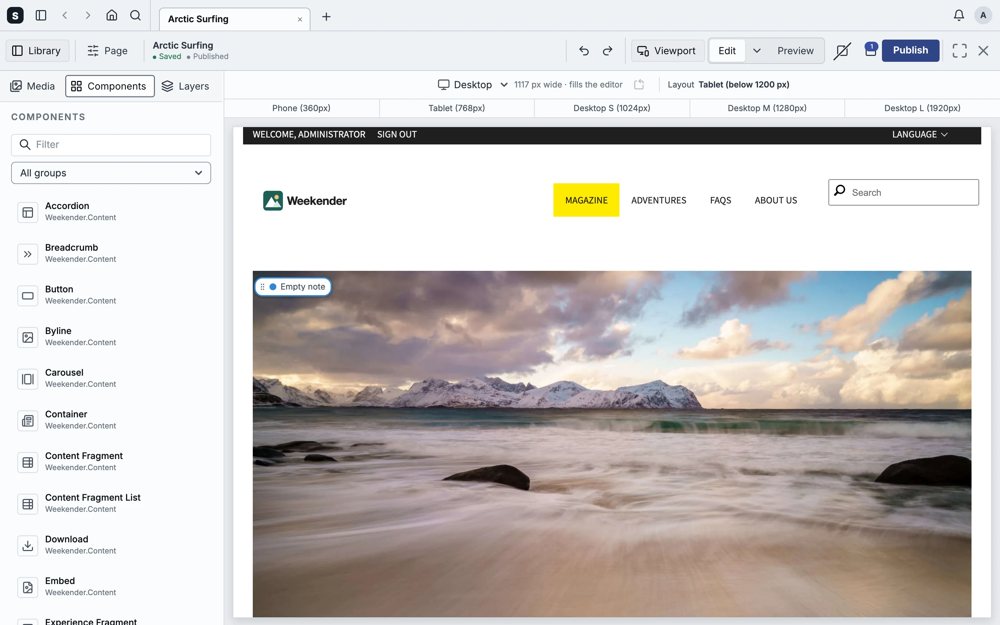

**Viewport** shows a ruler above the page.

- At its left, the selector chooses a device, or **Responsive** for any width you type. Beside it stands the width the page is shown at, and a button that turns the device on its side.
- The ruler marks the widths of **Phone**, **Tablet**, the desktop sizes. Click a mark to see the page at that width.
- **Layout** at the right says which of the template's layouts applies at this width.

## Modes

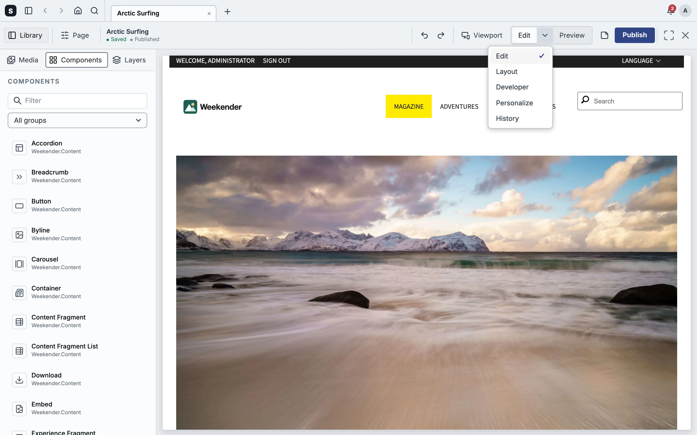

The arrow beside **Edit** changes what the editor is for.

| Mode | Use it to |
|---|---|
| **Edit** | Change content. The default |
| **Layout** | Set how wide each component is, and where it sits, for each screen size |
| **Developer** | Inspect a component: its path, its type, its dialog and configuration, and any script errors on the page |
| **Personalize** | Show a different experience to each audience |
| **History** | See the page as it was at an earlier date |

**Preview**, beside the mode, is separate: one click in, one click on **Edit** back out.

### Layout

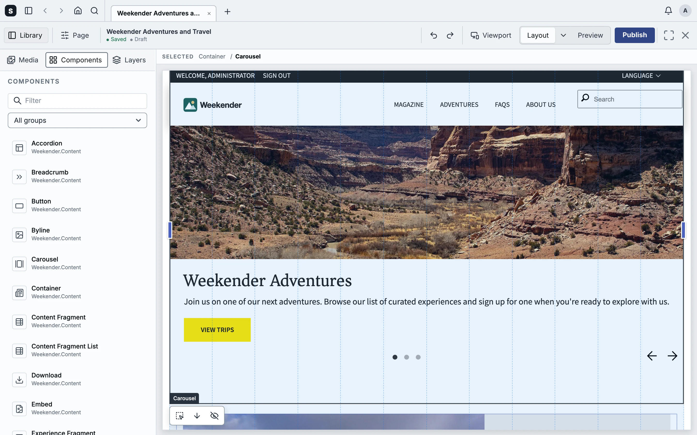

In **Layout** mode the toolbar of a selected component holds only what concerns its place. A component that sits in a container with a grid shows handles at its sides: drag them to make it narrower or wider, or to push it to the right; it snaps to the columns of the grid. The toolbar adds **Float to new line**, **Hide component**, **Show hidden components** and **Revert breakpoint layout**.

A layout belongs to one screen size. Choose a width in the viewport ruler first: what you then change applies to that size only.

### Developer

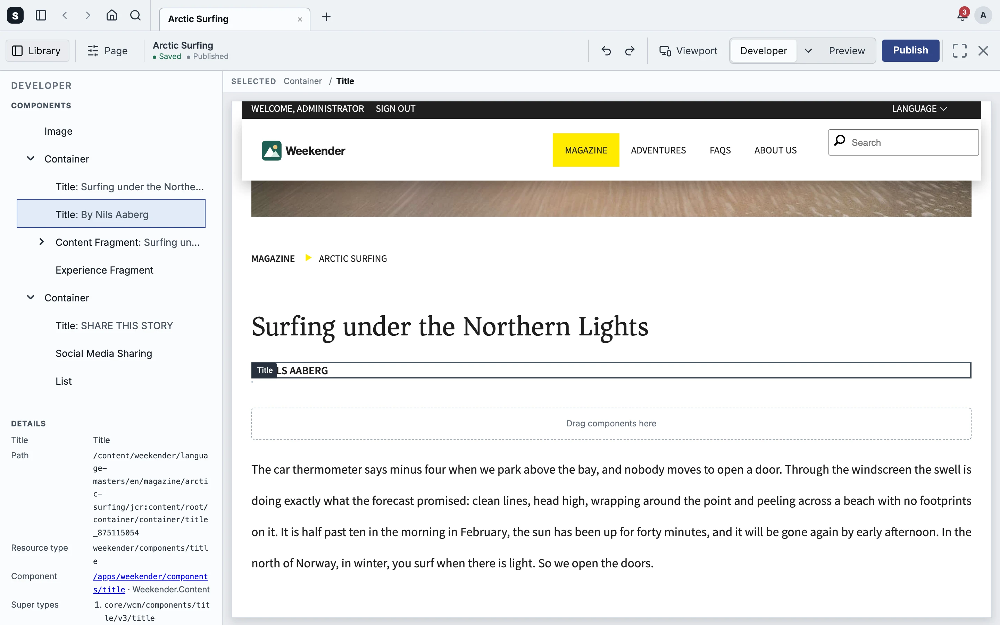

The panel at the left becomes the tree of components. Select one, on the page or in the tree, and **Details** shows its title, its path in the repository, its resource type, the component it is made by (a link to it), the components that one builds on, its dialogs, and the container it is in. **Errors** lists what the page's scripts reported.

### Personalize

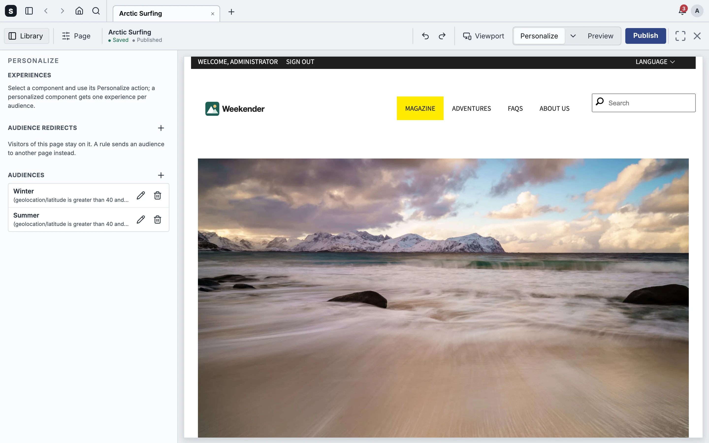

| Section | What it holds |
|---|---|
| **Experiences** | Select a component and use its **Target** action: a targeted component gets one experience per audience |
| **Audience redirects** | Visitors of this page stay on it; a rule sends an audience to another page instead |
| **Audiences** | The audiences of the site, with their rules. The `+` adds one; the pencil and the bin change and delete |

See [Personalization](personalization.md).

### History

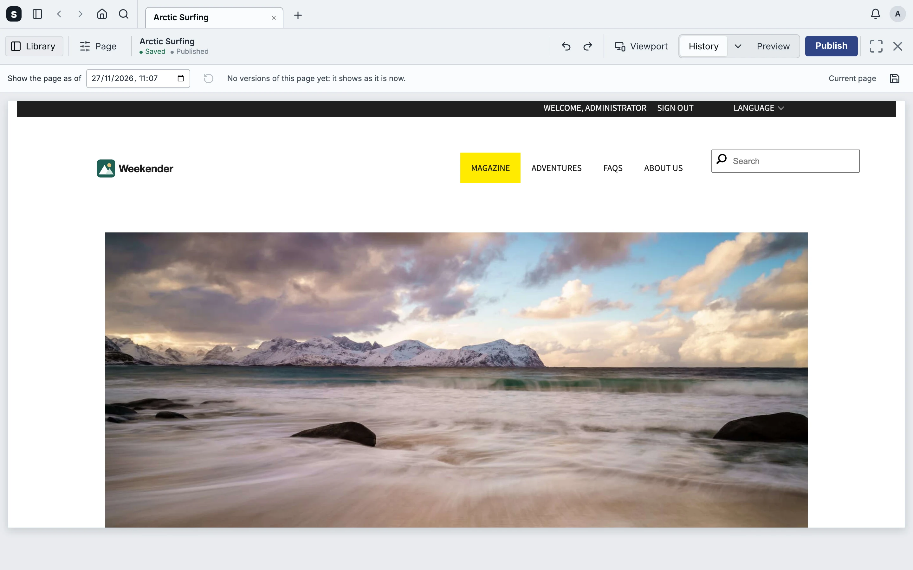

**Show the page as of** takes a date and a time; the page is shown as it was then. The bar says when there are no versions yet. **Current page** returns to today's page, and the button at the right saves a version of the page as it is.

### Preview and the visitor simulator

In **Preview** the page works as it does for a visitor: links lead somewhere, and nothing can be selected. The bar keeps **Viewport**, and adds **Visitor**:

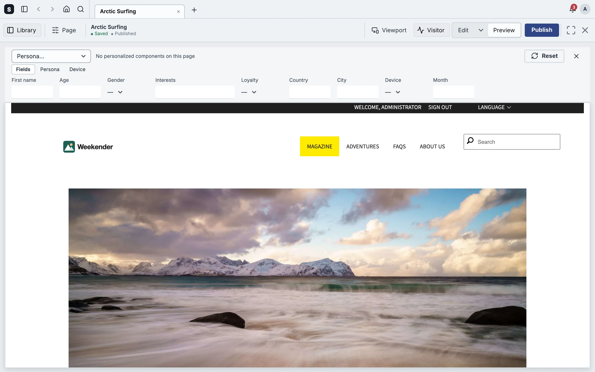

The simulator lets you look at the page as a particular visitor. Personalized components show the experience that visitor would get; the bar says when the page has none.

| Part | What it does |
|---|---|
| **Persona…** | Fills everything in from a prepared visitor |
| **Fields** | The visitor piece by piece: first name, age, gender, interests, loyalty, country, city, device, month |
| **Persona**, **Device** | The prepared visitors and devices to choose from |
| **Reset** | Back to yourself |
| `×` | Closes the simulator |

## The page menu

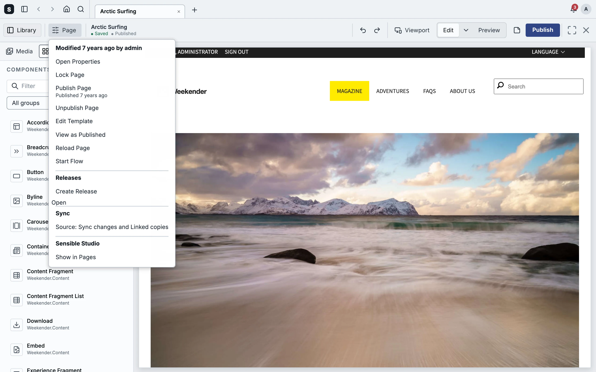

| Item | What it does |
|---|---|
| **Open Properties** | The [page properties](page-properties.md) |
| **Lock Page**, **Unlock Page** | Keeps the page to yourself while you work |
| **Publish Page** | Opens the Publish dialog, below. The line under the entry says when the page was last published |
| **Unpublish Page** | Takes it off the live site |
| **Edit Template** | Opens the page's template in the template editor |
| **View as Published** | The page without the editor |
| **Reload Page** | Loads the page again |
| **Start Flow** | Starts a [flow](flows.md) for this page, such as a review |
| **Create Release** | Adds the page to a [release](releases.md) |
| **Source: Sync changes and Linked copies** | On a page that others follow: sends its changes to them, and lists them. A linked copy has **Linked copy Status** and **Synchronize Page** instead. See [Several sites](sync.md) |
| **Show in Pages** | Opens the Pages console at this page |

## Publish

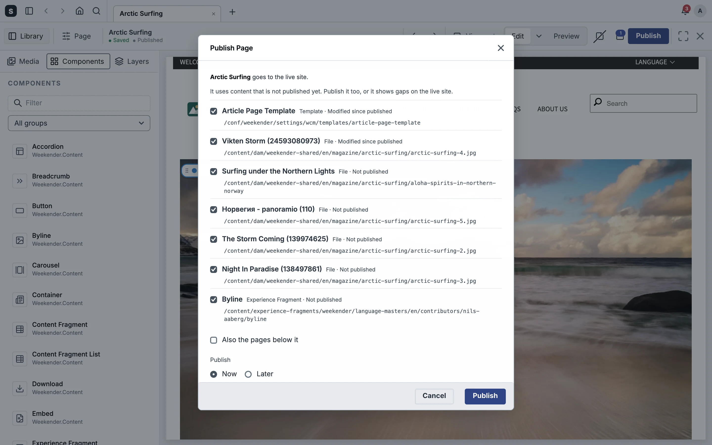

**Publish** in the bar, and **Publish Page** in the page menu, open the same dialog.

| Part | What it does |
|---|---|
| **What the page uses** | The template, the files, the experience and content fragments the page uses that are not on the live site yet, each with its kind and path. They are ticked: published with the page. Untick one, and the page shows a gap there on the live site |
| **Also the pages below it** | Publishes the whole section |
| **Now**, **Later** | At once, or at a date and time you set |

See [Publishing](publishing.md).

## Annotations

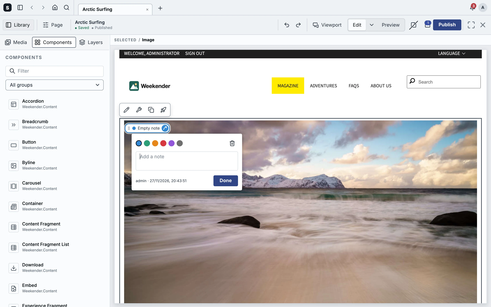

An annotation is a note on a component, for the people who work on the page. Visitors never see annotations, and they are never published.

- **Add one**: select a component and click **Add annotation** in the bar. A note opens on it. Type, choose one of the six colours, click **Done**. The bin deletes the note; the line at the bottom says who wrote it and when.
- **Read one**: each note shows its first words on the page. Hover to read all of it.
- **Move one**: drag it by the dotted handle at its left. Dropped on another component, the note now belongs to that component.
- **Point at something**: press the round arrow button on the note and draw to where the arrow should point. A note can have several arrows. Click an arrow, then the cross on it, to remove it.
- **Change or delete one**: click the note.

Once a page has notes, a button beside **Add annotation** hides them and shows them again, with their number. Notes also appear in the page's **Timeline** in the Pages console, so a reviewer's comments are easy to find later.

## When a page cannot be edited

- **Locked by someone else**: the status bar says who. Ask them to unlock it.
- **In a flow**: the status bar shows the step and who it is assigned to. Depending on the flow, the page can still be edited.
- **A linked copy**: components that follow the source offer only **Cancel inheritance** and **Copy**. Cancel the inheritance to change one here; **Re-enable inheritance** gives it back to the source. See [Several sites](sync.md).
