A page's properties are everything about the page that is not its content: what it is called, when it is visible, how its address behaves, who may see it.

Open them from the Pages console (**Properties**, or `p`) or from the page menu in the editor (**Open Properties**).

> **Note:** A change to the properties is a change to the page. It reaches the live site when you publish the page.

## The form

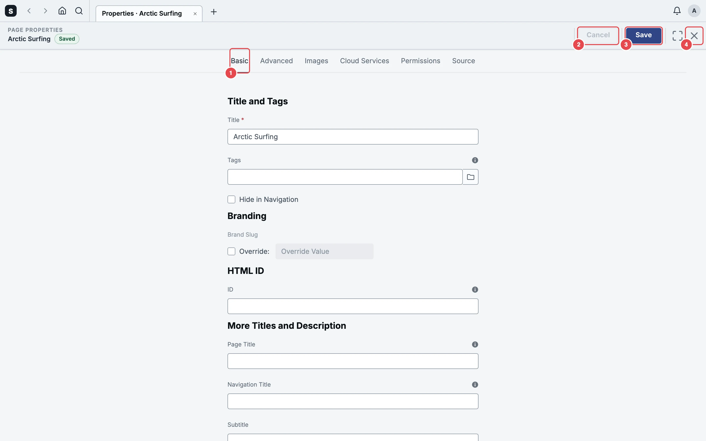

| | Part | What it does |
|---|---|---|
| 1 | **The tabs** | Basic, Advanced, Images, Cloud Services, Permissions, and **Source** or **Linked copy** for a page that has that role |
| 2 | **Cancel** | Forgets what you changed. Grey while nothing is changed |
| 3 | **Save** | Saves every tab at once |
| 4 | **Close** | Goes back to where you came from. Left of it, **Full screen** |

The form is a place of its own, with its own tab title. The badge beside the page's name says **Saved**, or that there are changes you have not saved yet. A small `i` at the right of a field explains it.

## Basic

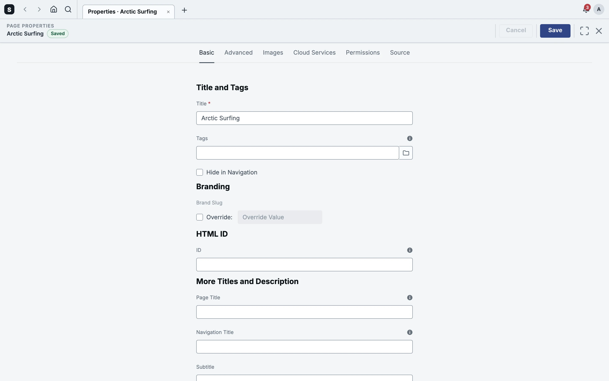

### Title and Tags

| Field | What it is for |
|---|---|
| **Title** | The page's name everywhere in Sensible Studio, and on the site unless a field below says otherwise. The only field that must be filled in |
| **Tags** | The [tags](tags.md) that classify the page. Type to find one, or use the folder button to browse. Lists and searches on the site can use them |
| **Hide in Navigation** | Keeps the page out of menus. The page still exists and can be linked to |

### Branding and HTML ID

Fields a site's templates can add. Weekender's pages have two:

| Field | What it is for |
|---|---|
| **Brand Slug** | The words added to the page's title in the browser's tab. Tick **Override** to set other words for this page and the pages below it |
| **ID** | An HTML id for the page's body, for the site's styles and scripts |

### More Titles and Description

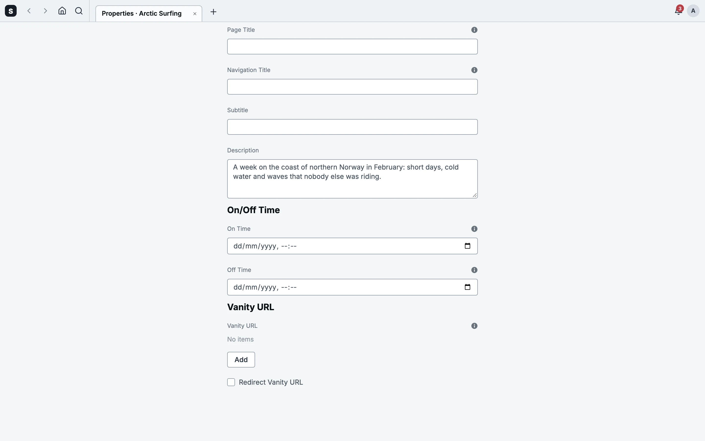

| Field | What it is for |
|---|---|
| **Page Title** | The title shown in the browser's tab and in search results, when it should differ from the title |
| **Navigation Title** | A shorter name for menus |
| **Subtitle** | A second line, shown by components that list pages |
| **Description** | A summary: shown by lists and teasers, and used as the description for search engines |

### On/Off Time

| Field | What it is for |
|---|---|
| **On Time** | When the page starts being visible on the live site |
| **Off Time** | When it stops |

Publish the page as usual; the on and off times decide when visitors can see it. Outside these times a visitor gets "not found". A page with an on time in the future is published but not yet visible. To publish at a certain moment instead, use **Publish › Later**, described in [Publishing](publishing.md).

### Vanity URL

A vanity URL is an extra, short address that leads to the page. Click **Add** and type it without the site's name: `/summer`. A page can have several. With **Redirect Vanity URL** ticked, the visitor's browser is sent to the page's real address; without it, the page is shown under the short address.

The live site learns about a new vanity URL when the page is published.

## Advanced

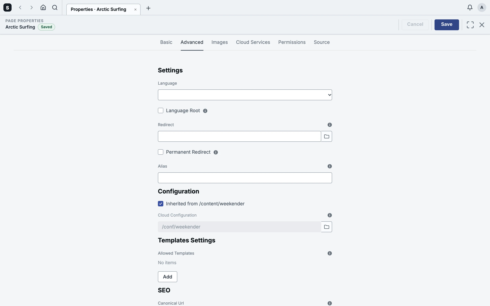

### Settings

| Field | What it is for |
|---|---|
| **Language** | The language of this page and the pages below it. Empty, the page has the language of the pages above it |
| **Language Root** | Marks the page as the top of one language of the site. Translations start from language roots. See [Translations](translations.md) |
| **Redirect** | Sends visitors of this page to another page. Type a path or use the folder button |
| **Permanent Redirect** | Tick it when the move is for good: browsers and search engines then remember the new address |
| **Alias** | Another name for the last part of the page's address |

### Configuration

| Field | What it is for |
|---|---|
| **Inherited from…** | Ticked, the page uses the configuration of the page named there. Untick to choose another one here |
| **Cloud Configuration** | The site configuration this page and the pages below it use: their templates, component settings and audiences |

### Templates Settings

**Allowed Templates** decides which templates can be used for pages below this one. **Add** adds a line; each line is the path of a template, or a pattern for several.

### SEO

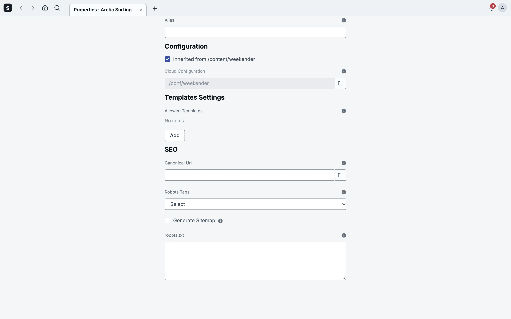

| Field | What it is for |
|---|---|
| **Canonical Url** | The address search engines should treat as the page's own, when the same content is reachable at several |
| **Robots Tags** | What search engines may do with the page: `index` or `noindex`, `follow` or `nofollow`, and more |
| **Generate Sitemap** | Makes this page the root of a sitemap listing it and the pages below it |
| **robots.txt** | On a site's top page: what the site's `/robots.txt` says. Left empty, everything is allowed and every sitemap of the site is named |

Tick **Generate Sitemap** on each language root of a site. The sitemap then lists every published page below that root, leaves out pages marked `noindex` and pages that only redirect, and names the same page in the other languages. The site's `/sitemap.xml` is the index of all of them.

## Images

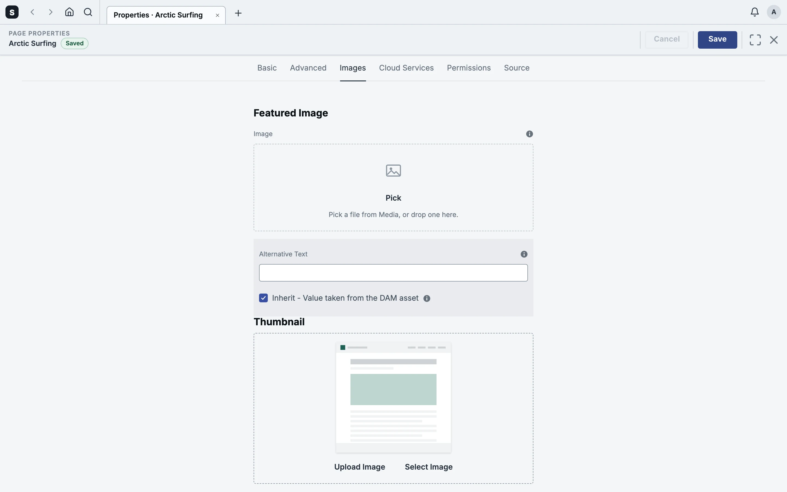

| Field | What it is for |
|---|---|
| **Featured Image** | The picture that stands for the page in teasers, lists and when the page is shared. **Pick** chooses a file from Media, or drop one on the field |
| **Alternative Text** | What the picture shows, for people who cannot see it. With **Inherit** ticked, the description of the file in Media is used |
| **Thumbnail** | The small picture of the page in the Pages console. **Upload Image** takes a file from your computer, **Select Image** one from Media. Without one, a sketch of the template is shown |

## Cloud Services

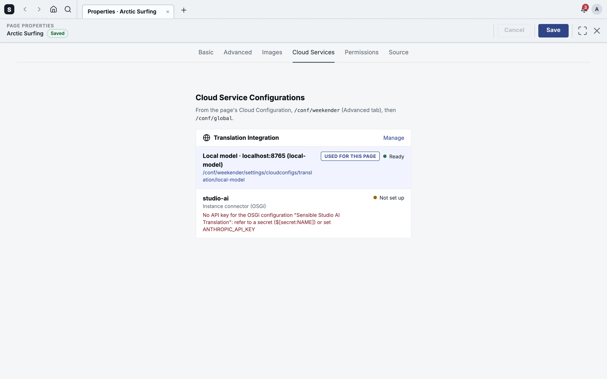

The configurations of outside services used below this page, looked up in the page's Cloud Configuration and then in the global one. Today that is **Translation Integration**:

- **Manage** opens the translation settings, and **Create a configuration** makes one for this site.
- Below are the translation providers of the instance, each with its state: **Ready**, or **Not set up** with what is missing. **Used for this page** marks the one that translates this page.

See [Translations](translations.md).

## Permissions

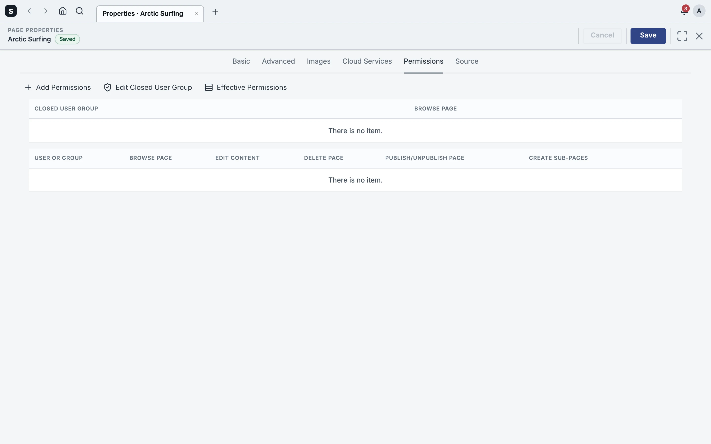

The tab shows who may do what with this page, and lets an administrator change it. The first table is the **closed user group** of the page; the second lists the users and groups with rules here, and for each whether it may **browse** the page, **edit** its content, **delete** it, **publish and unpublish** it, and **create sub-pages**.

| Button | What it does |
|---|---|
| **Add Permissions** | Gives a user or a group rights on this page and the pages below it |
| **Edit Closed User Group** | Limits the page and the pages below it to the users and groups you name. On the live site, everyone else gets "not found" until they sign in as a member |
| **Effective Permissions** | What a user or group can do here once every rule is taken into account, and where each rule comes from |

See [Users and permissions](users.md).

## Source

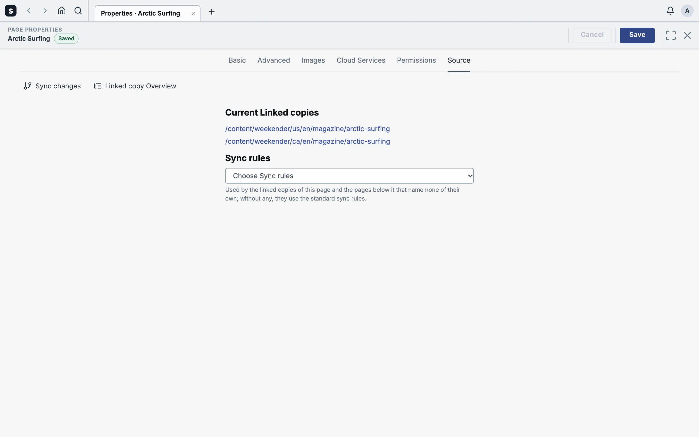

A page that has linked copies gets a **Source** tab.

| Part | What it does |
|---|---|
| **Sync changes** | Sends this page's changes to its linked copies |
| **Linked copy Overview** | Every copy of this page and of the pages below it, with the state of each |
| **Current Linked copies** | The copies of this page; click one to open its properties |
| **Sync rules** | The rules used by the linked copies of this page and the pages below it that name none of their own. Without any, they use the standard sync |

## Linked copy

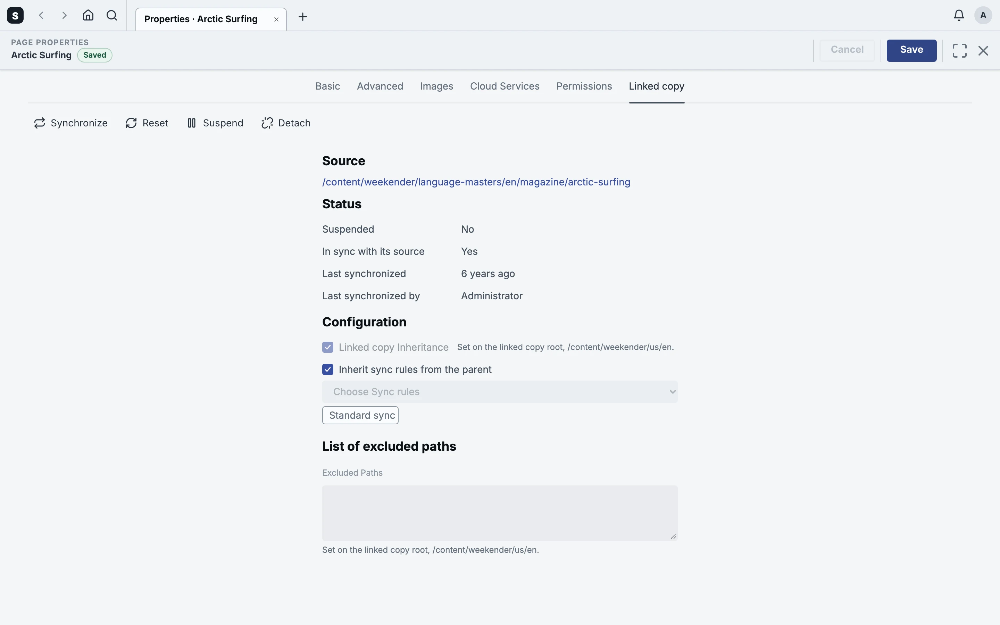

A page that follows a source gets a **Linked copy** tab.

| Part | What it does |
|---|---|
| **Synchronize** | Brings the changes of the source now |
| **Reset** | Makes the page equal to its source again, giving up what was changed here |
| **Suspend**, **Resume** | Stops following the source for a while, and starts again |
| **Detach** | Ends the link for good: the page becomes an ordinary page |
| **Source** | The page this one follows; click to open its properties |
| **Status** | Whether the copy is suspended, whether it is in sync with its source, when it was last synchronized and by whom |
| **Linked copy Inheritance** | Whether the page inherits at all. Set on the root of the linked copy; the pages below show where |
| **Inherit sync rules from the parent** | Ticked, the page uses the rules of the page above it, shown below. Untick to choose its own |
| **Excluded Paths** | Pages of the source that are left out of the copy. Set on the root of the linked copy |

See [Several sites](sync.md).

## Several pages at once

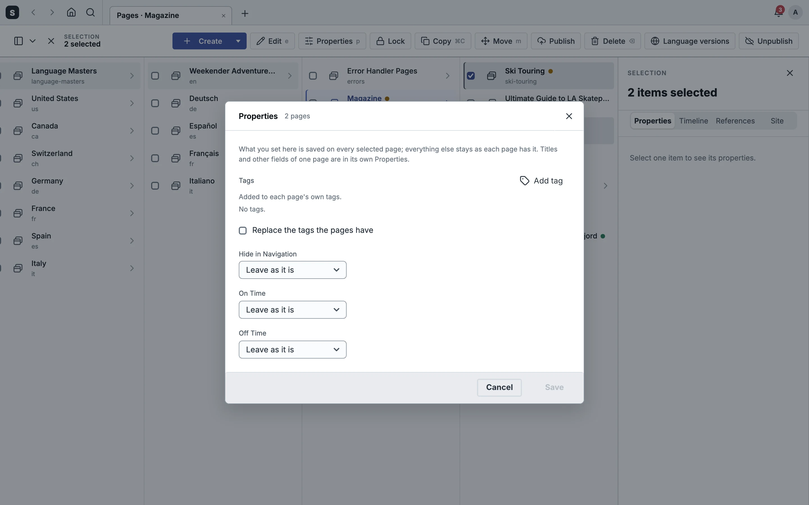

Select several pages in the Pages console and choose **Properties**. The dialog offers what pages can share:

| Field | What you can do |
|---|---|
| **Tags** | **Add tag** adds tags to each page's own. Tick **Replace the tags the pages have** to set exactly these instead |
| **Hide in Navigation**, **On Time**, **Off Time** | **Leave as it is**, or set a value |

What you set is saved on every selected page; everything else stays as each page has it. Titles and the other fields of one page are in its own properties.
