The Pages console is where a site's pages live. You browse the tree, create and organise pages, and start everything else from here: editing, publishing, translating, a flow, a release.

Open it from **Home › Pages**. Experience Fragments and Forms use the same console, rooted at their own folder, so what you learn here works there too. The parts every console shares (the bar, the rail, the inspector) are introduced in [A tour of the interface](../getting-started/tour.md).

## Three ways to see the pages

The **display format** button in the bar switches between three views. The console remembers your choice.

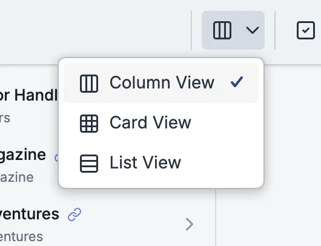

### Column View

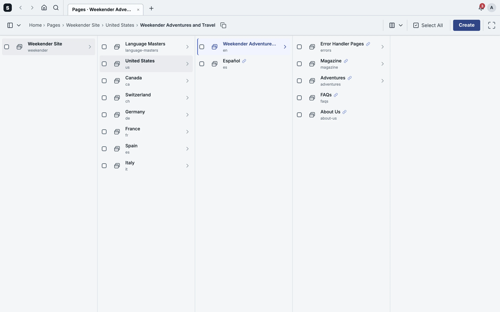

One column per level of the tree. Click a row to open the pages below it in the next column; the arrow at the right of a row says that it has pages below. The row you are in keeps a line at its left. This is the quickest way to move through a deep site.

Each row shows the page's **title**, and below it its **name**: the last part of its address.

### Card View

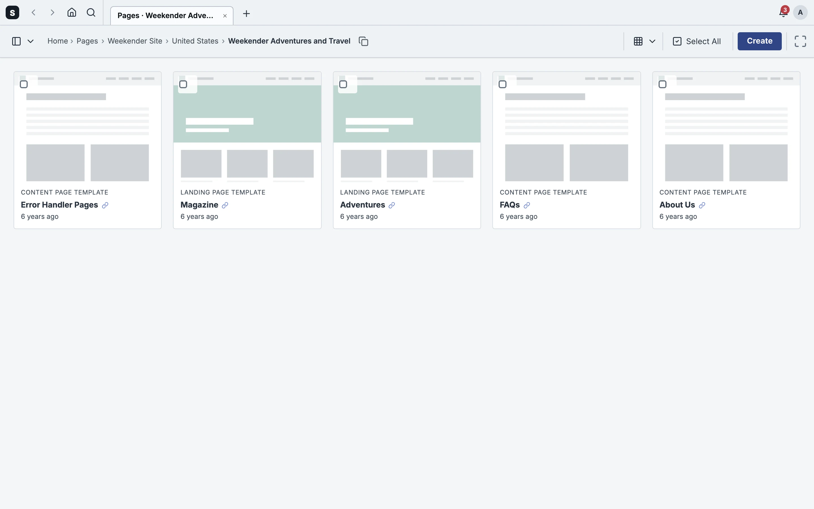

A card for each page of the folder you are in: a sketch of its layout, its template, its title, and when it was last changed. Click a card to go into it; the checkbox in its corner selects it.

### List View

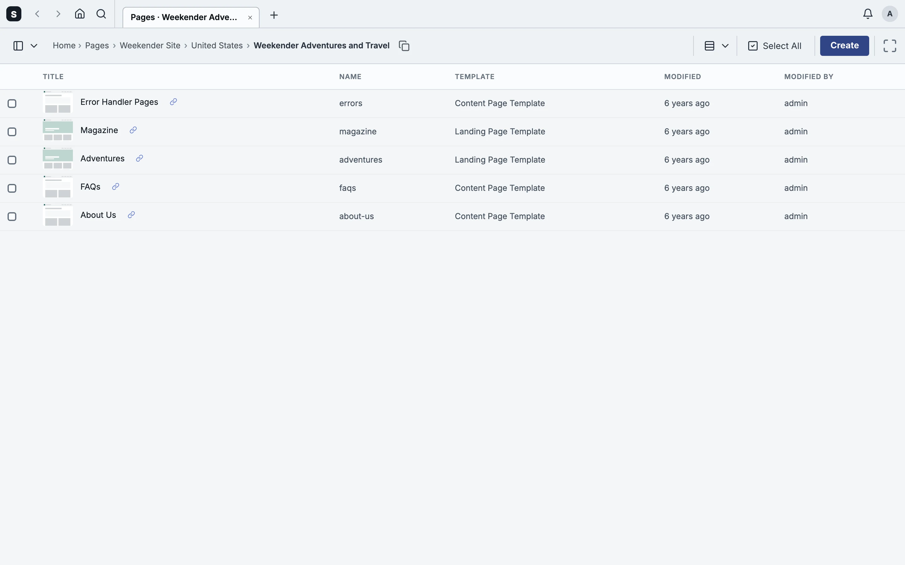

A table: **Title**, **Name**, **Template**, **Modified** and **Modified by**. Click a column heading to sort by it; click again for the other direction. Click a row to go into it.

### What the small signs mean

| Sign | Meaning |
|---|---|
| A chain link after the title | The page is a linked copy: it follows a source page. See [Several sites](sync.md) |
| A dot after the title | The page was published. Its colour says where it stands now: **Published**, **Modified since published**, or **Unpublished**. A page that was never published has no dot |
| A lock | Someone locked the page |
| An arrow at the right of a row | The page has pages below it |

The breadcrumbs in the bar show where you are; click any part to go up. The button after them copies the path of the folder.

## Create

**Create** in the bar makes something new in the folder you are in.

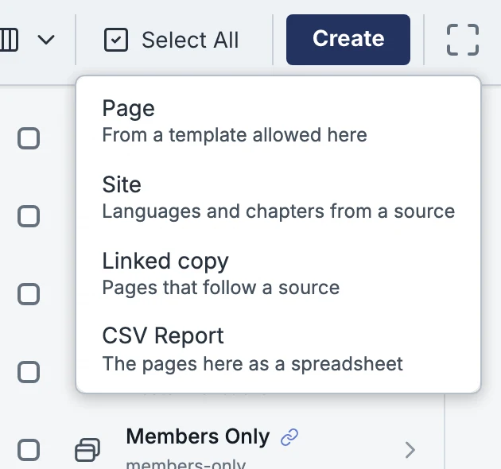

| Create | What you get |
|---|---|
| **Page** | A page from a template allowed here |
| **Site** | A whole site, with its languages and chapters, made from a source |
| **Linked copy** | Pages that follow a source page |
| **CSV Report** | The pages here as a spreadsheet |

After you copied pages, **Paste** appears here as well.

### A page

Creating a page takes two steps. The bar shows where the page will be created; **Next**, **Back** and **Create** move through the steps, and the `×` leaves without creating anything.

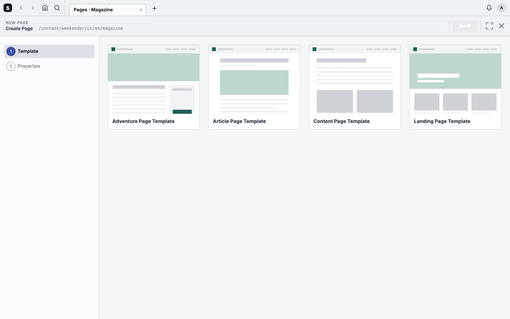

**1. Template.** Click the template the page is made from. Only the templates allowed at this place are offered. The picture on a card sketches the layout the template gives.

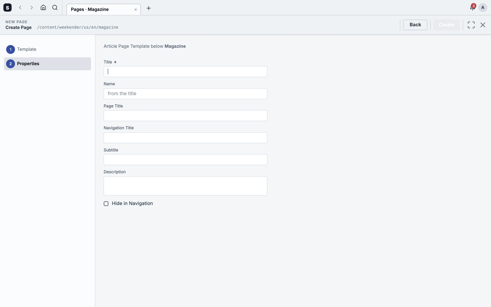

**2. Properties.**

| Field | What it is |
|---|---|
| **Title** | The name people see. The only field you must fill in |
| **Name** | The part of the address. Left empty, it is made from the title |
| **Page Title** | The title shown at the top of the page and in the browser, when it differs from Title |
| **Navigation Title** | A shorter title for menus |
| **Subtitle** | A second line below the title, where the template shows one |
| **Description** | A summary, used by lists, teasers and search engines |
| **Hide in Navigation** | Keeps the page out of the site's menus |

All of them can be changed later in the [page properties](page-properties.md). Click **Create**, then open the new page to edit it.

### A site

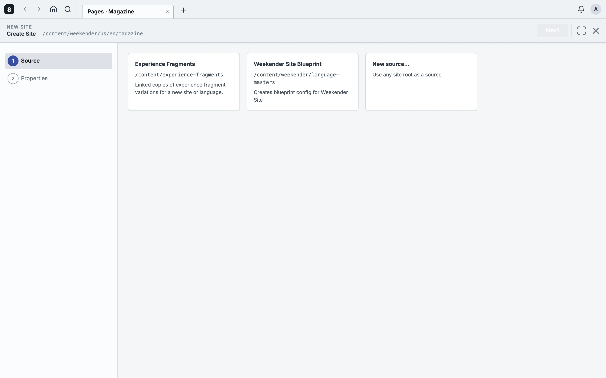

**Site** lists the sources registered on this instance, and **New source…**, which takes any site root as a source. The second step, **Properties**, names the new site and chooses what it takes from the source. The pages of the new site are linked copies of the source. [Several sites](sync.md) explains sources and linked copies.

### A linked copy

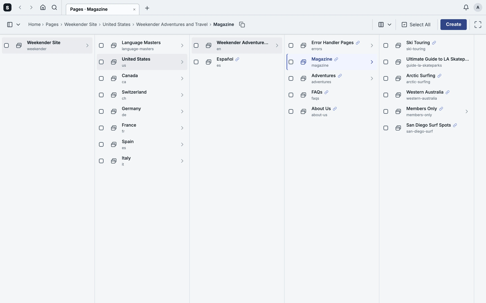

**Linked copy** asks for the **source page**: type to search, or open the list. The list holds the pages of the sites; in the Forms and Experience Fragments consoles it holds forms and fragments instead. The second step, **Linked copy**, sets up the copy itself: its title and name, and how it follows the source.

### A CSV report

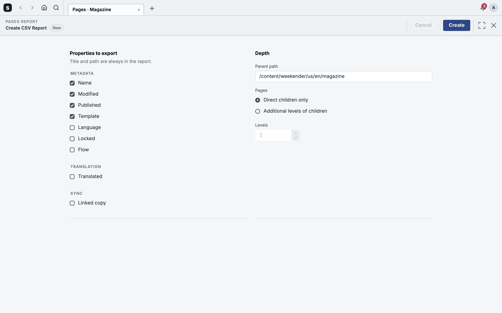

A spreadsheet of the pages below a path. Title and path are always in it; tick the other properties you want:

| Group | Properties |
|---|---|
| **Metadata** | Name, Modified, Published, Template, Language, Locked, Flow |
| **Translation** | Translated |
| **Sync** | Linked copy |

**Depth** decides which pages: **Direct children only**, or **Additional levels of children** with the number of levels. **Create** downloads the file.

## Select pages

Tick the checkbox at the left of a row or a card. The bar becomes the action bar, and the inspector opens at the right.

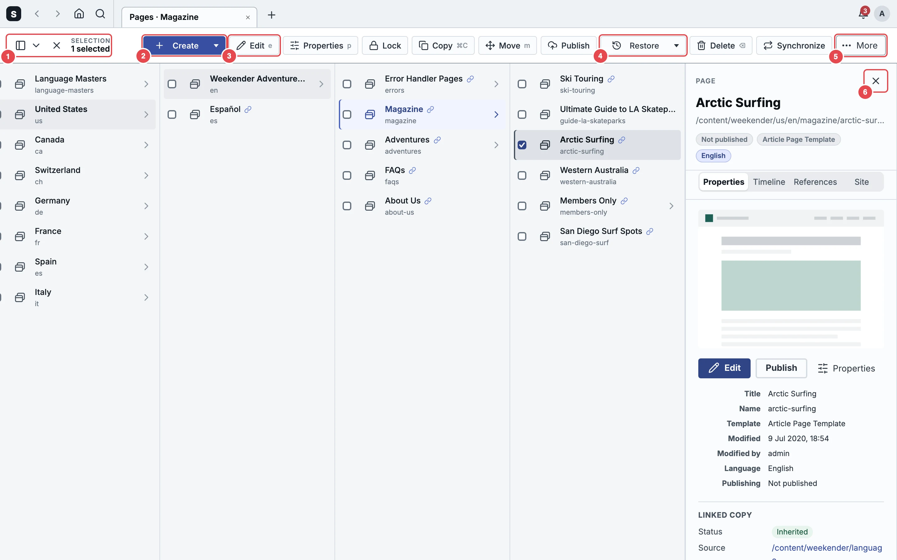

| | Part | What it does |
|---|---|---|
| 1 | **Selection** | How many items are selected. The `×` before it clears the selection |
| 2 | **Create** | Still creates in the folder; its arrow opens what can be created *for the selection* |
| 3 | **The actions** | Edit, Properties, Lock, Copy, Move, Publish, Restore, Delete, Synchronize. A grey letter is the action's key |
| 4 | **Restore** | Opens Restore Version and Restore Tree |
| 5 | **More** | The actions that did not fit in the bar |
| 6 | **Close inspector** | Hides the panel; `Alt` and the backtick key bring it back |

**Select All** in the bar selects everything in the folder, or everything the filter found.

The same actions are in the right-click menu of a page:

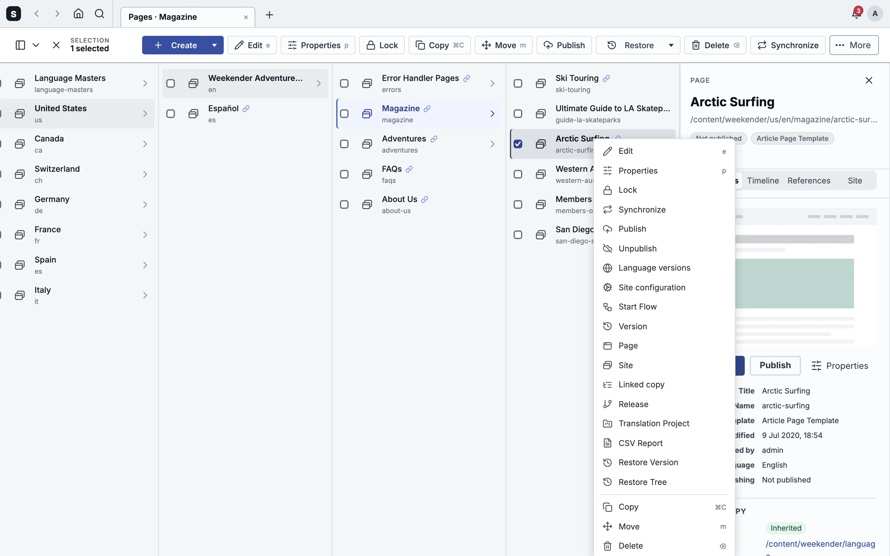

## What you can do with a page

| Action | Key | What it does |
|---|---|---|
| **Edit** | `e` | Opens the page in the [page editor](page-editor.md). With several pages selected, each opens in a tab of its own |
| **Properties** | `p` | Opens the [page properties](page-properties.md). With several pages selected, you set what they can share: tags, on and off time, hide in navigation |
| **Lock**, **Unlock** | | Keeps others from changing the page while you work on it. Only you, or an administrator, can unlock it |
| **Synchronize** | | For a linked copy: brings the changes of its source. See [Several sites](sync.md) |
| **Publish** | | Puts the page on the live site. See [Publishing](publishing.md) |
| **Publish with the pages below** | | Publishes a whole section. Offered for a page that has pages below it |
| **Unpublish** | | Takes the page off the live site |
| **Language versions** | | The page in other languages, and translating it |
| **Site configuration** | | The settings the site's code reads at this place. For developers |
| **Start Flow** | | Sends the page through a flow, such as a review |
| **Version** | | Saves the page as it is now |
| **Page**, **Site**, **Linked copy** | | The same as in **Create**, with this page as the place |
| **Release** | | A copy of the page to work on apart from the live site |
| **Translation Project** | | Collects the page for translation into several languages |
| **CSV Report** | | The report above, for the pages below this one |
| **Restore Version**, **Restore Tree** | | Brings back earlier versions and deleted pages |
| **Copy** | `Cmd+C` | Remembers the selection for **Create › Paste** |
| **Move** | `m` | Moves or renames the page |
| **Delete** | `Backspace` | Deletes the selection |

**More** in the action bar holds Language versions, Site configuration and Unpublish:

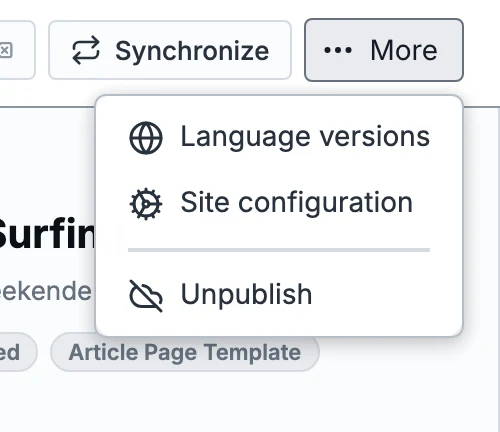

The arrow beside **Create** opens what can be made for the selected page: Start Flow, Version, Page, Site, Linked copy, Release, Translation Project and CSV Report.

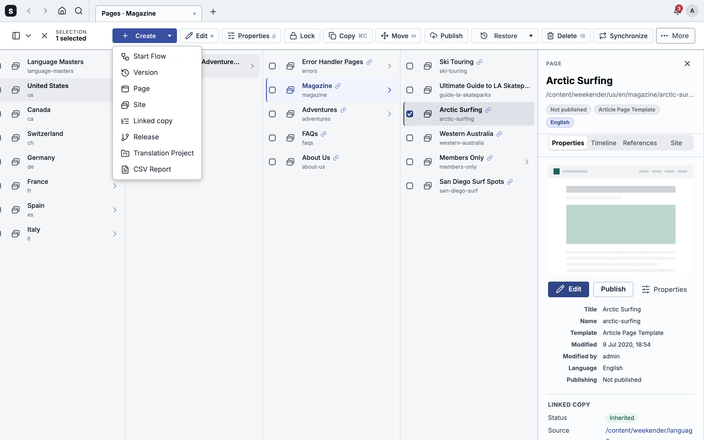

### Move or rename

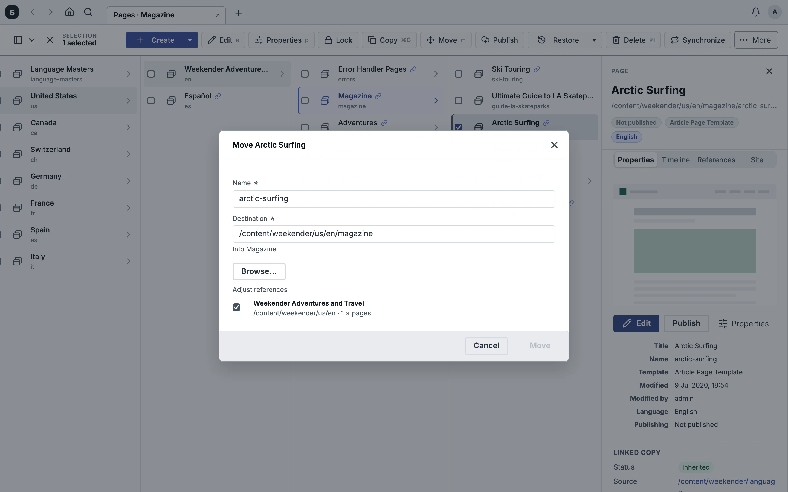

| Field | What it is |
|---|---|
| **Name** | The page's name at its new place. Change only this to rename the page where it is |
| **Destination** | The page it will sit below. Type a path or click **Browse…** |
| **Adjust references** | The pages that link to the one you are moving, each with the number of links. Leave them ticked, and their links are rewritten to the new address |

**Move** stays grey until the name or the destination changed.

A move changes the page's address. If the page was published, the live site follows: the page is published at its new address and removed from the old one.

### Delete

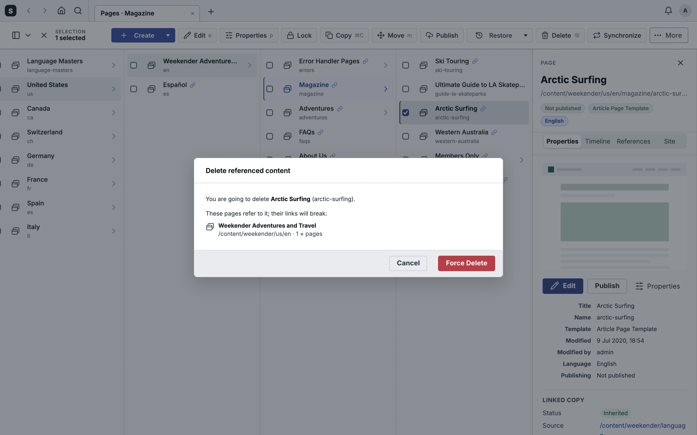

When other pages refer to what you are deleting, the dialog lists them, because their links will break; the button then reads **Force Delete**. Deleting a page also deletes the pages below it, and a published page is taken off the live site first.

Nothing is lost for good: every deleted page can be brought back. See [Restore](#restore) below.

### Save a version

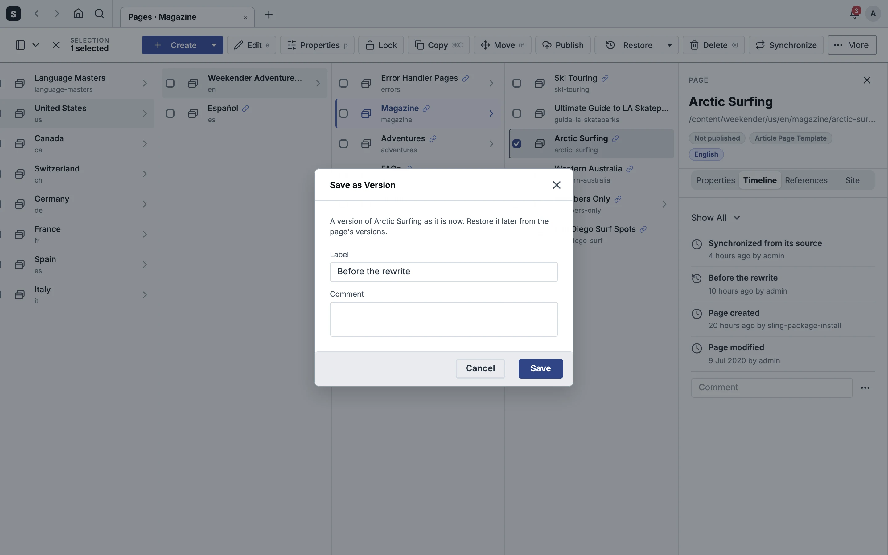

A version is the page as it was at a moment you chose. Give it a **Label** and a **Comment**, so that you find it later. With several pages selected, each gets a version. Sensible Studio also makes one by itself before anything risky: before a revert, before a delete.

### Start a flow

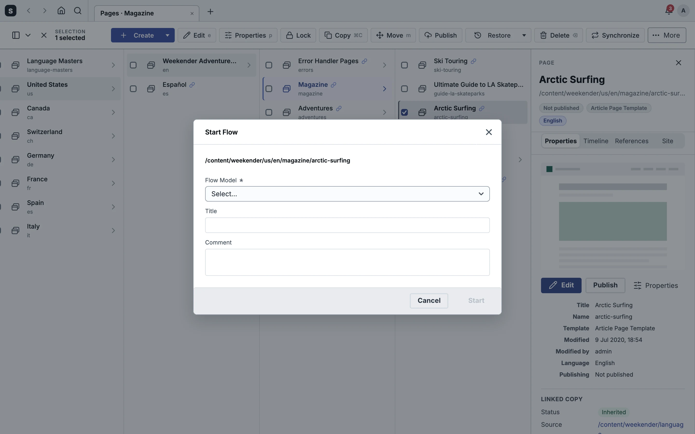

Choose the **Flow Model**, and give the flow a **Title** and a **Comment** for the people who get its steps. See [Flows](flows.md).

### Language versions

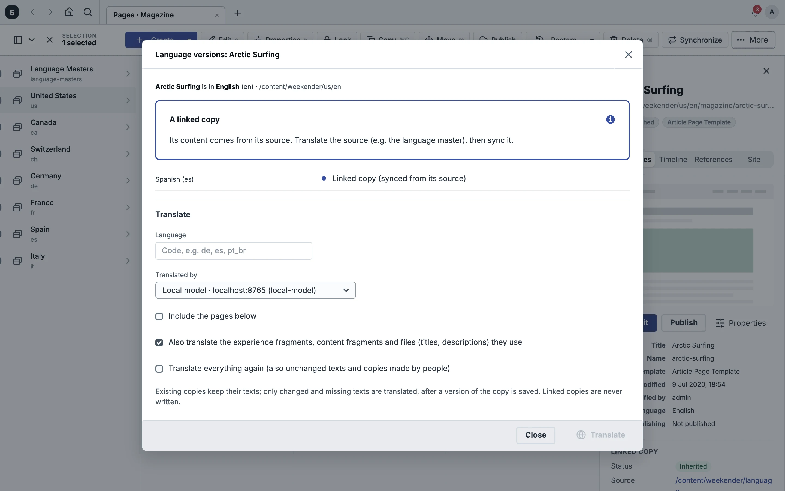

The dialog says which language the page is in, lists its versions in the site's other languages with the state of each, and translates:

| Field | What it is |
|---|---|
| **Language** | The code of the language to translate into, such as `de`, `es` or `pt_br` |
| **Translated by** | The provider that translates |
| **Include the pages below** | Translates the whole section |
| **Also translate the experience fragments, content fragments and files they use** | So that nothing on the page stays in the old language |
| **Translate everything again** | Also texts that did not change, and copies people corrected. Without it, existing copies keep their texts and only changed and missing texts are translated |

A linked copy is not translated itself: translate its source, then synchronize. The dialog says so when that is the case. See [Translations](translations.md).

### A release

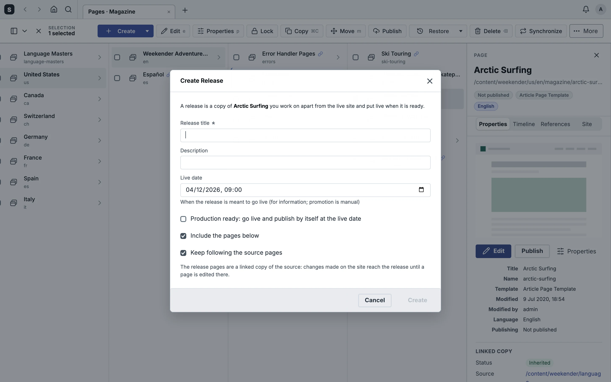

| Field | What it is |
|---|---|
| **Release title**, **Description** | How the release is called in the Releases console |
| **Live date** | When the release is meant to go live |
| **Production ready** | Goes live and publishes by itself at the live date. Without it, the date is information and you promote the release by hand |
| **Include the pages below** | Takes the whole section into the release |
| **Keep following the source pages** | Changes made on the site reach the release until a page is edited there |

See [Releases](releases.md).

### A translation project

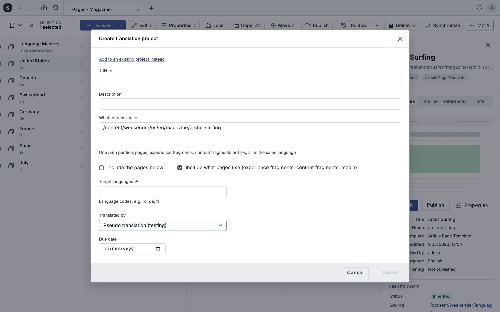

| Field | What it is |
|---|---|
| **Title**, **Description** | How the project is called |
| **What to translate** | One path per line: pages, experience fragments, content fragments or files, all in the same language |
| **Include the pages below**, **Include what pages use** | The section, and the fragments and media its pages use |
| **Target languages** | Language codes, such as `ro, de, fr`. One job per language is made |
| **Translated by** | The provider |
| **Due date** | When it should be done |

**Add to an existing project instead** puts the pages into a project that is already open.

## Find pages: the filter

`Alt+2`, or **Filter** in the rail selector, opens the filter at the left. While a filter is set, the console shows the results as a list, and every action works on them.

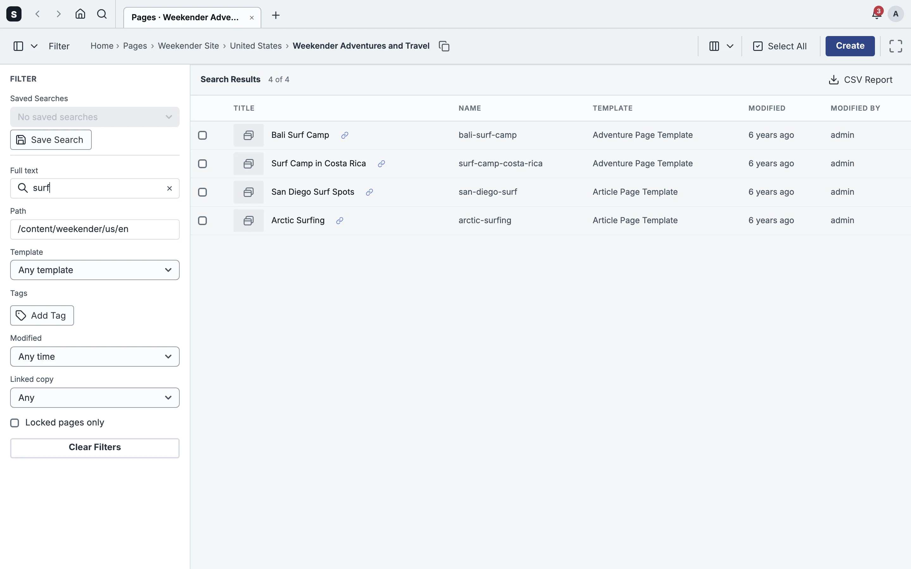

| Field | Finds |
|---|---|
| **Full text** | Pages with these words in their title or content |
| **Path** | Only pages below this path. It starts at the folder you are in |
| **Template** | Pages made from one template |
| **Tags** | Pages that carry the tags you add |
| **Modified** | Pages changed in a period |
| **Linked copy** | Pages that are linked copies, or that are not |
| **Locked pages only** | Pages someone locked |

**Save Search** keeps the filter under a name; **Saved Searches** at the top runs one again. **Clear Filters** empties the fields. **CSV Report** above the results downloads them as a spreadsheet.

To find a page by name from anywhere, press `Cmd+K` and type.

## Versions and the timeline

The inspector's **Timeline** tab lists everything that happened to the selected page, newest first: it was created, modified, published; versions; flows and each step someone completed; comments; the notes left in the editor's Annotate mode; the releases that hold a copy of it.

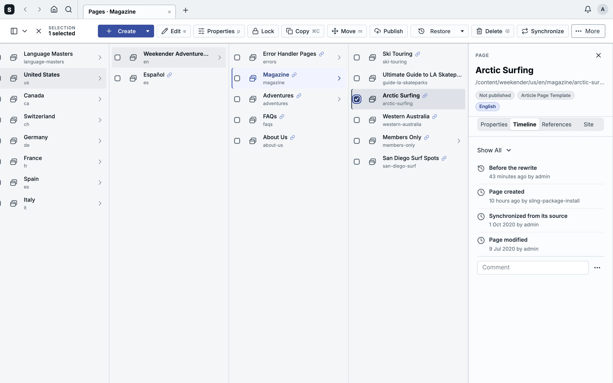

**Show All** narrows the list to one kind of entry. Click a version for what you can do with it:

- **Preview Version** opens the page as it was, in a new tab. Nothing is changed.
- **Compare to Current** shows the version and today's page side by side with the changes marked, and a second tab that lists them component by component.
- **Revert to this Version** goes back to it. The page as it is now is saved as a version first, so a revert can be undone.

Write in the **Comment** field at the bottom to leave a note for your colleagues. Comments are kept beside the page, not in it: they are never published.

## Restore

**Restore** in the action bar has two entries.

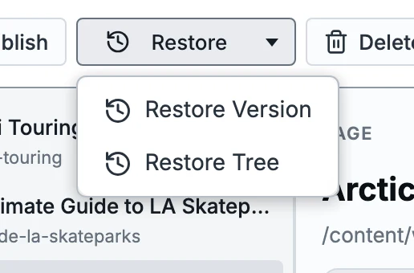

### Restore Version

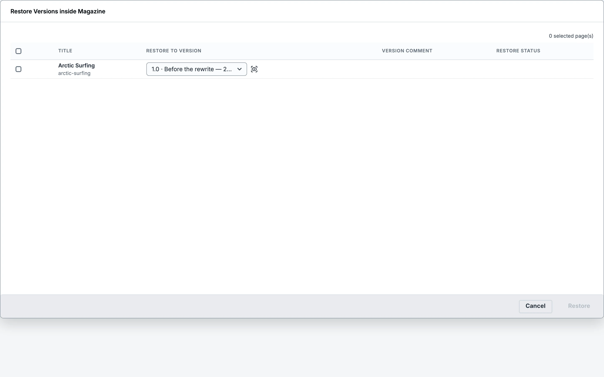

Select the page that contained what was deleted, then **Restore › Restore Version**. The screen lists every page inside it that has versions, the deleted ones included. The columns are the page, **Restore to version** with the versions to choose from, the **version comment**, and the **restore status** once it ran. For each, choose the version to go back to (the button beside the list previews it), tick the pages you want, and click **Restore**. A deleted page comes back as the same page, with its history.

Pages deleted in some other way than this console, such as by a script or a package, are listed too. Sensible Studio keeps a copy of every deleted page for 90 days.

### Restore Tree

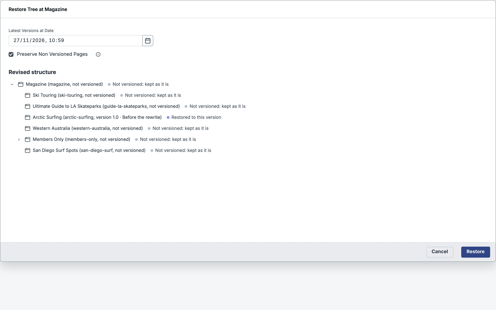

Puts a whole section back as it was at a date and time.

| Field | What it is |
|---|---|
| **Latest Versions at Date** | The moment to go back to. Each page returns to its last version before it |
| **Preserve Non Versioned Pages** | Keeps the pages that have no version from before that date, such as pages created after it |
| **Revised structure** | What will happen to each page, before you confirm |

> **Warning:** Restore Tree changes every page below the one you start from. Without *Preserve Non Versioned Pages*, pages created after the date are deleted.

## Who refers to a page

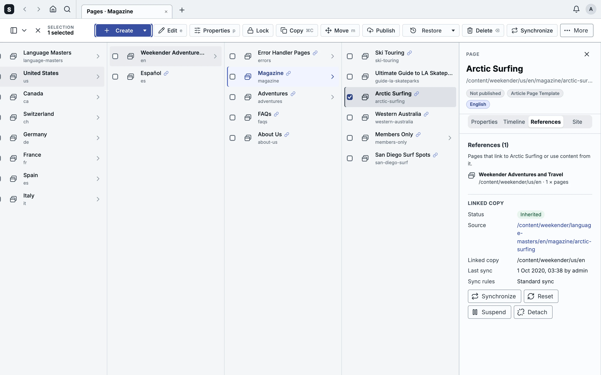

The inspector's **References** tab shows the pages that link to the selection or use content from it, each with the number of links, and the releases that contain it. Look here before you move, unpublish or delete something.

For a linked copy, the tab also has a **Linked copy** block: whether the page still inherits from its source, the source, when it was last synchronized and by whom, and its sync rules, with the buttons **Synchronize**, **Reset**, **Suspend** and **Detach**. They are explained in [Several sites](sync.md).

The **Site** tab sums up the site the page belongs to: how many pages it has and how many of them are linked copies, its last change, its configuration, and every language of the site with a link to its root.

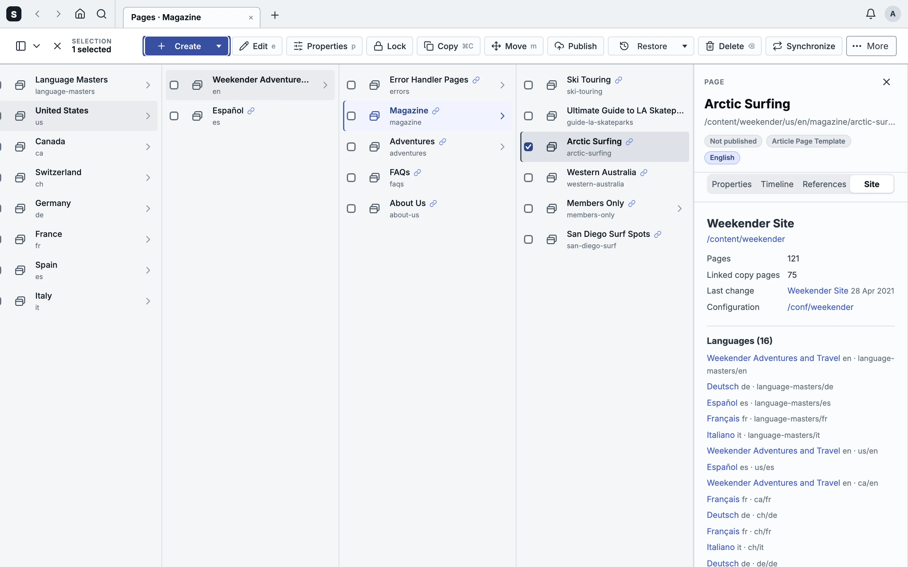

## Several pages at once

Most actions work on a selection of many pages: publish, unpublish, move, delete, start a flow, create a translation project, a version or a release. Actions that make sense for one page only, such as Language versions, are offered when one page is selected.
