Personalization shows different content to different visitors: a winter offer to someone in the northern hemisphere in January, a shorter page to someone on a phone. It is made of four things that build on each other:

1. An **audience** is a rule about the visitor.
2. A **personalized component** has one **experience** per audience, and a default for everyone else.
3. A **goal** says what counts as success, so results can be counted.
4. A **report** shows which experience does best.

Nothing about a visitor is stored on the server. What the site knows about a visitor stays in that visitor's browser; only counts are sent back.

The tools are under **Home › System › Audiences**.

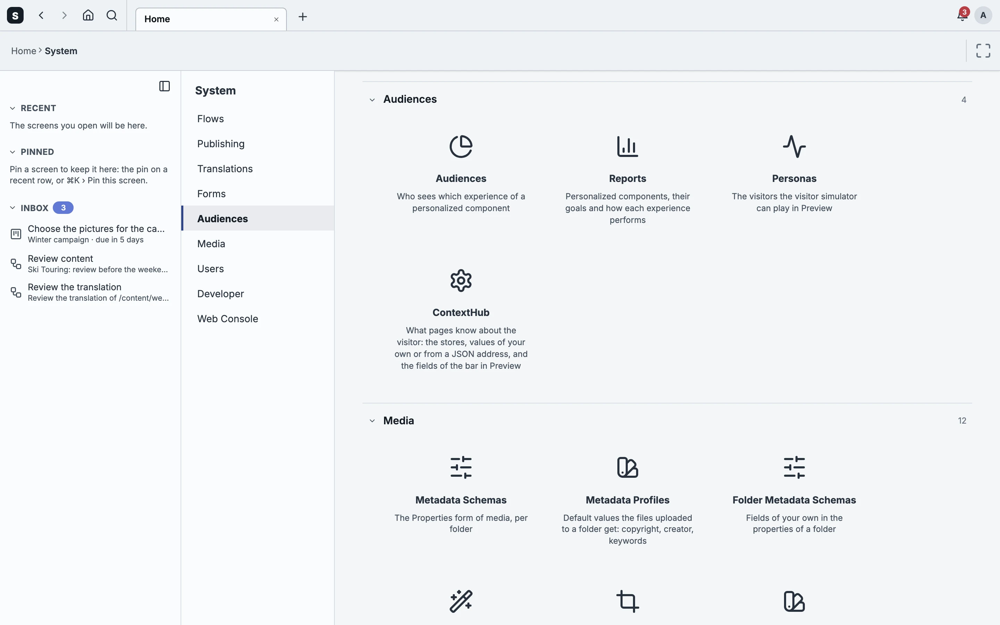

| Tool | What it is for |
|---|---|
| **Audiences** | The rules about visitors |
| **Reports** | Every personalized component with its experiences and their results |
| **Personas** | The ready-made visitors of the visitor simulator. It opens in the repository browser; this is an administrator's tool |
| **ContextHub** | What pages know about a visitor, and what the visitor simulator offers |

## Audiences

An audience answers one question about the visitor: does this person match, yes or no?

**Audiences** lists them per configuration: choose the site's configuration in the menu at the top right. The demo has two, *Winter* and *Summer*, which look at where the visitor is and at the month.

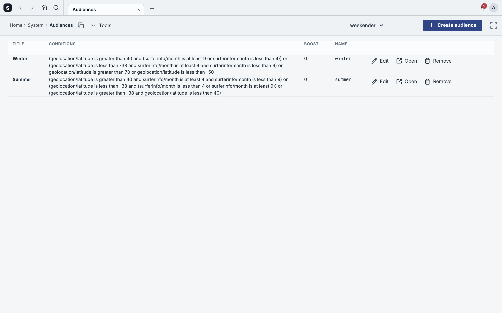

| Column | Meaning |
|---|---|
| **Title** | The audience |
| **Conditions** | Its rule, written out |
| **Boost** | When a visitor matches several audiences that a component has experiences for, the highest boost wins |
| **Name** | Its name in the configuration |
| **Edit**, **Open**, **Remove** | Change the rule, open the audience's page, delete it |

**Create audience**, or **Edit**, opens the rule.

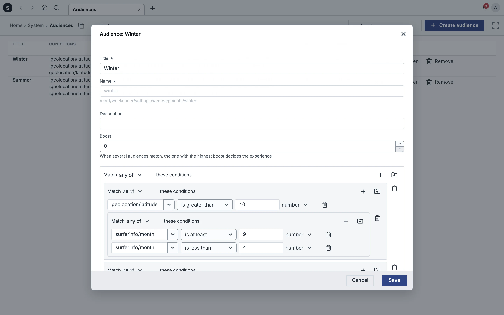

| Part | Meaning |
|---|---|
| **Title**, **Name**, **Description** | How the audience is called |
| **Boost** | A number; see above |
| **Match all of / any of these conditions** | Whether every condition must hold, or one is enough |
| A condition | A **property** of the visitor, an operator and a value, with the value's type: text, number or yes/no |
| The plus | One more condition |
| The folder with a plus | A group of conditions with its own all of / any of, for rules such as "north and winter, or south and summer" |
| The bin | Removes a condition or a group |

The property is picked from a list or typed:

| What you can ask about | Examples |
|---|---|
| **The profile** (`profile/…`) | Age, gender, interests, loyalty level. Your site fills these in, for example after sign-in |
| **The place** (`geolocation/…`) | Country, city, latitude |
| **The device** (`surferinfo/…`) | Phone, tablet or desktop; browser; operating system |
| **The moment** (`surferinfo/…`) | Month, weekday, hour |
| **What they read** | The tags of the pages they visited most |

The operators are *equals*, *does not equal*, *contains*, *does not contain*, *starts with*, *ends with*, *is greater than*, *is at least*, *is less than*, *is at most*, *exists* and *does not exist*.

An audience with no condition matches nobody, so a half-finished audience cannot take over a page.

## Personalize a component

Open the page in the editor and switch the mode to **Personalize**.

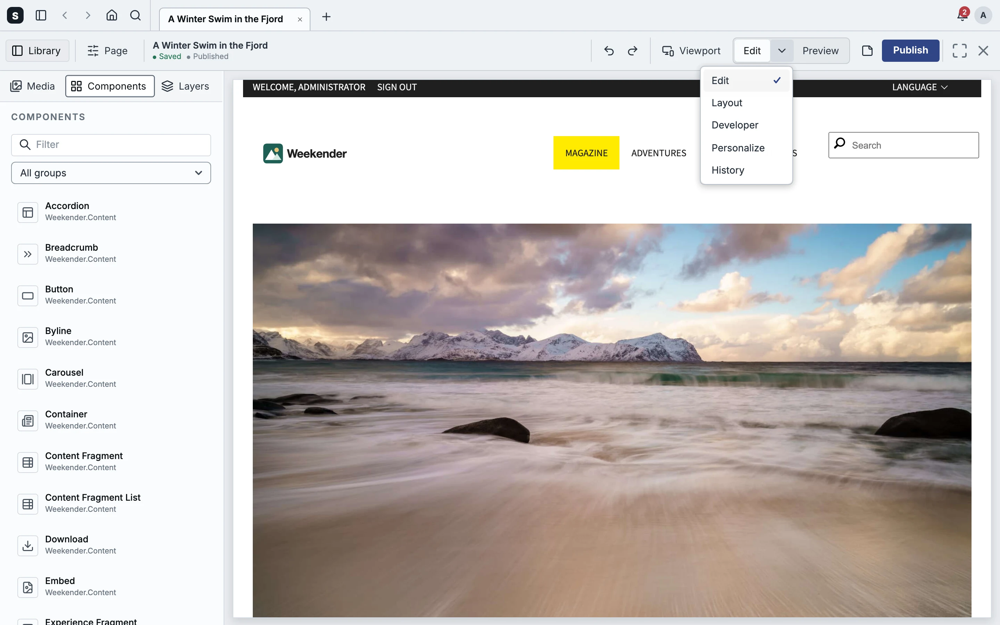

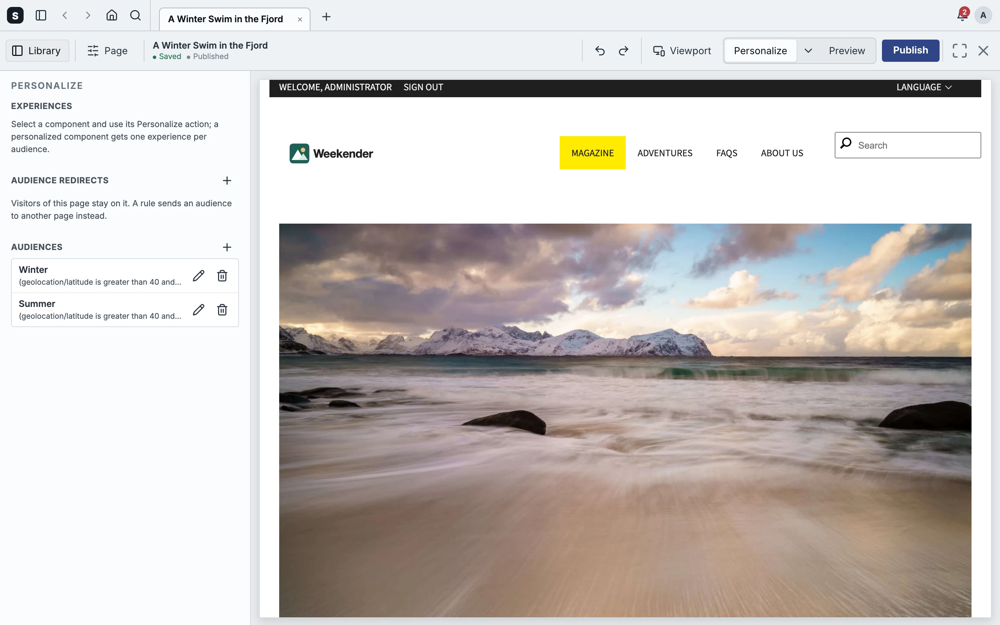

The panel has three sections: **Experiences**, for the component you select; **Audience redirects**, for the whole page; and **Audiences**, the audiences of the site, which you can create and edit from here too.

Select a component. Its toolbar has **Personalize**; choose it, and the component becomes a personalized one. What it showed becomes the **Default** experience, for visitors who match no audience.

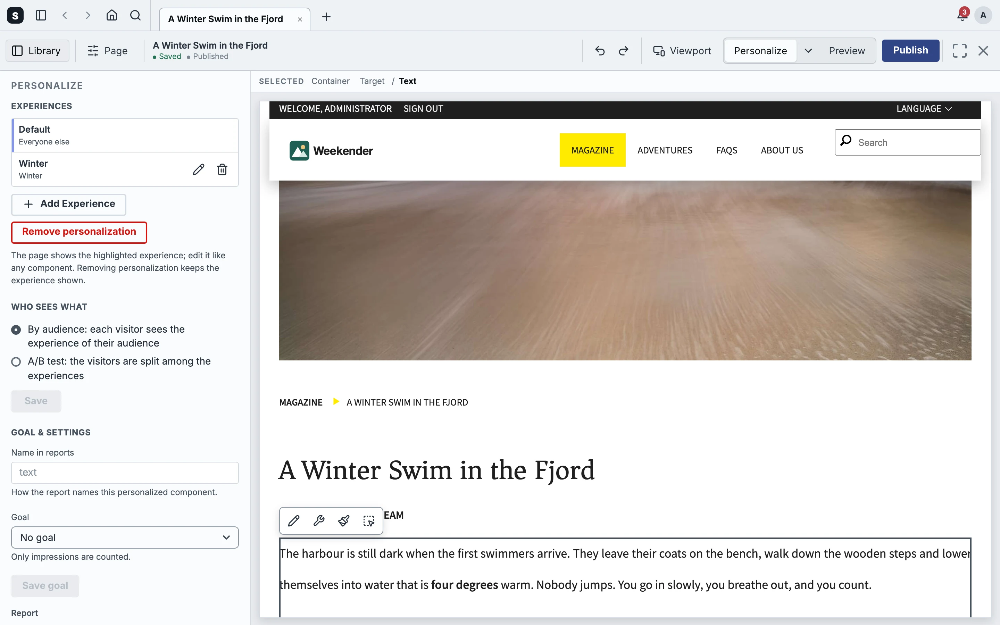

| In the panel | Meaning |
|---|---|
| The list of experiences | **Default**, then one per audience. Click one to see and edit it on the page: the page shows the highlighted experience, and you edit it like any component |
| The pencil, the bin | Rename an experience; remove it |
| **Add Experience** | A new experience for another audience |
| **Remove personalization** | Keeps the experience you are looking at as the component and drops the others. That is also how you make the winner permanent |

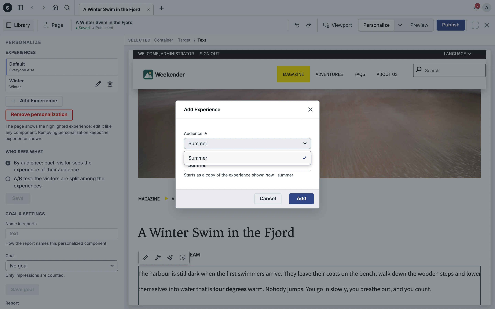

**Add Experience** asks for the **Audience** and a **Title**. The new experience starts as a copy of the one shown now; change it.

### A whole page instead of a component

When the pages for two audiences differ too much to be experiences of one component, send the audience to another page. Under **Audience redirects**, choose the plus and fill in a row: this **Audience** goes to that **Target page**. **Save redirects** keeps them.

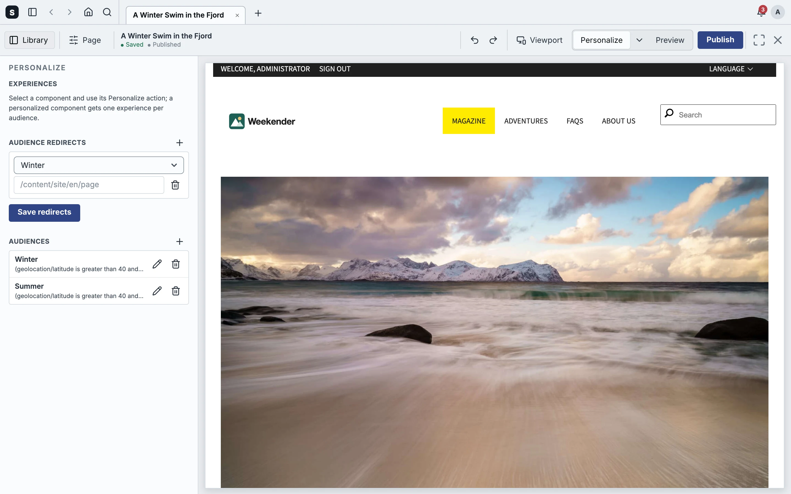

The redirect happens in the visitor's browser, so they may glimpse the first page. For a few components, experiences are smoother.

## Goals

A goal tells Sensible Studio what you are trying to achieve with a personalized component. Set it in the panel, under **Goal & Settings**.

| Goal | Counted when |
|---|---|
| **Clicked** | The visitor clicks in the experience. **Element** narrows it to one element, such as the button, by a CSS selector |
| **Viewed page** | The visitor reaches a page you name, later in the same visit |
| **Custom event** | The site's own code reports it: a purchase, a sign-up |
| **No goal** | Only how often each experience was shown is counted |

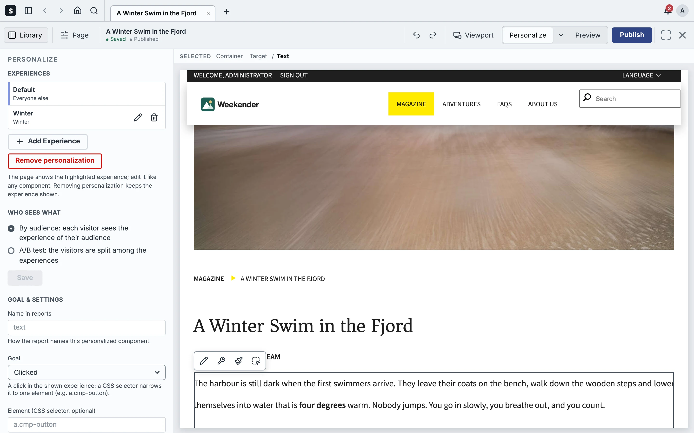

**Name in reports** is how the report calls this component; empty, it uses the component's own name. **Save goal** keeps the goal.

Each visitor counts once per visit, so reloading a page does not inflate the numbers. Only real visits count: the editor and previews never do.

### Test A against B

To learn which of two versions works better for *everyone*, split the visitors by percentage instead of by audience. Under **Who sees what**, choose **A/B test**.

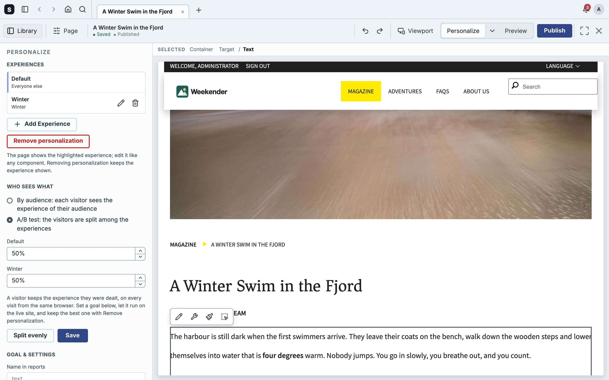

Give each experience its share; **Split evenly** does it for you, and **Save** starts the test. A visitor keeps the experience they were dealt, on every visit from the same browser. Set a goal below, let it run on the live site, and keep the best one with **Remove personalization**.

## Reports

In the panel, under **Report**, each experience shows how often it was shown, how often the goal was reached, and the rate. The best one is marked.

**Reports** shows the same for the whole site.

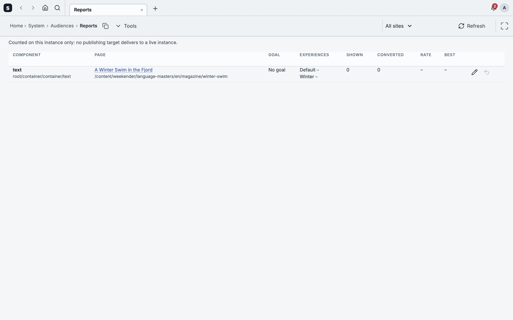

| Column | Meaning |
|---|---|
| **Component** | The personalized component, by its name in reports, and where it is on its page |
| **Page** | The page it is on |
| **Goal** | What is counted |
| **Experiences**, **Shown**, **Converted**, **Rate** | Each experience with how often it was shown, how often the goal was reached, and the rate |
| **Best** | The experience that does best so far |
| The pencil | Opens the page straight in Personalize mode |

The menu at the top narrows the list to one site. The line above the table says where the numbers come from: the live site, or this instance only when nothing is published yet.

Give a result time. A difference of a few visits means nothing; wait until each experience has been shown some hundreds of times.

## See the page as someone else

In the editor's **Preview** mode, **Visitor** in the top bar opens the **visitor simulator**: a bar that lets you become a particular visitor.

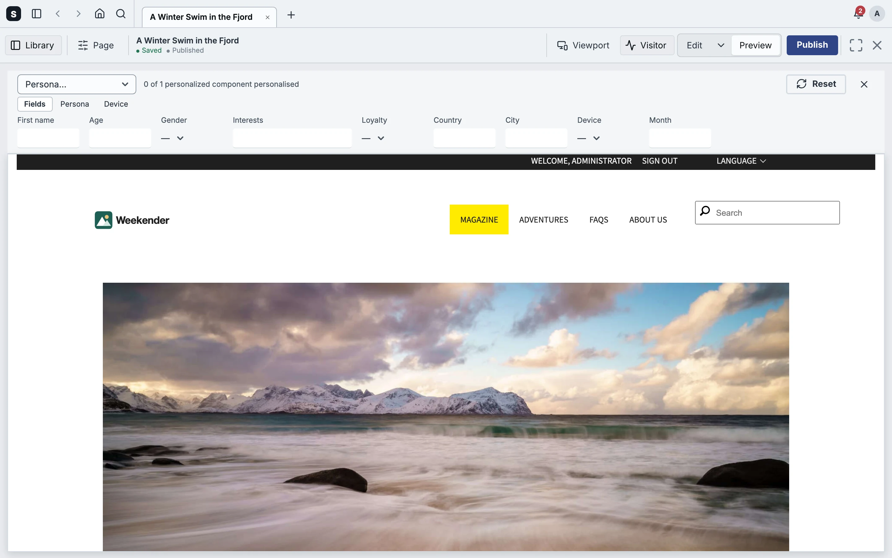

| Part | Meaning |
|---|---|
| **Persona…** | A ready-made visitor, such as a weekend hiker on a phone |
| The line beside it | How many of the page's personalized components changed for this visitor |
| **Fields**, **Persona**, **Device** | What the bar shows: single values, the persona's details, or the device with its screen size |
| The fields | First name, age, gender, interests, loyalty, country, city, device, month: set them yourself |
| **Reset** | Back to yourself |

The page shows the experiences that visitor would get.

### ContextHub

**ContextHub** decides what pages know about a visitor and what the simulator's bar offers, per configuration.

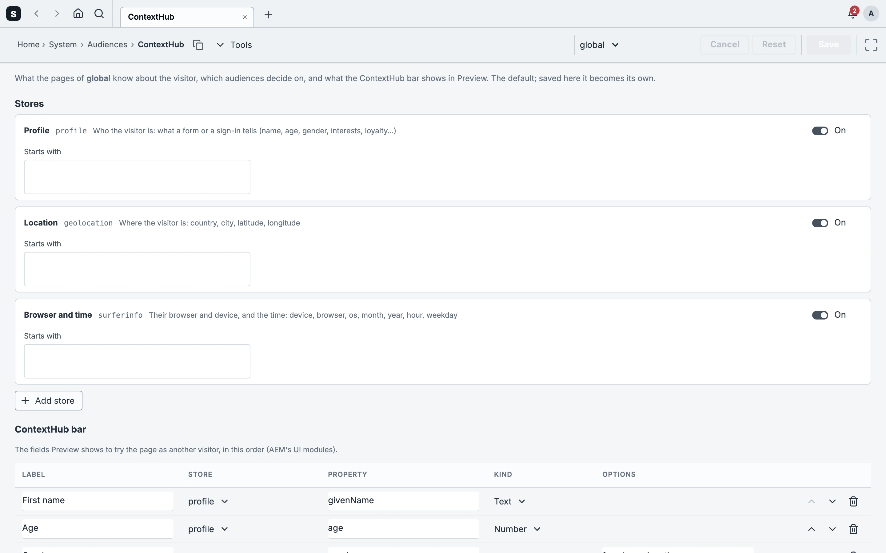

| Section | Meaning |
|---|---|
| **Stores** | The sets of facts about a visitor: profile, place, device and time. Switch one off to stop using it; **Add store** adds one of your own |
| **ContextHub bar** | The fields of the simulator: each with its **Label**, the **Store** and **Property** it sets, and its **Kind** (text, number, or a choice with its **Options**). The arrows order them; **Add field** adds one |

**Save** keeps the changes; **Reset** goes back to what Sensible Studio starts with.

## Publishing

Audiences are content, kept in the site's configuration. A personalized page on the live site needs its audiences there too: when you publish the page, the audiences it uses are offered to be published with it.

Personalized pages stay fast. Every visitor gets the same page from the cache, and the choice of experience is made in the browser.
