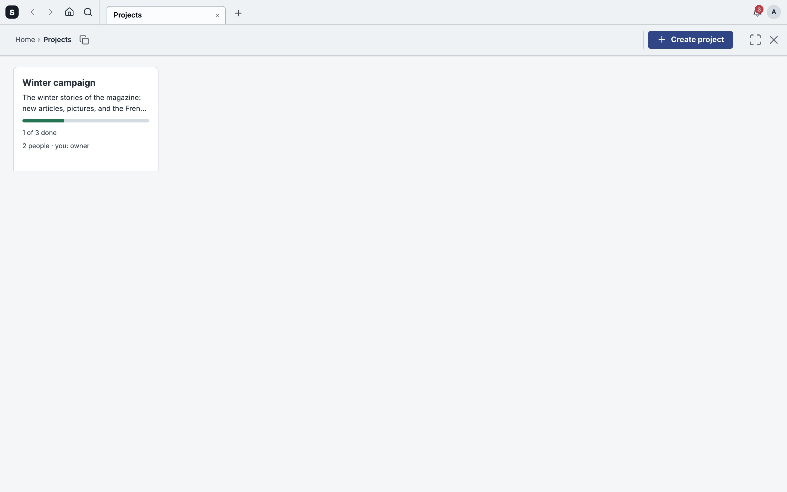
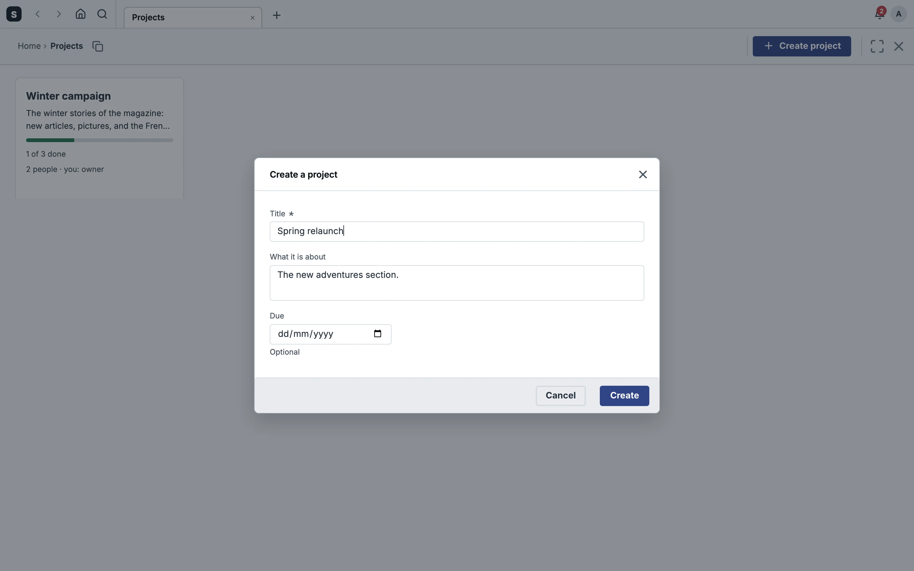
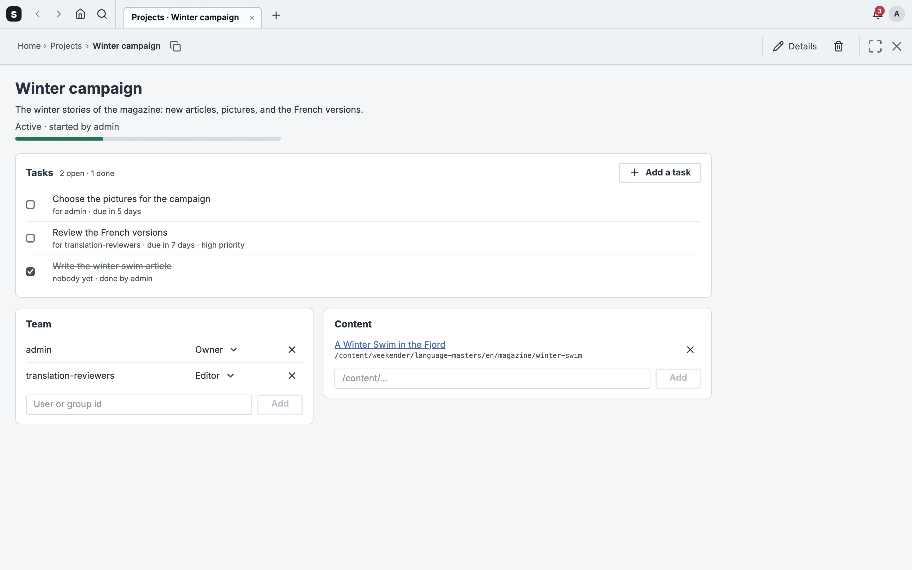
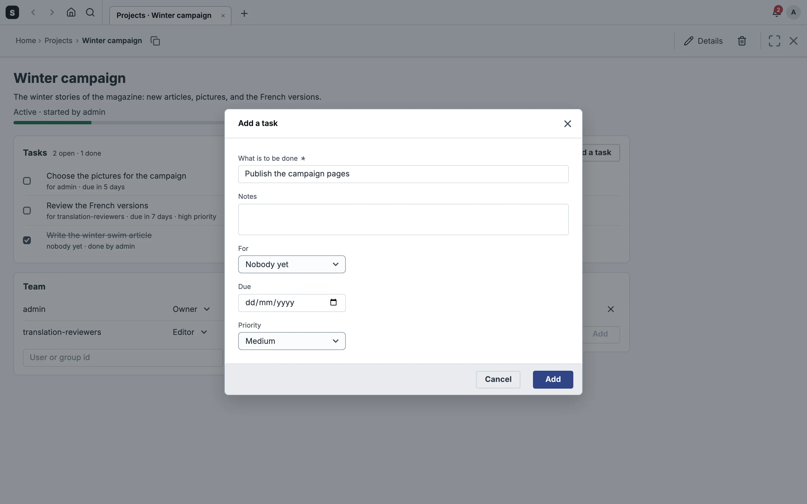
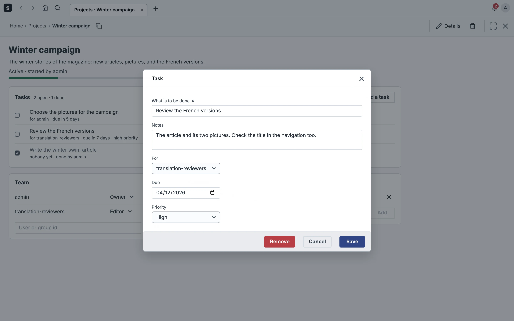
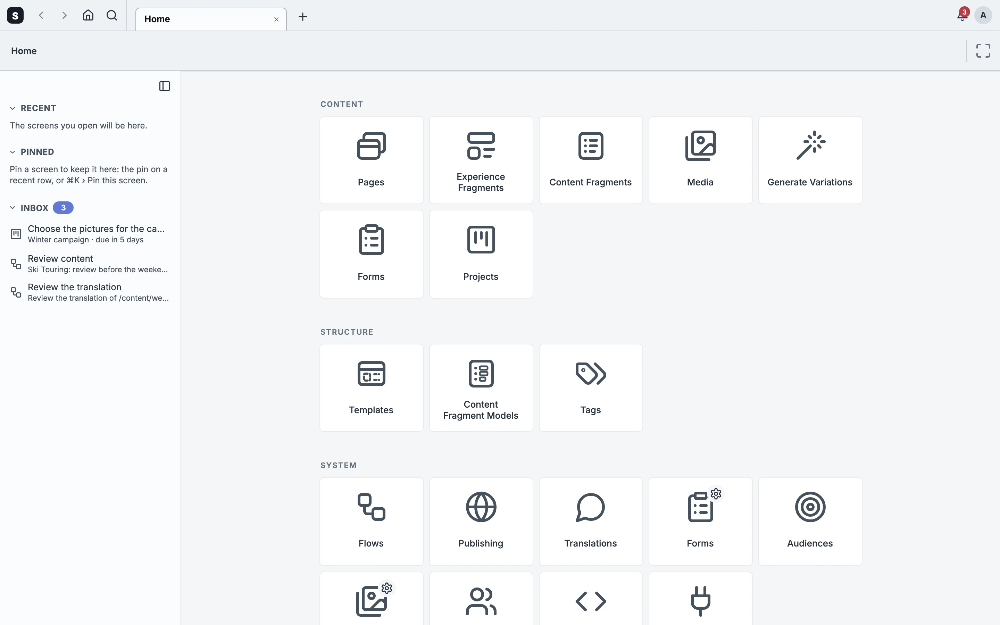
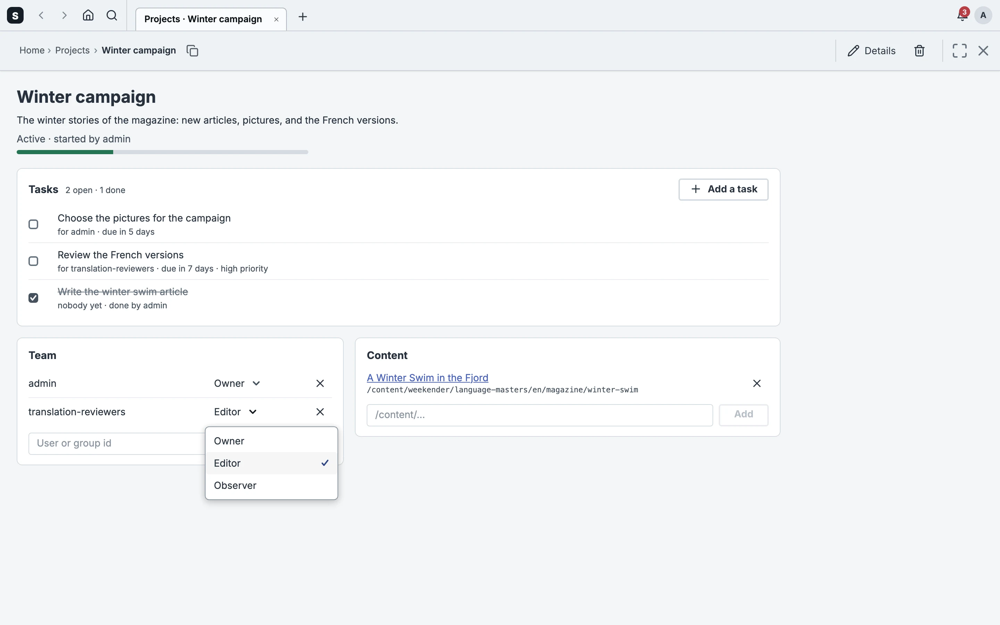
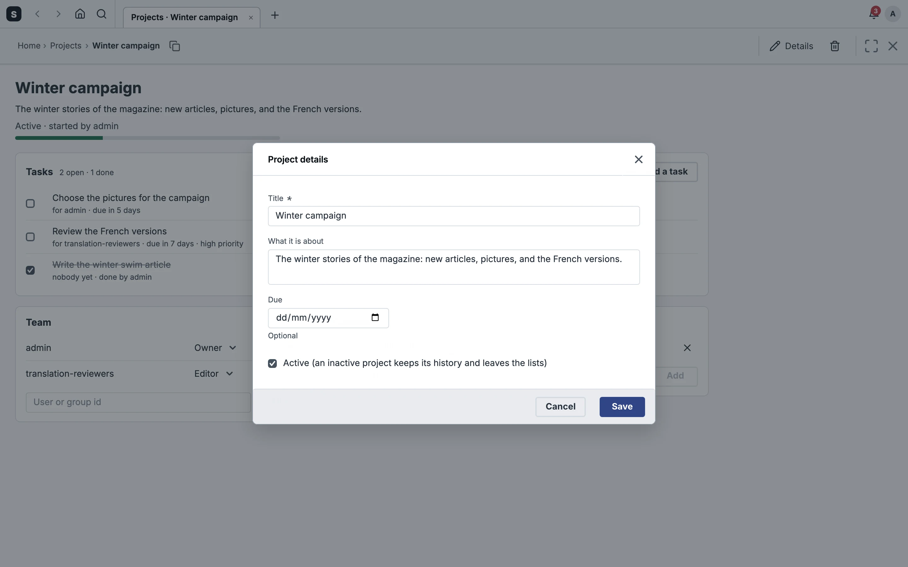

A project gathers what belongs to one piece of work: a campaign, a relaunch of a section, a new language. It holds the tasks to be done, the people doing them, and links to the pages and media involved.

Open **Home › Projects**.

## The list

Each project is a card with its title, what it is about, a progress bar, how many of its tasks are done, when it is due and how many tasks are late, how many people are in it, and your role. Active projects come first, the one due soonest at the top. Once a project is inactive, a switch at the top chooses between **Active** and **All**. A click opens a project.

## Create a project

**Create project** asks for three things.

| Field | Meaning |
|---|---|
| **Title** | The project's name |
| **What it is about** | A sentence or two, shown on the card and at the top of the project |
| **Due** | Optional: the date the work should be finished |

You become its owner.

## Inside a project

| Part | What it holds |
|---|---|
| The top | The title, what the project is about, whether it is active, who started it, and the progress of its tasks |
| **Tasks** | What has to be done, the open ones first, with how many are open and done |
| **Team** | The people and groups in the project, each with a role |
| **Content** | Links to the pages and media the project is about. A click opens them in their console |
| **Details**, the bin | At the top right: the project's own properties, and deleting the project |

## Tasks

**Add a task** opens a short form.

| Field | Meaning |
|---|---|
| **What is to be done** | The task, in a line |
| **Notes** | Anything the person needs to know |
| **For** | A member of the team, a person or a group, or **Nobody yet** |
| **Due** | Optional |
| **Priority** | High, Medium or Low |

In the list, a task shows who it is for, when it is due and its priority if it is high.

| To | Do this |
|---|---|
| Finish a task | Tick it. It is struck through and says who did it |
| Reopen it | Untick it |
| Change it | Click its title: the same form opens, with **Remove** to delete the task |

A task for you shows in the **Inbox** section on [Home](../getting-started/tour.md), above the flow steps that wait for you, with the project's name and when it is due. A click opens the project.

The bell at the top right counts your open tasks together with the flow steps, and the Inbox console lists them under **Tasks from projects**; see [Flows and the Inbox](flows.md).

## Team

Type a user or group id under **Team** and choose **Add**. Each member has a role, which you change with the menu beside the name; the cross removes the member.

| Role | May |
|---|---|
| **Owner** | Everything, including the team, the details and deleting the project |
| **Editor** | Add, change and finish tasks; add and remove content |
| **Observer** | Look |

A project always has at least one owner.

## Content

Type or paste the path of a page, a fragment or a file under **Content** and choose **Add**. The link shows the item's title with its path under it; the cross takes it out of the project, without touching the item itself.

## Details

**Details** changes the title, the description and the due date. Untick **Active** when the work is over: an inactive project keeps its history and leaves the list.

## Projects and other features

- A [translation project](translations.md) is a project of a special kind, for translating content into several languages. It has jobs instead of tasks, and its own console.
- A [flow](flows.md) moves one piece of content through fixed steps. A project is looser: a list of tasks you write yourself. Use a flow when every article must be approved the same way; use a project to keep track of everything a campaign needs.
- A [release](releases.md) holds the pages that go live together. A project can link to them.
