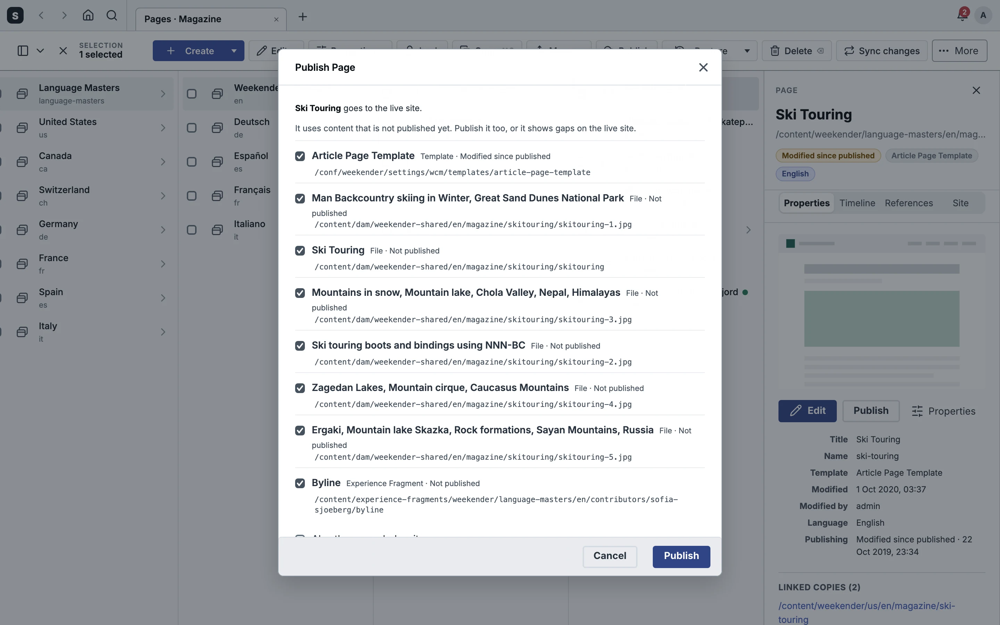
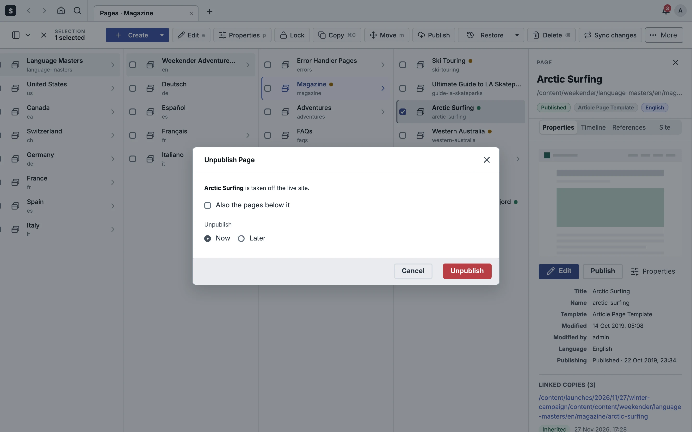
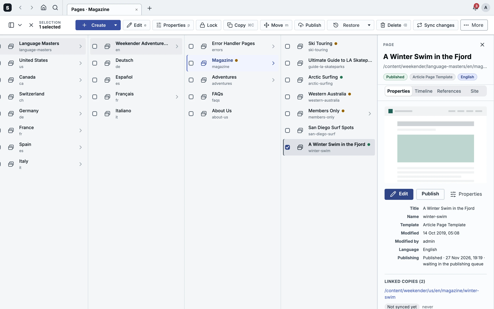
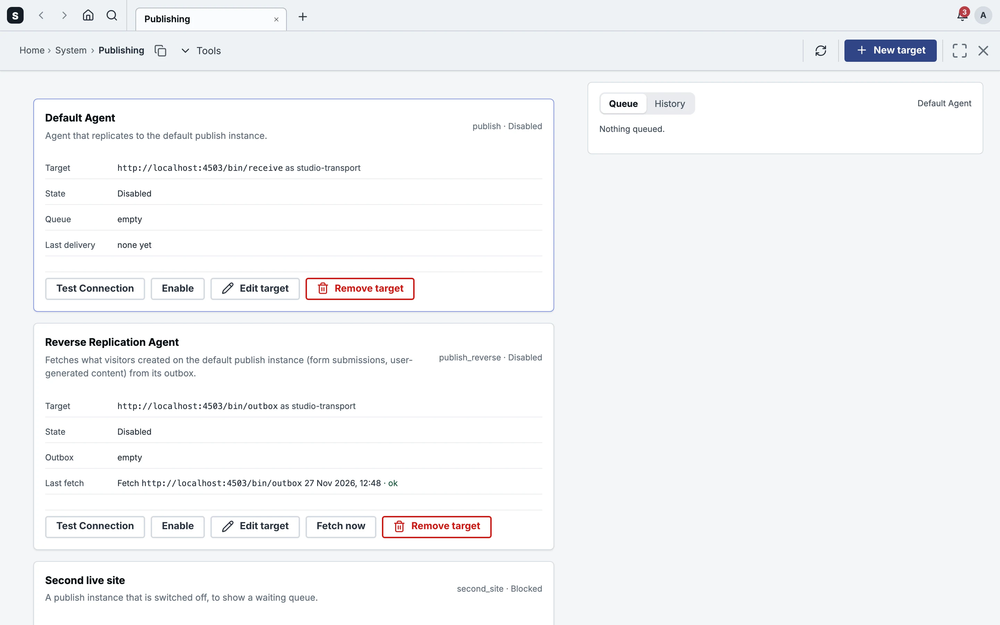
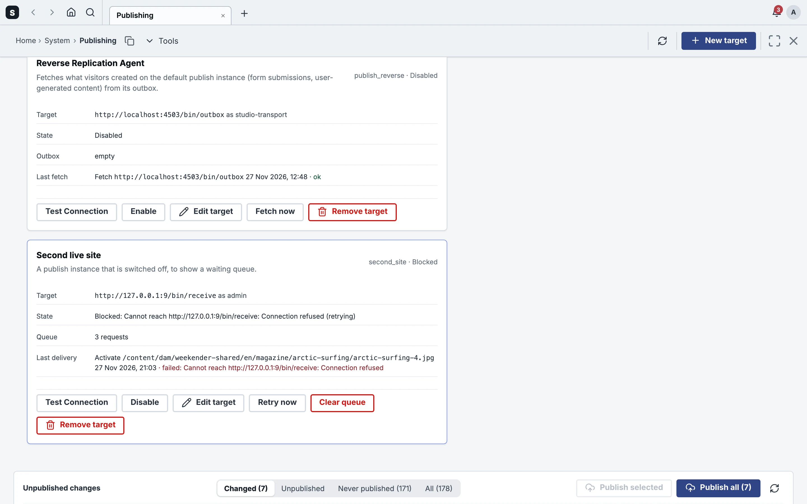
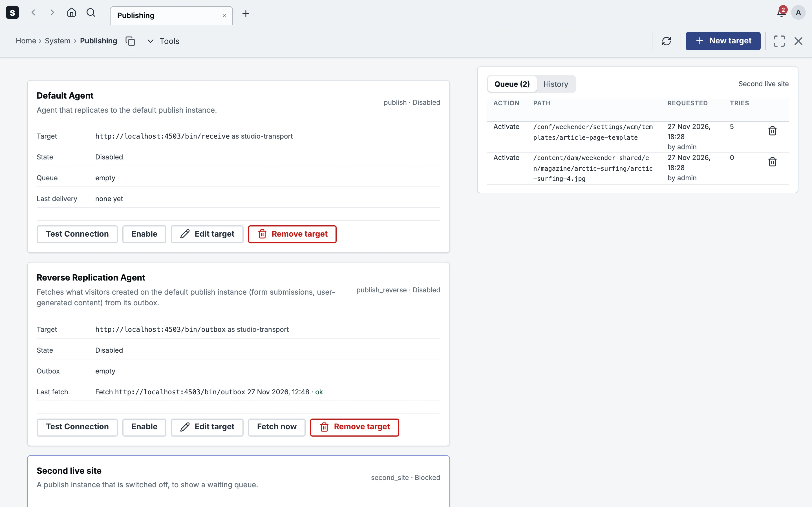
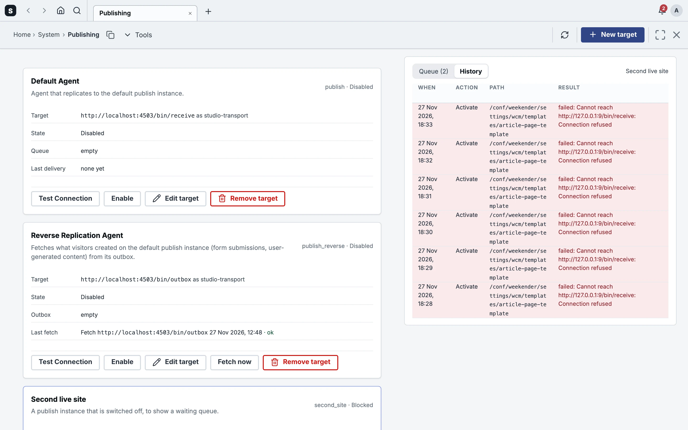
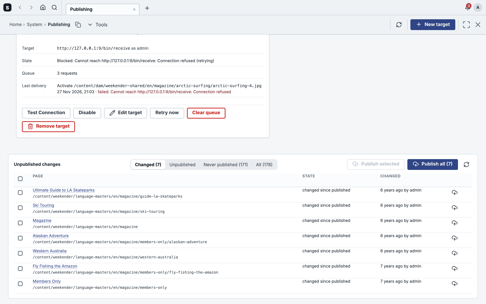
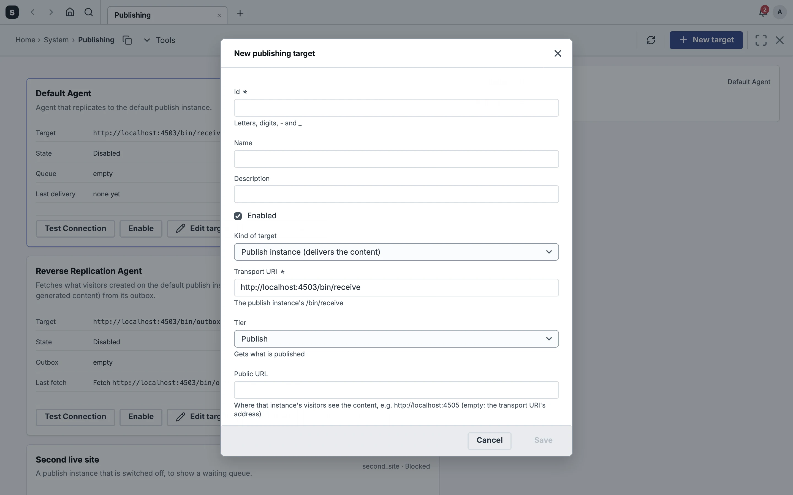
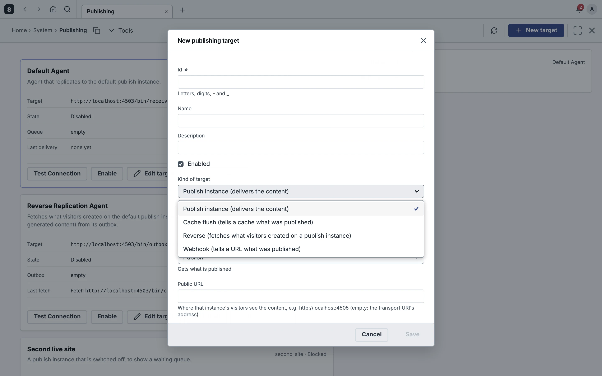

You write on the **author** instance. Visitors read the **live** site. Publishing is what carries a page from one to the other. Until you publish, nothing you do is seen by visitors.

## Publish a page

Select one or more pages in the Pages console and choose **Publish**. Or, in the page editor, choose **Publish** at the top right.

The dialog asks three things.

### What comes with it

A page is rarely complete by itself. The dialog lists what the page uses that is not yet published, each with a checkbox, its kind and its state:

- images and other media;
- experience fragments and content fragments;
- its template and component configurations;
- tags;
- pages it links to;
- the audiences its personalized components use.

Leave them ticked unless you know why not: a published page that shows an unpublished image shows a gap. When everything is already published, the dialog says so.

**Also the pages below it** publishes a whole section. Parents are sent before their children.

### When

- **Now**: the page is sent at once.
- **Later**: at a date and time you choose. The button becomes **Publish later**, and the request waits in the publishing queue until then. The page is published as it is *at that moment*, not as it is now, so you can keep working on it.

### Where

When a preview has been set up, the dialog also asks for the destination:

- **Publish**: the live site.
- **Preview**: a separate copy of the site for people to look at before something goes live. A page sent to the preview is not on the live site, and its publishing state is kept apart.

## Unpublish

**More › Unpublish** takes the page off the live site. It stays on the author instance, untouched, and can be published again. Like publishing, it can be done **Later**, and with **the pages below it**.

## What the dots mean

Each page in the Pages console shows its state with a dot after its title, and in words in the inspector.

| State | Meaning |
|---|---|
| **Published** (green) | The live site has the page as it is now |
| **Modified** (orange) | The page was changed since it was published. Visitors still see the older one |
| **Not published** (no dot) | The page has never been published, or was unpublished |
| **Pending** | A request is waiting to be delivered |

The inspector's **Properties** and **Timeline** tabs say when the page was last published, and by whom.

## The Publishing console

**Home › System › Publishing › Publishing** shows where publications go and what is on its way.

### Targets

A target is a place publications are sent to. Each has a card.

| Line | Meaning |
|---|---|
| The title and description | What the target is. Its id and state are at the right |
| **Target** | The address it delivers to, and the user it delivers as |
| **State** | *Idle*, *Disabled*, or *Blocked* with the reason: the address cannot be reached, the user is refused |
| **Queue** | How many requests wait |
| **Last delivery** | What was sent last and when; in red, why the last one failed |

| Button | What it does |
|---|---|
| **Test Connection** | Tries the address and the user, and says what answered |
| **Enable**, **Disable** | A disabled target receives nothing: what you publish does not wait for it |
| **Edit target** | Its settings |
| **Retry now** | Does not wait for the next minute to try the queue again |
| **Clear queue** | Drops everything that waits for this target |
| **Fetch now** | For a target that fetches: asks the live site now for what visitors created |
| **Remove target** | Deletes the target |

### The queue and the history

Click a target's card. The panel on the right shows its **Queue**: each waiting request with its action, its path, when it was asked for and by whom, and how often it was tried. The bin at the end of a row takes that one request out of the queue.

Publishing is a queue: if the live site cannot be reached, the requests wait and are tried again every minute; nothing is lost. A request that can never succeed holds the ones behind it. Take that one out with its bin instead of clearing the whole queue.

A request scheduled for later is listed here too, with its date, and the bin cancels it.

**History** lists what was delivered and what failed, newest first; failures are in red with their reason.

### Unpublished changes

Under the targets, **Unpublished changes** lists every page that the live site does not have as it is now.

| Tab | Lists |
|---|---|
| **Changed** | Pages changed since they were published |
| **Unpublished** | Pages that were taken off the live site |
| **Never published** | Pages that were never published |
| **All** | All three |

Each row has the page, its state, and when it was changed and by whom. Tick rows and choose **Publish selected**, use the button at the end of a row for one page, or **Publish all**. Look here before a release, or at the end of a day. The pages a [release](releases.md) holds are not listed: they are published when the release goes live.

### New target

**New target** adds one. This is an administrator's task; see [Publishing targets](../developer/publishing-setup.md) for what each kind needs on the other side.

| Field | Meaning |
|---|---|
| **Id**, **Name**, **Description** | How the target is called. The id cannot change later |
| **Enabled** | Whether it receives what is published |
| **Kind of target** | See below |
| **Transport URI** | The address to deliver to |
| **Tier** | **Publish** for the live site, **Preview** for a preview |
| **Public URL** | Where that instance's visitors see the content, when it differs from the transport address |
| **User**, **Password** | The account the target delivers as |
| **Retry delay** | How long to wait before a failed request is tried again |

| Kind | What it does |
|---|---|
| **Publish instance** | Delivers the content |
| **Cache flush** | Tells a cache what was published, so that it drops those pages |
| **Reverse** | Fetches what visitors created on a publish instance, such as form submissions |
| **Webhook** | Tells an address of your own what was published |

## When it does not arrive

If a page you published does not show on the live site:

1. Look at the page's state. **Pending** means it is still in the queue.
2. Open the Publishing console. A target that cannot be reached says why, and its queue shows what waits.
3. If it was delivered and the site still shows the old page, the cache has not been refreshed. See the next section.

Tell your administrator; these are things for them to fix.

## The cache in front of the live site

Most visitors do not reach the publish instance at all. A cache in front of it keeps a copy of each page and answers from that copy, which is what makes the site fast.

When you publish, the cache is told, and it drops what the publication changed:

- the page itself;
- the pages that show it: a page that lists it, a teaser that links to it, the navigation it is in;
- when an image, a fragment or a template is published, the pages that use it.

Other pages stay in the cache. The next visitor of a page that was dropped gets the new version.

When a cache is set up, the Publishing console shows it too: what it holds, what it was last told, and a **Test a URL** tool that says what the cache does with an address and why. **Clear cache** empties it; use it only after a change to the site's code, never as a routine. See [The Live cache](../developer/live-cache.md).

## Who may publish

Publishing is a right of its own. An author may be allowed to change pages and not to publish them. In that case **Publish** is not offered, and the usual way forward is a [flow](flows.md): you ask for a review, and the reviewer publishes.

## Things that are published separately

| What | How it reaches the live site |
|---|---|
| **Media** | **Publish** in the Media console, or along with a page that uses it |
| **Content fragments** and their **models** | **Publish** in their consoles. An application sees a fragment only once it is published |
| **Experience fragments** | Like pages |
| **Templates** | **Publish** in the Templates console, with their component configurations |
| **Tags** | **Publish** in the Tags console, or along with the content that uses them |
| **Users and groups** who sign in on the site | **Publish** in the Users and Groups consoles |
| **Forms** | Like pages. What visitors submit travels back to the author instance by itself |
| **Releases** | Not published: a release goes live, and its pages are published then |
