A release is a set of pages prepared for a date: a campaign, a seasonal change, a relaunch. You work on a copy of the pages, kept aside, while the pages visitors see stay as they are. When the day comes, the release **goes live**: its content takes the place of today's.

## Create a release

In the Pages console, select the page or pages and choose **Create › Release**. With several pages selected, they all go into the same release.

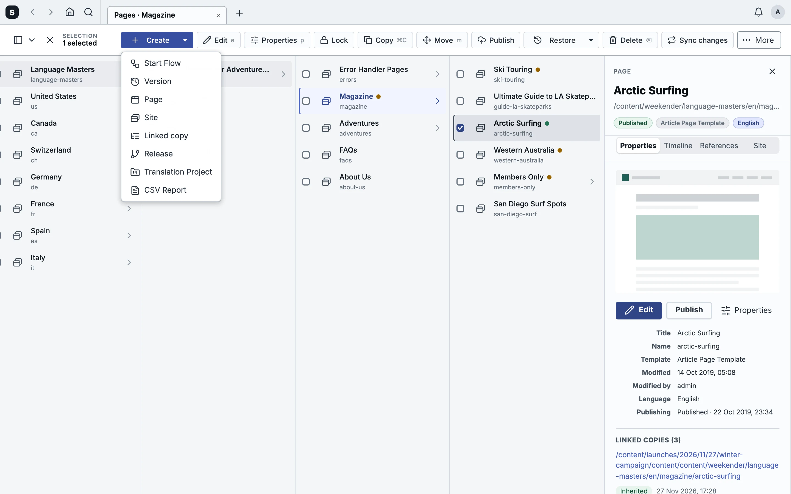

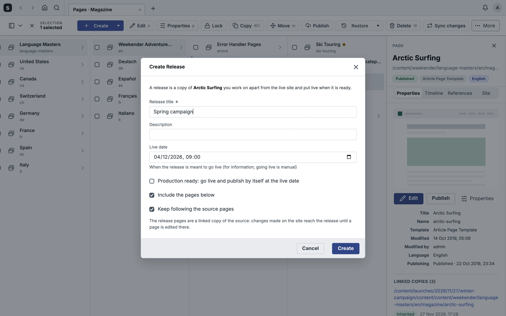

| Field | What it is for |
|---|---|
| **Release title** | A name people will recognise: "Spring campaign" |
| **Description** | What the release is for |
| **Live date** | When the release is meant to go live. It starts a week from now. By itself the date is information only: going live is done by hand |
| **Production ready** | The release goes live and its pages are published by themselves at the live date. Needs a live date |
| **Include the pages below** | The release takes the whole section, not only the selected page |
| **Keep following the source pages** | The release pages are a linked copy of today's pages: a change made on the site reaches the release too, until someone edits that page in the release |

**Create** makes the release and offers to open it.

You can also start from **Home › System › Publishing › Releases** with **Create Release**. It first asks for the source page: walk the sites with the arrows, click a page, and choose **Next** for the same dialog.

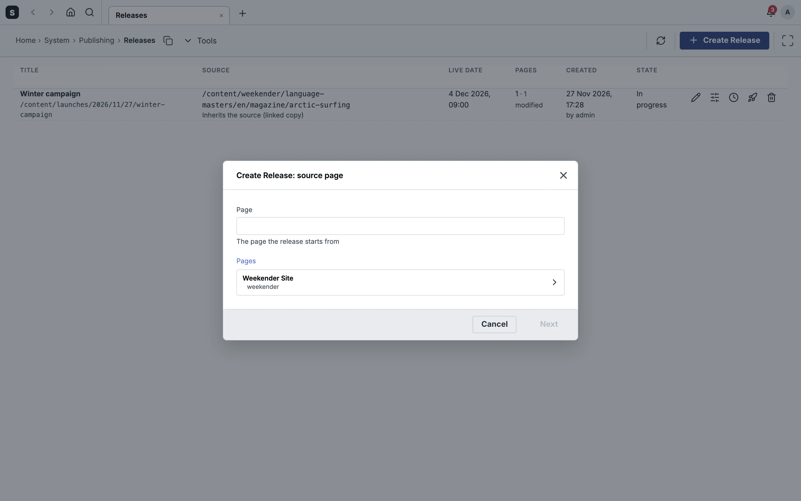

## Work in a release

A page in a release opens in the normal page editor. A band under the top bar tells you where you are.

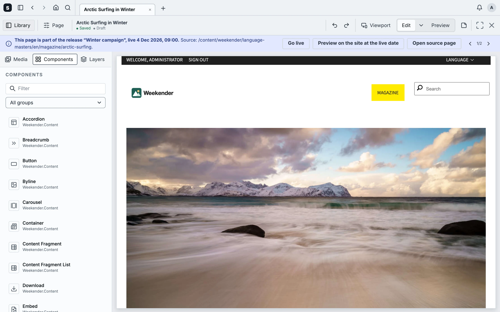

| In the band | Meaning |
|---|---|
| The text | The release the page belongs to, its live date, and the source page |
| **Go live** | Puts the release, or this page of it, live now |
| **Preview on the site at the live date** | Opens the page as a visitor will see it once the release is live |
| **Open source page** | Opens today's version of the page |
| The arrows and the count | Step through the versions of this page: today's, and each release that holds it |

Everything else works as usual: components, properties, annotations, flows for review. Nothing you do there shows on the live site. There is no **Publish** button, because a release is not published: it goes live, and the pages are published then.

The page menu has a section for the release.

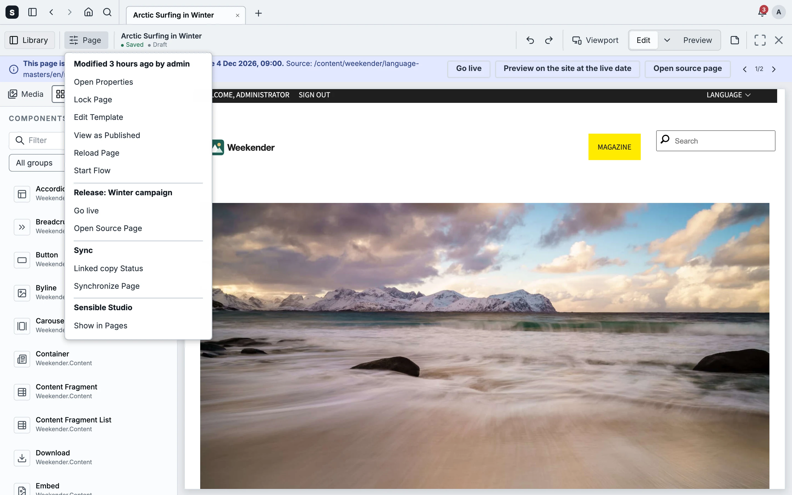

| Section | Entries |
|---|---|
| **Release: the title** | **Go live**, **Open Source Page** |
| **Sync** | For a release that follows its source: **Linked copy Status** and **Synchronize Page**, as in any [linked copy](sync.md) |

### Find a page's releases

Select today's page in the Pages console and open the inspector's **References** tab. Under the references and the linked copies, **Releases** lists each release that holds the page, with its live date and who made it. A click opens the page as it is in that release. A release that follows its source is also listed among the linked copies, with its state.

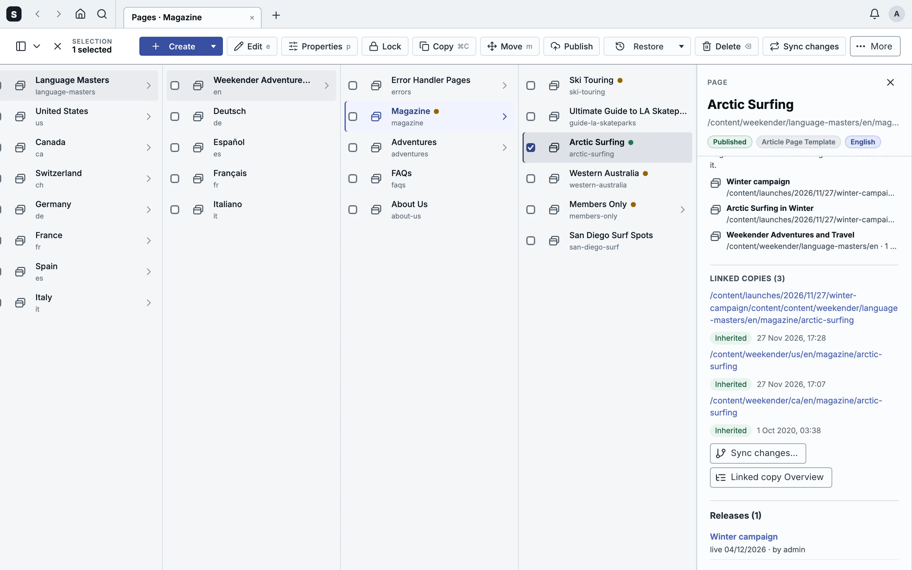

## Preview the future

There are two ways to see the site as it will be:

- In a release page's band, choose **Preview on the site at the live date**.
- In the editor of today's page, switch the mode to **History**. The bar shows a date to look at, and after it a button for each of the page's releases with its live date. Click one to see the page as of that date.

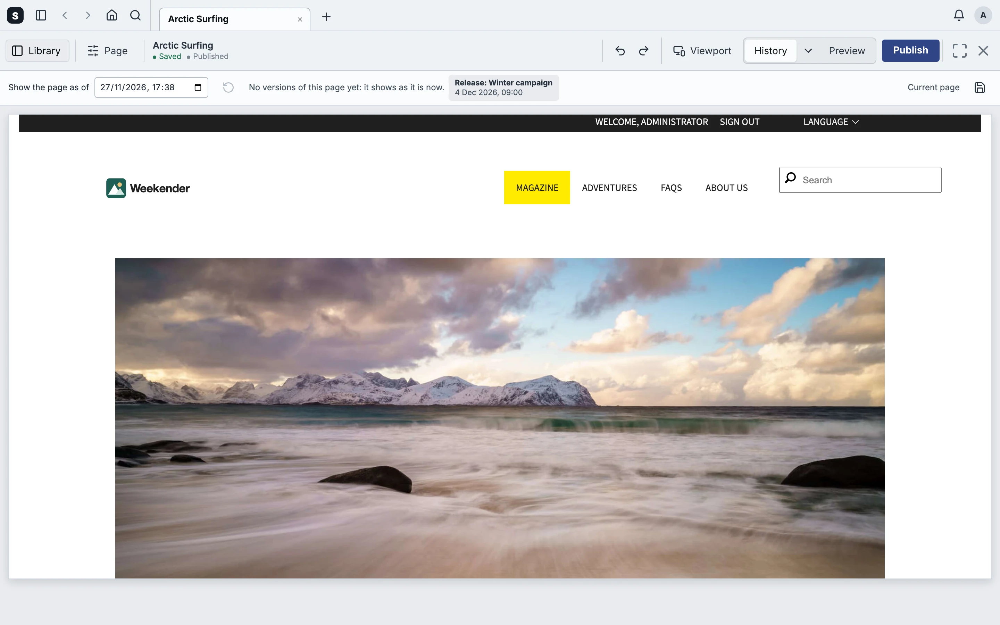

## Go live

Open **Home › System › Publishing › Releases** and choose the rocket of the release, **Go live**. Or choose **Go live** in the band or the page menu of a page in the release.

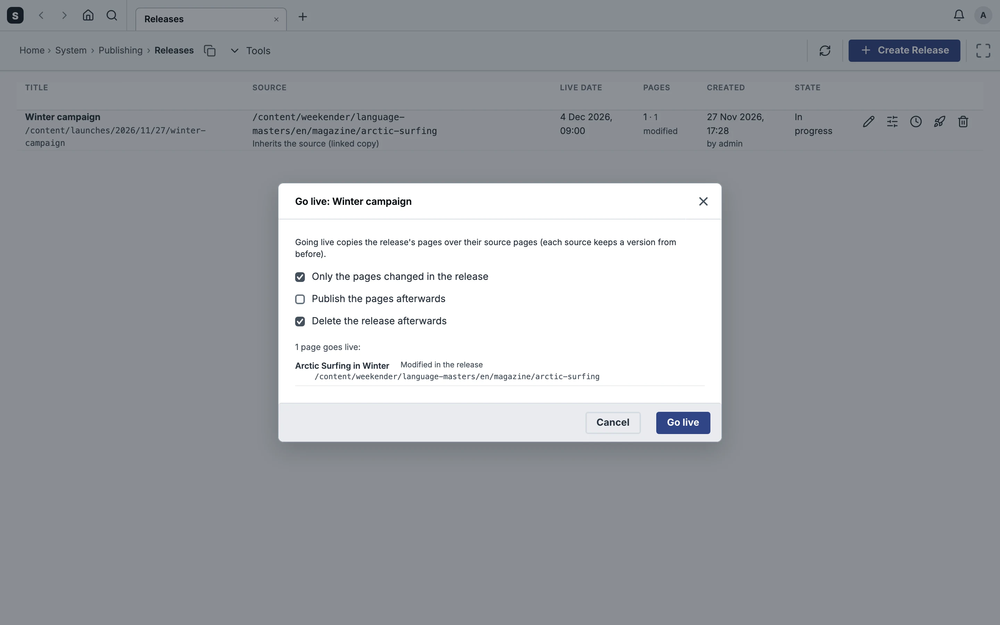

| Choice | Meaning |
|---|---|
| **Go live** (from a page only) | What goes live: **The whole release**, **This page only**, or **This page and the pages below it** |
| **Only the pages changed in the release** | Leaves alone the pages nobody touched in the release. Usually what you want: an untouched page may be older than today's |
| **Publish the pages afterwards** | Puts them on the live site at once. Without it they are changed on the author only, and you publish when you are ready |
| **Delete the release afterwards** | Removes the release once it has gone live |

The dialog lists what will go live with these choices, or says that nothing will: for example when only changed pages are asked for and no page was changed.

Going live copies the release's pages over their source pages. Before a page is replaced, a version of it is saved, so you can go back. A page that exists only in the release is created in the right place.

### By itself, at the live date

Tick **Production ready** when you create the release, or switch it on later with the clock in the Releases console. At the live date the release goes live and its pages are published, without anyone having to be there. The console then shows *Goes live by itself* with the date.

If something stops it, the console shows the reason in red and the release waits; fix the cause and switch **Production ready** on again.

> **Note:** Without **Production ready**, a live date is only information. Nothing happens by itself.

## The Releases console

**Home › System › Publishing › Releases** lists every release.

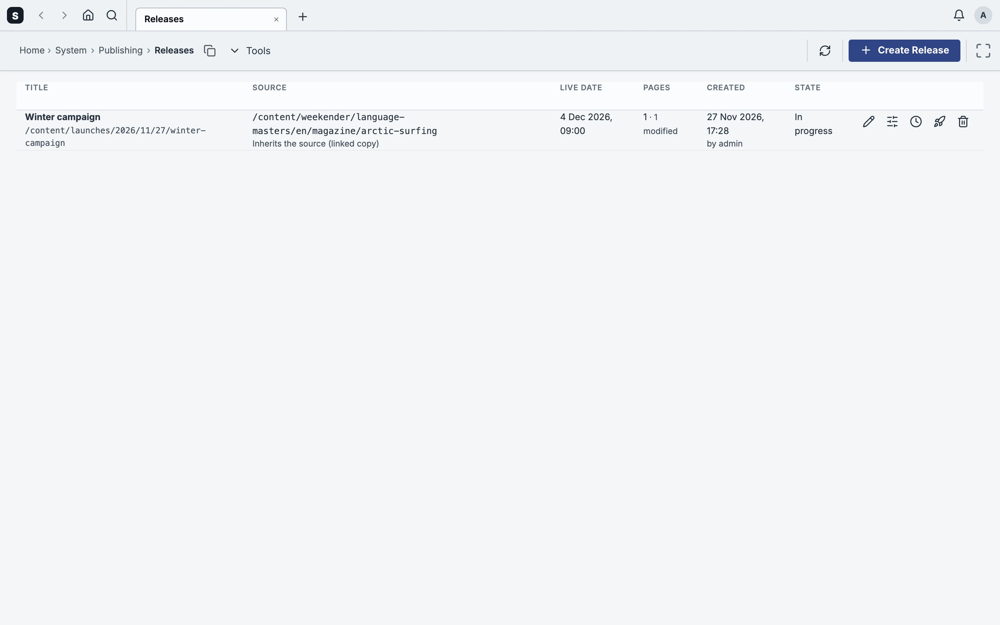

| Column | Meaning |
|---|---|
| **Title** | The release, and where it is kept |
| **Source** | The page it was made from (and how many more, for several), and whether it follows the source or is a plain copy |
| **Live date** | When it is meant to go live |
| **Pages** | How many pages it holds, and how many of them were changed in the release |
| **Created** | When, and by whom |
| **State** | *In progress*, *Goes live by itself* with the date, or *Went live* with the date |

| Button | What it does |
|---|---|
| The pencil | Opens the release's page in the page editor |
| **Properties** | The title, the description and the live date |
| The clock, **Production ready** | Switches going live by itself on or off. It needs a live date |
| The rocket, **Go live** | Puts the release live now |
| The bin | Deletes the release, after a confirmation |

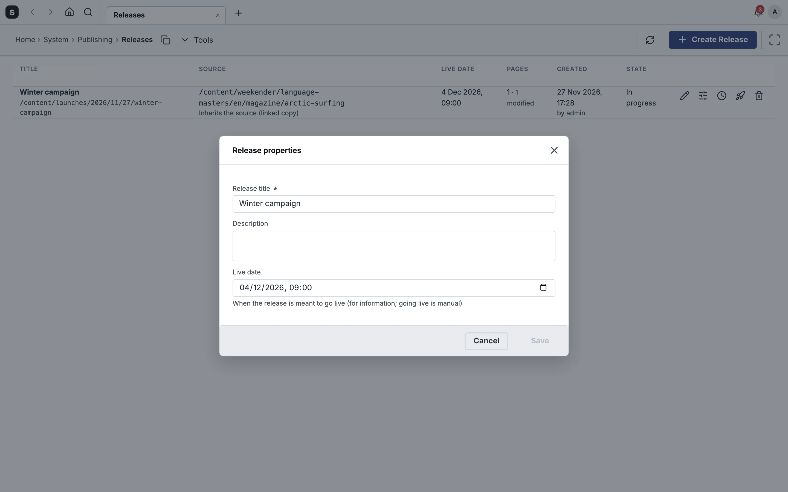

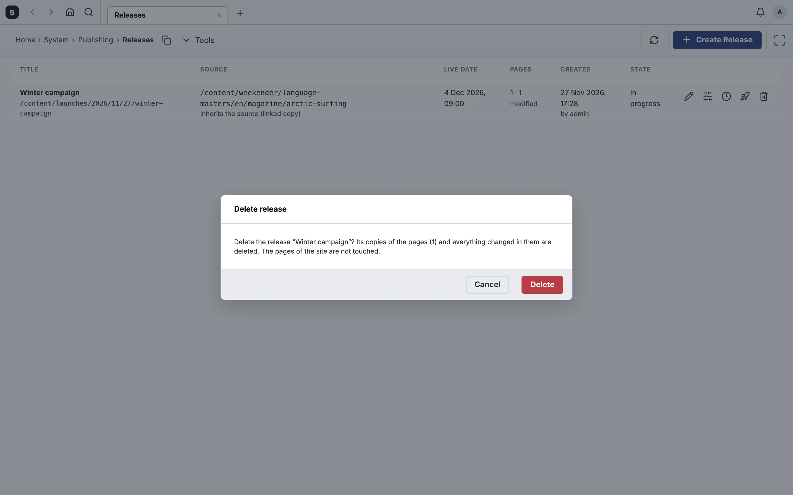

The circular arrow at the top reads the list again; **Create Release** starts a new one.

## Good to know

- A release is not published. You put it live, and the pages are published then.
- Two releases can hold the same page. The one that goes live last wins; look at the page's **References** before you start a second one.
- Deleting a release deletes its copies of the pages and what was changed in them. Today's pages are not touched.
- A release that follows its source receives the site's changes like any linked copy: **Sync changes** on the source page lists it beside the country sites.
