Many organisations run the same site several times: one per country, per brand, per shop. Most of the content is the same; some of it differs. Sensible Studio keeps such a family in step with **sources** and **linked copies**.

- The **source** is where content is written first.
- A **linked copy** follows the source. A change in the source is brought to the copy when you **sync changes**.
- Where a copy needs to differ, you **cancel the inheritance** of that component or page. From then on it is the copy's own, and syncing leaves it alone.

A typical site has a language master as its source, such as `/language-masters/en`, and one linked copy per country that uses that language. In the demo, *United States › English* (`/content/weekender/us/en`) and *Canada › English* (`/content/weekender/ca/en`) are linked copies of *Language Masters › English*.

## Recognise a copy and a source

In the Pages console a linked copy has a small link icon after its title.

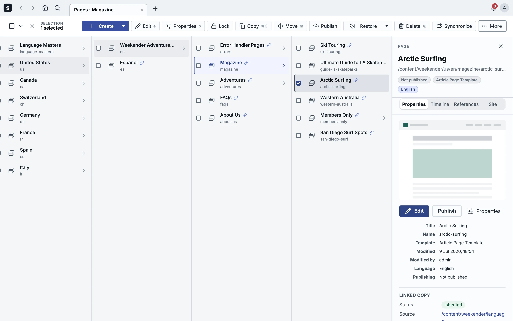

Select a page and look at the inspector's **Properties** tab. For a copy it has a section **Linked copy**:

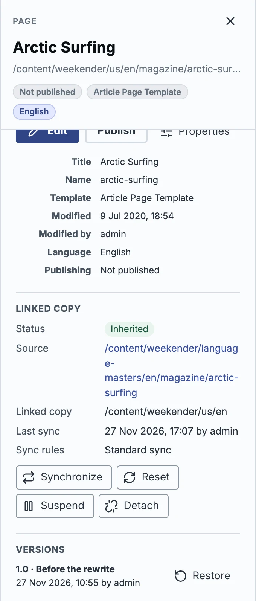

| Line | Meaning |
|---|---|
| **Status** | **Inherited**: the page follows its source. Other states: *Inheritance cancelled*, *Suspended*, *Not synced yet*, *Source page missing* |
| **Source** | The page this one follows. Click it to go there |
| **Linked copy** | The top of the copy this page belongs to |
| **Last sync** | When changes were last brought over, and by whom |
| **Sync rules** | What a sync does |
| **Synchronize**, **Reset**, **Suspend**, **Detach** | The actions on the copy, described below |

For a source, the same place lists its **Linked copies**, each with its state, and the bar has **Sync changes** instead of Synchronize.

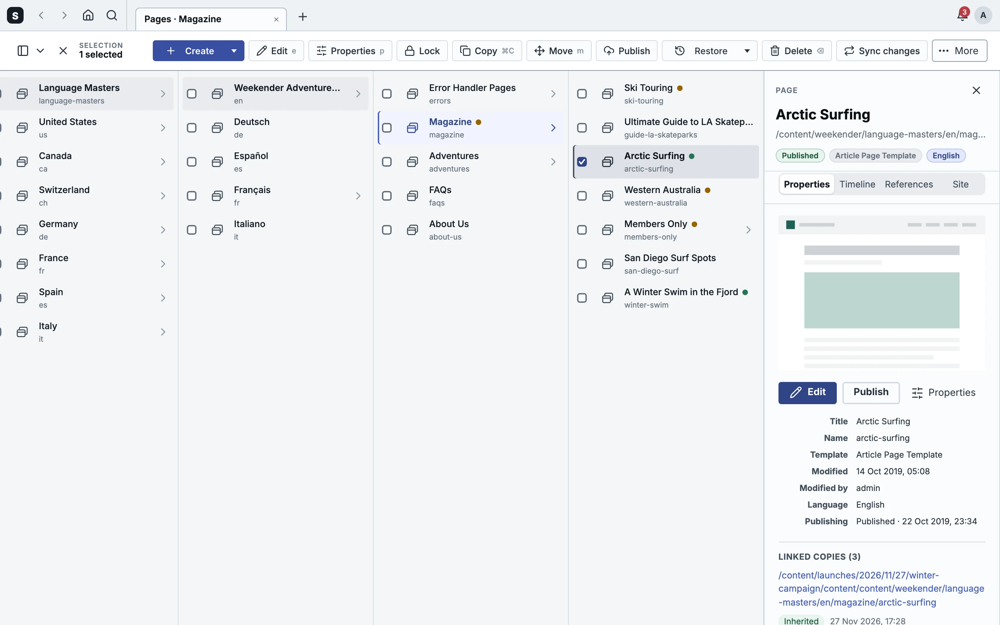

## Create a linked copy

In the Pages console, go to where the copy should be and choose **Create › Linked copy**.

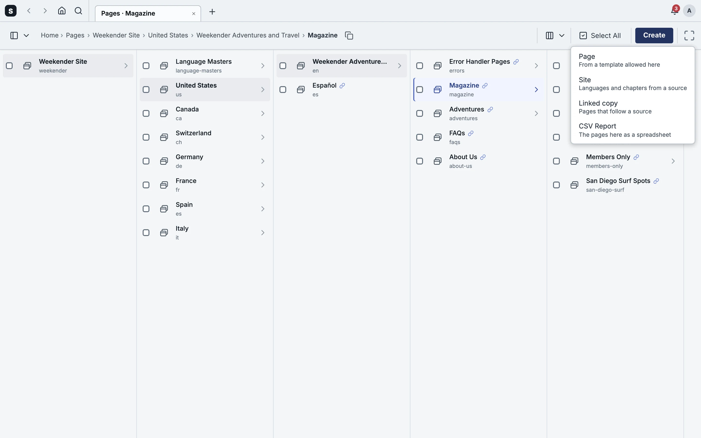

**Step 1, Source.** Type a part of the title or path of the page to follow and pick it from the list. Each line shows the title and the full path, because the same title exists in every country.

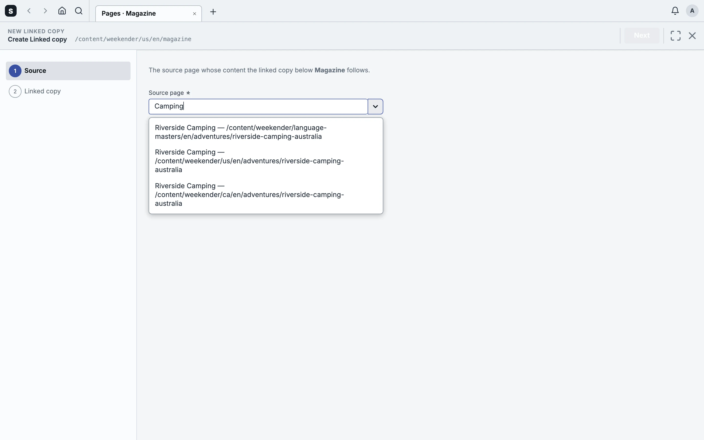

**Step 2, Linked copy.**

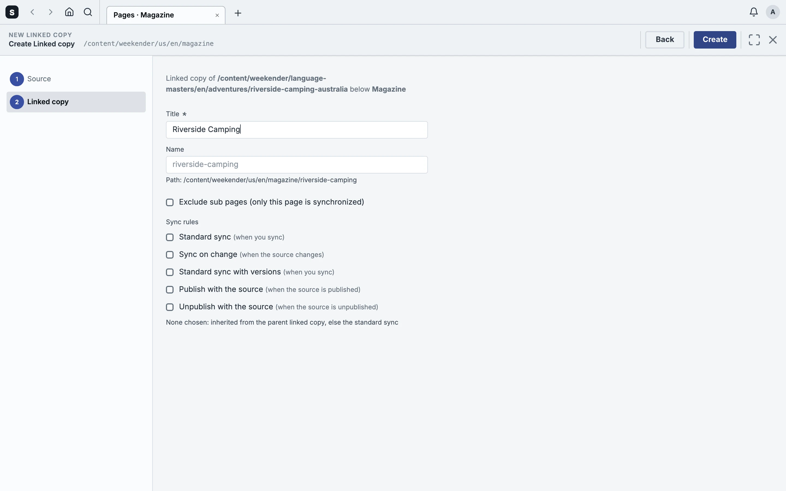

| Field | Meaning |
|---|---|
| **Title** | Starts as the source's title |
| **Name** | The page's name in the address. Empty, it is made from the title; the path that results is shown below |
| **Exclude sub pages** | Ticked, only this page follows the source. Otherwise the pages below it come along, now and when new ones are added in the source |
| **Sync rules** | What a sync does, and when. With none chosen, the copy uses the rules of the linked copy it is created in, or else the standard sync |

| Sync rule | When it runs | What it does |
|---|---|---|
| **Standard sync** | When you sync | Brings over new and changed content, and removes what was removed in the source |
| **Sync on change** | When the source changes | The same, by itself, each time the source is saved |
| **Standard sync with versions** | When you sync | The same as the standard sync, and saves a version of the copy first |
| **Publish with the source** | When the source is published | Publishes the copy too |
| **Unpublish with the source** | When the source is unpublished | Takes the copy off the live site too |

**Create** makes the copy. **Back** returns to the source.

## Create a whole site

**Create › Site** makes a complete site from a **site source**: the languages and chapters of an existing site, as the recipe for a new one.

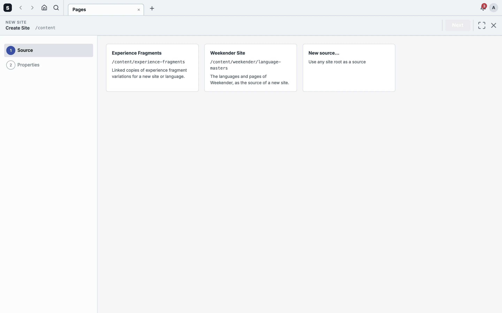

Pick a source and choose **Next**. **New source…** uses any site as a source without setting it up first.

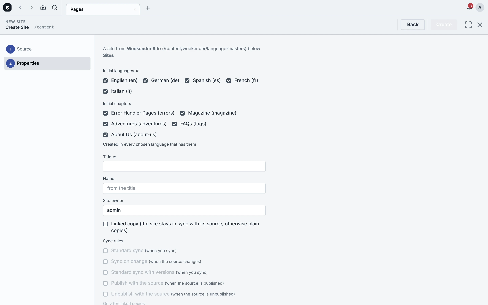

| Field | Meaning |
|---|---|
| **Initial languages** | The languages the new site starts with. At least one |
| **Initial chapters** | The sections below each language. A chapter is created in every chosen language that has it |
| **Title**, **Name** | The site's title, and its name in the address |
| **Site owner** | The user who looks after the site |
| **Linked copy** | Ticked, the site stays in sync with its source. Otherwise its pages are plain copies with no link back |
| **Sync rules** | For a linked copy: the rules of the table above |

## Sync changes

There are two directions, and both do the same work.

| From | Action | Use it when |
|---|---|---|
| The source | **Sync changes** | You changed the source and want to push it to some or all of its copies |
| A linked copy | **Synchronize** | You look after one copy and want to pull in what is new |

Both are on the bar of the Pages console when the page is selected, in the inspector, and in the page's properties.

**Sync changes** asks which copies receive the change.

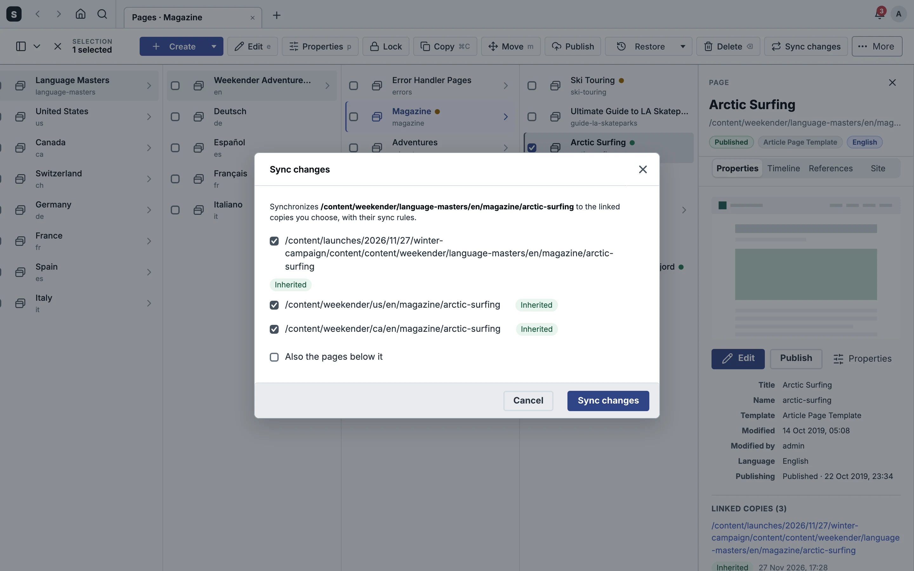

Untick the copies that should wait, tick **Also the pages below it** to include the whole branch, and choose **Sync changes**. A copy whose rules do not run on a manual sync is marked with what triggers it instead.

**Synchronize** has nothing to ask: it brings the source's changes to the selected copy at once and says how many pages were updated.

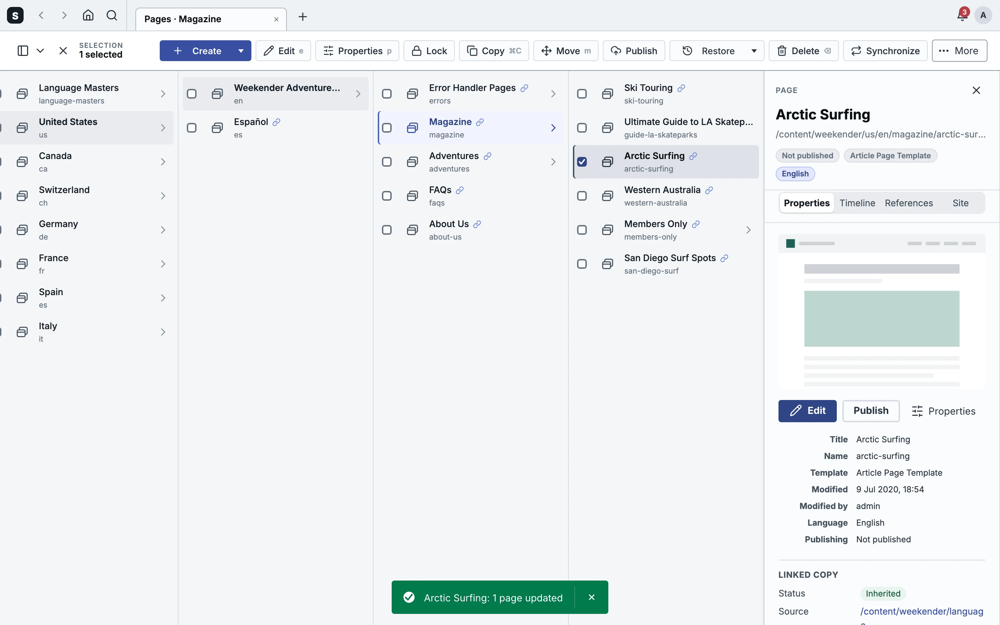

Before a page is changed by a sync with versions, a version of it is saved. If a sync brought something you did not want, go back to that version. See [Pages](pages.md).

> **Note:** Syncing changes the copy on the author instance. Visitors see the change after the copy is published.

## Let a copy differ

Open the linked copy in the page editor. A band under the top bar says that the page is a linked copy, names its source and says when it was last synced.

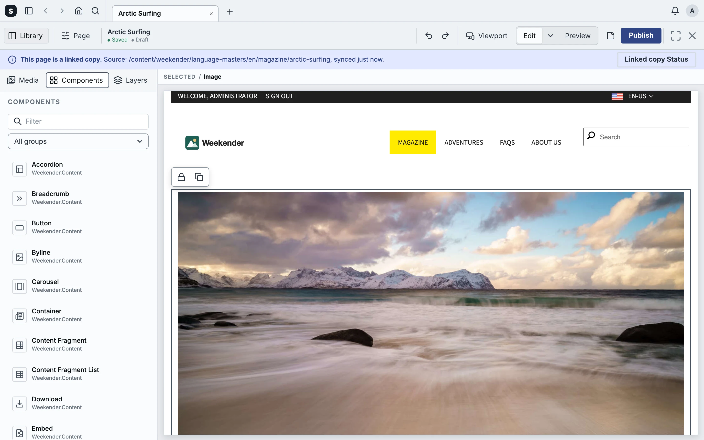

A component that follows the source has a short toolbar: a lock and **Copy**. You cannot edit it here, because the next sync would replace what you typed.

| To | Do this |
|---|---|
| Change one component | Select it and choose the lock, **Cancel inheritance**. The component gets its full toolbar, and it is the copy's own from now on |
| Give it back to the source | Select it and choose **Re-enable inheritance**. Its content is replaced by the source's at the next sync |
| Add something only this copy has | Add a component as usual. Components you add are the copy's own from the start, and syncing never touches them |

**Linked copy Status**, at the end of the band, shows the page's state and has the four actions.

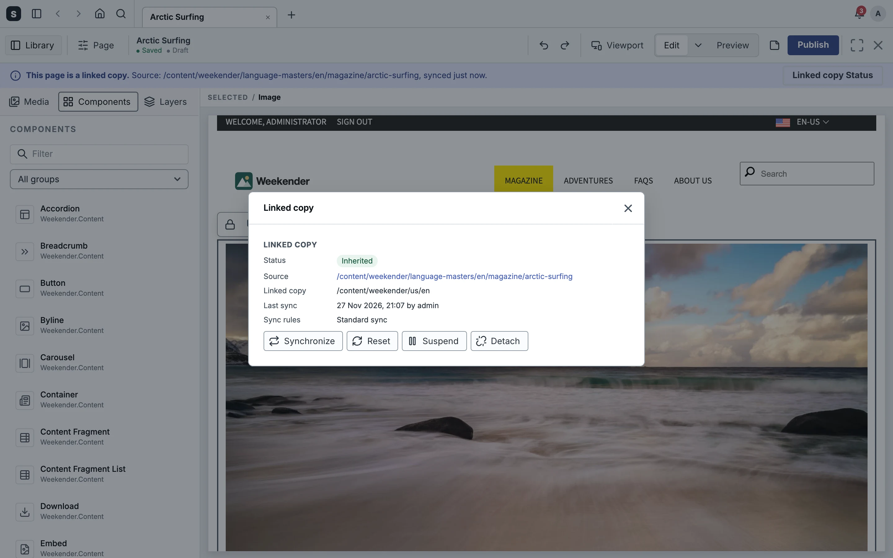

## Suspend, reset, detach

| Action | What it does |
|---|---|
| **Synchronize** | Brings the source's changes to this page now |
| **Reset** | Throws away everything that was changed in the copy and makes it match the source again, cancelled inheritances included |
| **Suspend** | The copy stops receiving changes for now. **Resume** switches it back on |
| **Detach** | Cuts the link for good. The page becomes an ordinary page |

> **Warning:** Reset and Detach cannot be undone, except by going back to a version of the page.

## In the page properties

A linked copy has a tab **Linked copy** in its [properties](page-properties.md).

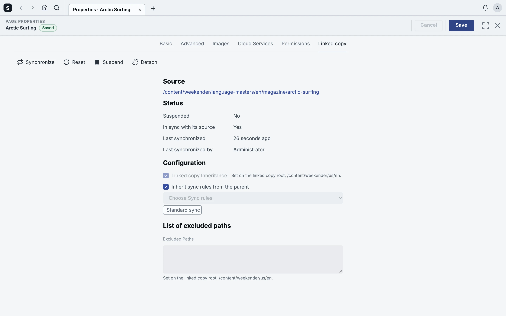

| Part | Meaning |
|---|---|
| The actions at the top | Synchronize, Reset, Suspend, Detach |
| **Source** | The page this one follows |
| **Status** | Whether it is suspended, whether it is in sync, when it was last synchronized and by whom |
| **Linked copy inheritance** | Whether the pages below follow too. It is set at the top of the copy and shown here |
| **Inherit sync rules from the parent** | Ticked, the page uses the rules of the page above it. Untick it to choose rules for this page and the pages below |
| **Excluded Paths** | Pages of the source that this copy does not take. Set at the top of the copy |

A source has a tab **Source**.

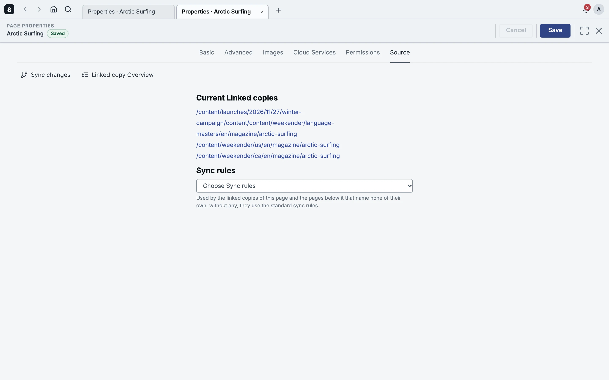

It lists the **current linked copies**, has **Sync changes** and **Linked copy Overview**, and lets you choose **Sync rules** for the copies of this page and of the pages below it that name none of their own.

## Linked copy Overview

**More › Linked copy Overview**, on a source, shows every copy of the page and of the pages below it.

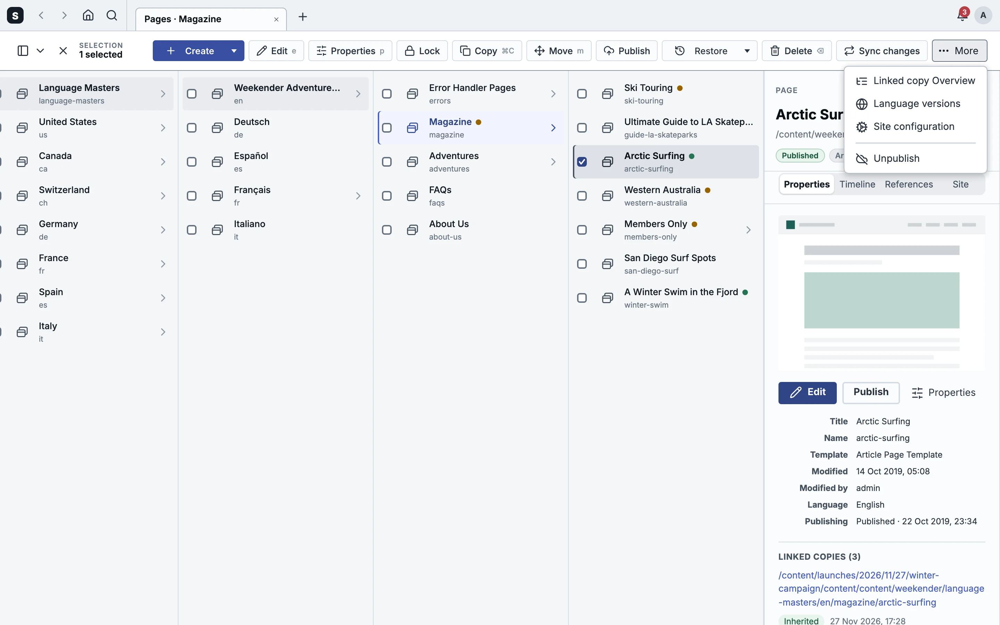

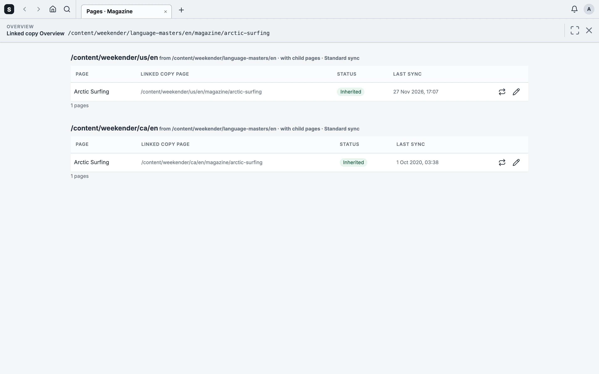

There is one table per copy, headed by the copy's top, its source, whether it includes the pages below, and its sync rules. Each row is a page with its copy's path, its **status** and its **last sync**. The two buttons at the end of a row synchronize that page and open the copy for editing.

## Site sources

An administrator keeps the list of site sources under **Home › System › Publishing › Site sources**.

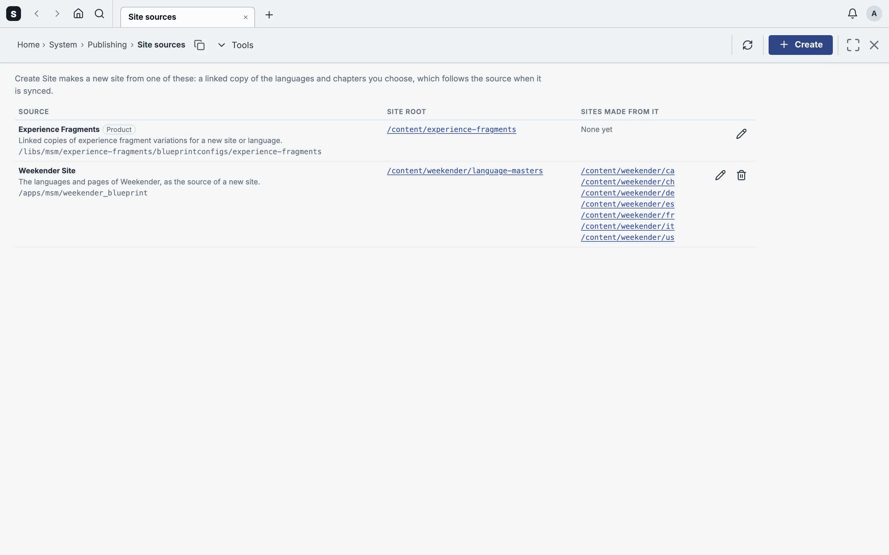

| Column | Meaning |
|---|---|
| **Source** | Its title and description, as Create Site shows them. *Product* marks a source that comes with Sensible Studio |
| **Site root** | The page whose children are the languages |
| **Sites made from it** | The linked copies that follow this source |

**Create** adds a source; the pencil changes one; the bin removes one. Removing a source does not touch the sites made from it.

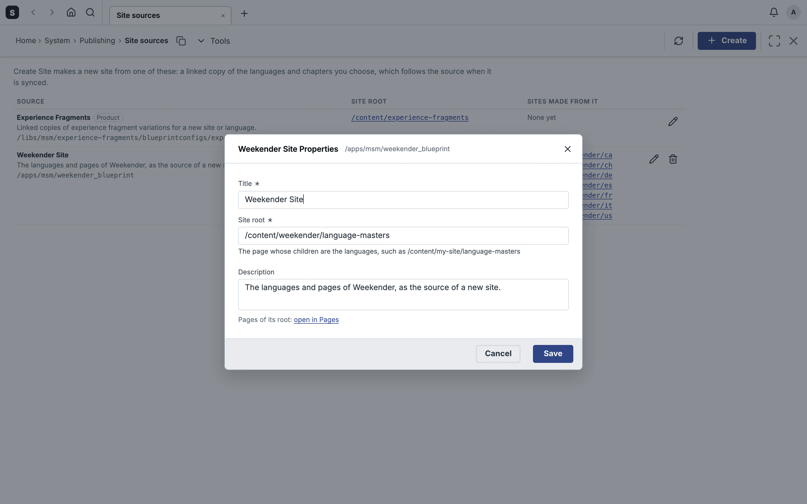

## Links between pages

When a page is synced, its links are adjusted: a link in the source that leads to another page of the source leads, in the copy, to the copy's own page. The same holds for experience fragments and content fragments that exist in both.

## Several sites and translation

A source and its copies share a language. To get a site in another language, [translate](translations.md) the language master, then create or sync the country sites from the translated master.
