A tag is a word from a list your organisation agrees on: a topic, an activity, a season, a region. Tagging content with the same words everywhere is what lets a site show "more articles about surfing", lets an author find every winter picture, and lets a list on a page fill itself.

## How tags are organised

Tags are kept in a tree. At the top are **namespaces**, one per site or per subject. Below a namespace are its tags, and a tag can have tags below it. The demo has one namespace, *Weekender Shared*, with the tags *Activity*, *Season*, *Region* and *Customer Journey*, and below *Activity* the activities: *Cycling*, *Hiking*, *Surfing* and so on.

Every tag has a **Tag ID**, which is what content stores: the namespace, a colon, then the path of names, as `weekender-shared:activity/surfing`. The title can change at any time; the ID changes only when the tag is moved or renamed, and the console then updates the content that uses it.

Searching for a tag also finds what is tagged with the tags below it: a search for *Activity* finds everything tagged *Surfing*.

## The Tags console

Open **Home › Tags**.

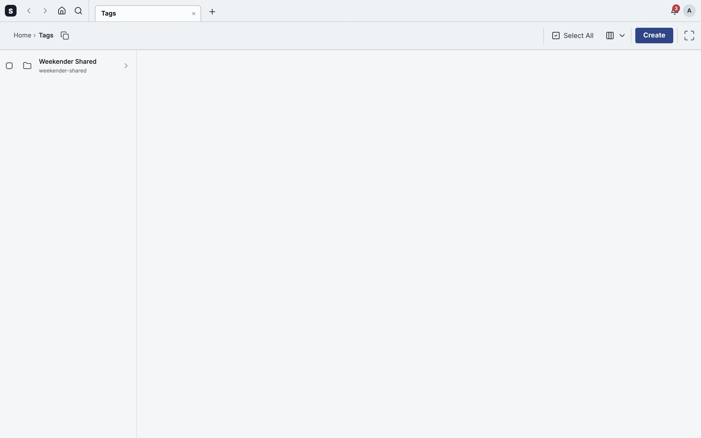

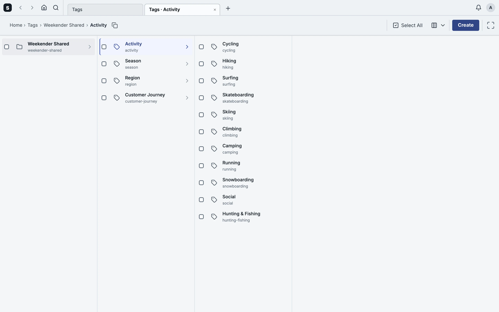

The console works like the [Pages console](pages.md): the path at the top, **Select All**, the view switch, and columns you walk through with a click or with the arrow keys. A tag with an arrow has tags below it.

**Create**, at the top right, has two choices.

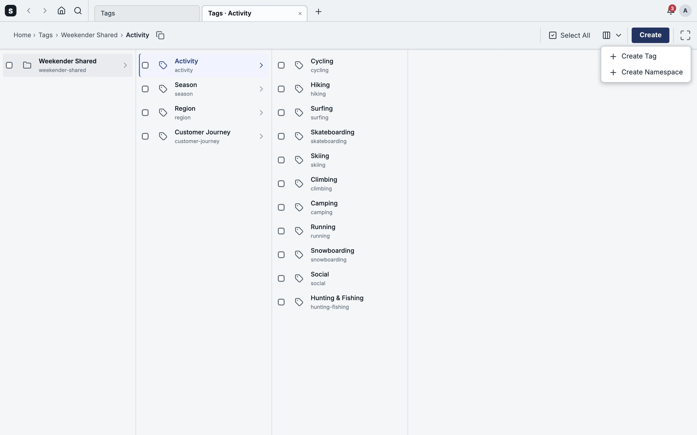

| Choice | What it makes |
|---|---|
| **Create Tag** | A tag below the place you are in |
| **Create Namespace** | A new namespace at the top of the tree |

## Select a tag

Tick a tag. The actions appear at the top and the tag's details on the right.

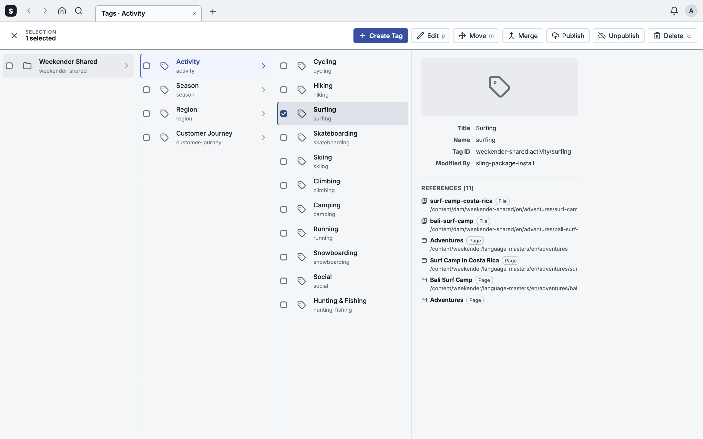

| On the right | Meaning |
|---|---|
| **Title**, **Name** | What people see, and the name in the tag's ID |
| **Tag ID** | What content stores for this tag |
| **Modified By** | Who changed it last |
| **References** | The pages and files that carry the tag, each with its kind and path, and how many there are. Look here before you move, merge or delete |

| Action | Key | What it does |
|---|---|---|
| **Create Tag** | | A new tag below the selected one |
| **Edit** | `p` | Title, description, and the title in other languages |
| **Move** | `m` | Moves the tag elsewhere in the tree, or renames it |
| **Merge** | | Makes this tag part of another. Not offered for a namespace |
| **Publish**, **Unpublish** | | Puts the tag, with the tags below it, on the live site, or takes it off |
| **Delete** | `⌫` | Removes the tag |

With several tags ticked, **Publish**, **Unpublish** and **Delete** act on all of them. The same actions are in the menu of a right-click.

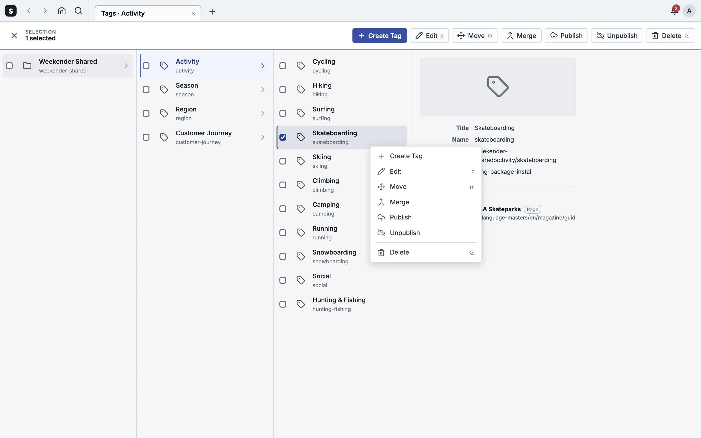

## Create a tag

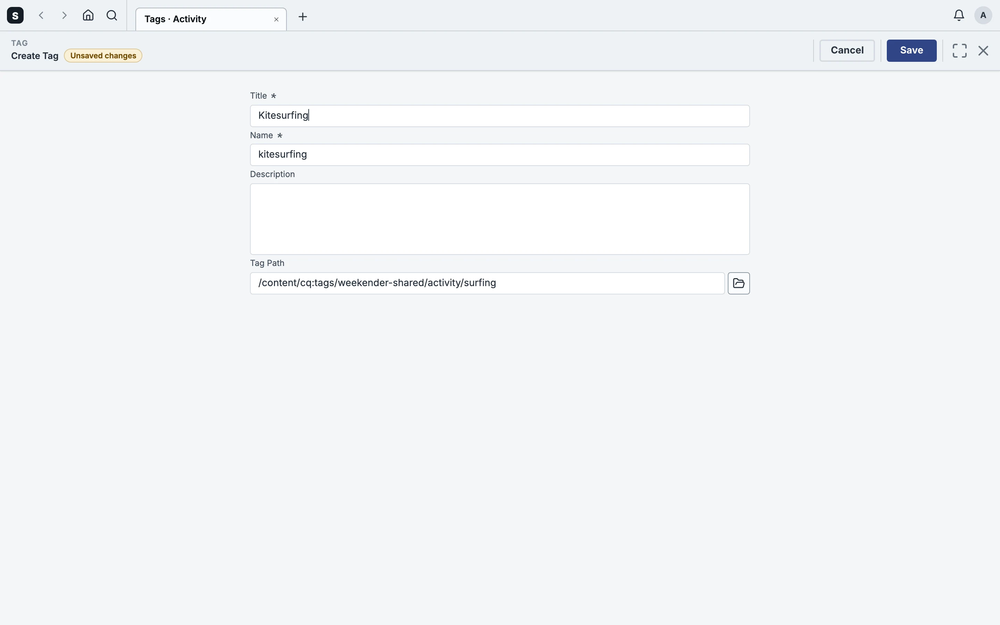

| Field | Meaning |
|---|---|
| **Title** | The word people see and search for |
| **Name** | The tag's name in its ID. It is made from the title as you type; change it if you want a shorter one. It cannot be changed here later, only with **Move** |
| **Description** | When to use the tag, for the people who tag |
| **Tag Path** | Where the tag is made. The folder button opens the tree to choose another place |

**Save**, at the top right, creates the tag.

**Create Namespace** asks for the same title, name and description, without a path: a namespace is always at the top.

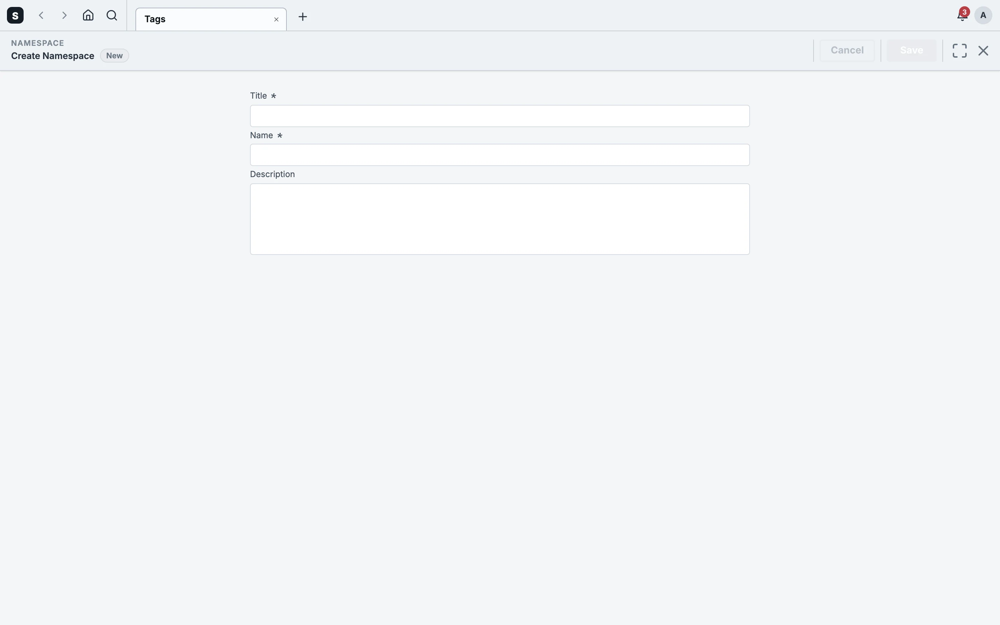

## Edit and translate a tag

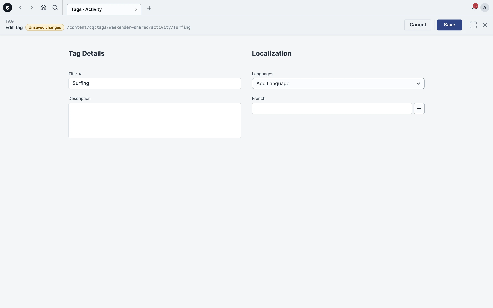

**Tag Details** has the title and the description. **Localization** gives the tag a title in other languages: choose a language under **Languages** and type the title in the field that appears.

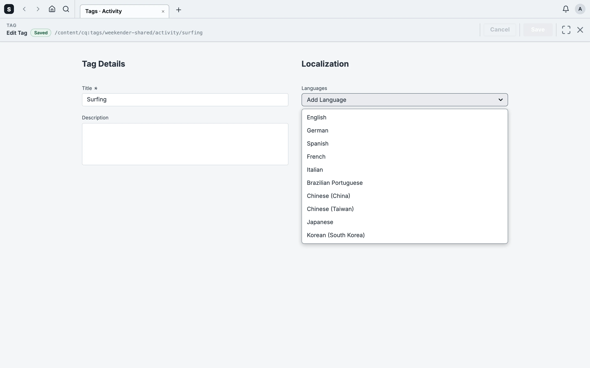

A language version of a site then shows the tag in its own words, in the tag fields of authors and on the site, while the content stays tagged with the same tag. The button at the end of a language's field removes that title; the tag then shows its main title in that language.

## Move or rename

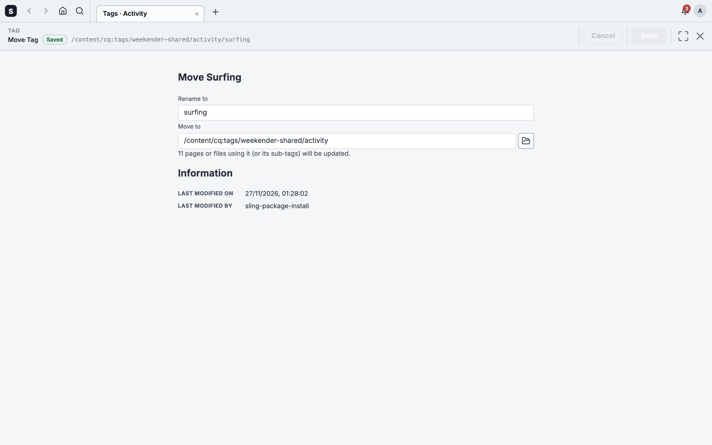

| Field | Meaning |
|---|---|
| **Rename to** | A new name. Leave it to keep the name |
| **Move to** | The tag or namespace it should be below |

The line below says how many pages and files use the tag or the tags below it. They are updated: content stays tagged, with the new ID. **Information** shows when the tag was last changed and by whom.

## Merge two tags

Merging cleans up duplicates such as *Bike* and *Bicycle*.

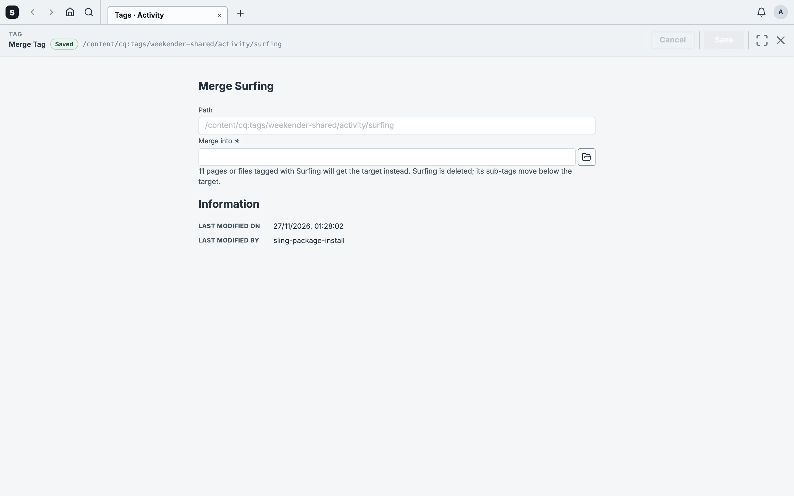

**Path** is the tag you are merging away; **Merge into** is the tag that stays. Everything tagged with the first gets the second instead, the first tag is deleted, and the tags that were below it move below the one that stays. Merging cannot be undone, so read the line that says how many pages and files it touches.

## Delete

A tag nobody uses is deleted after a confirmation. For a tag in use, the dialog lists the pages and files that carry it.

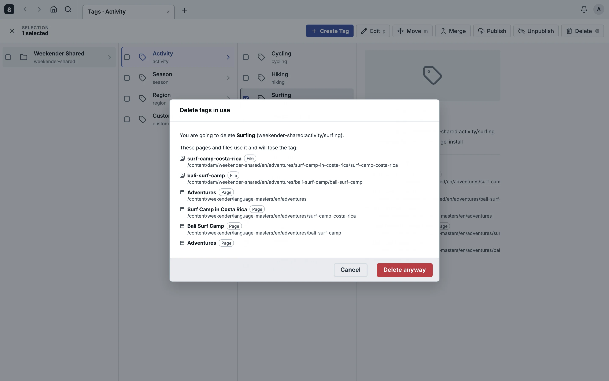

**Delete anyway** removes the tag and takes it off everything in the list. If the tag only has the wrong name, use **Move**; if it doubles another, use **Merge**.

## Publish tags

Tags are content: a tag used on a published page must itself be on the live site, or the site cannot show its title.

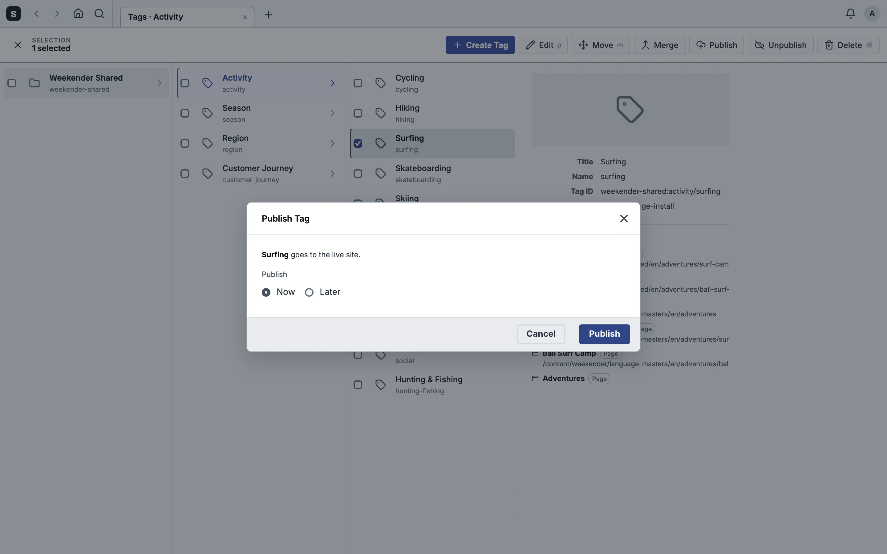

**Publish** sends the tag and the tags below it, **Now** or **Later** at a time you choose. **Unpublish** takes them off the live site. When you publish a page, the tags it uses that are not yet published are offered to be published with it, so you rarely publish tags by hand: do it after you renamed or translated one.

## Tag content

- **A page**: in its [properties](page-properties.md), under **Tags**.
- **Several pages**: select them, choose **Properties**, and set **Tags** for all.
- **A file in Media**: in its [properties](media.md). Images can also get tags proposed for them: see [Auto tags](media-delivery.md).
- **A content fragment**: in its properties, and in any field of the type *Tags* its [model](content-fragments.md) has.

Wherever tags are set, the field works the same: type to search by title, or open the picker with the button at its end and walk the tree.

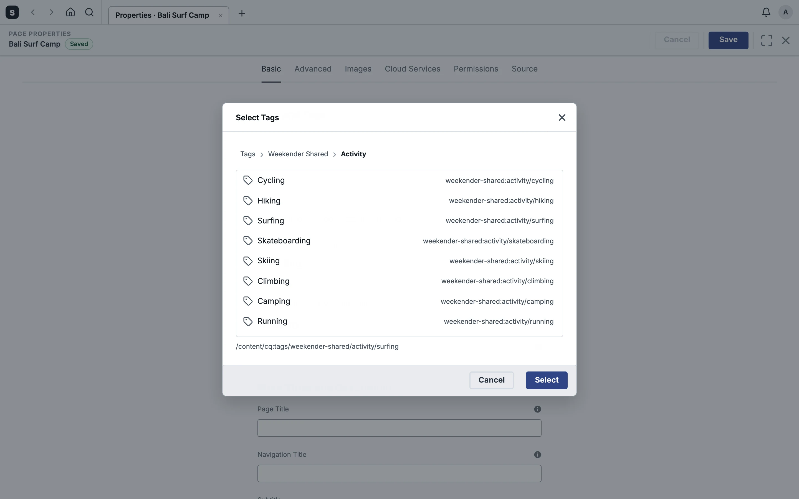

The picker shows the path you walked at the top, each tag with its ID, and under the list the tag you clicked. The arrow at the end of a row opens the tags below it; **Select** adds the tag to the field.

## Where tags show up

- **In searches**: the Filter rail of Pages and the filters of Media both narrow by tag.
- **On the site**: components that list pages or fragments can choose them by tag.
- **In Media**: auto tags propose tags from the namespaces an administrator chose.
- **In personalization**: a visitor's interests can be gathered from the tags of the pages they read.
