A template decides what a page is before anyone writes on it: which parts are the same on every page, where authors may add components, which components, and how each of them is set up. Change a template, and every page made from it follows.

## The Templates console

Templates belong to a site's configuration. Open **Home › Templates**: the first column lists the configurations (**Global**, and one per site), the second the templates of the one you click.

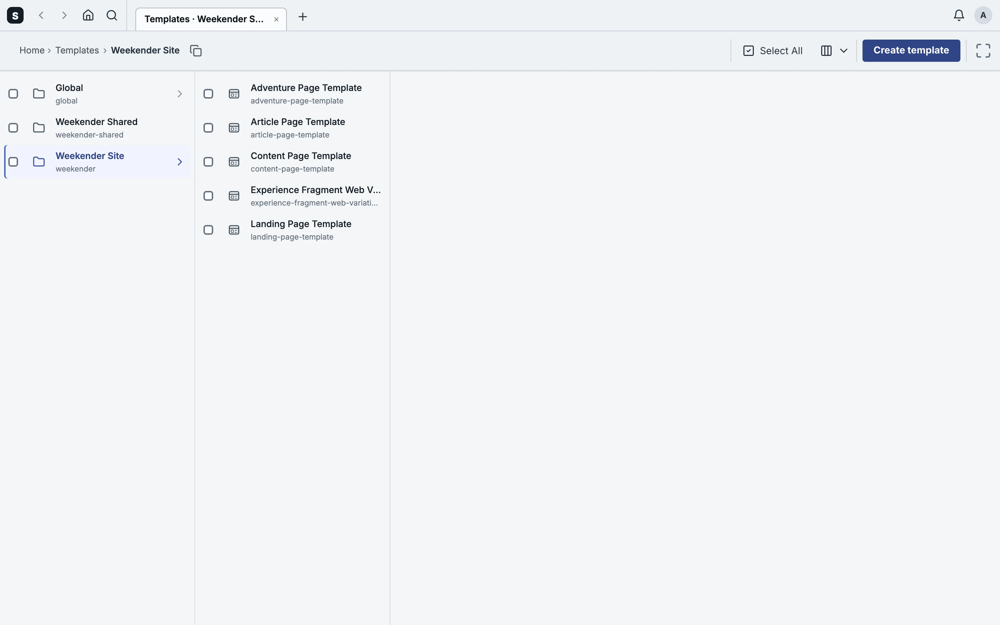

The display format button offers the same three views as Pages. **List View** shows the most at once:

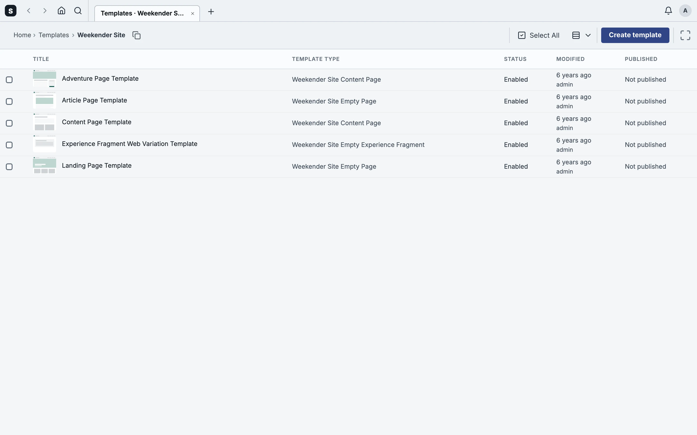

| Column | What it says |
|---|---|
| **Title** | The template, with a sketch of its layout |
| **Template type** | The starting point it was made from |
| **Status** | **Enabled**: offered when someone creates a page. **Disabled**: not offered. **Draft**: never enabled yet |
| **Modified** | When it was last changed, and by whom |
| **Published** | Whether it is on the live site |

### Select a template

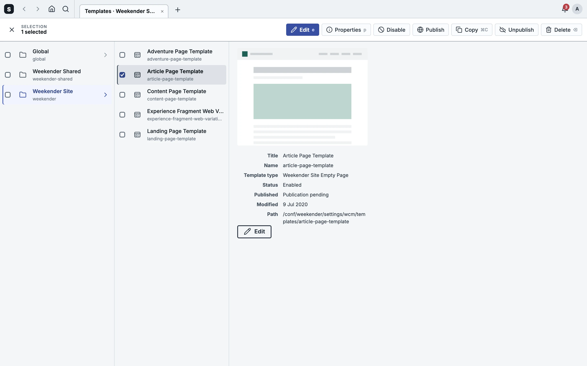

Tick a template to see it at the right: its preview, title, name, template type, status, whether it is published, when it was modified, its path, and an **Edit** button. The bar shows what you can do with it:

| Action | Key | What it does |
|---|---|---|
| **Edit** | `e` | Opens the template editor |
| **Properties** | `p` | Title, description and preview picture |
| **Enable**, **Disable** | | Offers the template when a page is created, or stops offering it. Existing pages keep working |
| **Publish**, **Unpublish** | | Puts the template and the configurations it uses on the live site, or takes them off |
| **Copy** | `Cmd+C` | Remembers the template; **Paste** then makes a new template from it |
| **Delete** | `Backspace` | Refused while pages still use the template; the pages are listed |

### Properties

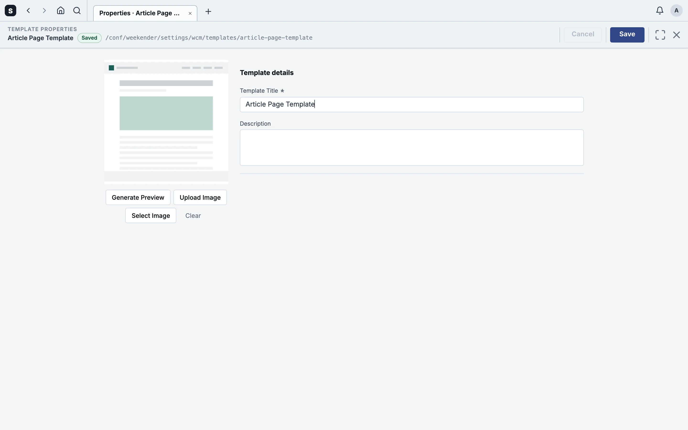

| Part | What it does |
|---|---|
| **Template Title**, **Description** | What authors see when they choose a template for a new page |
| **Generate Preview** | Draws the preview picture from the template's structure |
| **Upload Image**, **Select Image** | Uses a picture from your computer or from Media instead |
| **Clear** | Removes the picture |

## Create a template

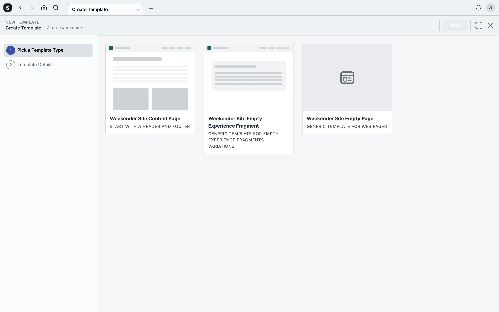

1. In the Templates console, go into the configuration and click **Create template**.
2. **Pick a Template Type.** A template type is a starting point provided by the site's developers: an empty page, a page that starts with the site's header and footer, an experience fragment.
3. **Template Details.** Give the template a title and a description, then create it.

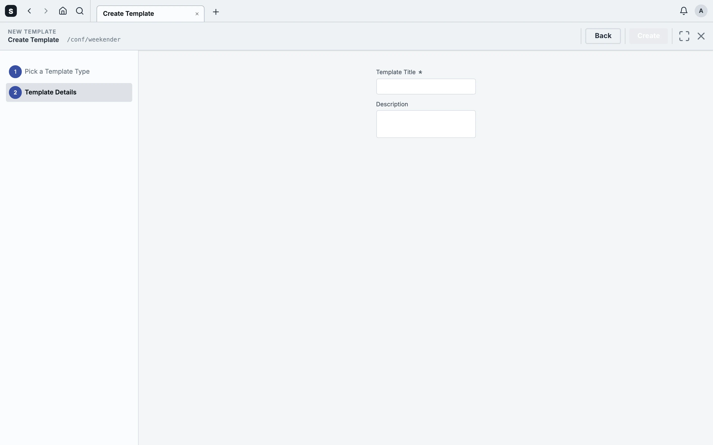

4. Open it to edit its structure.
5. When it is ready, **Enable** it. Only enabled templates are offered when someone creates a page.
6. **Publish** it. A page on the live site needs its template there too; publishing a template publishes the component configurations it uses with it.

## The template editor

**Edit** opens the template in the editor you know from pages. See [The page editor](page-editor.md) for its bar, the Library and the toolbar of a component; this is what differs.

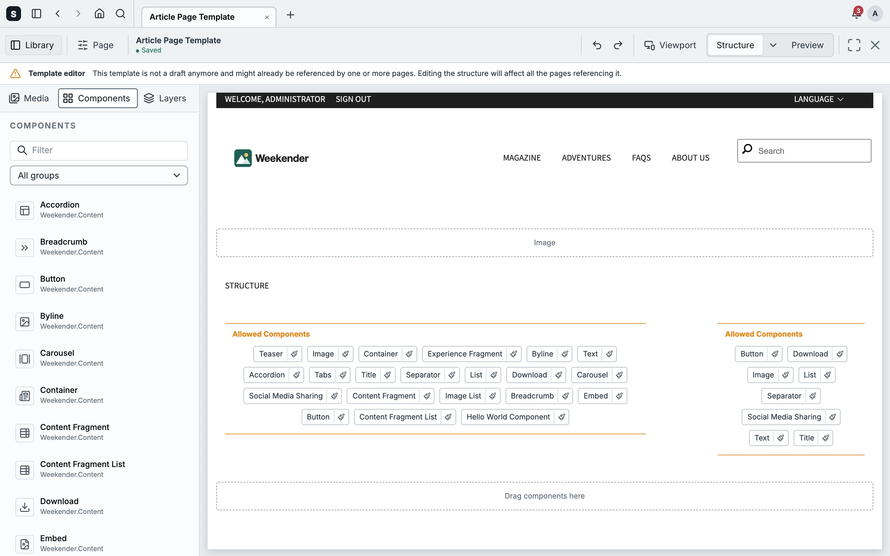

- The bar under the top one warns when the template is already in use: *editing the structure will affect all the pages referencing it*.
- Where the page editor has Edit, the mode is **Structure**. The arrow beside it offers the template's three modes:

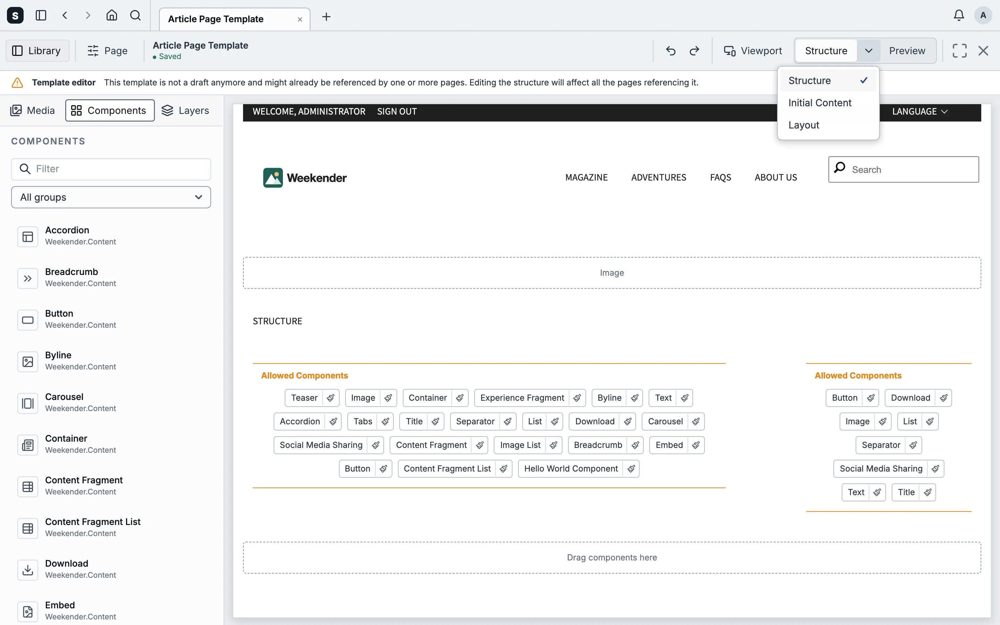

| Mode | What you do in it |
|---|---|
| **Structure** | Build what every page made from the template has |
| **Initial Content** | Put in place what a new page starts with |
| **Layout** | Set how the structure behaves at each screen size |

- The **Page** menu has what belongs to a template:

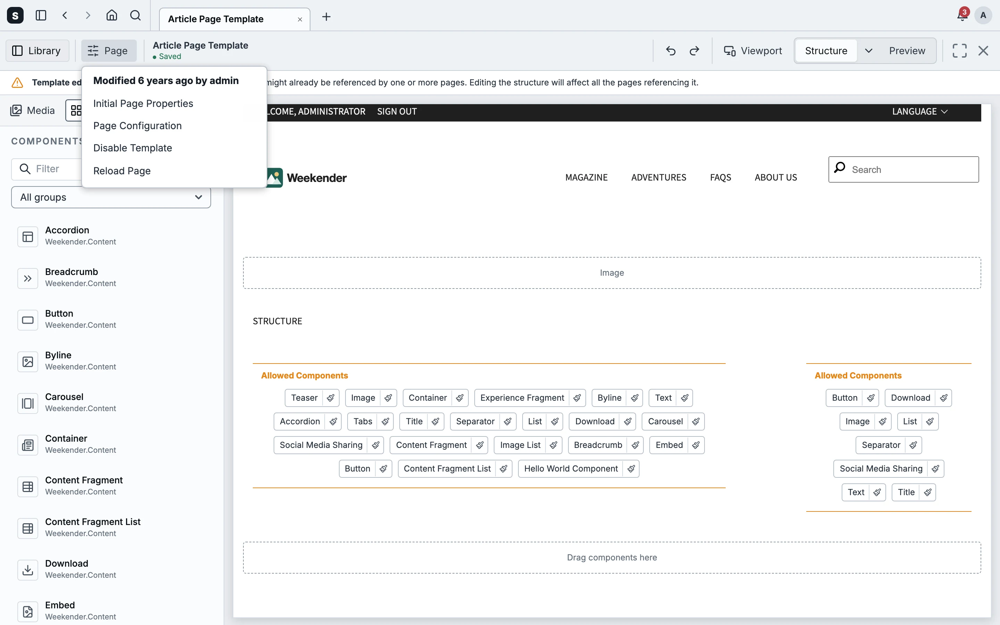

| Item | What it does |
|---|---|
| **Initial Page Properties** | The properties new pages start with. The form is the one of [page properties](page-properties.md) |
| **Page Configuration** | The site's CSS and JavaScript (client libraries) and the options of the page itself, as a configuration form like the one of a container |
| **Enable Template**, **Disable Template** | The same as in the console |
| **Reload Page** | Loads the template again |

### Structure

In **Structure** mode you add the parts every page will have. The **Layers** tab shows them as a tree:

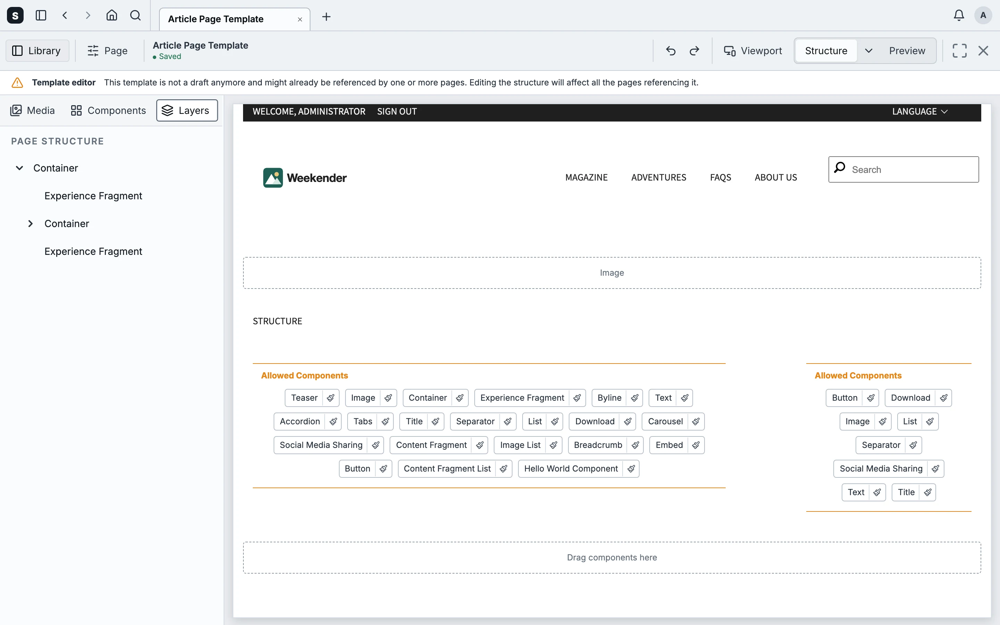

A component you add here is **fixed**: authors see it on their pages and cannot change it. That is how a header and a footer are the same everywhere; in the picture they are the two Experience Fragments.

A container that authors may fill shows **Allowed Components**: the components they can add there, each as a small chip. Select such a container for its toolbar:

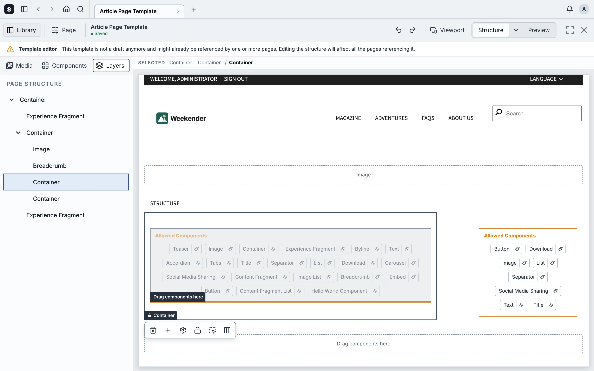

| Action | What it does |
|---|---|
| **Delete** | Removes the component from the structure, and so from every page |
| **Insert component** | Adds a component to the structure here |
| **Configuration** | Chooses what authors may add to this container, and how it is set up |
| **Lock structure component**, **Unlock structure component** | Unlocked, authors can change the component on their pages; an unlocked container is where they add their own components. Locked, it is fixed |
| **Parent** | Selects the container around it |
| **Layout** | Switches to Layout mode for this component |

The wrench on a chip opens the configuration of *that* component in this container: the heading sizes a Title may use, the formats a Text offers, its styles.

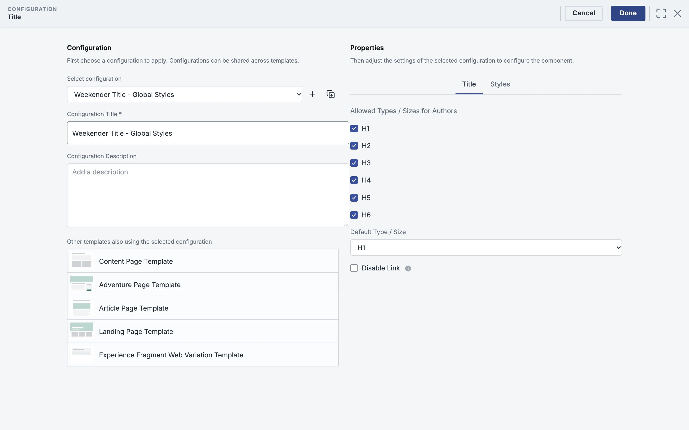

For a Title that is which heading sizes authors may choose (**H1** to **H6**), the size a new title starts with, whether its link is switched off, and on the second tab its **Styles**.

> **Note:** A change to the structure shows on existing pages at once, on the author instance. It shows on the live site when you publish the template.

### Configuration: what authors may add, and how it is set up

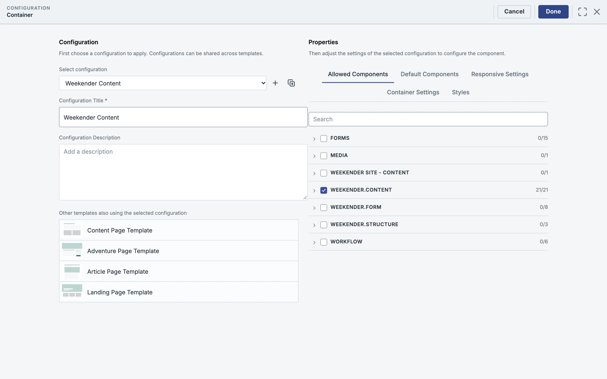

**Configuration** opens a form with two halves.

**At the left: which configuration.** A configuration has a name and can be shared between templates.

| Part | What it does |
|---|---|
| **Select configuration** | The configuration this container uses. Choosing another one changes this container only |
| `+` | Starts a new, empty configuration |
| **Duplicate** | Starts a new one as a copy of the selected one |
| **Configuration Title**, **Configuration Description** | Its name and what it is for |
| **Other templates also using the selected configuration** | Where else your changes will show: changing a shared configuration changes every place that uses it |

**At the right: its settings**, on tabs. A container has:

| Tab | What it sets |
|---|---|
| **Allowed Components** | Tick the groups, or open a group and tick single components, that may be added to this container. The numbers say how many of a group are allowed. Ticking a whole group also allows the components added to that group later |
| **Default Components** | Which component is created when a file of a certain type is dropped on the container: an image becomes an Image |
| **Responsive Settings** | The number of columns of the container's grid |
| **Container Settings** | The container's own options, such as its layout and background |
| **Styles** | The named looks authors can choose for it |

**Done** saves, **Cancel** discards. Two containers can have different configurations, so a sidebar can allow other components than the main area.

### Styles

A component's configuration can define **Styles**: named looks, such as "Dark" or "Wide", each backed by a CSS class the site's developers provide. Authors then choose among them with the **Styles** button of the component's toolbar, without touching code.

### Initial Content

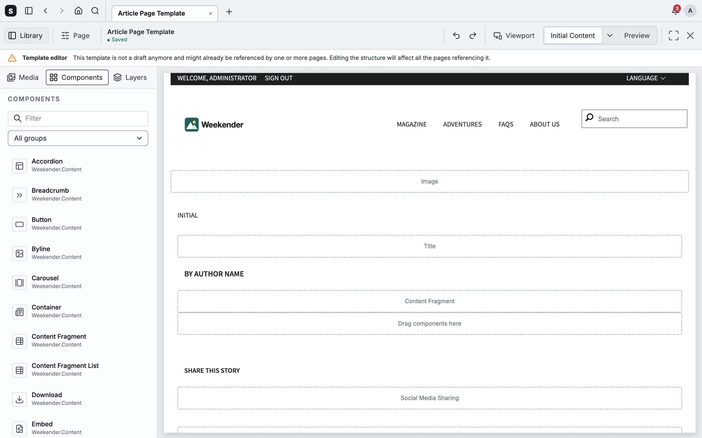

In **Initial Content** mode you edit a page as it will be when it is new: the fixed parts are there, and in the unlocked containers you add the components a new page should start with, ready to be filled in. The picture shows an article that starts with a title, a byline, a content fragment and the sharing buttons.

Initial content is copied into each new page once; changing it later does not change existing pages.

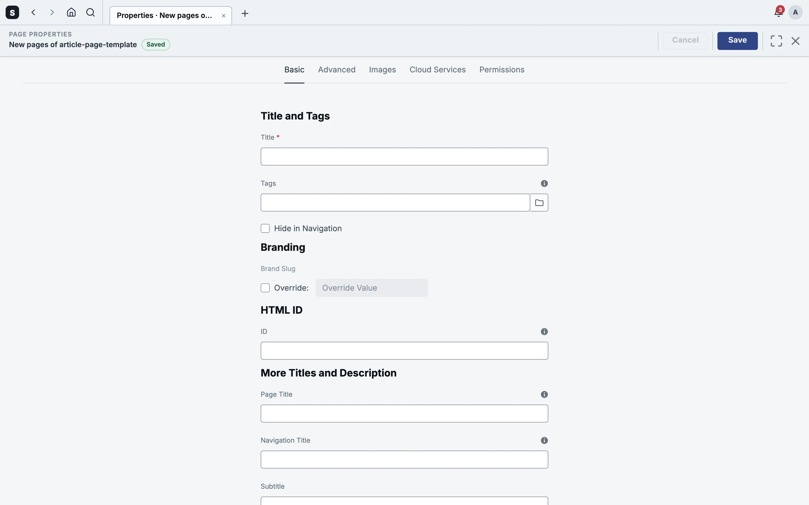

**Page › Initial Page Properties** does the same for the properties: what you fill in here is what a new page starts with.

### Layout

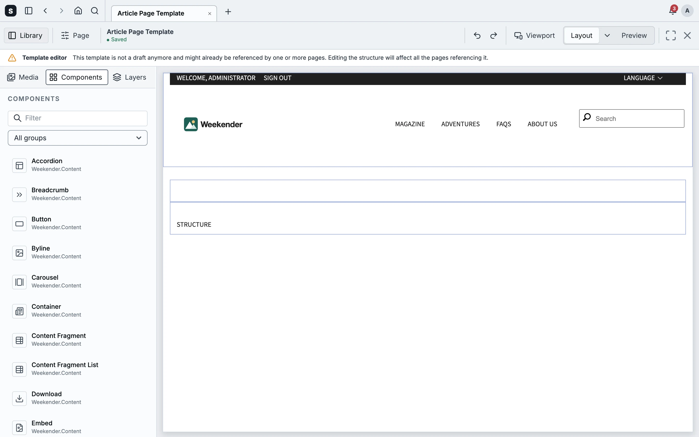

**Layout** mode sets how wide the parts of the structure are and where they sit, for each screen size of the viewport ruler. Pages take this layout until someone changes it on the page.

### Page Configuration

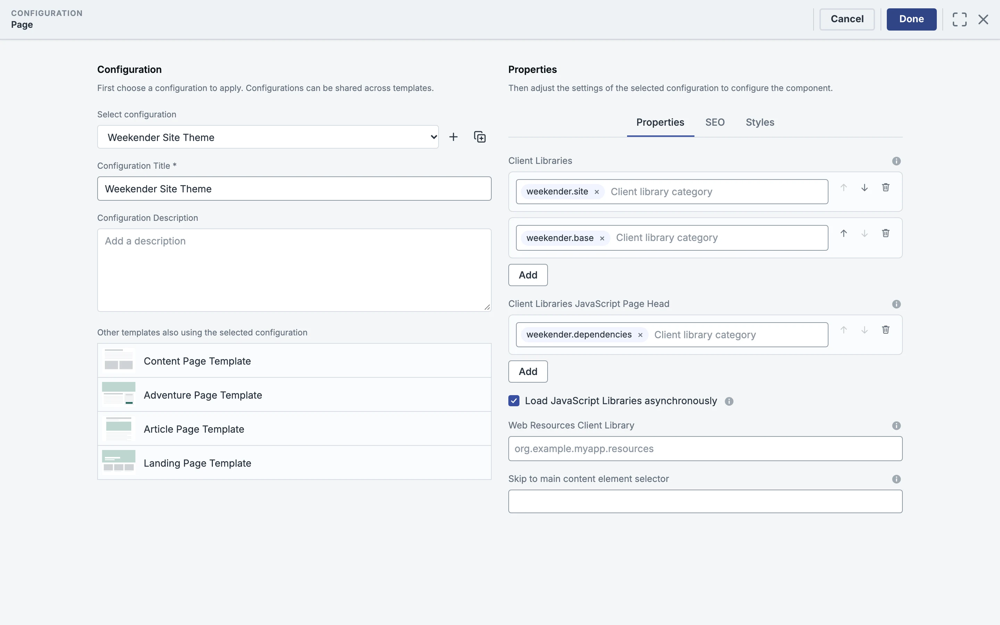

## Which templates are offered where

When someone creates a page, they see the enabled templates that are allowed at that place. **Allowed Templates**, in the [properties](page-properties.md) of a page, decides this for the pages below it. It is usually set once, on a site's top page.

## If a component is not offered

When a component you expect is missing from the editor's **Components** tab:

1. Reload the editor. The list of components is read when the editor opens.
2. Open the template and check the container's **Allowed Components**.
3. Ask a developer to check that the component has a group of its own. A component without a group, or in a hidden group, is never offered. See [Components and templates](../developer/components.md).
