Sensible Studio translates content into **language versions**: the same page, fragment or file in another language, kept beside the original. A **provider** does the translating, usually a language model. People review and approve the result, and every approved sentence is remembered so it is never translated twice.

The tools are under **Home › System › Translations**.

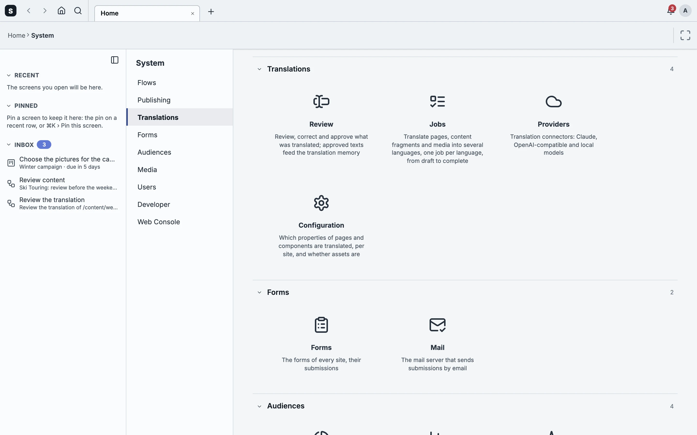

| Tool | What it is for |
|---|---|
| **Review** | Read, correct and approve what was translated |
| **Jobs** | Translation projects: many pages, several languages, a deadline |
| **Providers** | The services that translate, per site |
| **Configuration** | The rules: which properties of pages, components and files are text to translate |

## How languages are laid out

A site keeps each language in a folder named with its code. The folder is the **language root**:

```
/content/weekender/language-masters/en     English
/content/weekender/language-masters/fr     French
/content/weekender/language-masters/de     German
```

A page has the same place in every language: `…/en/magazine/winter-swim` is `…/fr/magazine/winter-swim` in French. Media and content fragments follow the same idea in their own folders.

## Translate pages

In the Pages console, select the page and choose **More › Language versions**.

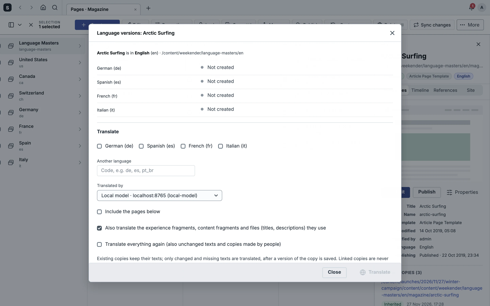

| Part | Meaning |
|---|---|
| The first line | The page's own language and its language root |
| The list of languages | Every other language of the site with the state of this page in it: **Not created**, **Translated, to review**, **In review**, **Outdated** because the original changed, or **Approved**. A version that exists has **Open** and **Approve** beside it |
| **Translate** | Tick the languages to translate into |
| **Another language** | A language the site does not have yet: type its code, such as `ro` or `pt_br`. Its language root is created |
| **Translated by** | The provider. The one set up for the site is chosen for you |
| **Include the pages below** | The whole section, not only this page |
| **Also translate the experience fragments, content fragments and files they use** | On by default: what the page shows is translated with it. For files that means their titles and descriptions |
| **Translate everything again** | Also the texts that did not change, and the copies people made or corrected by hand. Leave it off unless you want to start over |

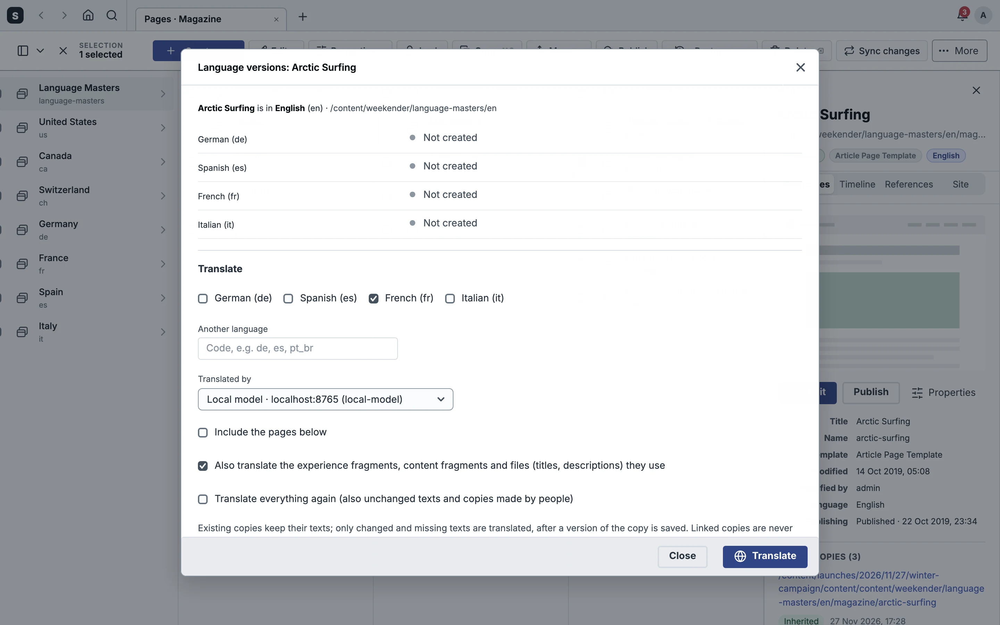

**Translate** starts, and the bottom of the dialog shows each item as it is done. When it has finished, the language shows its new state.

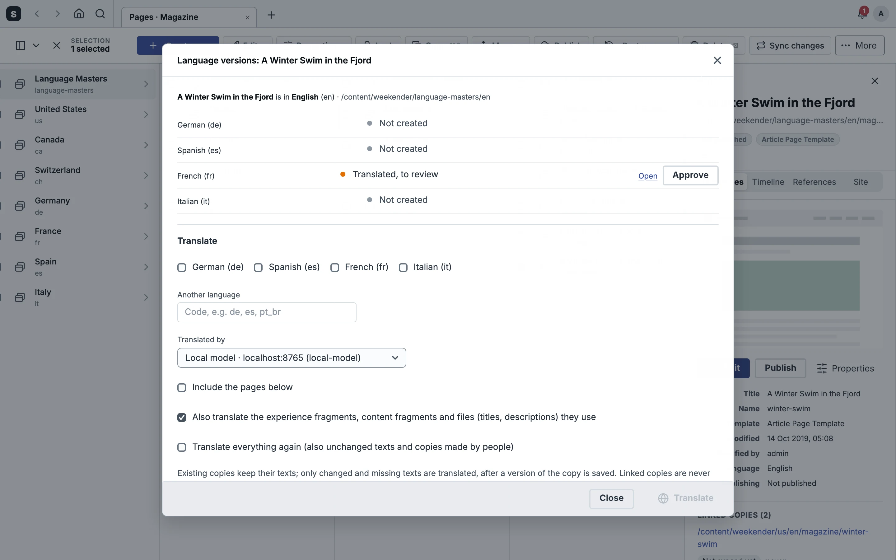

**Open** shows the version in the page editor.

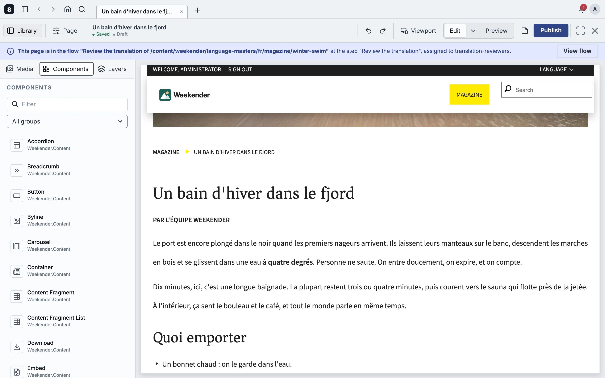

The band at the top of this picture is there because a review was requested for the version: it names the flow, the step it is at and who has it. See [Review](#review) below.

### What is translated

Text is translated: titles, descriptions, body text, the alternative text of images, link and button labels, the titles of tabs and accordions, form labels and messages. Addresses, numbers and settings are left as they are. Formatting inside a text, such as bold words and links, is kept.

Links are adjusted. A link to another page of the original language leads, in the new version, to that page in the new language, if it exists or is being translated in the same run. The same goes for fragments and media.

### When the original changes

Translate the page again. Only the sentences that changed are sent to the provider; components added to the original are added to the version at the same place; what a person changed by hand in the version is kept. A version of the page is saved first, so you can go back.

A language version shows as **Outdated** from the moment its original changes.

Linked copies are never translated directly: they get their content from their source. See [Several sites](sync.md).

## Translate content fragments and media

- **Content fragments**: select them in the Content Fragments console and choose **Translate**, or open the fragment and use its **Languages** panel. The fields marked as translatable in the model are translated.
- **Media**: a file's title, description and alternative text are translated. The file itself is shared between languages; it is not copied.

Both are translated by themselves when a page that uses them is translated with what it uses.

## The translation memory

Every sentence translated into a language is kept with its translation. The next time the same sentence appears, on any page, it is reused: the wording stays the same everywhere, and nothing is paid twice.

When a version is approved, its sentences are stored as approved, with the reviewer's corrections. A machine translation never replaces an approved one. So when you correct a title once in review, it is right from then on wherever it appears.

## Review

**Review** lists everything that was translated.

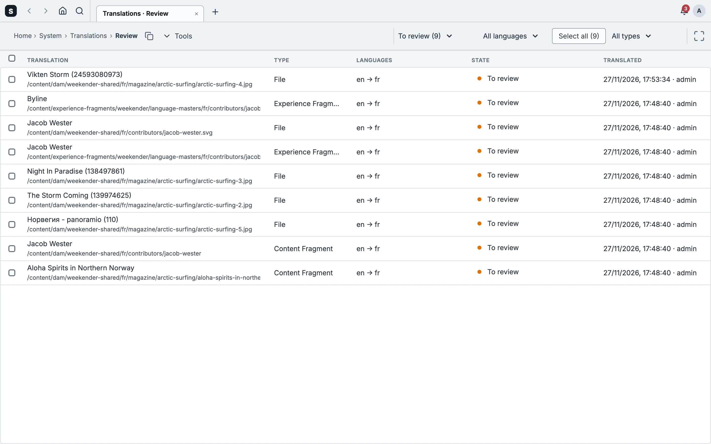

| Column | Meaning |
|---|---|
| **Translation** | The title in the new language, and where the version is |
| **Type** | Page, Experience Fragment, Content Fragment or File |
| **Languages** | From which language into which |
| **State** | See below |
| **Translated** | When, and by whom |

The three menus at the top filter by state, language and type; each state shows how many items are in it.

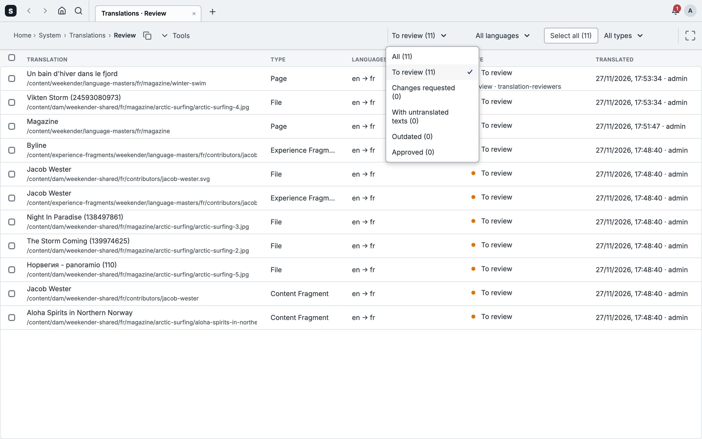

| State | Meaning |
|---|---|
| **To review** | Translated; nobody has approved it yet |
| **With untranslated texts** | Some texts could not be translated; the original stands in for them |
| **Changes requested** | A reviewer sent it back, with a comment |
| **Outdated** | The original changed since |
| **Approved** | Checked; its sentences are in the memory |

To approve many at once, set the filters, tick the rows (or **Select all**), and choose **Approve**.

### Review one item

Click an item. Each text is shown with the original on the left and the translation on the right, ready to edit.

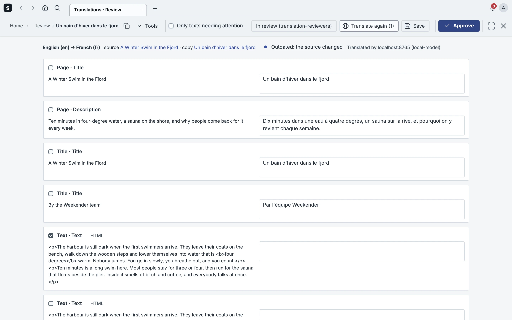

| Part | Meaning |
|---|---|
| The line at the top | The languages, links to the source and to the version, the state, and who or what translated |
| A box | One text: where it is (*Page · Title*, *Text · Text*), the original, and the translation to correct. **HTML** marks a text with formatting: keep its tags as they are |
| The tick of a box | Selects the text for **Translate again** |
| **Only texts needing attention** | Hides the texts that are fine: shows the untranslated ones and those whose original changed |
| **Request review** | Hands the version to a reviewer. The button then reads **In review** |
| **Translate again** | Asks the provider afresh for the ticked texts. The number on the button is how many are ticked |
| **Save** | Keeps your corrections. A correction must keep the formatting of the original: its links and its bold words |
| **Approve** | Saves, marks the version approved and stores its sentences in the memory |

### A second pair of eyes

**Request review** starts a flow: a task lands in the [Inbox](flows.md) of the translation reviewers, and the bell at the top right shows it. The reviewer opens the version, corrects what needs it, then completes the task with **Approve** or **Request changes** and a comment. Use this when the person who checks is not the person who translated.

## Translation projects

A translation project is for larger work: many pages, several languages, a deadline. It gathers the content, the target languages and the provider, and has one **translation job** per language.

**Jobs** lists the projects.

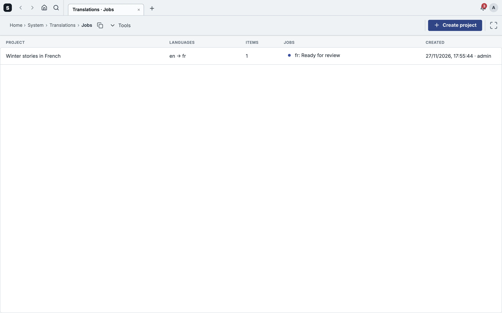

Create one with **Create project**, or from the Pages or Media console: select the content, then **Create › Translation Project**. There you can also add to an existing project instead.

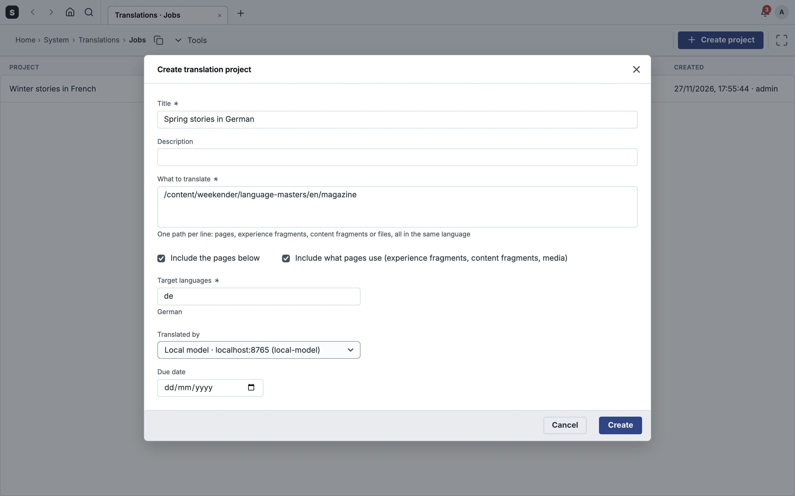

| Field | Meaning |
|---|---|
| **Title**, **Description** | For the list |
| **What to translate** | One path per line: pages, experience fragments, content fragments or files, all in the same language |
| **Include the pages below** | Whole sections |
| **Include what pages use** | Their experience fragments, content fragments and media |
| **Target languages** | Language codes, such as `ro, de, fr`. Each gets a job |
| **Due date** | Optional. The project puts a reminder in its owner's Inbox, and is marked late once the date has passed |

A click on a project opens it.

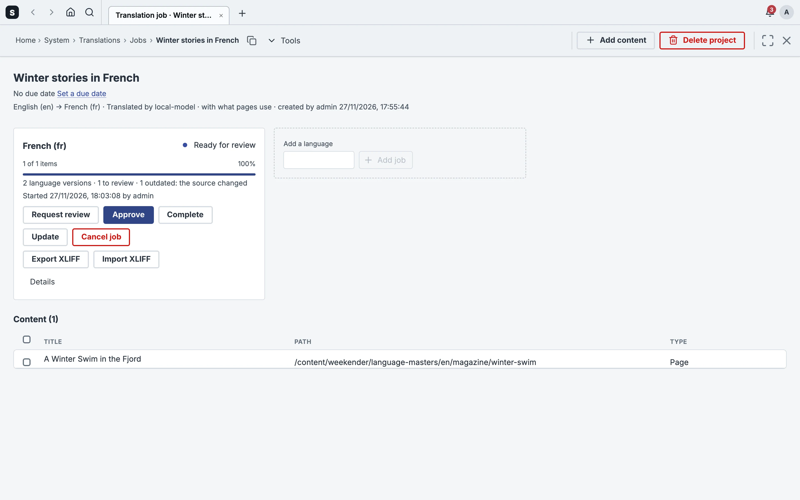

| Part | Meaning |
|---|---|
| The lines at the top | The due date (**Set a due date**), the languages, the provider, whether what pages use is included, and who created the project |
| A job's card | The language, the job's state, how far it is, and its buttons |
| **Start** | Translates from your browser while you watch |
| **Run on the server** | Does it in the background. You can close the page; the job carries on and the card shows where it stands |
| **Cancel job** | Stops and removes the job |
| **Add a language**, **Add job** | One more target language for the same content |
| **Content** | What the project translates. **Add content**, at the top, adds more; tick rows to remove them |
| **Delete project** | Removes the project. The translations it made stay |

A job moves through **Draft**, **In progress**, **Ready for review**, **Approved** and **Complete**.

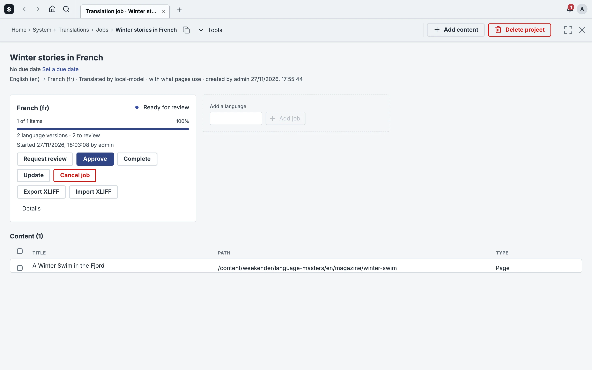

| Button of a finished job | What it does |
|---|---|
| **Request review** | Starts the review flow for everything the job made |
| **Approve** | Approves all of it at once |
| **Complete** | Closes the job |
| **Update** | Runs the job again, sending only what changed in the originals since |
| **Cancel job** | Removes the job |
| **Export XLIFF**, **Import XLIFF** | Exchange with a translation agency, below |
| **Details** | What the job did: texts translated, characters sent to the provider, and texts taken from the memory |

### Work with a translation agency: XLIFF

XLIFF is the file format translation agencies and their tools use.

1. Translate the job first, so the agency improves a draft and does not start from nothing.
2. On the job, choose **Export XLIFF** and send the file to the agency.
3. When it comes back, choose **Import XLIFF**. Only texts that changed are touched; a report lists what was saved and what was left out, with the reason.
4. Review and approve as usual. The agency's wording goes into the memory.

## Providers

A provider is the service that translates. An administrator sets providers up under **Providers**, per configuration: **Global** for every site, or a site's own.

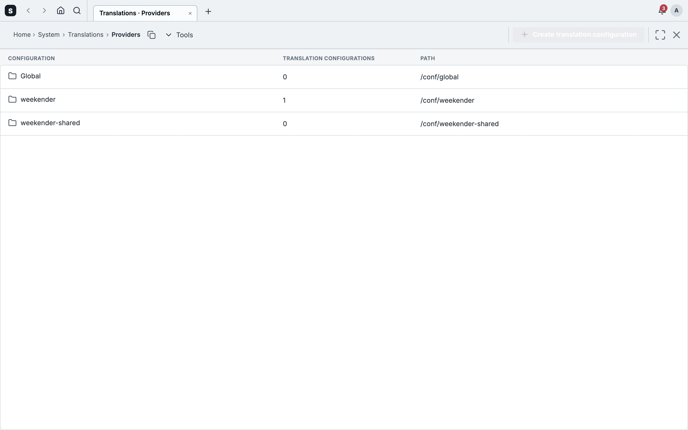

Click a configuration to see its providers, and **Create** to add one. A click on a provider opens it.

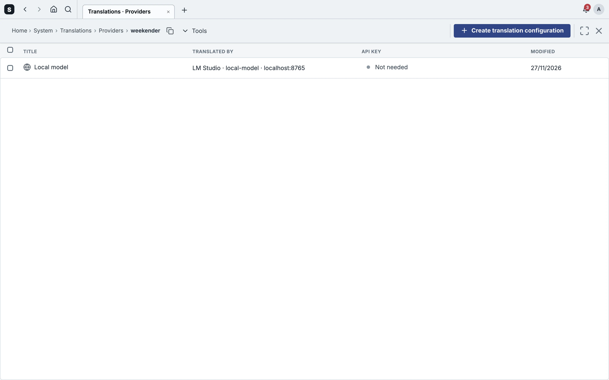

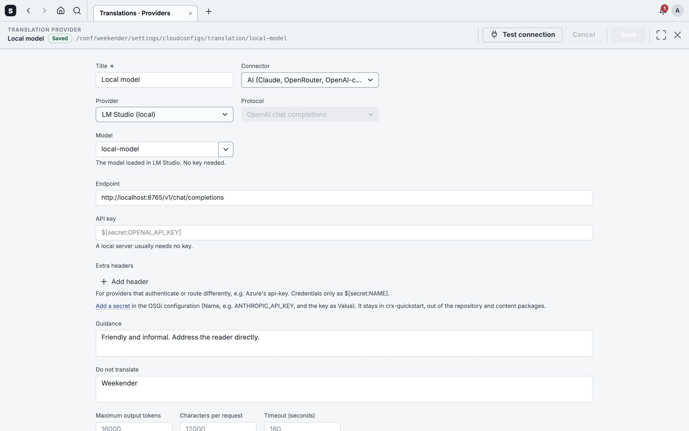

| Field | Meaning |
|---|---|
| **Title**, **Name** | What authors see in **Translated by**, and its name in the configuration |
| **Connector** | The kind of service. *AI* is a language model |
| **Provider** | The service: a list of well-known ones, each with its usual address and models filled in, or **Custom** |
| **Protocol** | How the service is spoken to. It follows from the provider |
| **Model** | The model's name. The arrow suggests some; any other name can be typed |
| **Endpoint** | The service's address. Filled in for the known providers |
| **API key** | **Enter the key** types it here, and it is stored encrypted. **Refer to a secret** names a secret kept outside the content, as `$[secret:NAME]`. A model on your own machine usually needs none |
| **Extra headers** | For services that authenticate or route differently |
| **Guidance** | Tone and style for this site, in words: "Friendly and informal. Address the reader directly." |
| **Do not translate** | Words to keep as they are, such as brand names |
| **Maximum output tokens**, **Characters per request**, **Timeout** | Limits. The defaults suit most models |

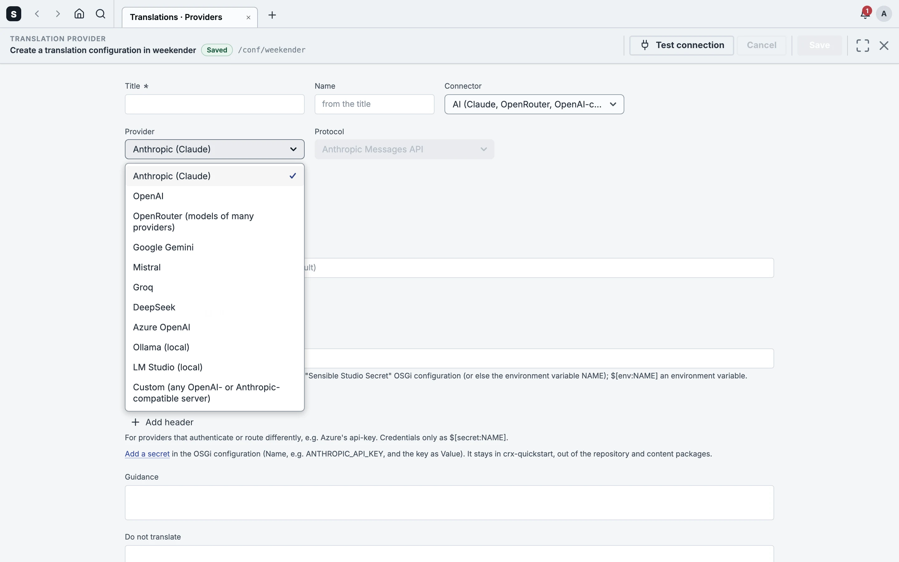

**Test connection**, at the top, translates a sample sentence and shows the result with the time it took, or the reason it failed.

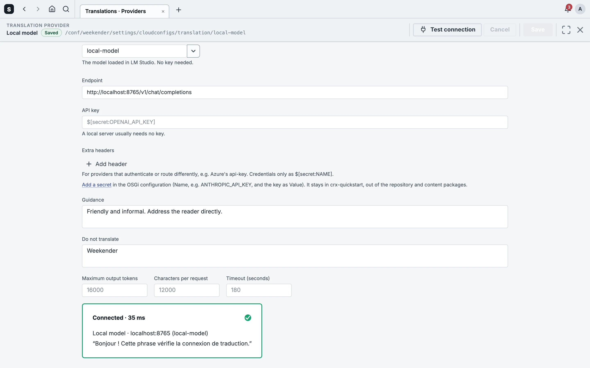

Sensible Studio works with Anthropic (Claude), OpenAI, OpenRouter, Google Gemini, Mistral, Groq, DeepSeek, Azure OpenAI and any service that speaks one of their protocols, and with models running on your own machines through Ollama or LM Studio, where no text leaves your network.

The texts of your pages are sent to the provider you choose. Check that this fits your organisation's rules for the content in question.

See [Extending](../developer/extending.md) for writing a provider of your own.

## Configuration: what counts as text

**Configuration** holds the translation rules: which properties of a page, of its components and of files are texts to translate.

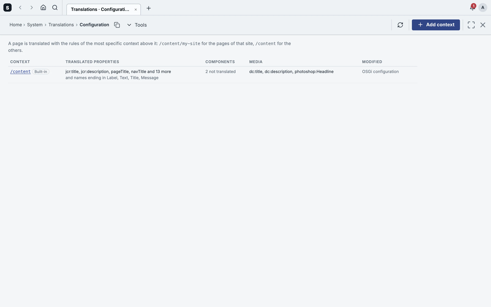

A page is translated with the rules of the most specific context above it: a context for one site, or `/content` for all the others. The built-in context covers titles and descriptions, the properties whose names end in *Label*, *Text*, *Title* or *Message*, and the title and description of files. **Add context** makes rules for one site or one section; a click on a context opens its rules.

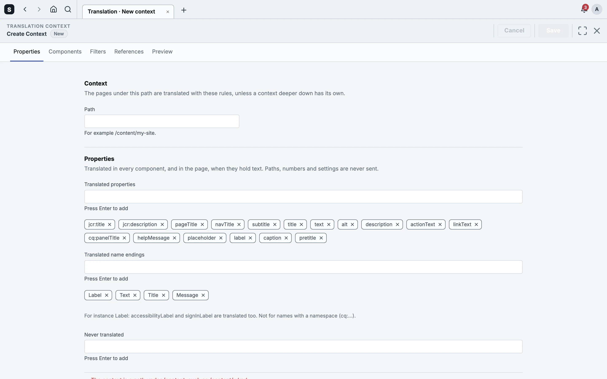

| Tab | What it sets |
|---|---|
| **Properties** | The **Path** the rules are for. **Translated properties**: the property names that hold text, in every component and in the page. **Translated name endings**: any property whose name ends this way is text too, so `accessibilityLabel` is covered by *Label*. **Never translated**: names to leave alone even when a rule above matches |
| **Components** | Components with rules of their own: properties to translate only there, or a component that is not translated at all |
| **Filters** | Pages and content to leave out |
| **References** | What comes along with a page: its experience fragments, content fragments, and the titles and descriptions of its files |
| **Preview** | Type the path of a page to see which of its texts these rules would send to the provider |

Type a name and press Enter to add it to a list; the cross on a name removes it.

## Translation and several sites

Translate the language master, then sync the country sites from it. See [Several sites](sync.md).
