This page is for the people who administer Sensible Studio. It explains users, groups and permissions, and where to see what happened.

Everything here is under **Home › System › Users**.

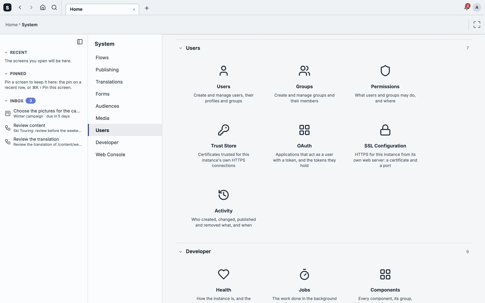

| Tool | What it is for |
|---|---|
| **Users** | The people who sign in, their profiles and groups |
| **Groups** | Sets of users, and their members |
| **Permissions** | What users and groups may do, and where |
| **OAuth** | Applications that act as a user with a token |
| **Activity** | Who created, changed, published and removed what, and when |
| **Trust Store**, **SSL Configuration** | Certificates and HTTPS of the instance itself. See [Run a server](../developer/server.md) |

## Users

A user is a person who signs in, or a member of the public who signs in on the live site.

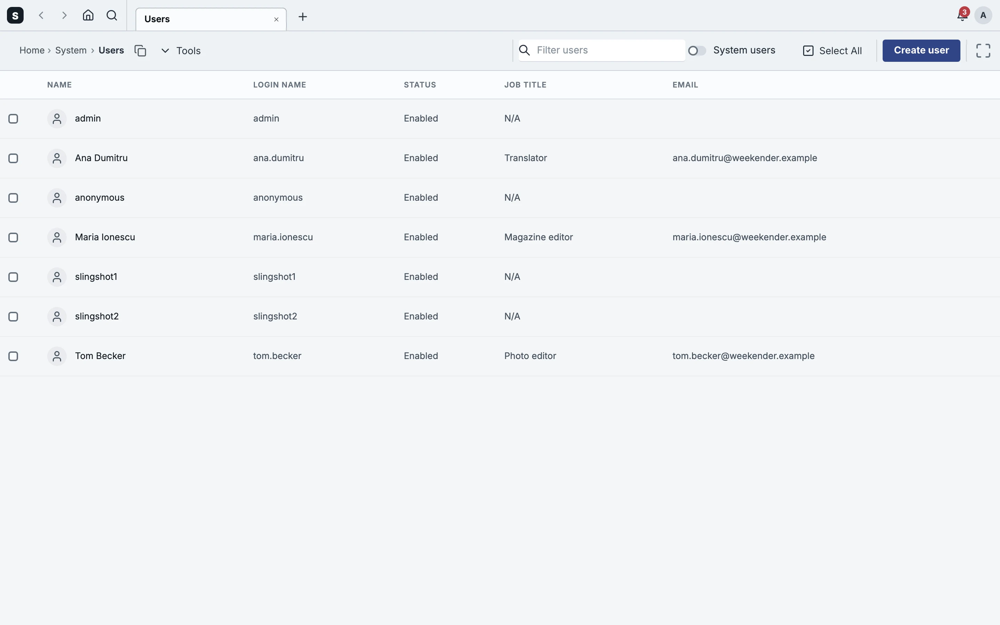

The list has each user's name, login name, status, job title and email. **Filter** narrows it as you type; **System users** also shows the accounts Sensible Studio uses for its own work, which nobody signs in with.

Tick users to act on them.

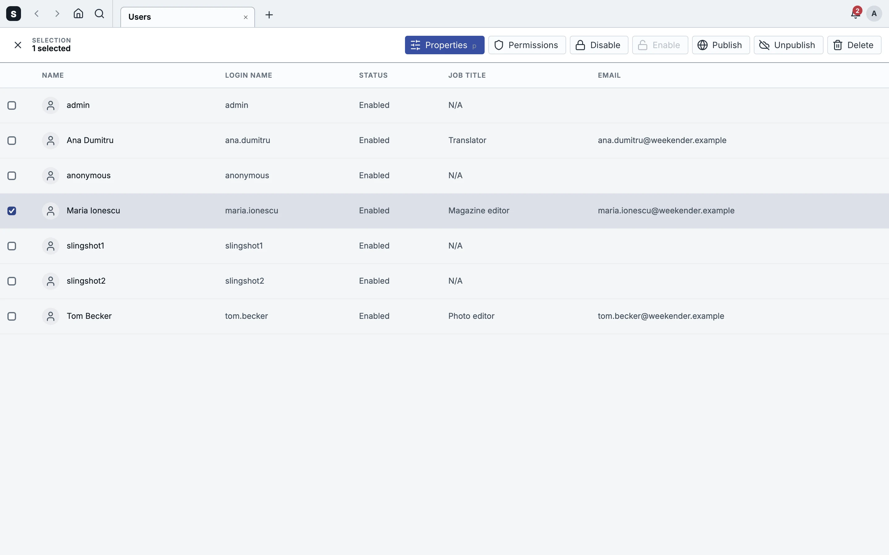

| Action | What it does |
|---|---|
| **Properties** | Opens the user |
| **Permissions** | Opens the Permissions console on this user |
| **Disable**, **Enable** | A disabled user can no longer sign in; what they did stays attributed to them. Use it for someone who has left |
| **Publish**, **Unpublish** | Puts the user on the live site, or takes them off: for people who sign in there |
| **Delete** | Removes the user |

### Create a user

**Create user** opens an empty user.

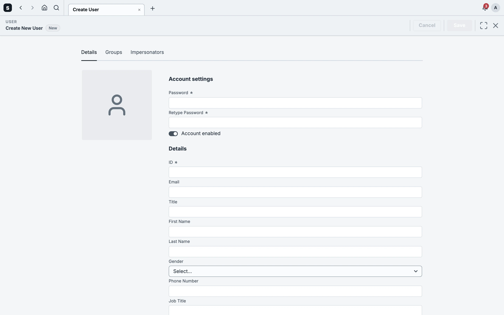

| Field | Meaning |
|---|---|
| **Password**, **Retype Password** | The password they start with |
| **Account enabled** | Off, the user exists but cannot sign in |
| **ID** | What they sign in with. It cannot be changed later |
| **Email**, **Title**, **First Name**, **Last Name**, **Gender**, **Phone Number**, **Job Title**, **About** | The profile. The names are what other people see in lists and in the Timeline |
| **Street**, **City**, **Postal Code**, **Country/Region** | An address, if you keep one |

**Save**, at the top right, creates the user.

### A user's page

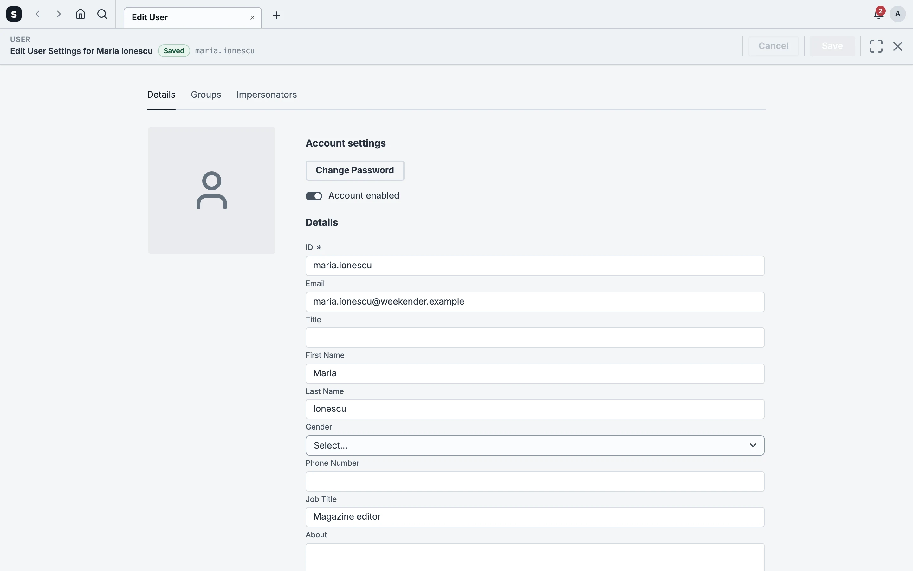

| Tab | What it holds |
|---|---|
| **Details** | The account (**Change Password**, **Account enabled**) and the profile |
| **Groups** | The groups the user is in. Type a group's name and choose **Add**; the cross removes one |
| **Impersonators** | The users who may act as this user, to see what they see. Leave it empty unless you need it for support |

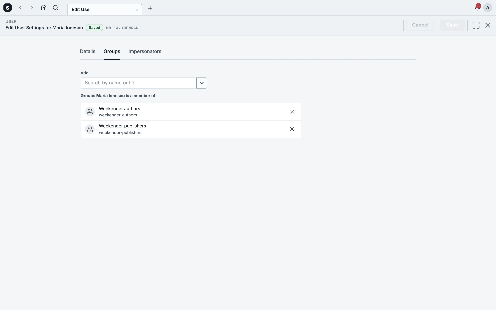

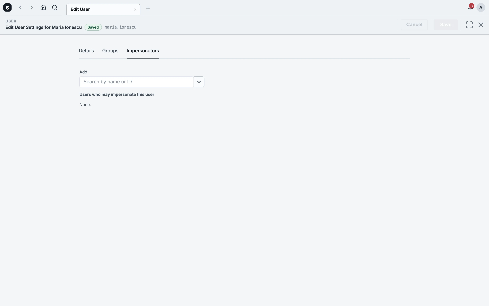

## Groups

A group is a set of users, and of other groups. Give permissions to groups, never to single users: when someone changes role, you move them between groups and everything follows.

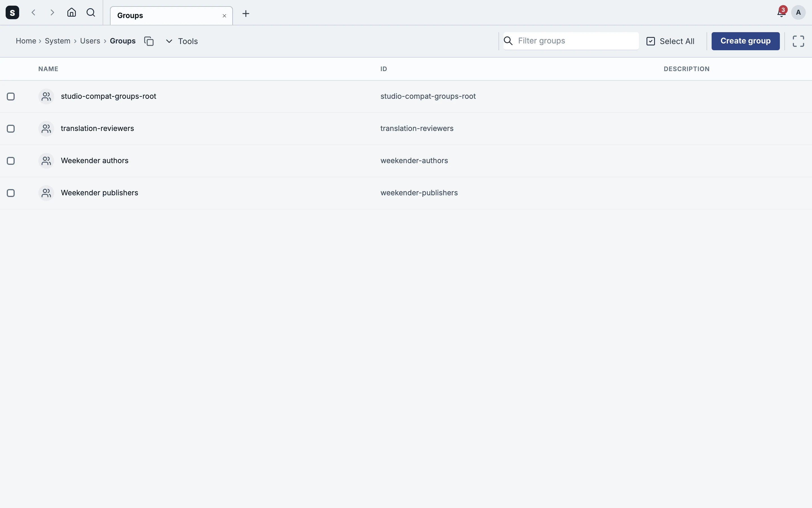

A workable start:

| Group | For |
|---|---|
| Authors of a site | May read and change that site's pages and media |
| Publishers of a site | Authors who may also publish |
| Reviewers | Receive the review steps of [flows](flows.md). **translation-reviewers**, which comes with Sensible Studio, receives the reviews of translations |
| Administrators | May do everything. Keep this group small |

**Create group** asks for an **ID**, a **Group Name**, a **Description** and an **Email**. A group's page has the tabs **Details**, **Groups** (the groups this group is in) and **Members**.

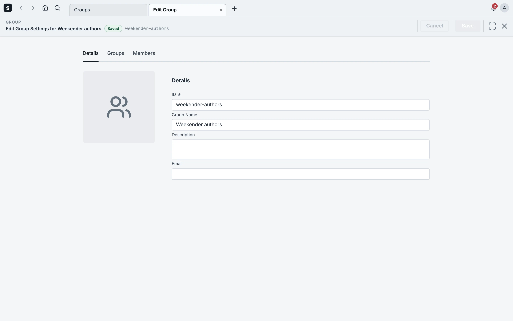

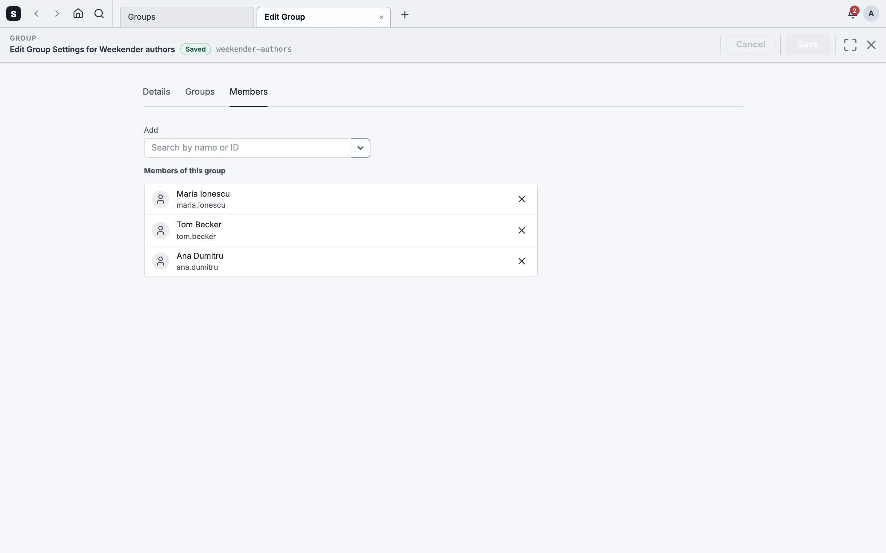

## Permissions

A permission says what a user or a group may do at a place in the content tree, and below it.

| Permission | Allows |
|---|---|
| **Read** | See the page or file |
| **Modify** | Change it |
| **Create** | Add pages or files below it |
| **Delete** | Remove it |
| **Read ACL**, **Edit ACL** | See, and change, the permissions themselves |
| **Publish** | Publish and unpublish it |

**Permissions** has the users and groups on the left; **Filter users and groups** finds one. Click one to see what it may do.

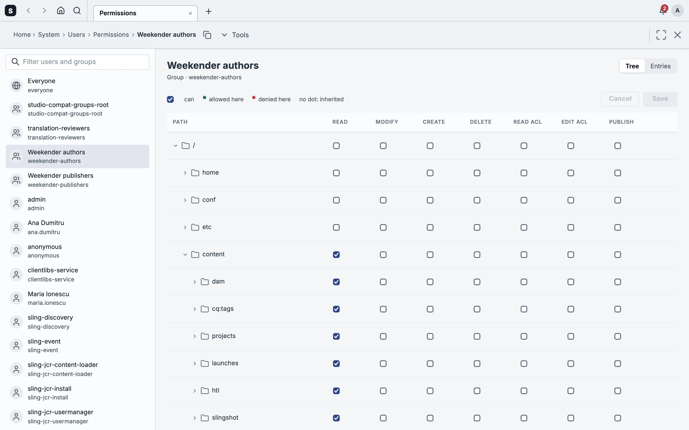

The **Tree** view is the content tree with one column per permission. A tick means the group can; the dot beside a tick says where that comes from: green for allowed at this very place, red for denied here, no dot for inherited from above. Open a folder with its arrow, tick or untick boxes, and **Save**.

**Entries** lists the rules themselves, one per line: the path, the privileges, allow or deny, and restrictions if any.

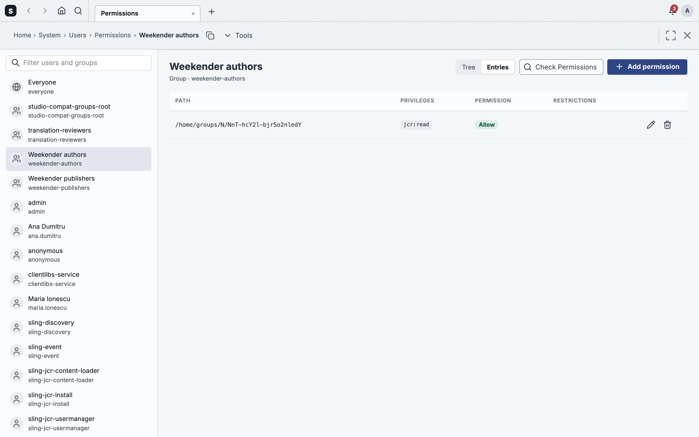

| Button | What it does |
|---|---|
| **Add permission** | A new rule: a path, what is allowed or denied there |
| The pencil, the bin | Change or remove a rule |
| **Check Permissions** | Asks what this user or group can do at a path you give, and which rules decide |

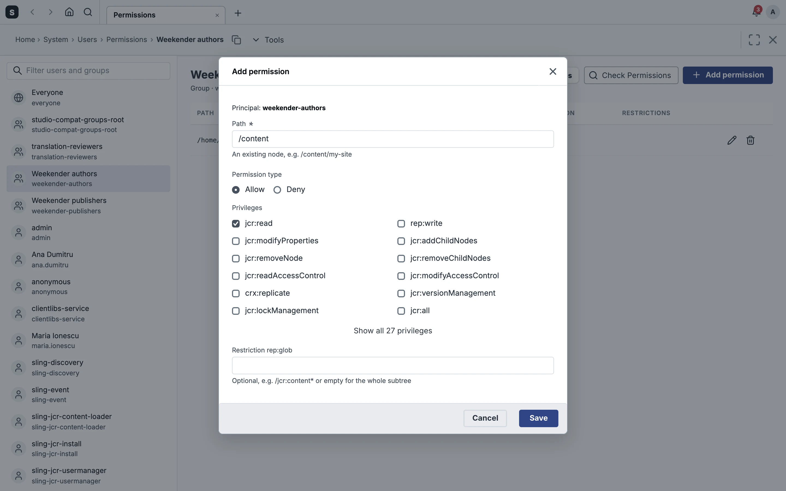

| Field | Meaning |
|---|---|
| **Path** | Where the rule applies, and below |
| **Permission type** | **Allow** or **Deny** |
| **Privileges** | What exactly. The entries use the repository's own names: `jcr:read` is Read, `rep:write` covers Modify, Create and Delete, `crx:replicate` is Publish. **Show all 27 privileges** lists the finer ones |
| **Restriction** | Optional: a pattern that narrows the rule to part of what is below the path, such as `/jcr:content*` |

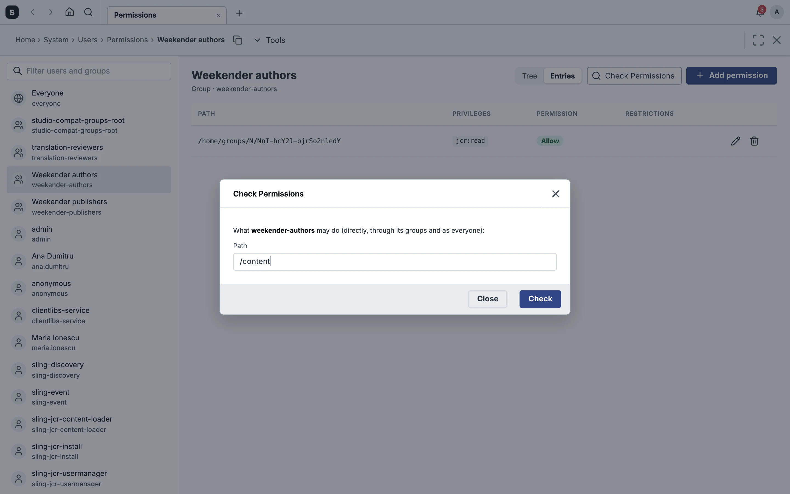

A rule either allows or denies. Rules set further down the tree override rules set above, and a deny for a user overrides an allow for one of their groups.

You can also set permissions where the content is: the **Permissions** tab of a page's [properties](page-properties.md) has **Add Permissions**, **Edit Closed User Group** and **Effective Permissions**, which tells you what someone can do on that page and which rule decides.

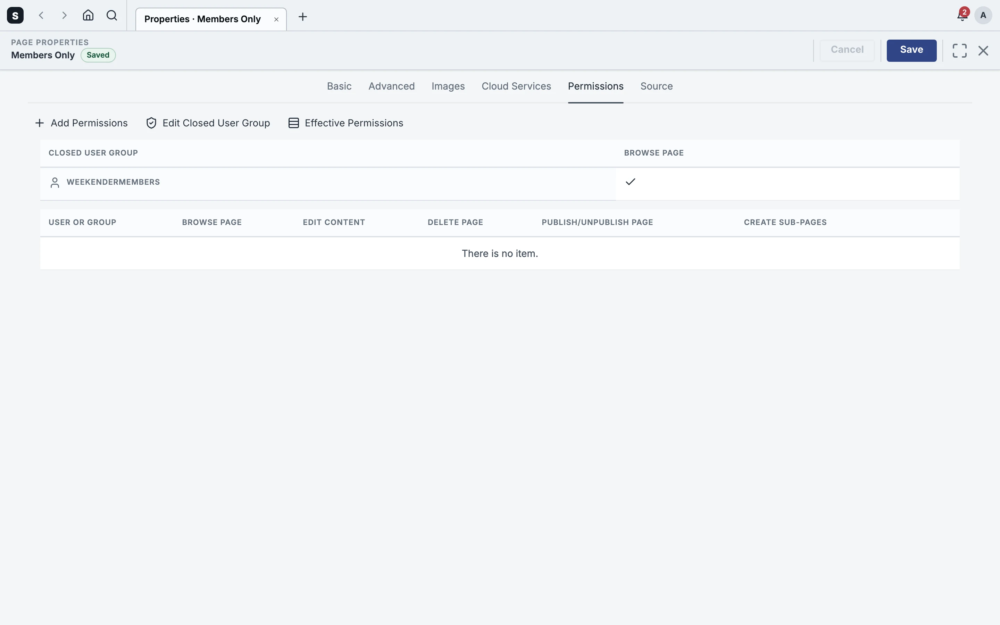

The interface follows the permissions: an action a person may not perform is not offered to them.

## Pages for members only

To limit a section of the live site to certain visitors, open the properties of its top page, go to **Permissions**, and choose **Edit Closed User Group**. Name the groups that may see it. Everyone else gets "not found" on the live site, until they sign in as a member.

The members must exist on the live site: see the next section.

## Users of the live site

Users are kept per instance. A person who signs in on the live site must exist there.

- **Created on the author instance**: select the users or groups and choose **Publish**. **Unpublish** removes them from the live site.
- **Registered on the live site**: a visitor who signs up, or changes their profile, on one publish instance is copied to the others by themselves, within about half a minute.

Keep each group in one place. A group you manage on the author instance and publish replaces its members on the live site every time it is published. For visitors who sign up on the site, use a group that exists only there, and make it a member of the group that grants access.

## Applications: OAuth

An application that reads or writes content does so as a user, with a token instead of a password. **OAuth** has two lists: the **Clients**, the applications you registered, and the **Tokens** in use, each of which you can **Revoke**.

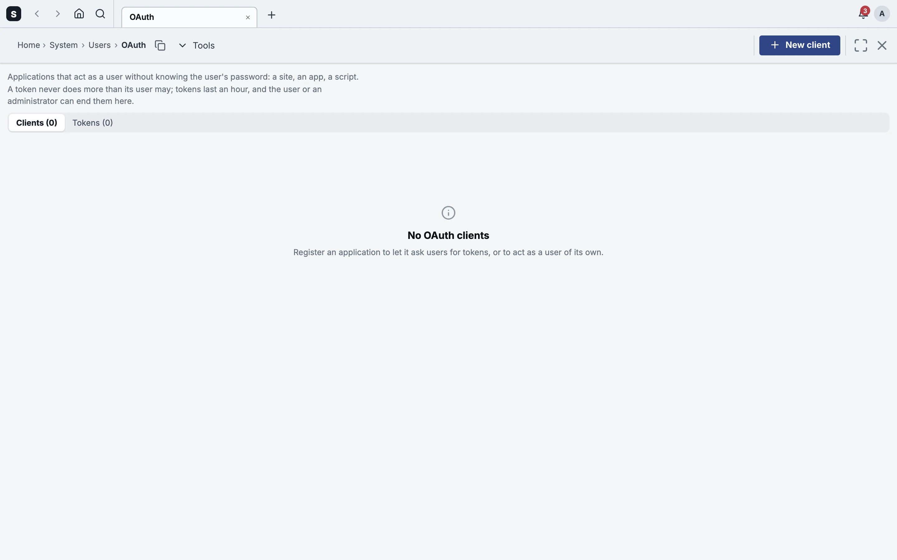

**New client** registers an application.

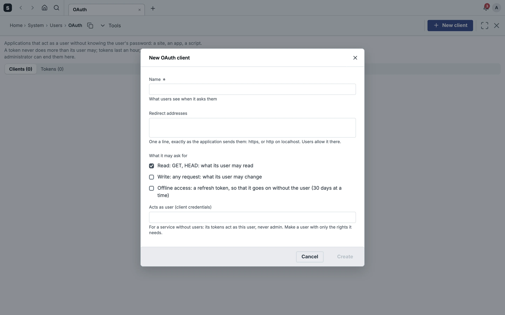

| Field | Meaning |
|---|---|
| **Name** | What users see when the application asks them for access |
| **Redirect addresses** | One a line, exactly as the application sends them: `https`, or `http` on localhost. Users allow the application there |
| **Read** | The application may read what its user may read |
| **Write** | It may change what its user may change |
| **Offline access** | It gets a refresh token, so that it goes on without the user, 30 days at a time |
| **Acts as user** | For a service without users: its tokens act as this user. Make a user with only the rights it needs; it can never be an administrator |

See [APIs](../developer/apis.md).

## Who did what

**Activity** lists what happened in Sensible Studio: who created, changed, published and removed what, and when.

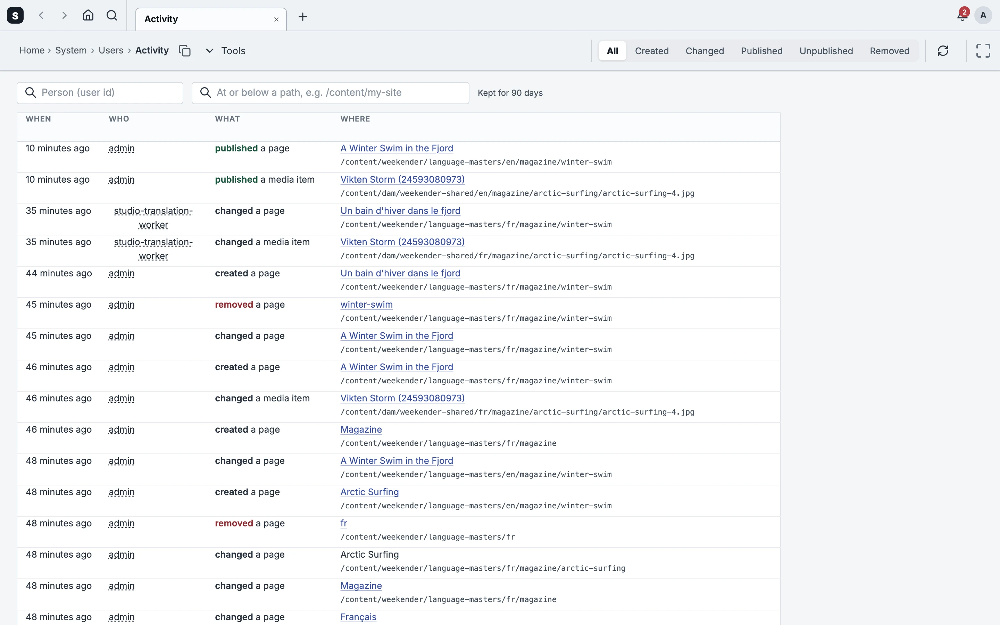

| Part | Meaning |
|---|---|
| **All**, **Created**, **Changed**, **Published**, **Unpublished**, **Removed** | Filter by what happened |
| **Person** | Only what one user did. A click on a name in the list does the same |
| **At or below a path** | Only what happened in one part of the content |
| The columns | When, who, what, and where: the title links to the item |

The log keeps 90 days. Names such as *studio-translation-worker* are Sensible Studio's own accounts: work it did in the background for someone.

For one page, the **Timeline** tab of the inspector in the Pages console shows the same, limited to that page.
