Sensible Studio is one window that never reloads. Everything you open is a place with an address: a folder of pages, a file, a template, even a properties form. You move between places the way you do in a browser or a file manager: tabs, Back and Forward, a sidebar, and one field that takes you anywhere.

The pictures on this page show Weekender, the demo site. Click a picture to see it at full size.

## The window

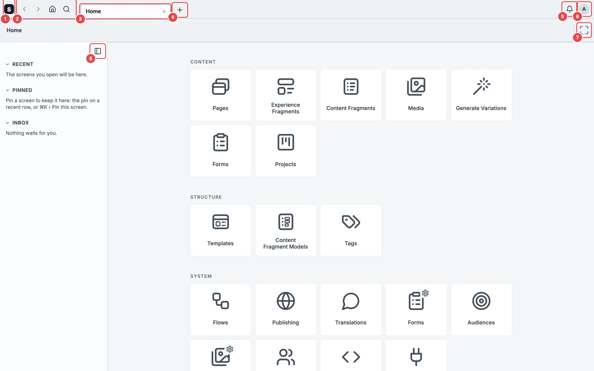

| | Part | What it does |
|---|---|---|
| 1 | **The mark** | Brings you to Home, like the house icon. |
| 2 | **Back, Forward, Home, Go to** | The arrows retrace the history of the tab you are in. The house opens Home. The magnifier opens the command palette. |
| 3 | **A tab** | The place you are at. The `×` closes it. Right-click it for more. |
| 4 | **New tab** | Opens another tab, at Home unless you chose otherwise in the user menu. |
| 5 | **Inbox** | The flow steps and project tasks that wait for you. A number appears on the bell when there are any. |
| 6 | **User** | Your initial. Opens the menu with where a new tab starts, the theme, and Sign Out. |
| 7 | **Full screen** | Hides the top bar and the sidebar, so that the place fills the window. `Esc` brings them back. |
| 8 | **Hide Recent and Pinned** | Folds the sidebar away. `Alt+B` does the same. |

Below the top bar, every place has its own bar: its name or its path at the left, its own buttons at the right.

## Home

Home is where a new tab starts. It has three groups of tiles:

- **Content**: Pages, Experience Fragments, Content Fragments, Media, Generate Variations, Forms and Projects.
- **Structure**: Templates, Content Fragment Models and Tags.
- **System**: the tools around the content: Flows, Publishing, Translations, Forms, Audiences, Media, Users, Developer and Web Console.

A tile of Content or Structure opens that console. A tile of System opens the list of its tools, each with a line that says what it is for:

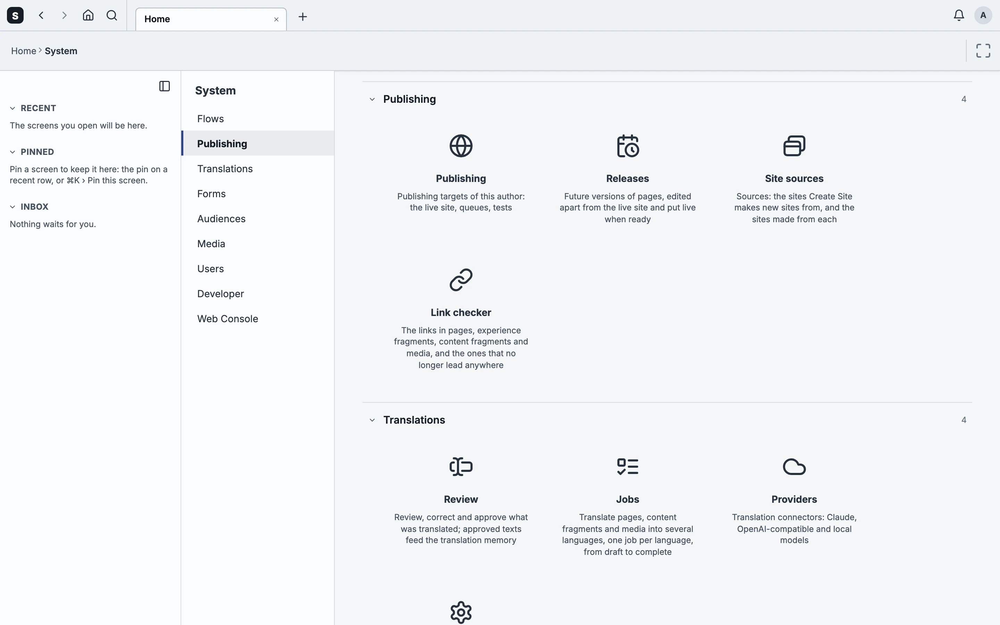

The list at the left jumps between the groups; the arrow beside a group's name folds it.

## Tabs

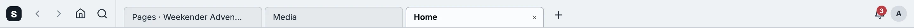

The bar at the top holds your tabs. A tab shows the console and the name of the place, and each tab has its own history, so Back and Forward retrace what you did in that tab and nothing else.

| To do this | Do this |
|---|---|
| Open a new tab | `+` in the tab bar, or `Alt+T` |
| Open a link in a new tab | `Cmd`-click it (`Ctrl`-click on Windows and Linux) |
| Close the tab | the `×` on it, or `Alt+W` |
| Reopen the tab you closed | `Alt+Shift+T` |
| Go back, go forward | the arrows left of the tabs, or `Alt+←` and `Alt+→` |

Right-click a tab for its menu:

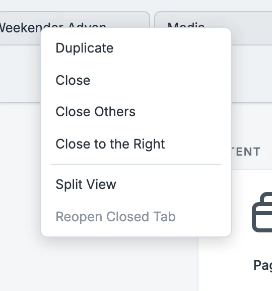

| Entry | What it does |
|---|---|
| **Duplicate** | Opens the same place in a new tab beside this one. |
| **Close** | Closes this tab. |
| **Close Others** | Closes every tab but this one. |
| **Close to the Right** | Closes the tabs after this one. |
| **Split View** | Shows two places side by side in this tab. |
| **Reopen Closed Tab** | Brings back the tab you closed last. Grey when there is none. |

Your tabs, the place each one is at, and the widths you set are remembered in the browser. Close the window, open it tomorrow, and it is as you left it.

## Two places side by side

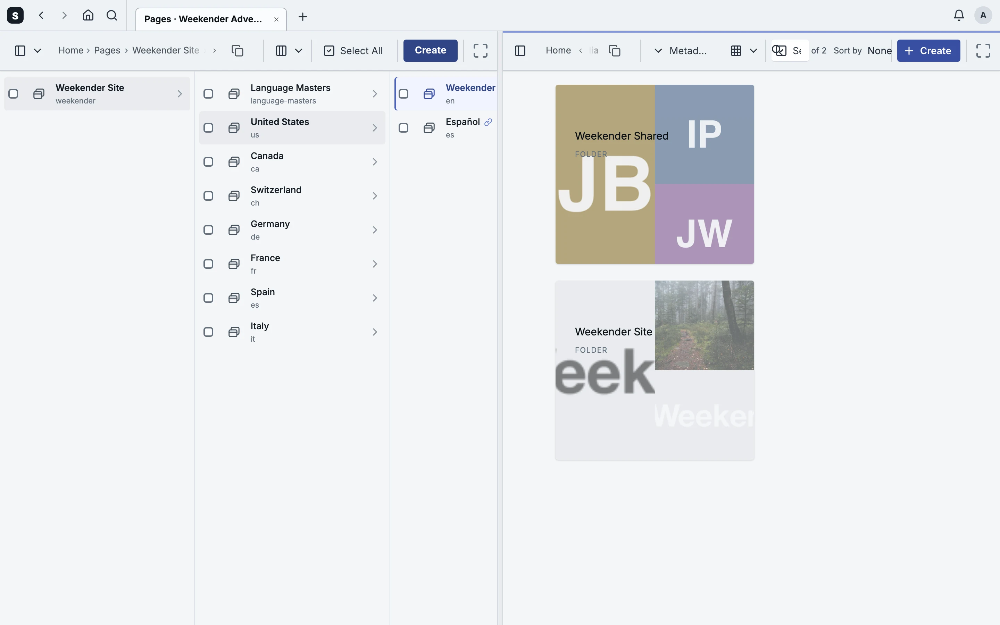

A tab can show two places next to each other. Press `Alt+\`, or right-click the tab and choose **Split View**. Each side has its own bar and its own history. A thin line at the top marks the side that has the focus, and Back, Forward and the command palette act on that side.

Split view is how you drag between places. Open Media on one side and a page in the editor on the other, then drag an image onto the page.

Press `Alt+\` again, or choose **Close Split**, to keep only the side with the focus.

## The sidebar

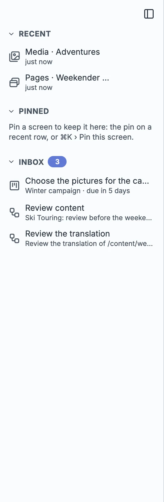

`Alt+B`, or the button at its top, shows and hides the sidebar at the left of Home. It has three lists, and the arrow beside each name folds it:

- **Recent**: the places you were at lately, newest first, with how long ago.
- **Pinned**: the places you chose to keep at hand. Pin a place with the pin on its row in Recent, or with **Pin this screen** in the command palette.
- **Inbox**: the flow steps and project tasks that are waiting for you.

## Go anywhere: the command palette

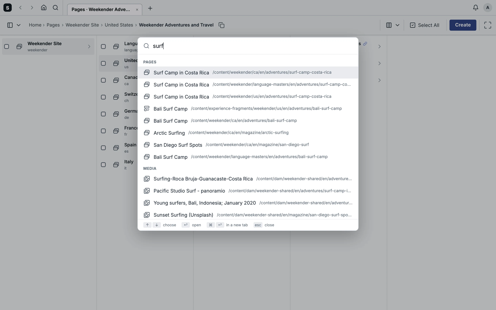

Press `Cmd+K` (`Ctrl+K`), or click the magnifier in the top bar, and start typing. The palette finds, in groups:

- your open tabs;
- every console and tool, by name;
- the places you were at recently;
- pages, experience fragments, media and content fragments, by title or name, each with its path;
- the actions for what you have selected, such as Publish or Move.

| Key | What it does |
|---|---|
| `↑` `↓` | Choose a result |
| `Enter` | Open it in the current tab |
| `Cmd+Enter` (`Ctrl+Enter`) | Open it in a new tab |
| `Esc` | Close the palette |

## A console

Pages, Media, Experience Fragments and the other consoles are built the same way. This is Pages:

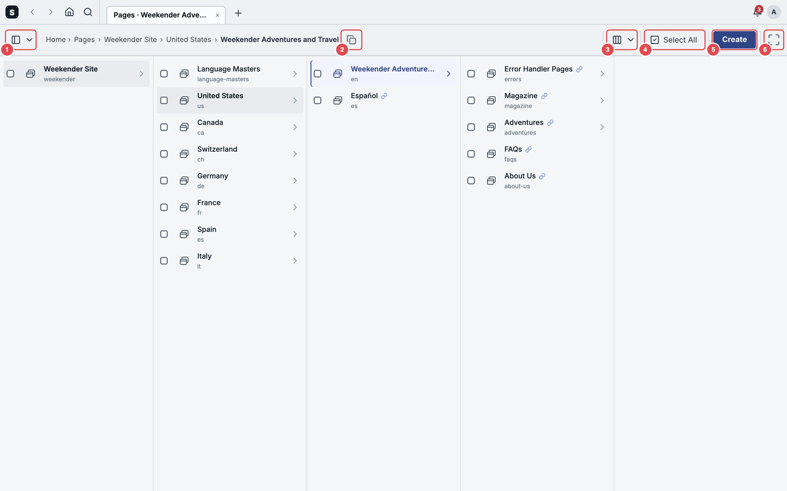

| | Part | What it does |
|---|---|---|
| 1 | **Rail** | Chooses what stands at the left of the list: nothing, the Content Tree, or the Filter. |
| 2 | **Copy path** | Copies the path of the folder you are in. Left of it are the breadcrumbs: click one to go up. |
| 3 | **Display format** | Columns, cards or a list. |
| 4 | **Select All** | Selects everything in the folder. |
| 5 | **Create** | Makes something new here: a page, a site, a linked copy and more. |
| 6 | **Full screen** | Gives the console the whole window. |

In the column view, a click on a row opens it in the next column; the checkbox at its left selects it.

## Select, then act

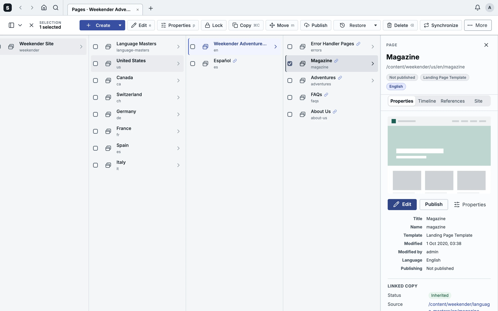

When you select something, the bar of the console becomes the **action bar**: how many items are selected, an `×` that clears the selection, and the actions for them. A letter beside an action is its key: in Pages, `e` edits, `p` opens the properties, `m` moves, and `Backspace` deletes. **More** holds the actions that did not fit.

The same actions are in two more places:

- **Right-click** an item for them as a menu. Right-clicking also selects the item.
- **The command palette** lists them under *Selection*.

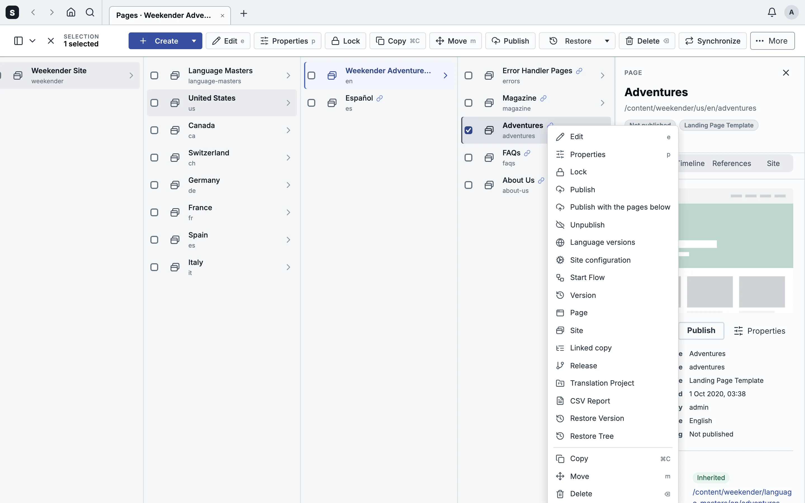

What each action does is described with its console, starting with [Pages](../author/pages.md).

## The inspector

In Pages, Experience Fragments and Forms, the panel at the right tells you about what you selected without leaving the list. It opens when you select something; close it with its `×` and open it again with the **Inspector** button in the bar, or with `Alt` and the backtick key.

At its top are the kind of item, its title, its path, and badges: whether it is published, its template, its language. Below are four tabs:

| Tab | Shortcut | Shows |
|---|---|---|
| Properties | `Alt+3` | A preview, the buttons Edit, Publish and Properties, then title, name, template, who changed the page and when, its language, its publishing state, and whether it is a linked copy and of what |
| Timeline | `Alt+4` | Everything that happened to the page: changes, versions, flows, comments, annotations, releases. A field at the bottom adds a comment |
| References | `Alt+5` | The pages that link to it, its linked copies and the releases that contain it |
| Site | `Alt+6` | A summary of the site the page belongs to |

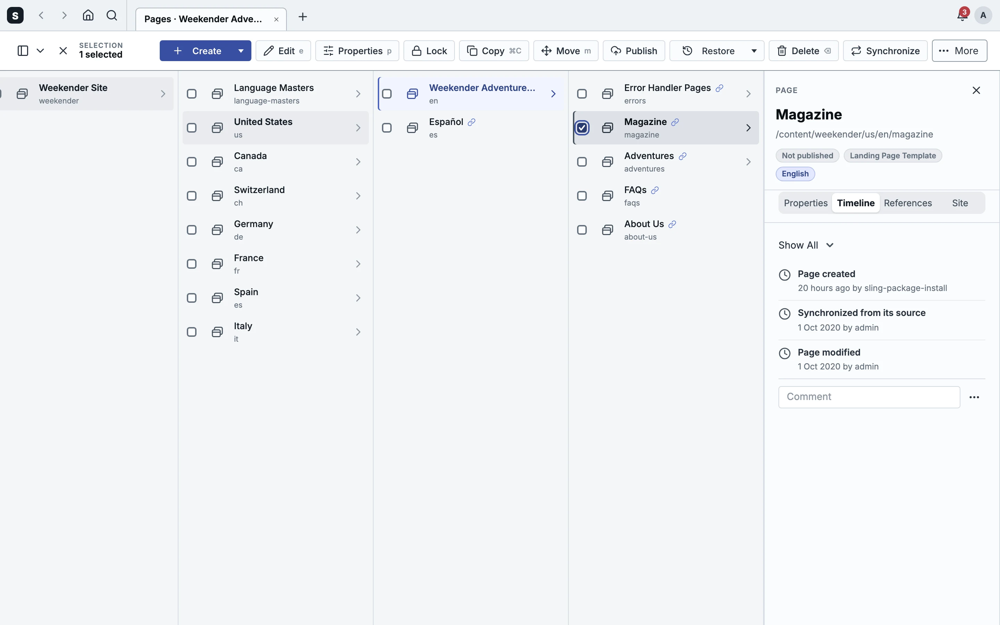

**Show All** above the timeline narrows it to one kind of entry. With nothing selected, the inspector describes the folder you are in.

## The left rail

The selector at the left of the bar opens a rail beside the list:

- **Content Tree** (`Alt+1`): the tree of pages, opened down to where you are. Click a page to go there.
- **Filter** (`Alt+2`): search the pages below a path by text, template, tags or date, and save searches you use often.

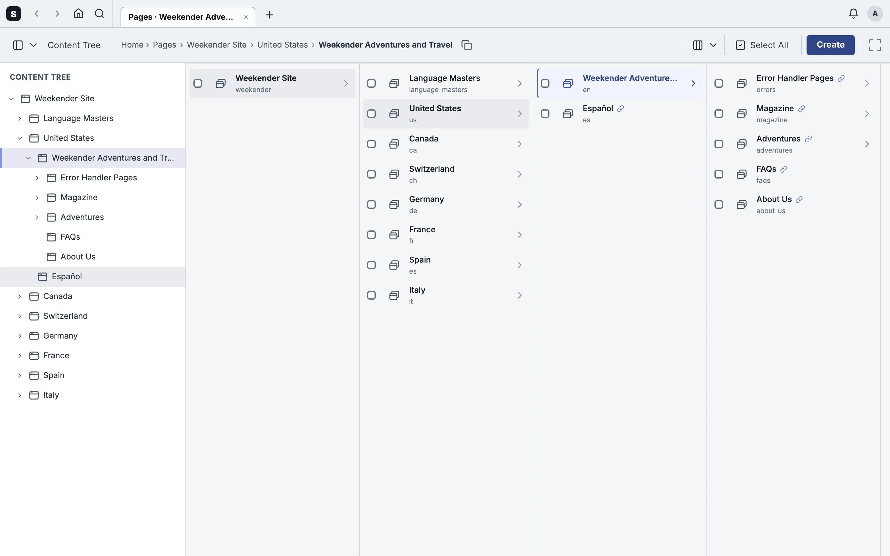

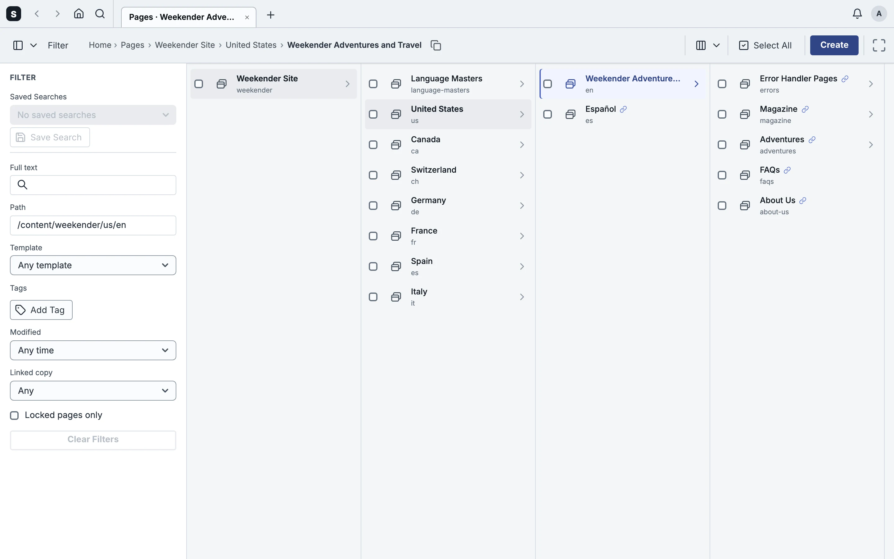

The backtick key hides the rail.

## The user menu and themes

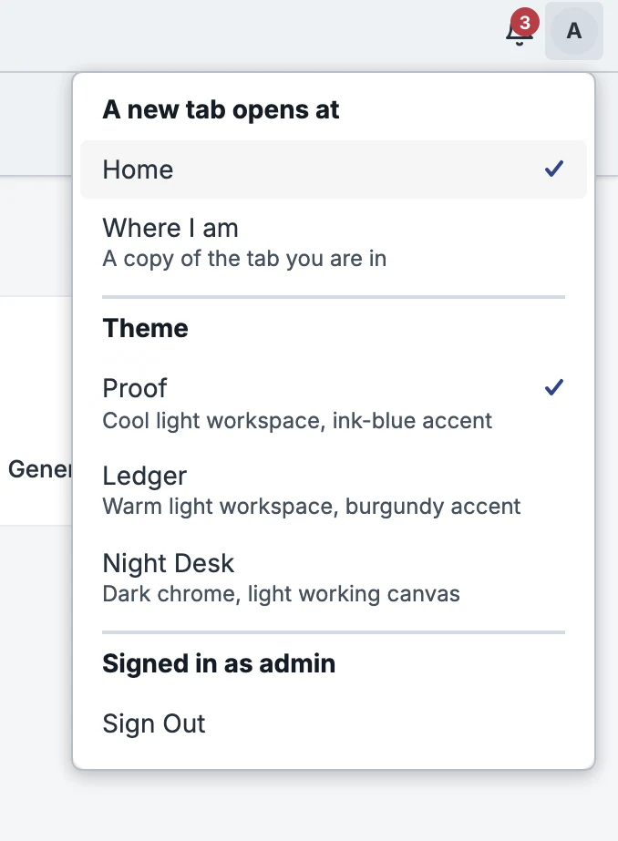

The round button with your initial opens the user menu:

- **A new tab opens at**: *Home*, or *Where I am*, which starts a new tab as a copy of the one you are in.
- **Theme**: how the window looks. The choice is remembered in the browser.
- **Signed in as**: your user name, and **Sign Out**.

| Theme | Looks like |
|---|---|
| **Proof** | Cool light workspace, ink-blue accent. The one in the pictures of this documentation. |
| **Ledger** | Warm light workspace, burgundy accent. |
| **Night Desk** | Dark top bar and sidebar, light working canvas. |

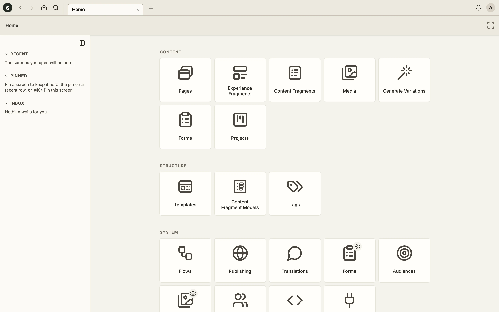

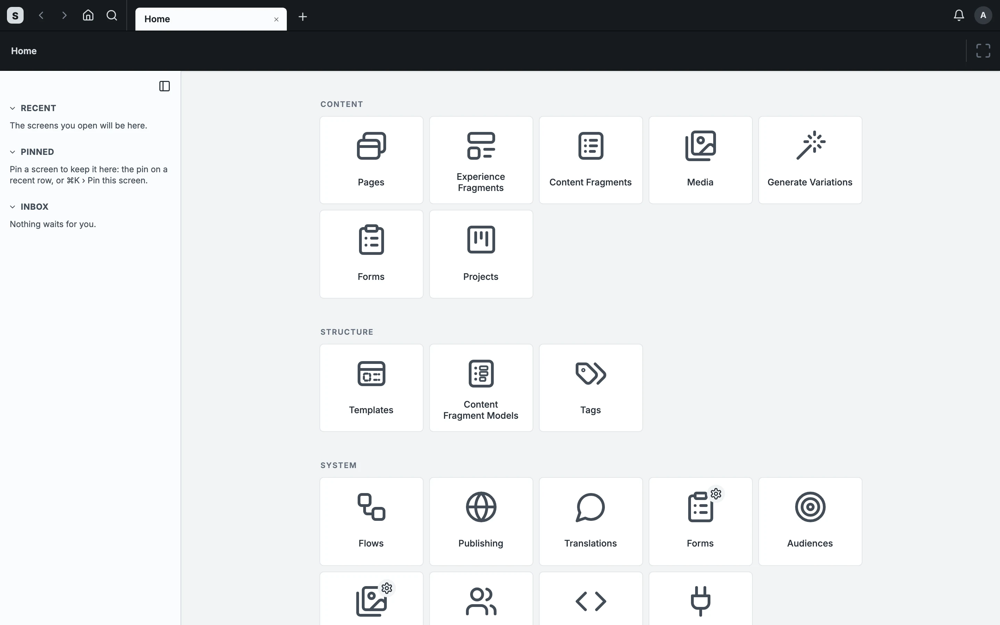

## Next

Now [create your first page](first-page.md), or read the [author guide](../author/index.md) from the start.
